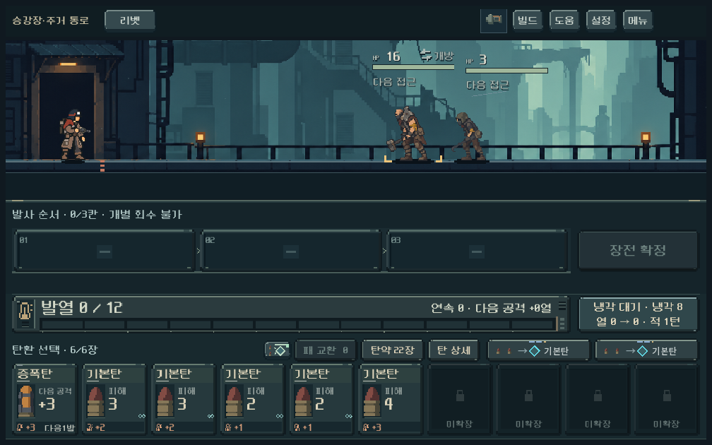
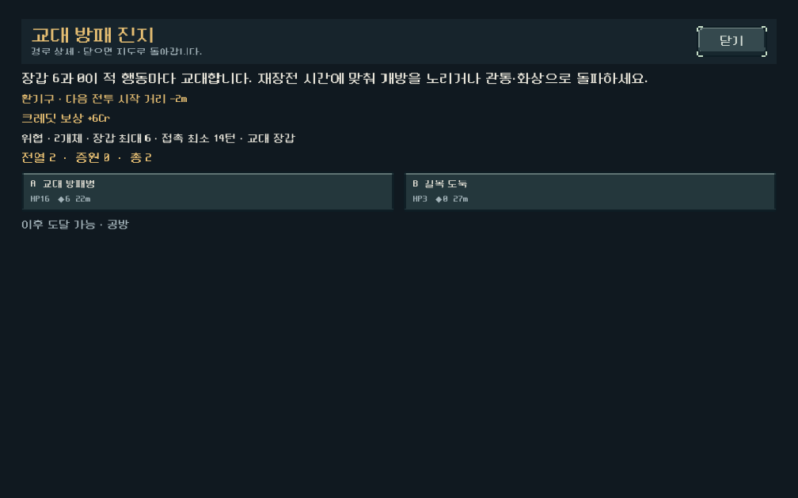

# 초반 전투 호흡 1차 개편 검증

사용자 승인에 따라 첫 구역 일반전의 역할·증원 길이와 두 번째 승리 보상을 개편했다. [현행 규칙](../../direction/combat-rhythm.md). 기능·실제 화면·사람의 재미를 별도로 판단한다.

## 적용 범위

- 새 등반 편성 12: 짧은 무리전 → 사수/교대 장갑 대응 → 정비한 조합을 쓰는 무리전. 경로에 따라 일부 역할을 건너뛸 수 있다.
- 일반전의 반복 증원을 없애고 최대 4명의 전열로 끝낸다. 첫 전투·정예·보스·2~5구역 편성은 유지한다.
- 교대 방패병은 기존 태세 교대를 사용한다. 적 행동당 장갑 6↔0, 재장전 비용만큼 교대하며 전장에 방어/개방을 표시한다.
- 두 번째 승리에서는 첫 특수탄과 함께 쓸 후보를 제공한다. 소이는 기존 맞춤 후보를 먼저 유지하고 충격을 대안으로 제공한다. 선택한 한 장만 획득하며 휴대량·교체 비용은 유지한다.
- 이전 저장의 편성 1~11을 보존한다. 기존 전투 계산과 RNG를 사용하고 모든 QA 저장은 `qa_runtime/combat_rhythm_20261030/`로 격리했다.

## 첫 구역 실제 획득 비교

최종 초반 비교는 17조건·85전투다. 새 규칙은 운반 5무기/시드 731042, 작업 5무기/시드 17, 정찰 래칫·리액터/시드 731042의 12조건이며, 이전 편성 운반 5무기가 대조군이다. 모두 실제 보상·상점·공방을 사용해 첫 관문을 통과하고 다음 구역으로 출발했다. 매 합법 명령 뒤 저장 복원과 사격 예측을 확인했다.

시드 731042·운반 복장·일반전 우선 경로의 전투별 경과 턴:

| 무기 | 이전: 도입 / 두 번째 / 중간 / 정비 후 / 관문 | 개편: 도입 / 무리 / 방패 / 무리 / 관문 |
| --- | --- | --- |
| 리벳 | 1 / 1 / 3 / 5 / 7 | 1 / 1 / 5 / 1 / 7 |
| 래칫 | 4 / 1 / 7 / 7 / 14 | 4 / 1 / 4 / 1 / 14 |
| 스플린터 | 5 / 1 / 4 / 7 / 11 | 5 / 1 / 4 / 1 / 11 |
| 리액터 | 1 / 1 / 7 / 6 / 16 | 1 / 1 / 6 / 1 / 16 |
| 스파이크 | 2 / 1 / 3 / 6 / 6 | 2 / 1 / 2 / 1 / 7 |

자동 탐색이 찾은 경로이며 최적 턴이나 사람의 승률이 아니다. 무리전의 단축과 대응전 사이의 대비가 생겼다는 계산 근거다. 정찰 리액터는 무리전도 5턴인 경우가 있고 첫 관문은 30턴까지 걸렸다. 모든 무기에 동일한 짧은 호흡이 보장되지는 않는다.

## 같은 장비에서 준비를 바꾼 비교

같은 실제 획득 상태의 방패 진지에서 시작 행동만 달리하고 이후 합법 사격을 탐색했다. 각 칸은 `턴 / 사용 탄`이다.

| 무기 | 즉시 준비·사격 | 먼저 재장전 | 기본탄 1발 후 재준비 |
| --- | --- | --- | --- |
| 리벳 | 5 / 8 | 2 / 3 | 5 / 7 |
| 래칫 | 4 / 8 | 6 / 8 | 7 / 7 |
| 스플린터 | 4 / 9 | 6 / 9 | 7 / 9 |
| 리액터 | 6 / 7 | 8 / 7 | 4 / 7 |
| 스파이크 | 2 / 2 | 5 / 3 | 4 / 3 |

재장전이 한 턴인 리벳은 개방을 먼저 만드는 경로가 유리했고, 리액터는 짧은 첫 사격 뒤 재준비하는 경로의 턴이 줄었다. 모든 무기에 대기를 요구하는 고정 해법으로 보지 않는다. 탐색 폭과 미래 패/RNG 접근의 한계가 있으므로 각 정책의 최적성 비교가 아니다.

같은 리벳 손패에서 증폭→위력 3 기본탄은 방어 중 5피해, 개방 중 14피해였다. 기본탄→증폭은 각각 3피해·8피해다. 사격 순서와 개방 시점이 실제 피해를 바꾸며 예측과 실행이 일치했다.

## 검증 중 수정한 사항

- 최초 단축안은 대표 리벳의 일반전이 모두 한 사격에 끝났다. 길이 단축에 더해 기존 장갑 교대를 이용하는 대응전을 넣었다.
- 초기 보상안은 소이 보유 시 충격을 첫 후보로 제시했다. 리액터의 실제 획득 경로에서 소이 한 장이 충격으로 바뀌었고, 후반 3구역 보스에서 제한 탐색이 막혔다. 이전 후보를 고른 대조 경로는 같은 보스를 통과했다. 소이의 기존 맞춤 후보를 앞에 유지하고 충격은 대안으로 수정한 뒤 초반 비교를 다시 실행했다. 초기 실패와 대조 원자료도 최종 근거와 구분해 보존한다.
- UI 검사 초기에 창 크기를 논리 캔버스 크기로 바꾸어 실제 게임과 다른 잘림이 생겼다. 출시 설정의 1280×800 캔버스와 확대 방식을 유지해 세 창 비율에서 다시 검사했다. 이 부분은 검증 설정 수정이며 본편 레이아웃 변경이 아니다.
- 검사기 최초의 형식 추론 오류와 실행 인자 오류는 수정 후 재실행했으며 최종 검사 수에 포함하지 않는다.

## 실제 화면

1008×630, 1280×576, 1280×800의 실제 렌더에서 지도 편성 설명, 방어/개방 상태, 터치 재장전, 자동 저장 재개, 무리전 적 상태 영역을 확인했다. 기존 일렬 접지는 유지한다. 57개 UI 검사 통과. 대표 캡처를 직접 검수했으며 작은 화면의 전체 조작부가 실제 확대 설정에서 들어오는 것을 확인했다.

## 후반 연결과 최종 집계

최종 7실행은 **18,375검사 중 18,373통과, 경로 탐색 확인 2개 미충족**이다. 미충족 두 항목은 리액터 최종전 한 조건의 `해당 전투 승리 경로`와 `엔딩 도달`이다. 이 두 항목을 성공으로 집계하지 않는다. 나머지 기능·저장·예측·화면 검사 실패와 스크립트 오류는 없다.

| 구분 | 검사 | 결과 |
| --- | ---: | --- |
| 기존 편성·보상·저장 규칙 | 614 | 통과 |
| 운반 5무기 신구 비교 | 5,690 | 10조건·50전투 통과 |
| 작업 복장·다른 시드 | 2,651 | 새 등반 5조건·25전투 통과 |
| 정찰 래칫·리액터 | 1,400 | 새 등반 2조건·10전투 통과 |
| 같은 장비의 준비·순서 비교 | 1,332 | 통과 |
| 실제 화면·터치·자동 저장 | 57 | 통과 |
| 획득 장비를 이어 받은 후반 | 6,631 | 리벳 엔딩, 리액터 최종전 탐색 미해결 |

후반은 첫 관문 체크포인트에서 이어진 46전투 조건 중 45개를 실제로 완료했고, 리액터 최종전 하나의 탐색 경로를 찾지 못했다. 첫 구역과 합하면 **130전투 실제 완료 + 최종전 1조건 탐색 미해결**이다. 같은 체크포인트의 준비 방식 비교 15회는 이 전투 수에 중복 합산하지 않았다.

리액터 대조군도 같은 최종전에서 경로를 찾지 못했다. 두 최종전 체크포인트의 탄약·손패·장착/보유 파츠·성장·관문 개조·적·RNG 상태는 동일하며, 캠페인에는 편성 버전/기록, 전투에는 누적 턴·사격·재장전 수와 기록만 달랐다. 이번 초반 개편의 새 결함으로 단정하지 않고 기존 후반 과제로 남긴다. 탐색 실패는 패배 실행이나 공략 불가능의 증명이 아니다.

초기 소이→충격 우선 후보에서 막혔던 3구역 보스는 최종안에서 13턴·잔탄 11로 통과했다. 소이 보강을 앞에 유지하면서 충격 선택지를 남기는 수정이 실제 후반 경로에 반영됐다.

[최종 집계](assets/combat_rhythm_2026-10-30/summary.json) · [실행·획득 체크포인트·코드 근거](assets/combat_rhythm_2026-10-30/evidence.zip) · [파일 해시 목록](assets/combat_rhythm_2026-10-30/manifest.json). 이전 초기안과 대조군의 실패 기록도 압축 파일에 포함하되 최종 실행 합계에서 구분했다.

## 재현과 한계

`tools/run_rhythm_checks.ps1`의 `rules`, `slice`, `probe`, `ui`, `continuation`을 사용한다. `slice`는 `-Versions '11,12'`로 대조하며 후반 연결은 `-Versions 12 -Guns 'single,heavy'`로 실행한다. `matrix_final`의 실제 획득 체크포인트를 준비한 뒤 `probe`·`ui`·`continuation`을 실행한다. 이전 코드 편성 비교에는 근거 압축 파일의 `source_before`가 필요하다.

사람이 전투마다 다른 선택을 하고 더 오래 흥미를 느끼는지는 재테스트가 필요하다. 모바일 실기기의 지속 FPS·발열은 미검증이다. 이번 범위는 첫 구역이며 후반의 전투 길이·선택 반복까지 해결했다고 판단하지 않는다. APK·커밋·푸시·외부 게시를 수행하지 않았다.
