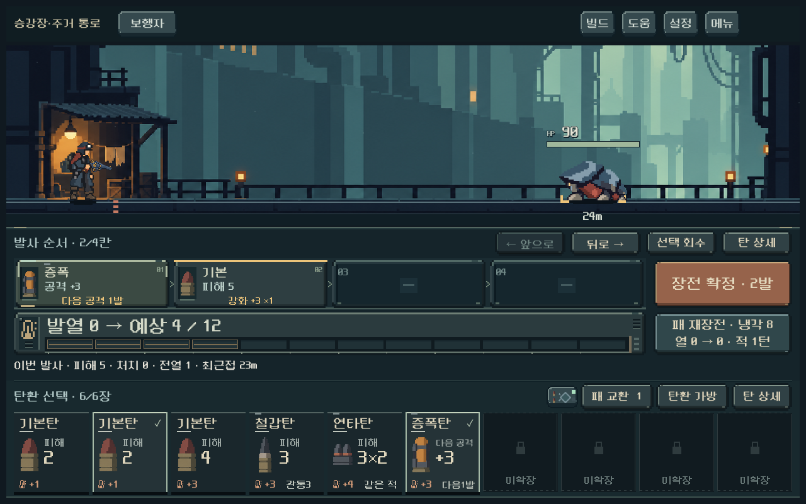
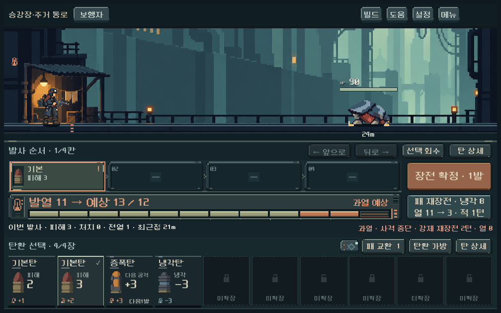

# 전투 여백·공통 조작 패널 정리

사용자는 전투 글자 위계 개편을 긍정적으로 평가하고, 빈 여백을 줄이면서 전체 UI 디자인을 조화롭게 맞추도록 요청했다. 승인된 탄환/레일/발열/키의 외형과 글자 크기를 유지하고 주변 공간과 공통 바탕을 정리했다.

## 적용

- 발사 순서·발열·손패에 하나의 청회색 금속 바탕을 두었다. 얇은 상단 턱, 손패 경계의 이음선, 하단 받침으로 연결하며 각 정보마다 외곽 박스를 추가하지 않았다.
- 중첩되던 패널 위아래 여백·섹션 간격을 줄였다. 약실 자체82px는 유지하고 그 주변 행92→82px, 결과 행40→32px로 압축했다. 압축 바로가기 키도 같은 도트 키 재질을 사용한다.
- 예상 결과와 과열 경고는 같은 줄에서 구분한다. 과열 확률·강제 재장전 턴·열0 등 기존 경고 내용은 모두 유지한다. 경고가 없을 때 오른쪽 공간을 예약하지 않으며, 긴 예상 요약은 말줄임을 허용하고 상세는 탄환 상세에서 확인한다.
- 확보한 높이는 전장으로 돌린다. 긴 창에서도 고정 높이 상한 때문에 화면 아래가 남지 않게 조절한다. 배우 표시 크기는 별도 기준을 유지한다.
- 빈 약실/장전/확정/과열/여러 턴 예측에서 행 높이는 고정된다. 최소 결과 한 줄은 장전 전에도 예약하여 손패·발사 버튼이 뛰지 않게 한다. 4·6·10장 모두 고정10자리와 카드132px 높이를 유지한다.
- 검수 중 발견한 큰 글씨에서 예측 범위 버튼 줄바꿈과, 연출 중 `건너뜀` 버튼의 기본 테마 여백 증가를 교정했다. 후자는 공통 픽셀 글꼴/키 여백을 표시 전부터 적용한다.

## 측정과 실제 화면

같은1280×800 본편 장전 화면의 논리 좌표:

| 항목 | 변경 전 | 변경 후 |
| --- | ---: | ---: |
| 하단 조작부 전체 높이 | 465px | 430px |
| 전장 높이 | 248px | 286px |
| 결과 행 높이 | 40px | 32px |
| 탄환 카드 높이 | 132px | 132px |

[이전 화면](combat_typography_2026-10-18/loaded_1280.png)

[10장·넓은 화면](combat_spacing_2026-10-18/bag10_1440.png) · [확률형 과열](combat_spacing_2026-10-18/random_1008x630.png) · [여러 턴 예측과 경고](combat_spacing_2026-10-18/full_scope_1008x630.png) · [긴 창의 전장 배분](combat_spacing_2026-10-18/loaded_1280x900.png)

## 검증

- `tools/run_combat_hand_live_checks.ps1`: 최종 **1,444검사 실패0**.3해상도,4/6/10장, 압축/회수/교환/장전/발사/과열/큰 글씨·세로 증가 검증.
- `qa_runtime/combat_spacing/capture.ps1`: **826검사 실패0**.1008×630/1280×800/1280×900/1440×630에서 실제 본편 씬·입력으로 빈 탄창→장전→확정, 확률형 과열, 증강의 여러 턴/예측 범위 전환, 위험 재장전. 경고 전체 폭과 각 행의 고정 위치를 측정했다. 첫 검수의 큰 글씨 예측 범위 줄바꿈7개 관련 실패를 수정 후 통과했다.
- `tools/run_heat_live_checks.ps1`: **410검사 실패0**. 다섯 총기의 장전 최고 열·실제 타격 값·냉각·강제 재장전 유지.
- `tools/run_finish_zoom_checks.ps1`: 최종 **456검사 실패0**.3해상도·여러 동시 처치/가장자리/화상/건너뛰기/빠르게/즉시. 기존1.25배 줌과 약2.5초 유지, 확대 중 HUD 고정. 첫 검수의 숨겨진 건너뜀 버튼 크기 변화1건을 수정 후 통과했다. 합계 **3,136검사 실패0**.
- 실제 GPU 대표 화면을 직접 확인했다. 모델/탄환 콘텐츠/캠페인의 SHA256은 이전 기록과 동일하다. 격리 저장·저장 비활성, 기존 미커밋 작업 보존. 엔진 루트 인증서 환경 경고 외 스크립트 오류 없음.

실제 Galaxy의 조작감과 사용자 미감은 후속 확인 대상이다. 자동 검사를 사람의 이해도 검증으로 간주하지 않는다. 생성형 이미지/외부 아트 도입 없음. [소스·제작 기록](../../art/combat-spacing-20261018.json). 실행은 `PLAY.cmd`, APK·커밋·푸시 없음.
