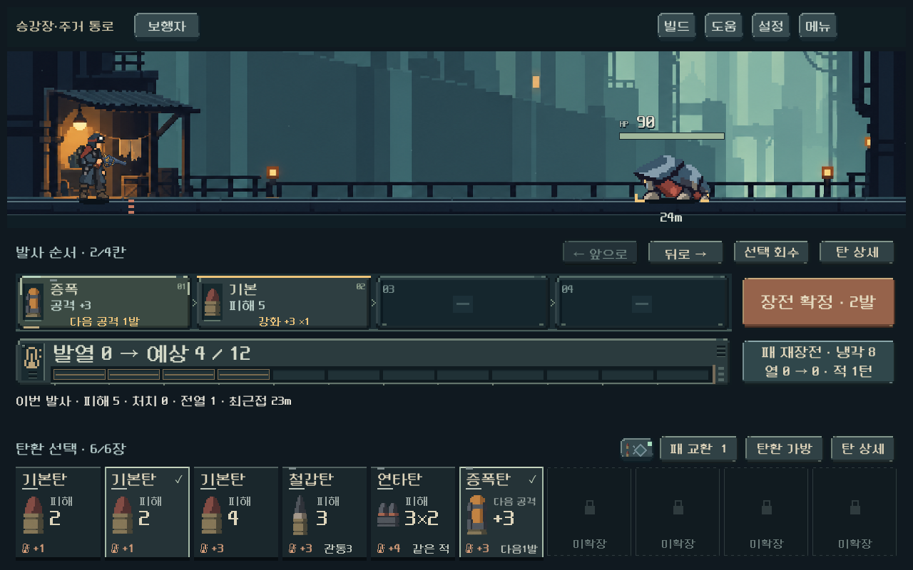
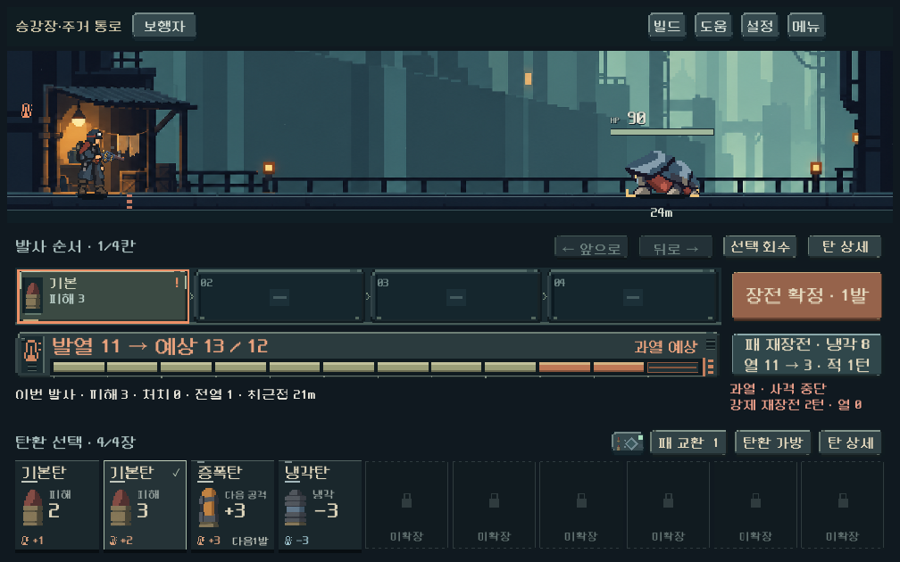

# 전투 글자 위계·중복 안내 정리

사용자는 급탄 레일·발열 계기 외형을 긍정적으로 평가하고, 전투 전반의 글자 크기를 조정하며 불필요한 구역명·발사 안내를 검토하도록 요청했다. 게임 규칙과 승인된 도트 외형은 유지하고 타이포그래피·보조 문구만 조정했다.

## 적용

- 전장 아래에 반복되던 `순찰 구역`과 일상적인 발사/행동 캡션을 본편에서 숨겼다. 상단 지역명, 실제 피해 팝업·예상 결과·증원 표시는 유지한다. 훈련/명시적 배경 미리보기만 기존 보조 캡션을 켠다.
- 빈 약실의 `장전 ↓`와 확정 후 제목의 `왼쪽부터`를 제거했다. 레일 순서 번호·화살표·삽입 위치 표시로 방향을 전달한다. 탄환별 강화/피해 조건과 과열·미발사 경고는 유지한다.
- 핵심은 큰 숫자와 실행 버튼, 그 아래는 구역/섹션/탄환 이름, 보조는 짧은 효과·결과로 구분했다. 기존 NeoDunggeunmoPro 도트 글꼴과 배색을 유지한다.

| 역할 | 이전 → 현재 논리 px |
| --- | --- |
| 발열 수치 | 28 → 30, 긴 값은 폭에 맞게 조절 |
| 장전 확정·발사 | 22 → 24 |
| 발사 순서 제목 / 손패 제목(기본 가로 화면) | 17 / 18 → 20 / 20 |
| 순서 편집 / 가방·교환·상세 | 15 / 14 → 18 / 18 |
| 재장전·냉각 | 18 → 20, 결과 경고가 길면18 |
| 약실 탄환 이름 / 효과 / 조건 | 18 / 15 / 14 → 20 / 18 / 16 |
| 손패 이름 / 주요 수치 / 항목명 | 19 / 28 / 14 → 21 / 32 / 16 |
| 손패 발열 / 특성 | 16 / 14 → 18 / 16 |

실제 출력 크기는 화면 스케일과 문자열 폭에 따라 달라진다. 고정10자리·카드132px·약실82px·열 계기68px는 유지한다. 편집 키는112px, 무기 이름은96px로 확보하고 조작 키의 자동 줄바꿈을 꺼서 글자 확대가 화면 세로 증가로 이어지지 않게 했다. 적 HP26/거리20과 승인된 큰 처치 숫자는 기존 위계를 유지한다.

## 실제 화면

[이전 화면](combat_instruments_2026-10-18/loaded_1280.png)

[작은 화면의 특수탄10장](combat_typography_2026-10-18/special_1008.png) · [넓은 화면10장](combat_typography_2026-10-18/bag10_1440.png) · [장전 최고 열](combat_typography_2026-10-18/planned_heat_1008.png) · [확정 후 발사](combat_typography_2026-10-18/after_amplifier.png)

## 검증과 한계

- `tools/run_combat_hand_live_checks.ps1`: **1,444검사 실패0**.1008×630/1280×800/1440×630,4/6/10장 고정배치와 회수·압축·교환·장전·발사·과열·큰 글씨1.1배. 장전 전후 화면 크기/버튼 위치 검사를 포함한다.
- `tools/run_heat_live_checks.ps1`: **410검사 실패0**.1008×630/1280×900/1440×630, 다섯 무기·장전 최고 열·타격 직후 값·순서 변경·냉각·강제 재장전·저장 복구.
- 실제 GPU 캡처를 직접 확인했다. 중요한 버튼/수치 잘림, 순서 키 돌출, 열 계기와 재장전의 어긋남이 대표 화면에서 관찰되지 않았다. 폰트 확대 외의 연출 시간·밸런스는 변경하지 않았다. 모델/콘텐츠/캠페인 SHA256 동일.
- Impeccable type scan은 전후 `[]`. GDScript 수동 그리기의 적합성을 보증하는 검사가 아니므로 소스의 글자 크기·실제 화면 검수를 별도로 수행했다.
- 격리 저장·저장 비활성, 기존 미커밋 작업 보존. 루트 인증서 환경 경고 외 스크립트 오류 없음. Galaxy 실기기에서의 가독성·사용자 체감은 후속 확인 대상이다.

[자산·소스 기록](../../art/combat-typography-20261018.json). 실행은 `PLAY.cmd`. APK·커밋·푸시 없음.
