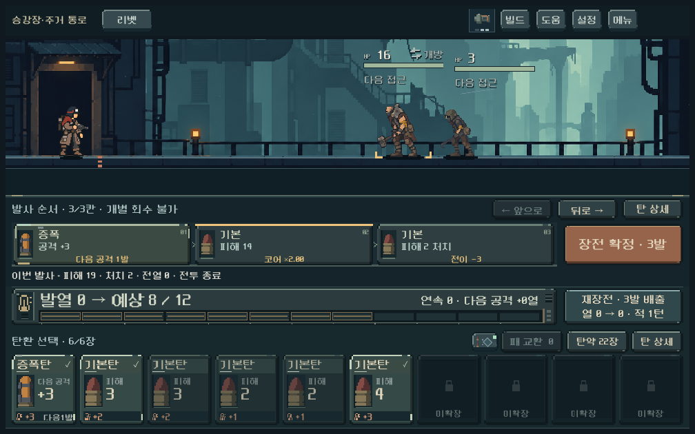
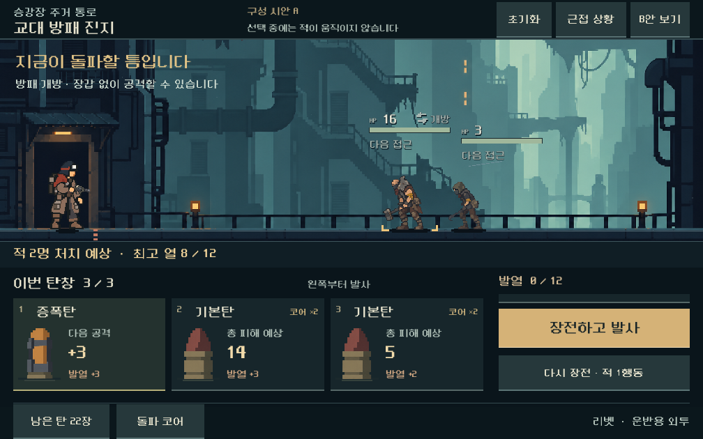
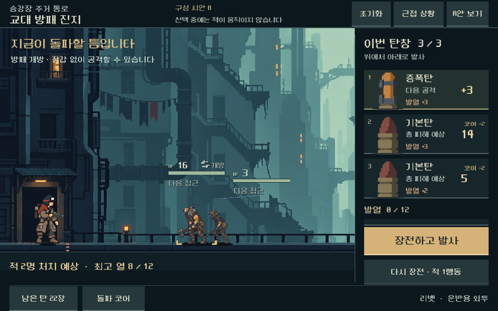
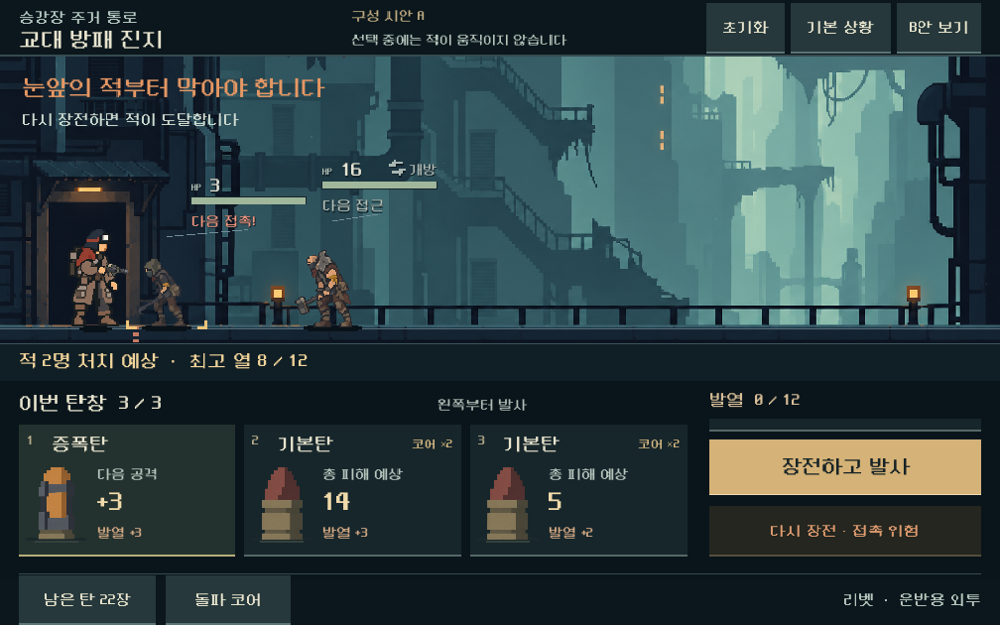

# 전투·UI 통합 개편 1단계 검증

2026-10-31 · Godot 4.7 stable · Windows / GL Compatibility / RTX 4060 Ti.

[행동·구성·다음 비교 설계](../../direction/combat-ui-stage1.md) · [전체 계획](../../direction/combat-ui-rework.md)

## 범위와 결과

- 현재 획득 경로 25전투 재생, 승리·턴·소모 탄 일치 확인. 규칙 변경 없음.
- 독립 Godot 구성안 2개, 현재 규칙의 장전+발사·재장전·상세·기본/근접 상태 연결.
- 1008×630, 1280×576, 1280×800에서 335검사 실패 0. A/B 전환·닫기 별도 4검사 실패 0.
- 실제 GPU 캡처 21장: 동일 상태의 기존 화면 3장, A/B의 기본·승리·근접 상태 각 3비율 18장.
- 기존 `redesign` 스크립트/씬/리소스와 `project.godot`의 사전 목록 **270파일 해시 동일**. 새 샘플·검증 파일만 추가했다. 본편 전투/화면을 교체하지 않았다.
- Godot MCP로 프로젝트와 4.7 버전을 확인하고 두 시안 루트 씬을 생성했다. 세부 배치는 직렬화된 TSCN으로 작성, 기존 격리 CLI/GPU 경로로 검증했다. 새 그림 생성·기존 원화 수정은 없음.

## 현행 전투 기준선

입력: `qa_runtime/combat_rhythm_20261030/matrix_final`의 시드 731042, 운반용 외투, 편성 12, 5총기 실제 획득 체크포인트와 기존 합법 명령 경로. 진단용 모델에서 적 진행 호출만 기록하고 본편 계산을 그대로 호출했다.

아래 숫자는 해당 전투 경로에서 실제로 요청된 **적 행동 턴 수**다. 사격 턴 수·클릭 수·적 한 명의 이동 횟수와는 다르다.

| 총기 | 첫 전투 101 | 무리 201 | 방패 401 | 성장 확인 602 | 첫 보스 802 | 보스에서 관측한 최소 내부 거리 |
| --- | ---: | ---: | ---: | ---: | ---: | ---: |
| 리벳 | 0 | 0 | 4 | 0 | 6 | 18 |
| 래칫 | 3 | 0 | 3 | 0 | 13 | 3 |
| 스플린터 | 4 | 0 | 3 | 0 | 10 | 3 |
| 리액터 | 0 | 0 | 6 | 0 | 16 | 3 |
| 스파이크 | 1 | 0 | 1 | 0 | 6 | 17 |

25건 중 12건이 적 행동 없이 끝났다. 모든 무리전이 지나치게 쉽다고 일반화하지 않는다. 이미 가까워지는 보스/총기와 짧은 돌파 구간을 구별할 이유다. 최소 거리는 명령 전후의 살아 있는 적/발사체에서 관측했으며 실시간 궤적·사람 체감의 측정값이 아니다. 경로 탐색은 숨은 패/시드를 알고 있으므로 일반 플레이어 난이도로 해석하지 않는다.

[25건 행동별 원자료](assets/combat_ui_stage1_2026-10-31/baseline.json)

## 실제 화면









기본 시안은 획득 저장의 합법 재장전 1회 후 `증폭 → 기본탄3 → 기본탄2`를 준비한 상태다. 실제 계산은 총 피해 14와 5(후자는 주 표적 2 + 전이 3), 적 2명 처치, 최고 열 8/12다. 피해값은 증폭·코어·전이를 반영한다. 승리 뒤 초기화된 현재 열 0과 사격 중 최고 열을 구별한다.

근접 시안은 같은 저장에서 빈 재장전을 13회 한 뒤 같은 탄 조합을 준비했다. 사격하면 승리하고 재장전하면 접촉 패배하는 것을 실제 모델로 확인했다. **표시 검수를 위한 의도적 대기이며 압박 개편 성과가 아니다.**

시각 검토: 작은 화면의 A/B, 넓은 화면의 A와 B 근접, 동일 상태 기존 화면을 직접 확인했다. 넓은 전장·순서와 행동의 연결을 근거로 A를 다음 비교의 기본안으로 권고했다. B는 작은 화면의 가로 전장 폭과 적 겹침이 불리하다. 재질·발사 연출·전체 탄종/탄창 용량은 아직 최종 완성도 검수 범위가 아니다.

## 기능과 실제 입력

- 실제 터치 이벤트로 상세 열기/닫기, 장전+발사, 근접 상태, 위험 재장전, 초기화를 실행했다.
- 장전+발사는 현재 모델의 확정과 발사를 순서대로 실행한다. 탄창 자동 추첨/새 준비 비용을 구현하지 않았다.
- 모든 주요 버튼이 시험한 화면에서 최소 44픽셀의 터치 영역을 갖고, 화면 안 배치/주요 글자 폭/발사·재장전 영역 분리를 확인했다.
- 예측한 처치 2명, 증폭/코어/전이를 합친 탄별 피해 14·5, 접촉 경고와 실제 패배가 일치했다. 승리 뒤 중복 발사 비활성 확인.
- A→B→A 전환 후 기본 상태 초기화, 시안 제거 뒤 초기 씬 구성으로 돌아옴을 확인했다.
- 격리 `APPDATA`/`LOCALAPPDATA`로 실행하고 본편 전후 캡처도 저장 기능을 끈 상태에서 마운트했다.

[UI 검사](assets/combat_ui_stage1_2026-10-31/ui.json) · [전환 검사](assets/combat_ui_stage1_2026-10-31/navigation.json) · [파일 해시](assets/combat_ui_stage1_2026-10-31/manifest.json)

## 검증 중 수정한 사항

- 최초 실행기는 Windows PowerShell의 한글 경로 해석 문제로 프로젝트를 열지 못했다. 기존 실행기와 같이 프로젝트 파일이 있는 디렉터리를 조회하도록 바꾸었다. 게임 코드 문제는 아니었다.
- 최초 터치 검사는 창 외부 좌표 경로로 주입해 36개 입력 후속 검사가 실패했다. 기존 QA와 같은 뷰포트 로컬 터치 경로로 교정 후 실제 입력을 재검증했다. 실패 실행을 통과 증거에 합산하지 않았다.
- 기존 화면과 대조하며 시안 카드의 기본 피해 표시가 증폭/코어의 효과를 가린다는 점을 확인했다. 실제 예측의 주 표적+전이 총 피해와 코어 배율을 연결하고 관련 검사/캡처를 갱신했다.
- 종료 검사는 큐 해제 완료 전 노드를 세어 한 번 실패했다. 해제 뒤 실제 프레임을 기다리고 시작 당시 루트 구성과 비교하도록 고쳤다. 최종 전환 검사 실패 0.

## 실행과 남은 범위

```powershell
powershell -NoProfile -ExecutionPolicy Bypass -File tools/run_combat_ui_stage1.ps1 -Mode baseline
powershell -NoProfile -ExecutionPolicy Bypass -File tools/run_combat_ui_stage1.ps1 -Mode ui
powershell -NoProfile -ExecutionPolicy Bypass -File tools/run_combat_ui_stage1.ps1 -Mode navigation
```

[시안 실행](../../../OPEN_COMBAT_UI_STUDY.cmd)은 별도 저장 경로에서 A로 시작하며 상단 버튼으로 B/근접 상황을 바꾼다. 씬 원본은 `redesign/samples/combat_ui_stage1_a.tscn`, `combat_ui_stage1_b.tscn`이며 주요 배치는 런타임에서 새로 만들지 않는다. 데이터·문구·상태만 `combat_ui_stage1.gd`에서 연결한다.

미검증: 사용자 미감/이해도, 실제 모바일 터치와 지속 FPS/기기 발열, 큰 글씨 설정, 다른 총기별 탄창 용량·덱 구성/순서 편집, 새로운 접근/발열/발사체 규칙, 후반 진행. 시안은 완성된 본편 UI나 밸런스 해결 결과가 아니다. APK·커밋·푸시·외부 게시 없음.
