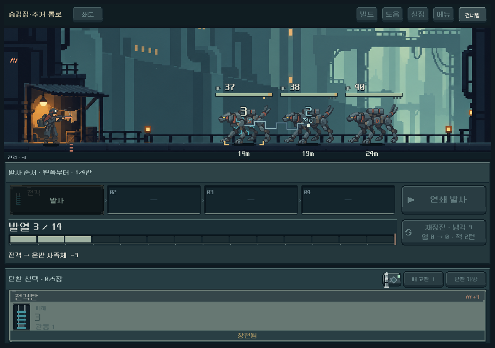

# 전투 효과와 제작 원본 경로 — 2026-10-11

## 적용

- 금속 파편은 실제 `armor_removed > 0`일 때만 발생한다. 장갑 관통과 구별한다.
- 전격은 `secondary`의 실제 전이 대상에만 연결한다. 일반 직선을 짧은 계단형 전격과 두께가 다른 색면으로 대체했다. 화상 이동은 전기처럼 표시하지 않는다.
- 냉각탄·열방출·처치/세 번째 발 냉각의 실제 감소와 과열 추가 냉각/재장전 완료에 국소 증기를 연결한다. 열0 재장전에 가짜 냉각 증기를 만들던 표현을 제거했다.
- 게임의 상태/RNG/피해/턴 수는 바꾸지 않았다. 그림을 위해 화면 전체나 UI 배치를 흔들지 않는다.
- 승인된 주인공4자세의 편집 원본 `.ase`와 발/총구 등록 JSON, 내보내기/검사 도구, 생성된 Godot 등록 데이터를 연결했다. 원본 생성 PNG와 RGBA 일치 및 원래 파일 해시 보존을 확인했다. 중간 동작 추가는 이번 범위가 아니다.

## 검증 구분

Godot4.7 Compatibility, 격리된 `qa_runtime` 저장으로 실제 버튼 입력을 재생했다. 일반 저장에는 접근하지 않았다.

- 전투 피드백: **911검사 / 0실패**, 1008×630 / 1280×900 / 1440×630. 일반·증폭·연타·전이·화상·막힘·처치·장갑 감소·관통·냉각·열0 냉각·과열을 재생했다. 실제 모델과 화면을 거친 모델의 전체 상태/RNG 일치, 숫자/HP/거리/다른 숫자 겹침과 고정 UI 배치, 효과 정리 및 즉시 연출의 냉각 잔상 부재를 검사했다.
- 주인공 동작: **226검사 / 0실패**, 관찰 **2,213프레임**, 거리 역전0 / 검사한 지상 적의 접지 이탈0. 기본탄 카드가 없는 손패에서 고정 기본탄을 누르던 구 테스트2곳을 현재 규칙에 맞게 수정한 뒤 통과했다.
- 제작 경로: LibreSprite `.ase` → PNG/JSON → Godot 좌표 데이터. `python tools/export_hero_animation.py --check` 통과. 원래 생성 PNG와 비교해 픽셀 보존을 별도로 확인했으며, 동일 픽셀은 PNG 인코딩을 덮어쓰지 않도록 했다.
- 시각 확인: 실제 작은 화면의 장갑 파편/전격/냉각, 기본 화면의 전격과 재장전 자세를 열어 확인했다. 효과를 배우 몸통·총구 주변에 국한해 HP·거리 영역을 덮지 않는다. 스크린샷은 효과 재현용 편성이며 자연 진행의 덱 구성과 다르다.
- 사람/Galaxy의 효과 강도·속도 체감은 미검증이다. APK는 만들지 않았다.

## 실제 화면·로그

[장갑 파편](combat_vfx_pipeline_2026-10-11_assets/armor_1008.png) · [냉각](combat_vfx_pipeline_2026-10-11_assets/cooling_1008.png) · [주인공 재장전](combat_vfx_pipeline_2026-10-11_assets/reload_open_1280.png)

[전투 검사](combat_vfx_pipeline_2026-10-11_assets/combat_stdout.log) · [동작 검사](combat_vfx_pipeline_2026-10-11_assets/actor_stdout.log)

## 한계와 도입 판단

외부 라이브러리 씬의 직접 복사 대신 현재 전장의 이벤트와 도트 크기에 맞는 별도 표현을 만들었다. Importality/Pixelorama/렌더링 플러그인 설치는 하지 않았다. 탄환·파츠 처리 순서와 확장 부담은 [검토 문서](../../direction/effect-pipeline.md)에 현행 구현/후속 제안을 구별해 남겼다. 현재 검토만으로 새 파츠 전체 조합의 균형을 검증했다고 보지 않는다.

Godot 편집기 가져오기에서 기존 Android build-tools 경고가 있었다. 실행한 데스크톱 검증과 구별하며 모바일 빌드 환경 검증은 이번 범위에 포함하지 않는다. 전체 작업 트리의 공백 검사에서는 이번에 건드리지 않은 `part_card_view.gd` 끝의 기존 빈 줄이 발견되어 보존했다.
