# 공통 창 — 설정·조작 안내·게임 규칙·기록실

2026-11-08. 사용자 요청: "진행해 줘"(남은 개편 대상인 공통 창). 새 시안은 만들지 않았다. 정비소·관문·탄약고·빌드 작업실과 같은 테마(`workbench/theme.tres`)로 옮기고 본편에 바로 적용했다. 기록실은 원래 후순위였지만, 관문·탄약고·조우의 `메뉴 → 기록`과 지도에서 열리는데 혼자 청록 화면이라 함께 바꿨다. APK·커밋·푸시는 하지 않았다.

## 무엇이 바뀌었나

| 이전 | 이후 |
| --- | --- |
| 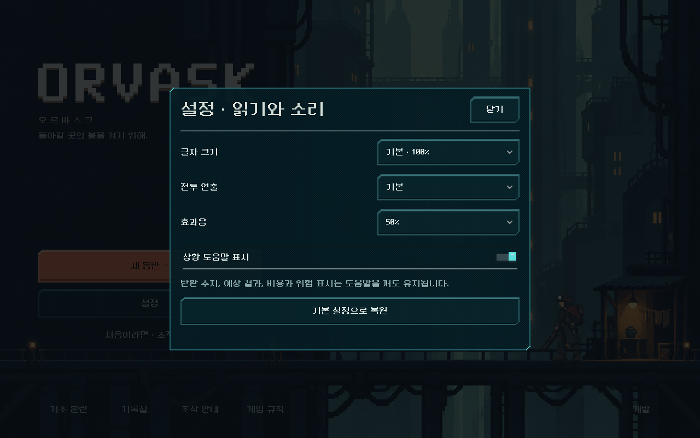 | 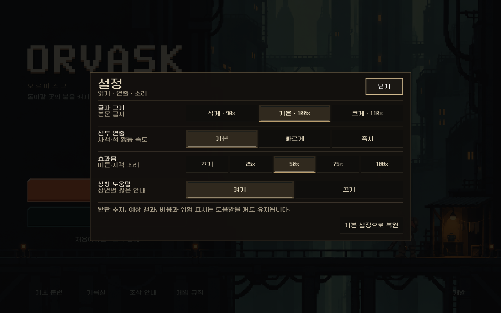 |
| 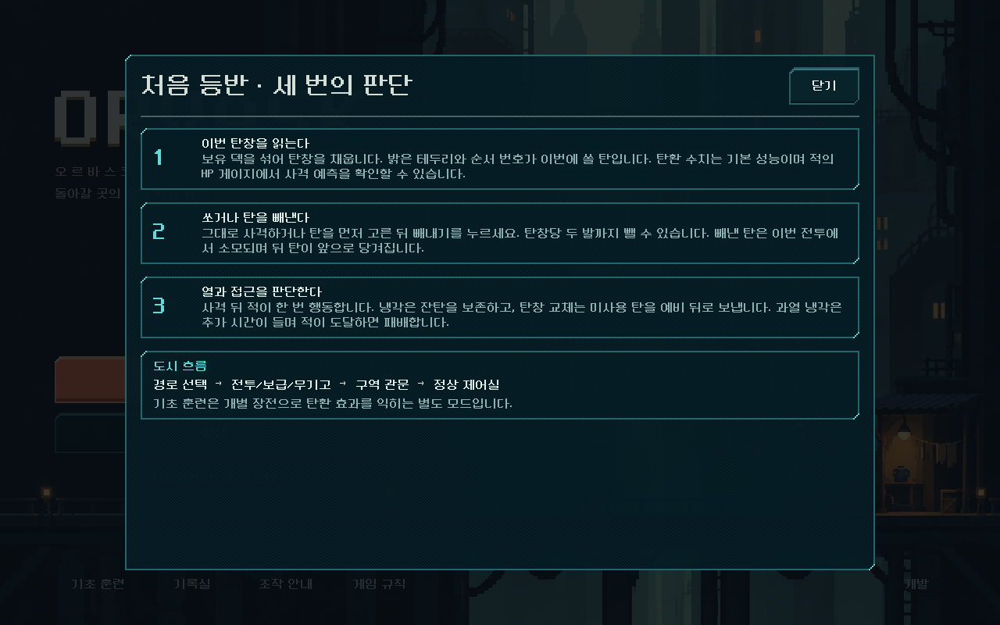 | 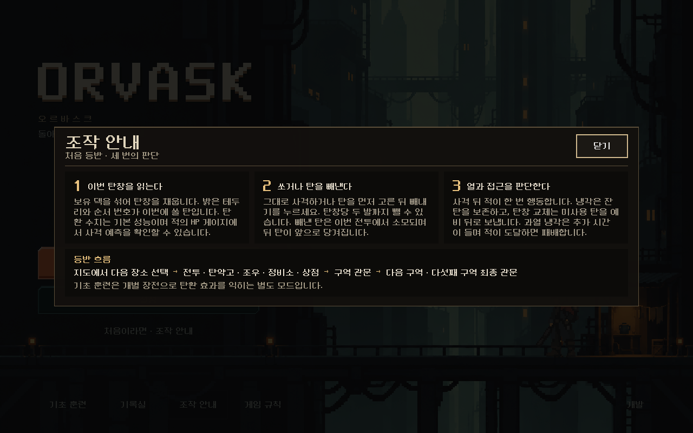 |
| 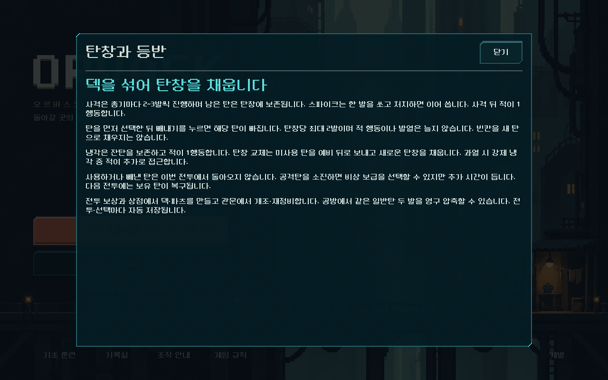 | 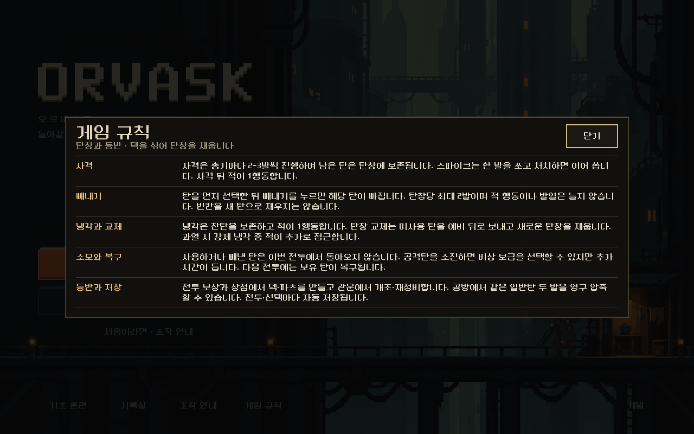 |
| 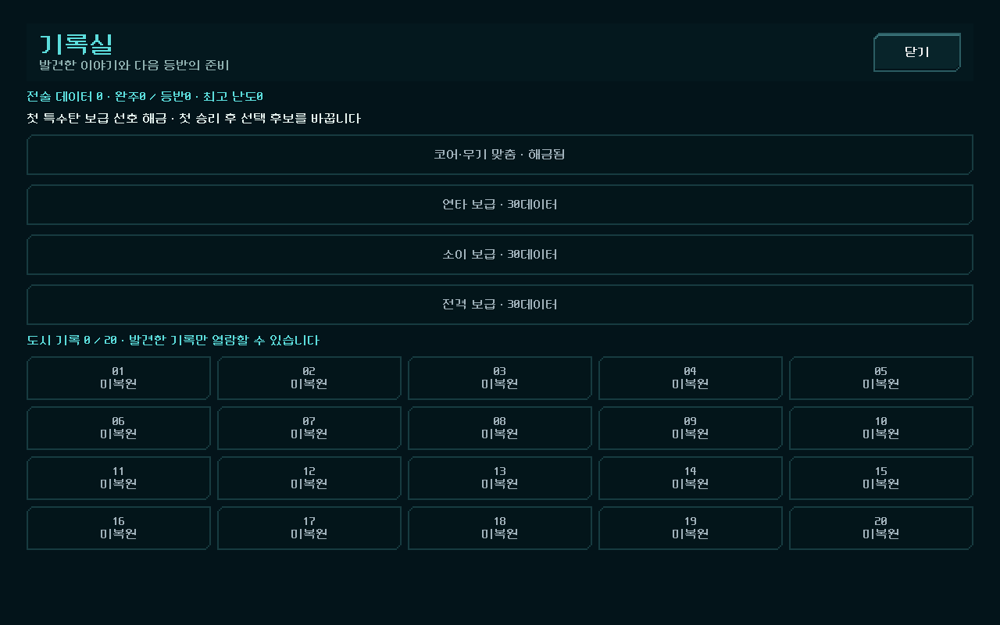 | 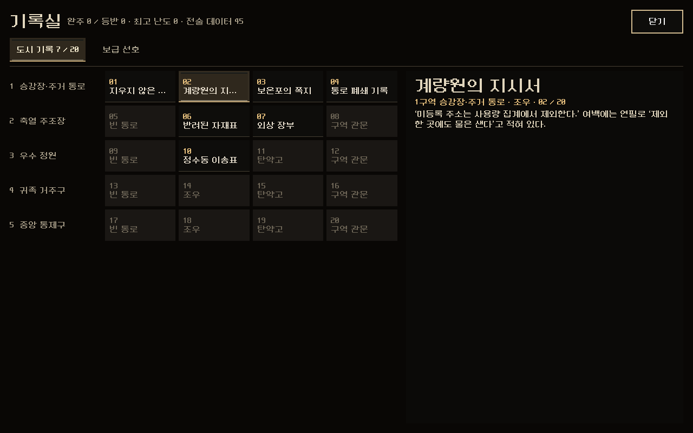 |

열리는 곳과 문장은 그대로다. 바뀐 것은 틀과 배치다.

- **공통 창 틀**(`common/window.tscn`): 어두운 갈색 판, 금색 윗선, 제목·부제·닫기. 동작은 기존 대화창(`console_dialog.gd`)을 그대로 상속한다. Esc·뒤로 가기로 닫고, 포커스가 창 밖으로 나가지 않으며, 안전 영역에 맞추고, 닫으면 연 버튼으로 포커스가 돌아간다. 내용이 짧으면 창이 내용 높이로 줄어든다.
- **설정**: 드롭다운 3개와 토글 대신 **모든 선택지를 버튼으로 펼쳤다.** 글자 크기 3단, 전투 연출 3단, 효과음 5단, 상황 도움말 켜기/끄기다. 한 번 누르면 바로 적용·저장된다(이전에는 드롭다운을 열고 다시 골라야 했다). `기본 설정으로 복원`은 창을 다시 열어 복원된 값을 보여 준다.
- **조작 안내**: 세 단계를 카드 3장으로 나란히(좁은 화면은 세로로) 놓았다. 아래 '등반 흐름'의 장소 이름을 현재 지도에 맞췄다(이전: 전투/보급/무기고 → 정상 제어실, 이후: 전투·탄약고·조우·정비소·상점 → 구역 관문 → 다섯째 구역 최종 관문). 단계 문장은 바꾸지 않았다.
- **게임 규칙**: 문단 다섯 개에 머리말(사격·빼내기·냉각과 교체·소모와 복구·등반과 저장)을 붙여 줄 단위로 나눴다. 문장은 그대로다. 이전 규칙 저장·기초 훈련용 긴 규칙(1~11번)도 같은 틀로 옮겼다.
- **기록실**(`common/archive.gd`, 빌드 작업실과 같은 전체 화면 구성):
  - `도시 기록` 탭: 20편을 **구역별 다섯 줄 × 네 칸**으로 놓았다. 찾은 기록은 번호(금색)와 제목, 못 찾은 기록은 **어디서 찾는지**(빈 통로·조우·탄약고·구역 관문)를 보여 준다. 누르면 오른쪽 읽기 판에 제목·구역·출처·본문이 나온다. 이전에는 기록마다 새 화면으로 넘어갔다.
  - `보급 선호` 탭: 해금 카드 4장(이름과 해금 버튼). 데이터가 30 이상이면 금색 `해금 · 30데이터` 버튼이 켜진다. 해금하면 저장하고 같은 탭으로 다시 연다.
  - 머리줄에 완주·등반·최고 난도·전술 데이터를 모았다.

| 화면 | |
| --- | --- |
| 844×390 설정 | 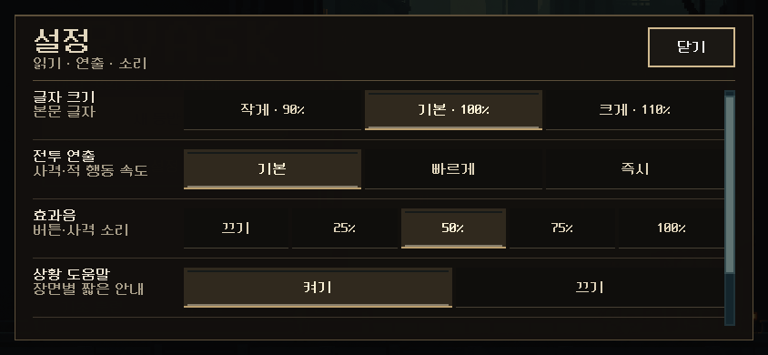 |
| 844×390 조작 안내 | 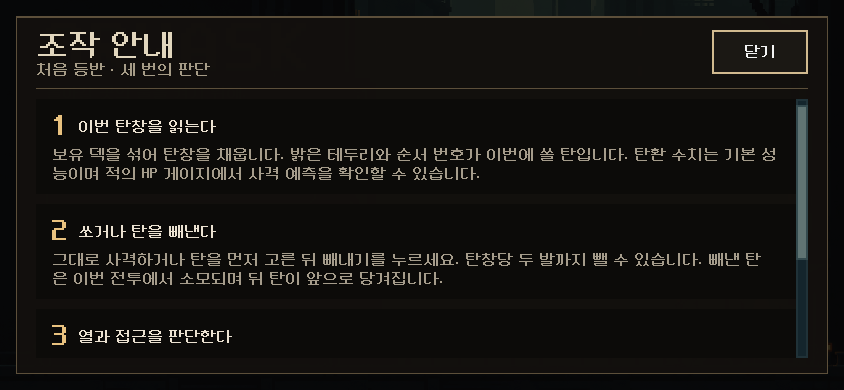 |
| 기록실 처음(기록 없음) | 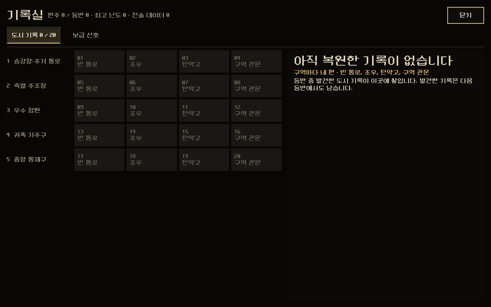 |
| 기록실 보급 선호 | 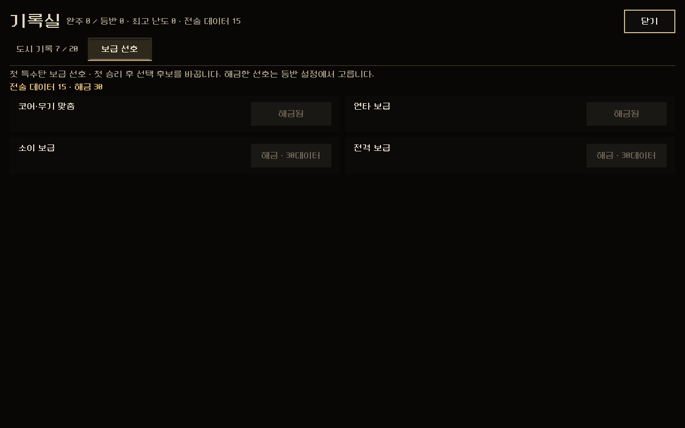 |

[규칙 844×390](rules_844x390.png) · [기록실 844×390](archive_empty_844x390.png)

### 함께 고친 것: 타이틀의 설정 버튼이 화면 밖으로 나가던 문제

검사 중 발견했다. **844×390(가로 휴대폰)에서 진행 중인 저장이 있으면** `등반 계속`·`새 등반`·`설정` 묶음이 아래로 밀려 하단 줄(기초 훈련·기록실·조작 안내·게임 규칙)과 겹쳤다. `설정`은 y=410(화면 높이 390)으로 화면 밖이었고, 그 자리를 누르면 `기록실`이 열렸다. 즉 가로 휴대폰에서는 타이틀에서 설정을 열 수 없었다.

높이 560 미만에서만 묶음을 줄였다: 로고 높이 84→56, 한글 제목·여백 줄 숨김, 버튼 높이 60/52→48/44, 간격 12→6, 하단 줄 위에서 끝나게 했다. 더 큰 화면은 원래 배치 그대로다(`title_screen.gd::_fit_hero`).

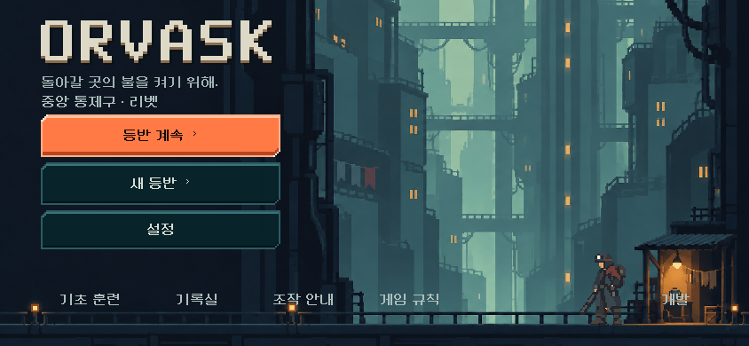

## 검증

`tests/common_windows_ui.gd`(새 파일): **128검사, 실패0, 스크립트 오류 없음.** 세 해상도(1280×800, 844×390, 1008×454)에서 타이틀 버튼을 실제로 터치했다.

- 설정: 새 창이 열리고 드롭다운 없음, 화면 안. 현재 값이 눌린 상태로 표시. 연출·효과음·도움말·글자 크기를 누르면 즉시 적용되고 설정 파일에 저장. 복원은 기본값으로 다시 열림. Esc로 닫힘.
- 조작 안내: 카드 3장과 등반 흐름, 화면 안, 내용 높이로 줄어듦. 닫기.
- 게임 규칙: 머리말 다섯 줄, 화면 안.
- 기록실(새 프로필): 20칸 모두 잠김, 빈 읽기 판, 다섯 구역 표시. 보급 선호는 보유·데이터 부족이 꺼짐. 닫으면 타이틀.
- 지도(11-06 자동 등반의 5구역 입구 상태에 기록 7편·데이터 45를 넣음): 지도의 `설정`이 지도 위에 열리고 Esc로 지도 복귀. `기록`에서 찾은 칸·잠긴 칸 구분, 마지막에 찾은 기록이 먼저 열림, 기록을 누르면 본문·구역·출처. `연타 보급` 해금 → 데이터 45→15, 자동 저장, 같은 탭으로 다시 열림.
- 저장이 있는 타이틀(844×390, 1008×454, 1280×800): `설정`이 화면 안·하단 줄 위에 있고 터치로 열림.

회귀: 관문 123·탄약고 85·조우 72·빌드 작업실 105·장비 선택 6142검사 모두 통과(스크립트 오류 없음). 타이틀 검사(`title_ui_runner`)는 190검사 중 2개 실패(`valid ending fixture reached through actual campaign flow`, `unfinished restoration stays on main action`)인데, **이번 변경 전 `title_screen.gd`로 되돌려 돌려도 같은 2개가 실패**한다. 11월 3~6일 밸런스 변경 뒤 낡은 결말 고정 상태 문제로 보이며 이번 변경과 무관하다.

## 남은 것과 주의

> 후속(같은 날): 아래 두 '결정 필요' 항목은 디렉터 결정으로 정리했다. 보급 선호는 숨기고 글자 크기 설정은 뺐다([현재 방향](../../../direction/current.md)). 오래된 검사는 [UI 검사 목록](../../ui-test-suites.md)에서 고치거나 은퇴시켰다.

- **결정 필요 — 보급 선호 해금이 지금 등반에 효과가 없다.** 현재 탄창 등반(`focus_build_version`)은 첫 승리 후보를 `FocusBuild.opening_options()`로 정하고 보급 선호(`loadout`)를 읽지 않는다. 기록실 문구('첫 승리 후 선택 후보를 바꿉니다')대로라면 30데이터를 써도 바뀌는 것이 없다. 규칙 문제라 이번에 고치지 않았다. 보급 선호를 새 등반에도 반영할지, 해금 항목을 다른 것으로 바꿀지, 숨길지 정해야 한다. 같은 이유로 카드에 이전 시작 덱 구성을 적지 않았다.
- **글자 크기 설정의 효과가 거의 없다.** 픽셀 글꼴이라 글자 크기를 16의 배수로 맞추는데(`ui_readability.gd::font_size`), 본문 20 기준 90%·100%·110%가 모두 16이 된다. 90%에서는 30짜리 제목이 32에서 16으로 크게 줄어든다. 또 11월에 개편한 화면들(정비소 테마)은 이 설정을 읽지 않는다. 설정 창은 기존 동작을 그대로 두었다. '크게'를 16→32 단계로 바꿀지 등은 별도 결정이다.
- 오래된 검사 중 설정 드롭다운·토글(`OptionButton`·`CheckButton`)을 직접 다루던 6개는 이제 실패하는 것이 맞다: `city_ui_runner`, `console_visual_runner`, `equipment_dialog_ui`, `modal_touch_runner`, `preart_ux_runner`, `presentation_feedback_runner`. 기록실의 `story_record_back`(기록별 새 화면의 '기록 목록으로')을 누르던 `story_flow_runner`·`city_ui_runner`도 갱신이 필요하다.
- 확인 창(분해 확인 등)과 전투 중 창은 여전히 `console_dialog.tscn`(청록 픽셀 틀)이다. 이번 범위는 위 네 창이다.
- 기록실 1280×800에서 아래쪽이 비어 있다. 기록이 20편뿐이라 칸을 키우지 않았다.
- 실기기·사람의 이해도 미확인.

## 변경 파일

[changes.patch](changes.patch) — 이 작업의 변경분만.

| 파일 | 변경 |
| --- | --- |
| `redesign/common/window.tscn`, `window.gd` | 새 공통 창 틀(대화창 동작 상속, 정비소 테마, 내용 높이 맞춤) |
| `redesign/common/windows.gd` | 설정·조작 안내·게임 규칙 내용 |
| `redesign/common/archive.gd` | 새 기록실(도시 기록·보급 선호 탭) |
| `redesign/screen.gd` | `_guide`·`_settings`·`_rules`가 새 창을 연다 |
| `redesign/campaign_ui.gd` | `archive(initial_tab)`가 새 기록실을 열고 작업 창으로 등록 |
| `redesign/title_screen.gd` | 낮은 화면에서 타이틀 버튼 묶음을 줄여 하단 줄 위에 둔다 |
| `tests/common_windows_ui.gd` | 새 본편 공통 창 검사 |
| `tests/common_windows_capture.gd` | 이전·이후 비교 캡처 |
