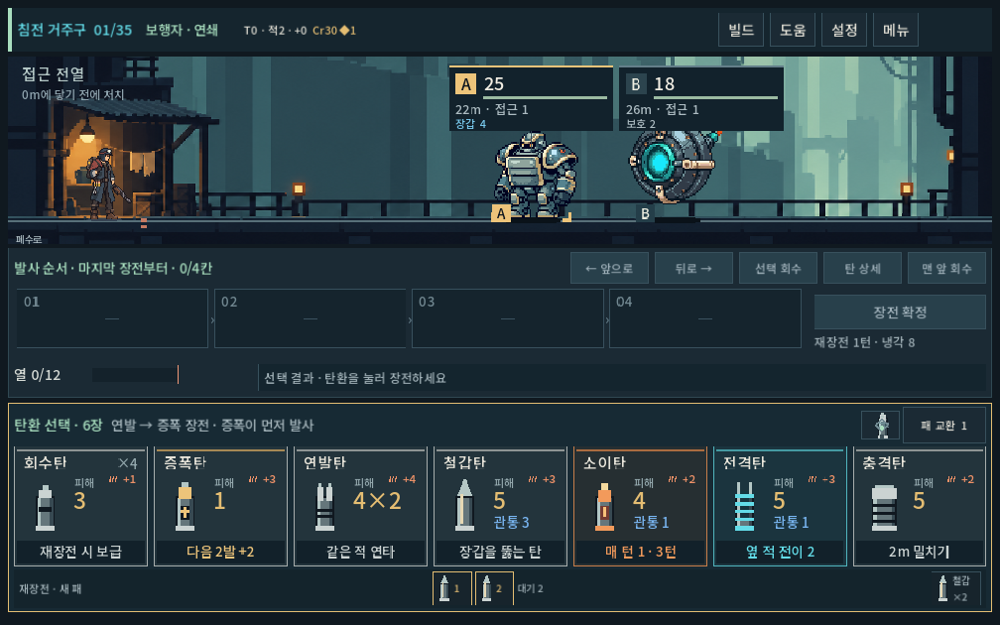
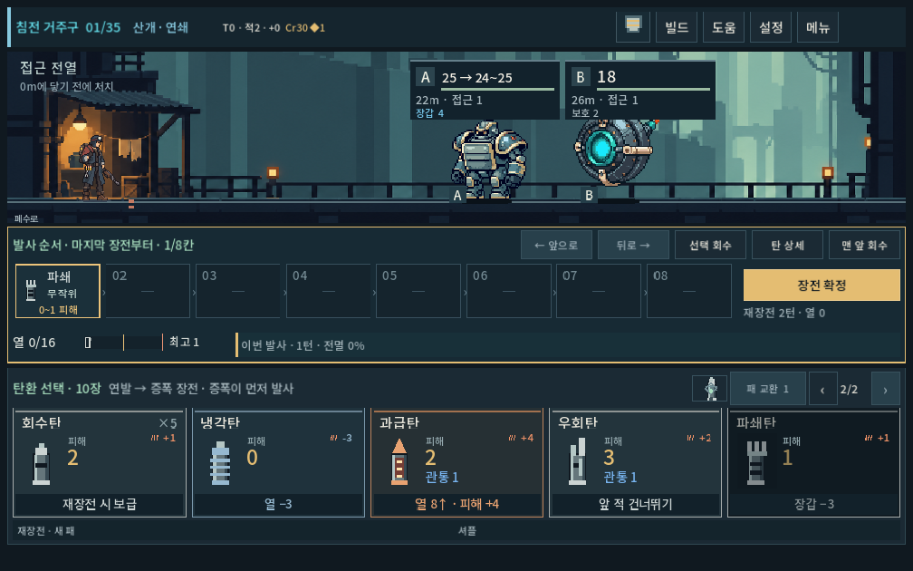
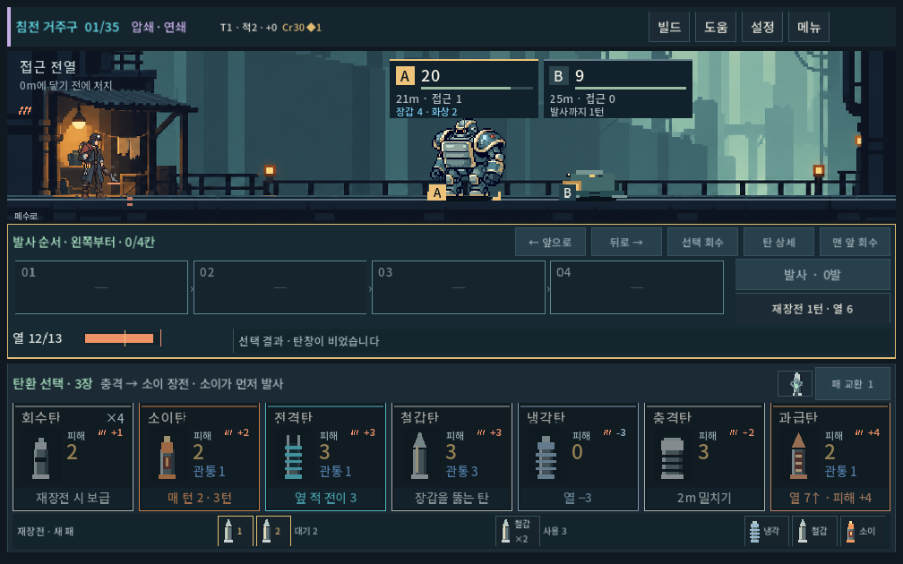
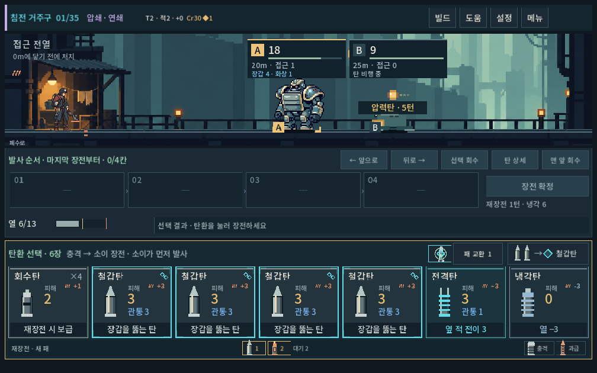

# 패 선택·순환·잔열 — 슬더스2 검토 후 1차 개편

2026-10-04 · `prototype/core-redesign` · Godot4.7 · 전투 저장v11.

## 판단과 적용 범위

사용자는 선택 가치 검토 후 개발을 승인하며 슬더스2가 덱 관리/활용을 유도하는 방식을 먼저 확인하도록 요청했다. 공개 자료 조사와 이 프로젝트에 대한 해석은 [설계 문서](../../direction/decision-value.md)에 출처와 함께 구분했다. 슬더스2를 직접 플레이한 검증은 아니다.

패는 탄창+2장(최소5장), 재장전은 미사용 패까지 순환, 일반 재장전은 무기별 일부 냉각과 잔열 유지로 변경했다. 강제 재장전은 기존 기본비용+1턴에 완전 냉각이다. 사격 순서/LIFO·탄환 피해·적 수치·기존 보상/압축 경제는 유지했다. 패 교환은 작은 구 저장 손패나 압축 후에도 정확히1장만 바꾼다.

**선택 가능한 후보와 과열의 실제 비용은 늘었다. 보행자의 무작위 운용은 여전히 강하므로 선택 가치 문제 전체를 해결했다고 판단하지 않는다.**

## 동일 감사 정책의 전후 비교

변경 전은 [동결된 v10 심층 감사](decision_depth_2026-10-04.md), 변경 후는 같은 스크립트의 v11 실행이다. 양쪽 모두 기본 난도. 패 크기/순환이 달라져 이후의 손패와 난수 소비는 달라지며 각 사격이 일대일로 같은 상태는 아니다. 정책 성공률은 사람의 승률·최적 플레이가 아니다.

### 시작 덱, 파츠/성장 없는 독립 전투 2,592건

5무기×6시드×36편성. 무작위/회수탄 정책, 보행자와 압쇄는32후보 즉시 결과 선택도 비교한다. 동일 정책을 유지했다.

| 무기 | 무작위 승리: 전→후 /216 | 회수탄만: 전→후 /216 | 32후보 선택: 전→후 /216 |
|---|---:|---:|---:|
| 보행자 | 212→211 | 197→197 | 216→216 |
| 쇄도 | 212→205 | 173→173 | — |
| 산개 | 197→197 | 48→48 | — |
| 압쇄 | 216→210 | 168→168 | 216→215 |
| 증강 | 191→183 | 39→39 | — |

변경 후 두 정책이 모두 이긴 일치 사례에서 평균 경과 턴은 보행자211쌍 **무작위10.00 / 선택7.05**, 압쇄210쌍 **8.99 / 7.18**이다. 후보 선택은 즉시 결과만 비교하며 최적 정책이 아니다. 사격 효율 차이는 존재하지만 보행자의 큰 생존 여유도 남아 있다.

### 실제35층 등반 270건

5무기×6시드×3정책(무작위/화면 순서/공개 열 휴리스틱)×3성장 정책. 출입/보상/구매/관문은 합법 명령, 분기는 항상 첫 선택이다. 자세한 정책은 변경 전 보고서와 감사 코드에 있다. 여기서는 일부 결과를 발췌하며 전체는 비교 JSON으로 보존한다.

| 조건 | 변경 전 | 변경 후 |
|---|---:|---:|
| 압쇄·무성장·무작위 완주 | 6/6 | 3/6 |
| 압쇄·확장 성장·무작위 완주 | 6/6 | 5/6 |
| 압쇄·확장 성장·열 휴리스틱 완주 | 6/6 | 6/6 |
| 보행자·확장 성장·무작위 완주 | 5/6 | 3/6 |
| 보행자·확장 성장·열 휴리스틱 완주 | 6/6 | 6/6 |
| 쇄도·무성장·무작위 / 열 휴리스틱 | 4/6 · 4/6 | 2/6 · 6/6 |

열 휴리스틱이 항상 좋은 것은 아니다. 압쇄 무성장은 변경 후 무작위3/6보다 낮은2/6이며 미래 처치선/열을 최적화하지 않는다. 산개와 증강의 어려움도 별도 조정 대상이다.

확장 성장·무작위·첫 지역 이후 ‘손패 전부를 장전’한 횟수는 보행자371/371→**0/283**, 쇄도425/425→**0/448**, 산개288/288→**0/301**, 압쇄376/419→**0/367**, 증강40/127→**0/27**이다. 매 탄창 남길 후보가 생겼다는 구조적 증거다. 모든 버림 선택이 동등하게 유익하다는 뜻은 아니다. 성장/생존 차이로 방문 교전 수는 다르다.

### 세 덱·다섯 파츠 구성의 독립 전투 2,400건

5무기×4시드×4편성×3덱×5파츠 구성×2정책. 통제된 덱/파츠이며 실제 구매 빈도를 나타내지 않는다.

| 측정 | 변경 전 | 변경 후 |
|---|---:|---:|
| 무작위 승리 /1,200 | 1,077 | 1,081 |
| 열 휴리스틱 승리 /1,200 | 1,176 | 1,183 |
| 무작위 강제 재장전 | 991 | 1,453 |
| 그중 아직 미발사 탄이 있었던 경우 | 168 | 476 |
| 과열로 못 쏜 탄 수 | 169 | 507 |
| 열 휴리스틱에서 과열로 못 쏜 탄 | 0 | 0 |

패를 더 넓게 고르고 새로 순환하는 이득이 발열 부담 증가와 함께 작동한다. 무작위 승리 전체가 일괄 하락하지 않았다. 특히 보행자의 통제 빌드는 변경 후 무작위도240/240이므로 탄환/적 역할 조정이 남는다. 공개 열 휴리스틱은 과열 직전 사격을 짧게 구성하므로 미발사0이 되며, 화력/보상까지 최적화한 결과가 아니다.

초반72손패의 최대 합법 장전은12,116→16,190가지로 늘었다. 선택 수만으로 재미를 평가하지 않는다. 초반의 넓은 안전 여유는 별도 검토 대상이다.

## 기능·조작 검증

모든 검사는 `qa_runtime/`의 격리 APPDATA/LOCALAPPDATA에서 수행한다. 실제 플레이어 저장을 사용하지 않았다.

| 검사 | 결과 |
|---|---:|
| 새 패/순환/잔열/v10복원/산개 범위 | 827검사 · 실패0 |
| 새 UI·공개 입력·화면비3종·큰 글자·무기 냉각 표시 | 245 · 0 |
| 기존 발열 규칙 / UI | 757 · 0 / 272 · 0 |
| 열 파츠/탄환 규칙 | 2,479 · 0 |
| 발열 기록 규칙 / UI | 248 · 0 / 316 · 0 |
| 기존 탄환·예측·보급 | 45,881 · 0 |
| 성장·교환·경제 | 4,589 · 0 |
| 무기·압축 | 3,605 · 0 |
| LIFO 규칙 / UI | 2,828 · 0 / 364 · 0 |
| 5무기×2경로·35층 전체 등반, 매 명령 저장/복원 | 26,757 · 0 / 10경로 완주 · 4,341명령 |
| 독립 전투/270등반/72패/2,400빌드 감사의 명령·종결 검사 | 실패0 |

전체 등반 검사는 후보800개 제한의 기능 탐색이며 미래 드로우/RNG를 사용할 수 있다. 사람 플레이의 승률이나 선택 이해도를 증명하지 않는다. 새 원시 기록은 `campaign.json.gz`로 보존했다.

일반 재장전의 열0 기대값, 저장 버전10 고정값, 재장전 뒤 원본 탄이 반드시 사용 더미에만 남아야 한다는 기존 검사3종은 새 규칙에 맞게 갱신했다. 원본 탄 두 장의 전체 영역 보존·코어 미환급·임시 탄 소멸은 계속 검증한다. 테스트를 맞추기 위한 화력 변경은 없다.

## 실제 렌더 확인

1008×630, 1440×630, 1280×900에서 장전/확정/발사/재장전/페이지 이동을 실제 입력해 캡처했다. 첫 검사에서 페이지 숫자의 자동 줄바꿈으로 높이가 늘어나는 결함을 고쳤다. 현재 전투 전체 스크롤 없이 후보10장까지 접근한다. 최대 글자1.1에서도 페이지와 주 행동이 화면 안에 있다. 이는 PC에서 모바일 비율을 렌더한 확인이며 Galaxy 실기기 검증은 아니다.

## 재현 자료와 남은 일

- `tools/run_decision_revision_checks.ps1 -Mode rules` / `-Mode ui`.
- `tools/run_ammo_choice_audit.ps1`, `tools/run_decision_depth_audit.ps1`, `python tools/summarize_decision_revision.py`.
- [전후 요약](decision_revision_2026-10-04_assets/comparison.json), 압축 원시 JSON·실행 로그·소스 SHA256은 같은 자산 폴더에 보존한다. 변경 전 원시 자료는 이전 보고서 자산을 참조한다.

사람 플레이로 ‘남길 탄/이번 사격/다음 잔열’이 실제 고민이 되는지 확인해야 한다. 보행자의 기본 화력, 기폭/추격 등 조건이 실패해도 남는 이득, 공개 적 위협에 따른 여러 대응이 다음 밸런스 대상이다. 후보가 늘어난 조작 피로와 원하는 패를 붙잡아 둘 수 없는 답답함도 관찰한다. APK·커밋·푸시는 이번에 수행하지 않았다.
