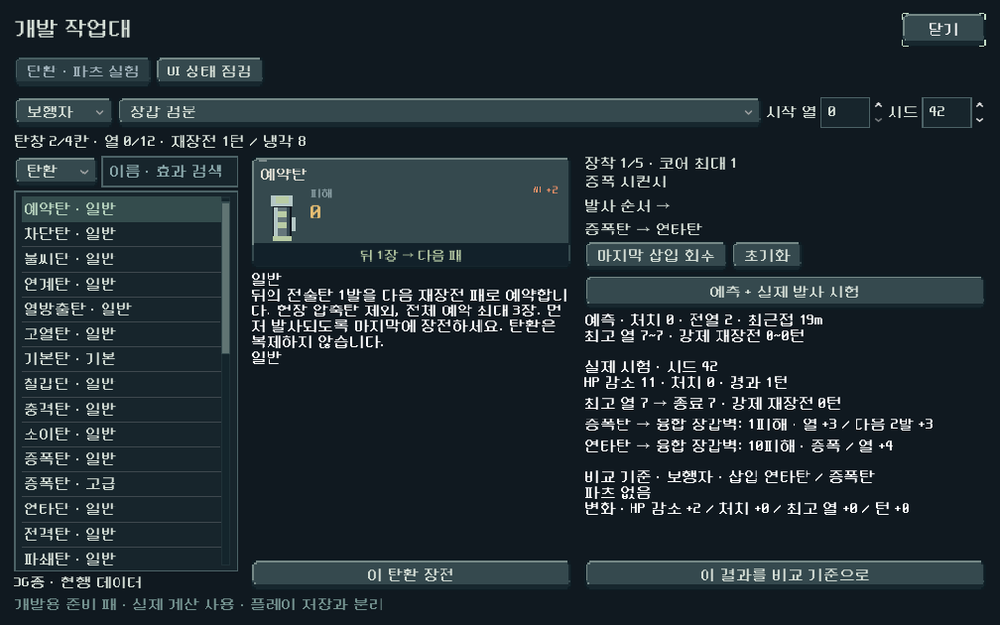
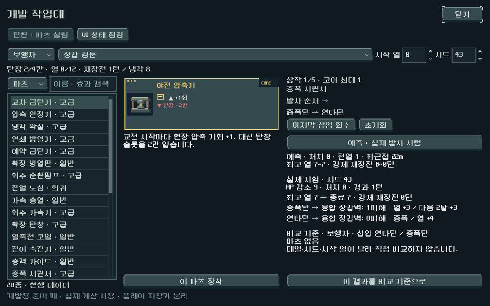
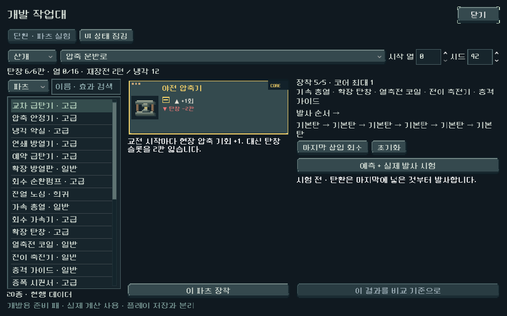
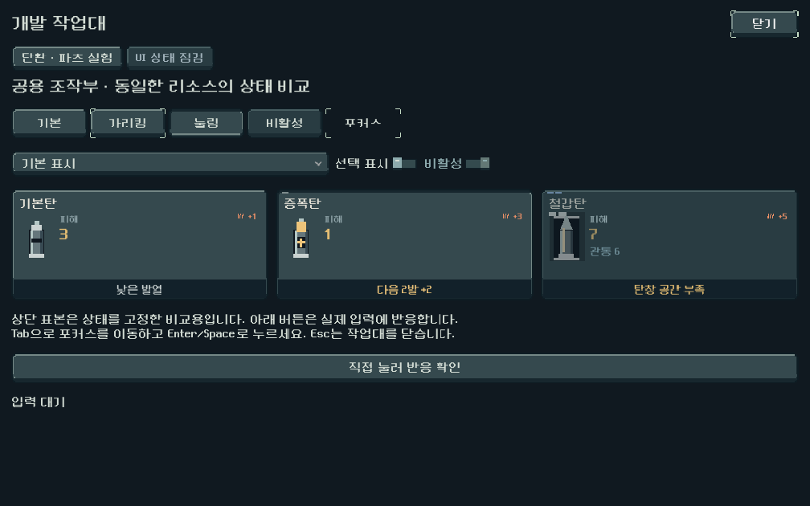

# 개발 작업대 — UI 상태 점검과 조합 시험

## 결과와 실행

`PLAY.cmd` → 메인 **개발** → **개발 작업대 · UI 점검 / 탄환·파츠 실험**.

Godot에서 직접 열 수 있는 구성: `res://redesign/developer_lab.tscn`. 본편 규칙, 획득 확률, 저장 형식, 캐릭터/몬스터 아트는 변경하지 않았다. 개발 메뉴 연결과 독립된 도구만 추가했다.

### 조합 시험

- 현행 Content에서 탄환 36종(영구 압축 포함, 임시 압축 제외)·파츠 28종을 검색한다. 이름·내부 ID·효과 설명 검색, 기존 공용 카드 렌더러와 설명 사용.
- 총기 5종, 기존 연습 대열 7종, 시드, 시작 열을 선택한다. 이 대열은 Content의 재현 가능한 시험 편성이며 캠페인 전체 구역 편성을 대체하지 않는다.
- 탄환을 누르고 **이 탄환 장전**. 마지막 삽입부터 실제 발사 순서가 표시된다. 2칸/위치 제약은 Content/Model을 사용한다. 파츠는 최대 5개/코어 1개, 총기 호환과 탄창 감소 불이익을 검사한다. 실패 시 기존 구성을 보존한다.
- **예측 + 실제 발사 시험**은 독립 Model을 만든다. Forecast와 실제 confirm/fire 경로를 모두 실행하고 예측·시드별 실제 HP 감소/처치/최고 열/종료 열/소모 턴/강제 재장전을 구분한다. 단발 총기도 탄창이 멈출 때까지 여러 행동을 실행한 결과다. 선택적 수동 재장전은 포함하지 않는다.
- HP 감소는 적의 실제 남은 HP 차이이므로 과잉 피해를 포함하지 않는다. 산개 예측은 범위/확률이고 실제 결과는 해당 시드 1회다. 둘을 평균 효율로 표현하지 않는다.
- **비교 기준**으로 결과를 고정하고 총기·탄·파츠를 바꿔 차이를 확인한다. 대열/시드/시작 열이 달라지면 비교 차이를 숨기고 조건 불일치를 알린다. 구성 변경 시 이전 결과는 즉시 무효화한다.
- 개발용 준비 패는 자유롭게 선택하는 시험 입력이다. 플레이 중 소유/뽑기/상점 획득을 의미하지 않는다. 저장·콘텐츠 원본 편집/내보내기 기능은 없다.

### UI 점검

공용 버튼의 기본/가리킴/눌림/비활성/포커스 리소스를 고정 표본으로 나란히 비교한다. 공용 탄환 카드의 기본/선택/사용 불가, 드롭다운 긴 문구·비활성 항목, 토글, 실제 입력 버튼을 제공한다. 화면 전체 메뉴의 완성도나 모든 개별 덮어쓰기 스타일을 자동 판정하는 도구는 아니다. 본편의 기존 네이티브 대화창 외곽 정리는 별도 후속이다.

## 검증

`tools/run_developer_lab_checks.ps1`: **134검사 / 0실패**. Godot 4.7, Compatibility 렌더링. APPDATA/LOCALAPPDATA는 `qa_runtime/developer_lab/ui`로 격리.

- 규칙: LIFO, 압축 2칸, 임시 압축 직접 삽입 금지, 용량 초과, 파츠 호환/5개/코어1개/용량 페널티, 검색/빈 검색, 잘못된 시험 조건, 모든 총기 재현성, 예측과 실제 적 상태·열의 정합성.
- UI: 1008×630 / 1280×800 / 1600×720. 개발 메뉴→도구, 비교 고정/무효화, 조건 변경 경고, 빈 목록, 최대 장착·탄창, 주요 영역 화면 경계, Esc 종료, 부모 전투 상태 보존.
- 버튼/선택 동작 대부분은 신호 기반 통합 검사. Enter와 Esc는 실제 InputEventKey 경로로 실행했다. Galaxy 터치 실기기와 사람의 이해도는 미검증.
- 실제 1008 화면을 보고 목록 저대비와 얇은 버튼을 수정한 뒤 재검증했다. 최종 실험/파츠/최대 장착/갤러리 화면을 직접 확인했다. `.tscn`은 스크립트를 제거해도 주요 구성이 표시되는 캡처로 확인했다.
- 새 파싱/실행 오류 없음. 격리 환경의 Android build-tools 안내는 기존 SDK 경로 경고이며 이번 APK 작업은 없다.
- Godot MCP `get_project_info`로 4.7 프로젝트 확인. 파일 편집과 격리 실행/캡처는 기존 CLI 검증 경로를 사용했다.

## 출처 활용과 남은 범위

[확보 자료](../../../reference_library/README.md)의 Card Game Skeleton 카드 검색/속성 분리와 공식 Godot control_gallery의 상태 점검 방식을 참고했다. 외부 프레임워크 코드·이미지를 직접 복사하거나 애드온을 활성화하지 않고, 현재 Content/Model/Forecast와 LoB 자체 UI 자산을 연결했다. 수치 원본을 별도 JSON으로 복제하지 않았다.

다음은 이 도구로 조합과 UI 상태를 비교하면서 대표 몬스터의 애니메이션 제작 경로를 연결하는 작업이다. 이번 도구 통과를 본편 밸런스·전체 UI·출시 품질의 완료로 보지 않는다.
