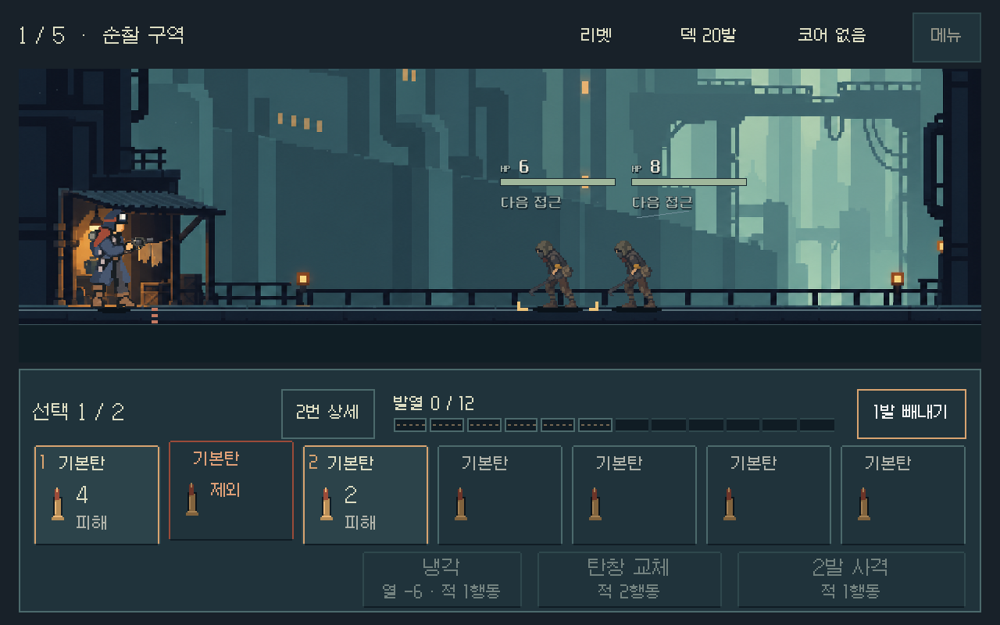
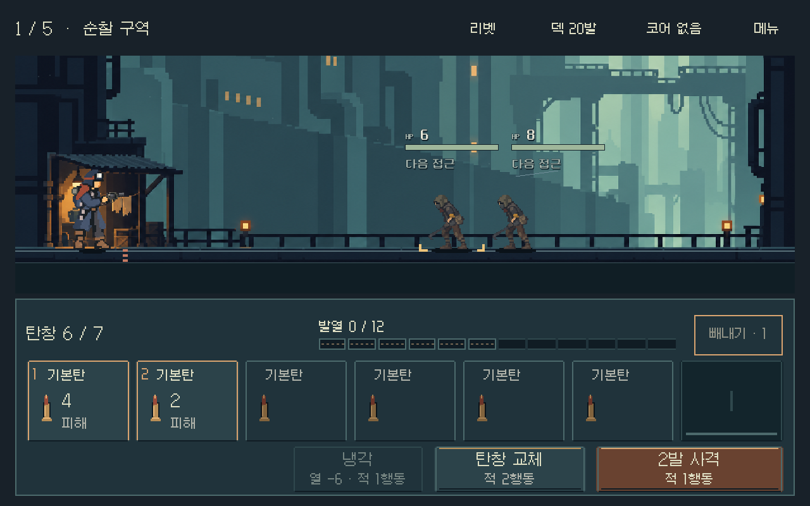

# 탄환 선택 후 바로 빼내기

2026-11-01 · 사용자 제안과 실행 승인에 따라 현재 픽셀 HUD의 조작을 바꿨다. 적용 대상은 탄창 여정과 독립 전투 비교다.

## 바뀐 조작

1. 탄환을 누르면 선택한다. 남은 빼내기 한도까지 두 발을 함께 고를 수 있다.
2. 탄창 위 같은 위치의 `1발 빼내기` 또는 `2발 빼내기`를 누르면 즉시 제거한다.

같은 탄을 다시 누르면 해당 선택을 해제하고, 빈 곳·빈 소켓·Escape는 전체 선택을 취소한다. 제거 후 선택을 비우고 실행 버튼을 비활성화해 앞으로 밀린 탄이 연속 제거되지 않게 했다.

선택 시에만 탄창 수 옆에 `N번 상세`가 나타난다. 여러 탄을 고르면 마지막에 선택한 탄의 정보를 읽는다. 상세창을 닫아도 선택은 남는다. 한도를 다 쓴 뒤에도 상세를 확인할 수 있으며 이때는 사격을 막지 않는다. 도움말에도 새 조작을 반영했다.

선택하는 동안 남을 탄의 발사 순서·피해·발열을 기존 계산으로 예측한다. 사격·냉각·교체는 그동안 비활성이다. 사격 버튼을 다른 실행 버튼으로 바꾸지 않는다. 마지막 가용 탄의 제거가 완전 소진 패배로 이어지면 위쪽 실행 버튼에 `빼내면 패배`를 표시한다.

## 실제 실행 화면

한 발 선택. 오른쪽 빼내기 버튼을 누르면 바로 제거한다.

제거 후. 빈 소켓과 남은 한도가 보이며 선택은 비워진다.

- [넓은 화면의 두 발 선택](direct_ejection_2026-11-01_assets/two_selected_comparison_1280x576.png)
- [한도 소진 뒤에도 볼 수 있는 상세](direct_ejection_2026-11-01_assets/quota_details_journey_1008x630.png)
- [완전 소진 경고 경계 사례](direct_ejection_2026-11-01_assets/exhaustion_boundary.png)

## 검증

Godot 4.7 Compatibility 렌더러, PC에서 실제 화면과 터치·마우스·키보드 입력을 사용했다. 저장은 `qa_runtime/combat_hud_20261031/direct_ejection_20261101/` 아래 APPDATA/LOCALAPPDATA에 격리했다.

| 검사 | 결과 | 확인 범위 |
|---|---:|---|
| 새 조작 집중 검사 | 2,431 / 실패 0 | 두 화면 × 세 비율, 선택/취소/직접 실행, 두 발 역순 선택과 한도, 상세·모달, 저장 바이트/난수 보존, 재개, 소진 경고 |
| 공통 HUD 회귀 | 13,536 / 실패 0 | 총기 5종 × 네 비율, 실제 발사·예측·입력 잠금·메뉴·이어하기·텍스트와 터치 영역 |
| 연속 여정 | 4,836 / 실패 0 | 세 비율에서 다섯 전투와 보상·정비·관문·저장 재개 |

새 집중 검사는 1280×800, 1008×630, 1280×576을 사용했다. HUD 회귀에는 1280×720도 포함한다. 소진 경고는 보유 탄을 사용함으로 옮겨 마지막 공격탄만 남긴 통제 경계 사례이며 자연 플레이 경로라고 주장하지 않는다.

초기 집중 검사에서 숫자형이 다른 JSON/원본 적 배열과 과거 이력을 생략한 예측/전체 이력을 직접 비교해 9건이 실패했다. 양쪽 적 상태를 같은 직렬화로, 예측은 같은 최근 이력 범위로 비교하도록 검사를 수정했다. 전투 계산은 변경하지 않았으며 최종 집중 검사는 실패 0이다.

실제 캡처에서 한 발/두 발 선택, 제거 후 빈칸, 작은 화면, 소진 경고의 글자·배치·예측 표시를 직접 확인했다. 사용자 이해도·손맛·Android 실기기 판독성과 지속 성능은 별도 확인이다. PC 검사 통과를 사람 체감 검증으로 대신하지 않는다.

## 구현과 실행

- 공통 TSCN에 문맥 상세 버튼을 두고 기존 전체 카드 영역을 선택에 사용했다. 공통 presenter와 두 HUD 연결 스크립트에서 입력을 연결했다.
- 기존 `eject_magazine_rounds`와 저장·예측을 재사용했다. 전투 규칙, 2발 한도, 소모 방식, 시간 비용, 모델·난수·저장 형식은 바꾸지 않았다.
- [전투 여정 실행](../../../OPEN_COMBAT_UI_STUDY.cmd), [총기 비교 실행](../../../OPEN_MAGAZINE_COMPARISON.cmd).
- 재검사: `powershell -NoProfile -ExecutionPolicy Bypass -File tools/run_direct_ejection.ps1 -Mode direct` (`ui`, `flow`도 지원).
- [집중 결과](direct_ejection_2026-11-01_assets/direct.json), [HUD 결과](direct_ejection_2026-11-01_assets/ui.json), [연속 여정 결과](direct_ejection_2026-11-01_assets/flow.json).

기존 모바일 배포 APK는 이 변경을 포함하지 않는다. 이번 작업에서 APK 생성·커밋·푸시·외부 게시를 하지 않았다.
