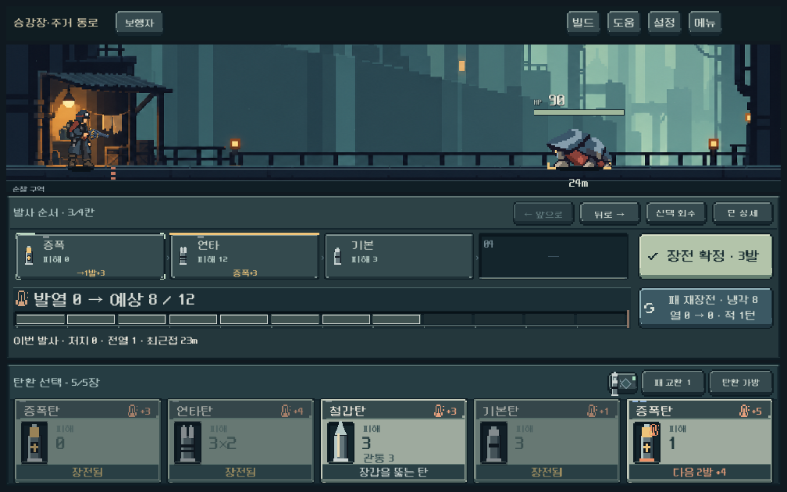

# 초반 탄환 — 단독 화력과 한 발 증폭

사용자는 일반 증폭/철갑의 초반 성능과 아무 탄이나 넣어도 효율적인 체감을 지적했고 조정을 승인했다. 아래 수치는 디렉터의 첫 플레이 테스트안이며 사용자 최종 밸런스 확정과 구별한다.

## 적용

| 항목 | 이전 | 최종 적용 |
|---|---|---|
| 일반 증폭 | 기본 피해1 · 다음2발의 타격당 +2 | 기본 피해0 · 다음1발의 타격당 +3 |
| 일반 철갑 | 기본 피해3 · 관통3 | 기본 피해2 · 관통3 |
| 보행자 | 공격탄 타격당 +2 · 기본탄 +1 | 공격탄 타격당 +1 · 기본탄 +1 |

열 비용/무기별 한계/적 HP·거리/복장4장/탄창/덱은 유지했다. 고출력·영구·임시 고급 증폭은 +4/2발 유지. 시퀀서는 효과 강도+1이며 발수를 늘리지 않는다. 증강은 일반 증폭 강도+6/1발이다. 일반 증폭을 쓰고 후속 발사를 하지 않으면 기본 피해 없이 열3을 쓰고 재장전 때 효과를 잃는다. 고급 증폭의 이월은 유지한다.

발수는 `content.gd`의 `boost_rounds`가 원본이다. 실행 결과에 발수를 기록하고 카드·탄창 예상 문구·피해 플로트·샘플 연출이 이를 읽는다. 이미 저장된 활성 증폭의 남은1/2발은 불러올 때 보존한다. 구형 결과 이벤트에 발수 필드가 없으면 당시2발로 표시한다.

## 실제 모델 비교

무파츠 보행자, 열0, 장갑0·HP100 표적, 증폭/연타/철갑/기본 각1장:

| 발사 순서 | 이전 | 최종 |
|---|---:|---:|
| 증폭→연타→철갑→기본 |23|18|
| 연타→철갑→증폭→기본 |19|15|
| 연타→철갑→기본→증폭 |17|12|

모두 열11/사격1턴. 장갑3에서는15/10/9 →10/8/6. 별도 HP10/20 두 적 검사에서 증폭→연타는 두 번째 발에 처치해 다음 기본탄을 뒤 적으로 넘기며, 증폭→기본→연타는 세 번째 발을 앞 적에 쓴다. 이 통제 사례는 실제 플레이 전체를 대표하지 않는다.

초기 후보(+2/1발·자체피해1)는 같은 무장갑 표적에서17/15/13으로 조합 이득도 축소되어 제외했다. 최종안은 자체 화력을 없애고 효과를 한 발에 집중했다.

실제 지역1 맵의 첫3개 서로 다른 깊이 전투를 독립 진입, 총기5종×시드6개. 실제 시작 덱·정찰복4장 사용, 성장/교환/압축/파츠 없음. 무작위는 합법 패를 무작위 순서로 용량까지 삽입한다. 선택 정책은 가능한 부분/전체 탄창의 현재 결과를 실제 모델로 비교하며 다음 패를 평가하지 않는다. 산개는 미래 무작위 표적을 보고 선택하지 않도록 무작위 정책만 검사한다. 162회씩 비교. 모든 경우 승리했으므로 사람 승률/완주율/난도 완성의 근거가 아니다.

| 무기 | 무작위 평균 턴 이전→최종 | 선택 정책 평균 턴 이전→최종 |
|---|---|---|
| 보행자 |2.83→3.78|1.78→3.11|
| 쇄도 |3.89→4.39|3.17→3.83|
| 산개 |5.00→5.67|미측정|
| 압쇄 |3.39→3.39|3.00→3.11|
| 증강 |5.06→5.67|3.06→3.61|

단독 화력과 순서 낭비의 손실을 조정했지만, 보행자의 정책 간 턴 차이는 이전보다 작다. **순서 중요성이 모든 편성에서 개선됐다는 증거는 아니다.** 후속 플레이에서 앞 적 처치/뒤 적 타격 전환과 재장전 횟수의 체감을 확인한다. 쉬운 초반을 억지로 패배하게 만들려고 적 수치까지 동시에 올리지는 않았다.

원자료: [이전](early_ammo_2026-10-14/before.json), [첫 후보](early_ammo_2026-10-14/after.json), [최종](early_ammo_2026-10-14/focused.json).

## 검증

- `tools/run_early_ammo_checks.ps1 -Mode rules`: 214검사 실패0. 5총기·연타·시퀀서·일반 효과 소멸·고급/임시 압축 이월·저장 보존·실제 예측 정합성·처치선.
- `tools/run_heat_checks.ps1`: 783검사 실패0. 기존 마지막 처치 검사의 적HP5는 새 철갑 단발 피해3에 맞춰3으로 변경했다. 검증 목적은 최종 처치 때 강제 재장전을 생략하는 규칙이다.
- `tools/run_early_ammo_checks.ps1 -Mode ui`: 181검사 실패0. 1008×630/1280×900/1440×630 실제 카드·LIFO 조작·발사와 수치, 격리 저장. 작은 화면의 일반1발/고급2발 표시를 직접 확인했다.
- `tools/run_early_ammo_checks.ps1 -Mode audit -AuditTag current`: 현재 수치의 비교 재실행 경로. 이전/첫 후보 원자료는 수정 전에 확보했다.
- 기존 `weapon_rules_runner.gd`는 기본탄을 손패에서 제외하고 무한 공급을 기대하는 구형 fixture와 구형 보급 덱 비교 때문에 실패·중단했다. [실패 기록](early_ammo_2026-10-14/legacy_weapon_incompatible.log). 해당 검사 전체 통과로 보고하지 않는다. 현행 무기 동작은 위 카드 순환 기반 검사로 검증했다.
- Galaxy 실기, 중후반 런/성장 파츠 전 조합과 사람 체감은 미검증. APK·커밋·푸시 없음.

[고급 비교 화면](early_ammo_2026-10-14/advanced_1008.png) · [규칙 로그](early_ammo_2026-10-14/rules.log) · [발열 로그](early_ammo_2026-10-14/heat.log) · [UI 로그](early_ammo_2026-10-14/ui.log)
