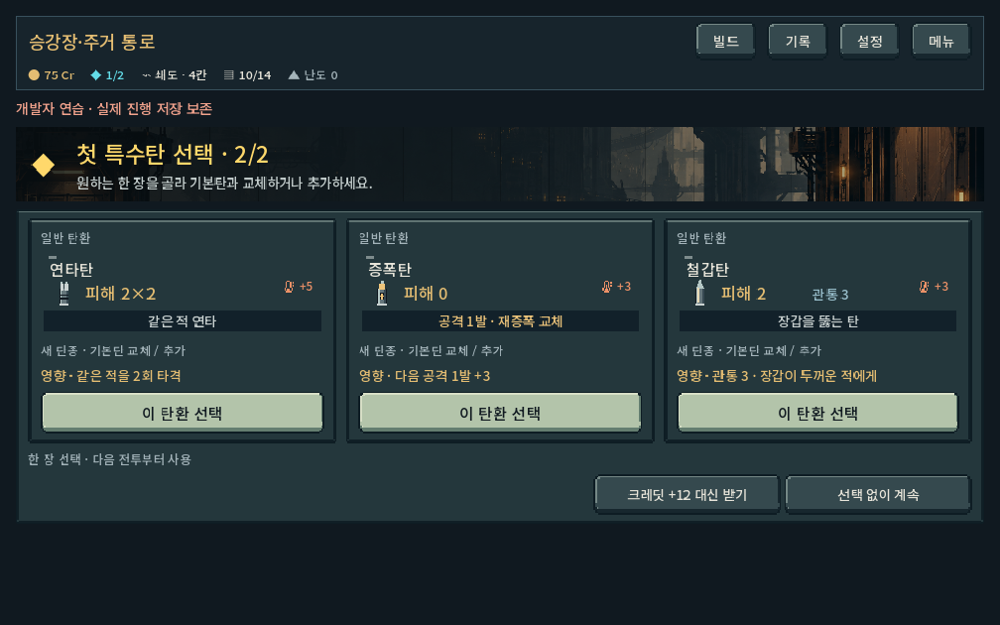
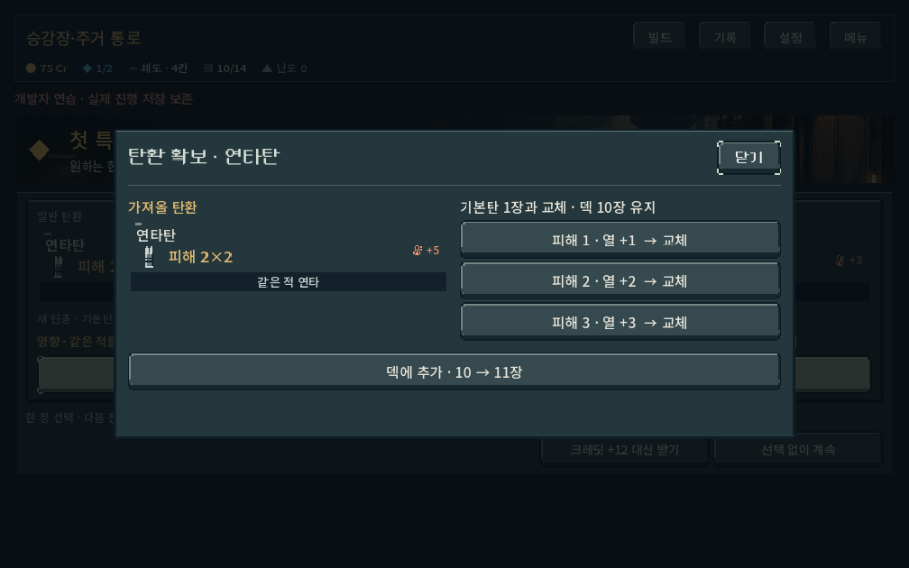
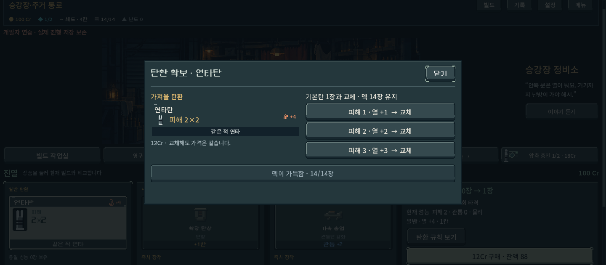

# 기본탄 출발과 특수탄 직접 확보

2026-10-17 · 활성 작업 트리 `prototype/core-redesign`. 사용자 승인에 따라 본편 새 등반의 시작 구성·첫 보상·탄환 확보 흐름과 초반 편성을 변경했다. 세부 수치/후보/교체 범위는 디렉터 적용안이며 사람의 재미 검증과 구별한다.

## 플레이 확인

`PLAY.cmd` → **새 등반** → 시작 탄환 확인 → 첫 전투 → 코어 선택 → 첫 특수탄 선택 → 기본탄 교체 또는 추가.

- 시작10장은 기초 위력1×2/2×6/3×2의 기본탄. 특수탄은 지급하지 않는다. 복장 가방 크기와 무기별 보정은 유지한다.
- 첫 승리의 코어/특수탄을 순차 선택한다. 첫 특수탄3후보는 코어 연결, 무기 역할, 다른 가능성을 포함한다. 압쇄의 소이/전격 선택지 보장. 코어를 거절해도 탄환 단계로 진행한다.
- 보상/상점/보급/기록 이벤트에서 일반 기본탄 한 장과 교체하거나 덱에 추가한다. 위력·화력/방열 개조를 구분하고 동일한 사본 중 한 장만 바꾼다. 압축 기본탄과 특수탄은 무료 교체 대상이 아니다.14장에서도 교체 가능, 구매 가격 동일. 취소는 무료이며 보상도 유지된다.
- 해금 보급은 새 시작 특수탄 지급 대신 첫 특수탄 후보 선호로 사용한다. 기존 해금 ID와 보유 기록은 유지한다.
- 발견3/편성4의 새 등반에 적용. 저장된 기존0~2의 보유물·진열·첫 보상은 유지한다. 훈련·개발 전투 샘플의 독립 구성은 유지한다. 첫 지역 깊이1~5 편성만 완화하고 이후 편성/성장 계산은 그대로다.

## 기능과 진행 검증

| 검사 | 결과 |
| --- | --- |
| 새 시작/후보/단계 저장/교체 원자성/기존 첫 보상 | 3,975검사, 실패0 |
| 첫 전투 5무기×3복장×4시드 | 4,332검사, 실패0.60경로/632명령 |
| 첫 구역 5무기×3성장 코어 | 6,771검사, 실패0.15경로/1,096명령 모두 관문 |
| 새 획득 UI,3해상도/터치 | 322검사, 실패0 |
| 기존 위력/개조/압축/예측 규칙 | 3,770검사, 실패0 |
| 기존 위력/개조/압축 UI | 398검사, 실패0 |
| 다수 처치/성장 규칙 | 942검사, 실패0 |
| 기존 발견0/1·고정 자료·저장 회귀 | 2,729검사, 실패0 |

- 합계23,239검사. 격리 `qa_runtime`만 사용했다. 캠페인 명령마다 실제 저장/복원과 상태 일치를 확인했다. 최초 코어 선택 중/특수탄 선택 중/완료 상태를 각각 확인했으며 저장 재개로 후보가 바뀌거나 코어를 중복 획득하지 않는다.
- 새 시작은5무기×7복장×4해금 보급 조합을 확인했다. 실제 첫 전투60회는 seed17/1001/731042/8888,정찰복4/작업복5/운반복6,난도0. 전체7복장의 플레이 균형을 입증한 것은 아니다.
- 첫 구역은seed731042,운반복6,난도0,상점 우선 경로. 첫 특수탄 및 초반 보상을 기본탄과 교체하고 상점에서 탄환/파츠를 구매하는 공개 명령을 사용했다. 추가로 넓힌 탐색 없이15경로를 통과했다. 탐색은 실제 Model을 사용하며 사람의 이해·선택 시간을 측정하지 않는다.
- 기존 탄환 위력/배율/열/압축 수치는 변경하지 않았다. 초기에는 특정 특수탄을 전제로 한 장갑을 줄였고, 이후 기존 관문과 무리 편성에서 획득/성장 선택을 검증했다.

재현: `tools/run_earned_ammo_checks.ps1 -Mode rules|opening|campaign|ui`. 기존 회귀는 `run_ammo_identity_checks.ps1 -Mode rules|ui`, `run_build_payoff_checks.ps1 -Mode rules`, `run_ammo_build_balance_checks.ps1 -Mode rules`.

[원시 경로·명령](earned_ammo_2026-10-17/campaign.json) · [첫 전투 표본](earned_ammo_2026-10-17/opening.json) · [검사/파일 해시](earned_ammo_2026-10-17/summary.json)

## 화면 검수

1008×630,1280×900,1440×630에서 실제 렌더 캡처와 터치 입력을 확인했다. 코어 선택,첫 특수탄 선택,취소,교체/추가,14장 상태의 구매,보급,수치가 같은 화력/방열 개조 기본탄 구분을 확인했다. 화면에 모든 후보와 행동 버튼이 보이고 가로 넘침이 없다.

- 개발 중 기본탄 등급이 일반0이 아닌 기본−1이라는 조건을 놓쳐 교체 목록이 비는 결함을 수정했다. 일반/압축 판정을 분리한 뒤 교체·가격·덱 보존을 재검증했다.
- 보급 UI 검사에서 획득 탄이 기본탄 위력1일 때 같은 카드를 교체하려던 테스트 전제를 수정했다. 동일 성능으로의 무의미한 교체는 제품에서 거부하고 다른 기본탄 또는 추가를 선택한다.
- 교체 창의 과한 빈 공간을 줄였으며, 가득 찬 덱에는 ‘14/14장’으로 추가 불가를 표시한다. 같은 피해/열이라도 화력/방열 개조를 문구로 구별한다.

## 남은 검증과 배포

기본탄을 끝까지 남기는 가치,첫 특수탄 한 장의 등장·사용 체감,반복 출발의 지루함,상위 지역·높은 난도·장기 경제,해금 보급의 만족도,Galaxy 터치/성능은 미검증이다. 자동 완주가 재미와 전체 균형을 보장하지 않는다.

이번 변경은 로컬 Godot 프로젝트에 적용했다. APK를 새로 생성하거나 Drive 파일을 교체하지 않았다. 앞서 배포한 `0.5.20261017.151423`은 발견2의 이전 시작 덱이다. 다음 APK 요청 때 현재 개편을 포함해 생성한다. 커밋·푸시 없음.
