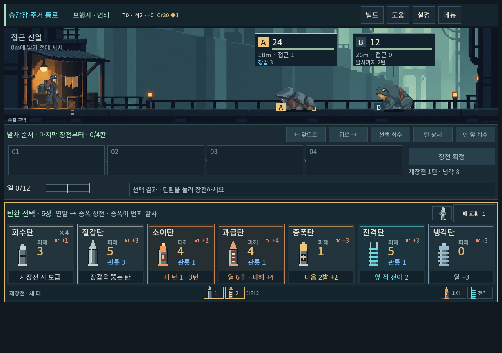
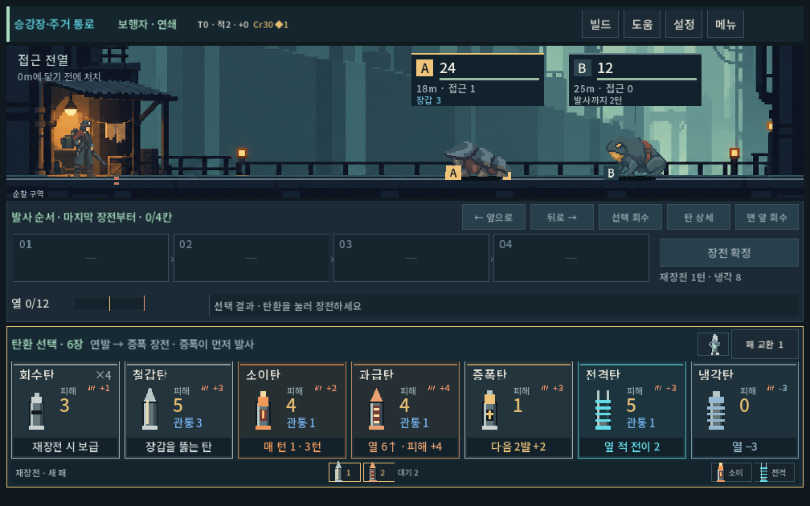
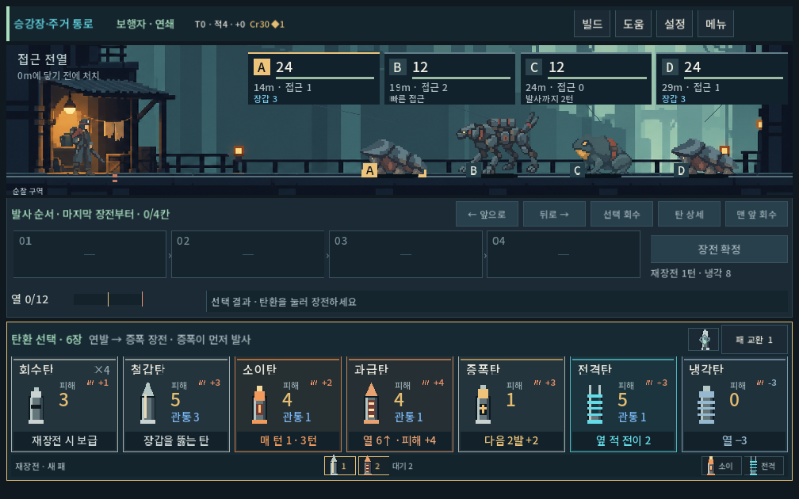

# 첫 구역 대표 몬스터 시안 — 처마등

2026-10-09 · 디렉터 컨셉/화풍 검토용. 개별 디자인은 사용자 확인 전이다.

## 컨셉

처마처럼 겹친 광물 등판 아래에 부드러운 몸을 숨긴 낮고 넓은 생물. 주거 통로의 배수·여과 시설 주변에서 살았고, 벗은 등판을 주민이 작은 지붕 수리에 사용했다는 설정 후보다. 기존 장갑 역할의 생물 대체안이며 새 종수 추가 확정이 아니다. 작은 패들 모양 다리와 큰 앞 등판이 형태를 만든다. 세 등판을 장갑3의 수치 표기로 해석하지 않는다.

이번에는 새 화풍 제작 기준을 실제 한 종에 적용했다. 승인 주인공 v2와 전투 배경을 직접 참조 입력으로 사용했다. 큰 도트 덩어리와 제한된 내부 묘사는 첫 생성에서 얻었으나 투명 가장자리를 한 차례 추가 편집했다. 따라서 ‘생성 한 번에 완성’ 사례가 아니며 여러 자산에서의 일관성은 후속 확인이다.

## 플레이

`PLAY.cmd → 개발 → 몬스터 시안 · 처마등`. 개발 메뉴를 아래로 스크롤하면 찾을 수 있다. 개인 저장을 쓰지 않는 연습 전투다.

처마등(HP24/장갑3/접근1)과 기존 압력두꺼비를 배치했다. 이 수치는 그림과 반응 확인용이며 첫 구역 최종 편성이 아니다. 기존 탄환·장갑 계산으로 사격·화상·접근·피격을 확인할 수 있다. 새 준비 행동/등판 파괴/장갑 감소 규칙을 추가하지 않았으며 완성 보행 애니메이션도 아니다. 캠페인 출현 목록·기존 몬스터 자산은 유지했다.

## 실제 화면과 판단

주인공과 비교해 작은 반사광/검은 외곽선이 과하지 않고 배경의 청회색 면과 이어진다. 낮고 넓은 등판이 기존 개구리의 둥근 몸과 구별된다. 3해상도에서 지면 접촉·명찰 여백·적 클릭 영역을 확인했다. 날카로운 껍질보다 모자/처마로도 읽힐 수 있는 형태이며, 생물의 매력과 낯섦은 사용자 확인이 남는다. 이 검토를 기존 적 전체의 아트 승인으로 확대하지 않는다.

## 제작·검증

- 내장 image_gen 사용. [선택 PNG](../../../새-게임-프로젝트/assets/art/monster_concept_20261009/eavesback_v1.png), [입력·프롬프트·해시·처리](../../../새-게임-프로젝트/assets/art/monster_concept_20261009/provenance.json).
- 1536×1024 RGBA 생성 파일을 그대로 복사했다. Godot에서 유효 영역을 잘라108×58 논리 크기로 표시, 바닥 가운데 기준. 원본에는 부분 알파가 남아 있으며 고정 픽셀 격자·단색 알파 완료를 주장하지 않는다. 실제 배경에서 외부 광륜이 두드러지지 않는 것을 확인했다.
- `tools/run_eavesback_checks.ps1`: **163검사 / 0실패**, Godot4.7,1280×900·1008×630·1440×630. [로그](eavesback_concept_2026-10-09_assets/stdout.log), [stderr](eavesback_concept_2026-10-09_assets/stderr.log).
- 실제 개발 메뉴 터치 진입, 장전/발사/재장전, 모델·표시 결과 일치, 원거리 공격체, 네 적 배치, 일반 지도/전투로 전환 시 기존 아트 유지. 시안 플래그는 캠페인 인스턴스 메타데이터로 저장 데이터 밖에 두며 공유 텍스처 캐시를 바꾸지 않는다.
- 초기 검사는 팝업에 루트 뷰포트 좌표로 입력해 메뉴 진입을 누락했다. 기존 지도 검사에서 검증한 화면 좌표의 터치 입력으로 검사 도구를 고친 뒤 실제 진입을 재검증했다.
- APPDATA/LOCALAPPDATA 격리 및 저장 비활성화. 이번 검사에서 전체 등반/밸런스/모바일 기기 성능을 검증한 것은 아니다. APK·커밋·푸시 없음.
