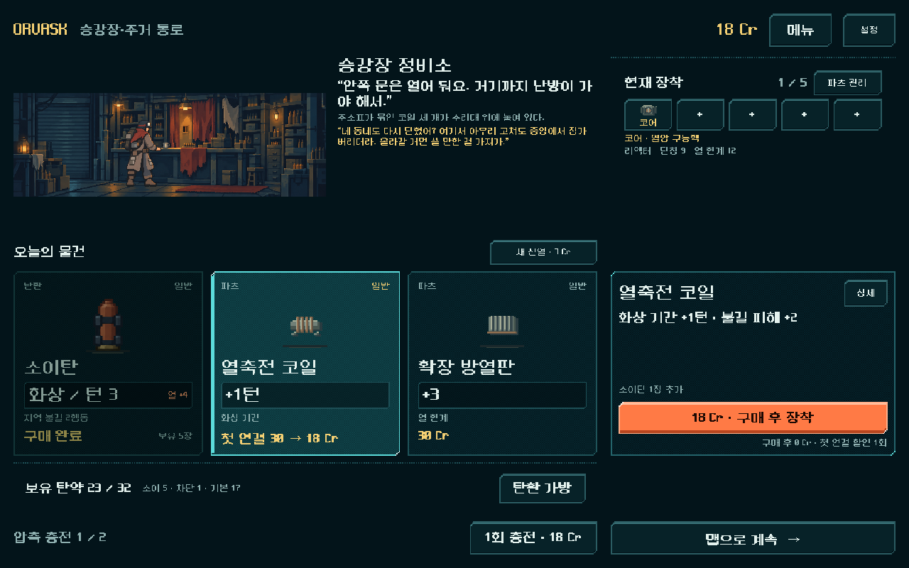
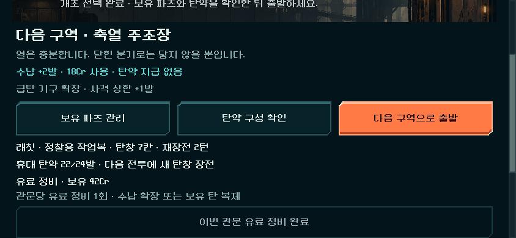
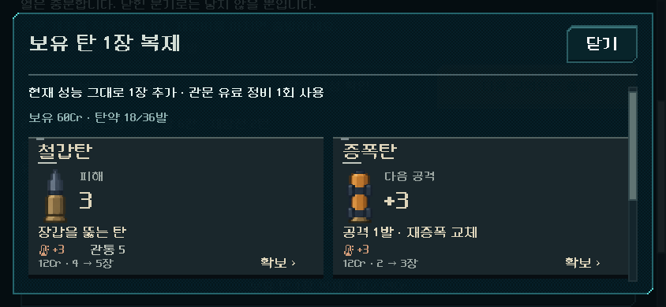

# 복장·탄약·정비 경제 검증

2026-11-03 · 사용자 순차 개편3 실행. [현행 결정](../../direction/outfit-bag.md) · [PLAY.cmd](../../../PLAY.cmd). 새 등반 `economy_version=1`에만 적용한다. 경제 표식이 없는 기존 역할v1/v2/v3 이어하기는 원래 가격/관문을 유지한다.

## 확인한 문제와 결정

200시드×5구역, 1,000개 지도에서 공방이 있는 경로는 존재했지만 공방/상점을 전혀 거치지 않는 경로도 모두 존재했다. 이는 시설 생성 누락이 아니라 경로 선택의 차이다. 현재 일반 최소4/샛길 포함 최소3전투를 바꾸거나 연결을 강제하지 않았다.

기존 운반·소이 시드17의 첫 상점은30Cr였다. 탄12Cr를 먼저 사면 연결 코일30Cr를 살 수 없었다. 원정·철갑 시드931104에서는 수납36 중20발만 보유하고, 상점 접근이 늦어 돈337Cr를 남기면서 최종전 비상 보급을2회 썼다. 단순히 복장 상한/수입을 올리기보다 구매와 정비 기회를 조정했다.

- 현재 주력/지원 탄과 맞는 첫 추천 **모듈**을 등반당1회18Cr에 구매. 보통30Cr 파츠/코어·탄 가격은 그대로. 구매가 성공해야 사용 처리하고 미사용 혜택은 뒤 구역에서도 유지한다. 재진열 비용/미등장 우선은 그대로다.
- 관문 무료 개조 결정 후 **유료 정비1회**: 수납+2발18Cr 또는 보유 특수탄1장복제12/24Cr 중 선택. 무료 파츠 교체/무료 관문 개조와 별도다.
- 수납은 공방 무료 확장과 총3회/구역 한도 공유. 탄약 지급/최소 덱/탄창 변화 없음. 복제는 보유한 일반/고급/개조 성능을 그대로 한 장 추가하며 없는 탄·기본 보급탄·임시탄·상한 초과는 불가.
- 건너뛰기와 돈 보관을 허용한다. 성장 코어·전투 계산·적 수치·기본 수입·복장 수치·지도는 그대로다. `model.gd`, `content.gd`, `combat_roles.gd`, `route_map.gd`는 작업 전과 바이트 동일하다.

## 실제 획득과 장기 자원

공통: 지도v4·기존 공개 보상 정책·실제 소유/구매/정비만 사용. 모든 입력의 저장/복원을 검사했다. 검색기는 미래 패/난수를 보므로 인간 승률/체감이나 최적 경로의 근거가 아니다. 안전 경로 정책은 현재 선택지에서 상점/공방을 우선하며 지도 전체를 최적화하지 않는다.

| 복장·총기·시드 | 전투 | 총 행동 | 비상 보급 | 실제 최소 잔탄 | 최종 수납 투자 | 결과 |
|---|---:|---:|---:|---:|---|---|
| 운반·리액터·17 |30|445|0|3|0회, 상한32|최종 관문 완료|
| 정찰·버스트·731042 |28|313|0|9|관문3회54Cr, 22→28|최종 관문 완료|
| 원정·단발·931104, 복제 보류 비교 |29|281|2|3|0회, 상한36|최종 관문 완료|
| 같은 원정·단발·시드, 관문 복제 사용 |29|267|0|2|확장0, 고급 탄4장96Cr|최종 관문 완료|

새로4등반116전투(검사8,383/실패0)를 계산했다. 최종 대표3구성은87전투이며 보류 비교29전투를 별도 구분한다. 원정의 복제 전후 경로와 최종 장착 파츠는 같고 덱20→24, 종료 돈337→252Cr다. 각 관문에서 이미 가진 `pierce_p2_power_c`를24Cr에 복제했다. 보상 선택/처치 비용에 따라 후속 수입도 달라지므로 종료 돈 차이를 구매비96과 혼동하지 않는다. 최종 관문 보너스 등 종료 재화는 남으며 무조건 돈을 전부 쓰게 만드는 것이 목표는 아니다.

운반의 기존 동일 시드·동일 경로90전투 자료 중30전투와 비교하면, 첫 연결 코일을 구매하게 되며468→445행동/비상0→0이었다. 이후 소유 파츠에 따른 추천/획득도 달라지므로 이 차이를 코일 한 개의 순수 피해 증가로 환산하지 않는다. 정찰은 수납 한계에 가까울 때만 확장했고, 운반/원정은 공간을 사지 않았다. 복장 최소/최대35개 시작 조합 검사는 별도로 통과했다.

신규 리포트의 상위 검사기가 비상 보급 탄을 빼고 `deck-discard`로 산출한 음수 잔탄은 물리적 탄약 부족 수치가 아니다. 표는 실제 `Reserve.remaining`을 기록한 `metrics.remaining`을 사용한다. 후속 생성기는 옛 값을 `raw_remaining`으로 분리했다. 원정 비교의2회 비상 보급은 숨기지 않았다.

## 기능·저장·표시

| 검사 | 결과 | 증거 |
|---|---:|---|
| 새 경제 규칙 |229 / 실패0|기존 진열 비교, 할인 가격/재구매/회수, 잘못된 저장 거부, 7복장×5총기 시작 범위, 비용·한도·무료 개조 보존, 복제/확장 공통 사용 제한|
| 실제 UI |72 / 실패0|844×390·1280×800 할인 표시/구매/자동 저장, 관문 개조→확장/복제→저장→출발, 비용·중복 차단·스크롤|
| 최종 대표87전투 재생 |7,474 / 실패0|운반2,638·정찰2,446·원정복제2,390. 매 명령 행동 수·잔액과 최종 탄/파츠/개조/유료 투자/단일 결산 일치|
| 이전 경제 없는 v3 등반30전투 |2,709 / 실패0|30Cr/기존 관문 그대로, 같은 행동/잔액/최종 장비. 기본 시작 후 경제 필드를 제거해 역사 버전을 명시|
| 기존 역할 |3,048 / 실패0|소이·제어·전이/위치 화력·v1/v2 전투/획득 계약|
| 기존 `run_prototype_hud.ps1 -Mode ui -Fast` |11,536 / 실패0|기존 HUD 회귀|
| Godot 임포트·변경 파일 공백 검사 |통과|로컬 Android build-tools 경고만 있으며 APK 생성하지 않음|

규칙 검사 중 다른 복장의25장/손패6 상태를 정찰로 바꿔 검사한 초기 fixture와 저장 정규화 누락, 이미 본 진열을 처음 진열과 직접 비교한 harness를 수정했다. 복장 경계 fixture는 제한 안의 통제 상태이며 실제 런 중 복장 교체를 구현하거나 검증한 것이 아니다. 실제 등반3복장의 출발/획득은 위 별도 경로다. 초기 `rules_first`의 실패 로그는 보존한다.

실제 Godot 캡처를 열어 확인했다. 관문 페이지/복제 창은 기존 스크롤을 사용하며 가격·수량·공통1회 비용을 보여 준다. 작은 화면은 모든 정비 선택이 동시에 보이지 않으므로 스크롤이 필요하다. 상점의 작은 보조 글자와 비정수 픽셀 획 문제는 기존 미해결 항목이며 이번 기능 통과를 판독성 완성으로 간주하지 않는다.

## 재현과 한계

- `tools/run_economy_roles.ps1 -Mode audit|rules|climb|replay|ui -Label <분리이름>`. 모든 저장은 `qa_runtime/economy_roles_20261103/`의 독립 APPDATA/LOCALAPPDATA다. `QA_GUN`, `QA_OUTFIT`, `QA_SEED`; `QA_COPY=1`은 관문에서 보유 주력 탄 복제도 사용하는 비교 정책이다. `QA_ECONOMY=0`은 경제 표식을 제거한 비교다.
- 재생은 `QA_REPLAY_FOLDER=climb_carrier_heavy|climb_scout_burst|climb_expedition_copy|legacy`. 원래 기록된 유료 입력을 사용하며 자동 복제 정책은 끈다.
- [지도/시작 조합](../../../qa_runtime/economy_roles_20261103/audit_baseline/result.json) · [규칙](../../../qa_runtime/economy_roles_20261103/rules_final/result.json) · [UI](../../../qa_runtime/economy_roles_20261103/ui_final/result.json) · [원정 복제 등반](../../../qa_runtime/economy_roles_20261103/climb_expedition_copy/balance.json) · [복제/돈 원장](../../../qa_runtime/economy_roles_20261103/climb_expedition_copy/economy.json).
- [운반 재생](../../../qa_runtime/economy_roles_20261103/replay_climb_carrier_heavy/result.json) · [정찰 재생](../../../qa_runtime/economy_roles_20261103/replay_climb_scout_burst/result.json) · [원정 재생](../../../qa_runtime/economy_roles_20261103/replay_expedition_copy/result.json) · [이전 규칙 재생](../../../qa_runtime/economy_roles_20261103/replay_legacy/result.json).
- 작업 전980개 파일·기존 변경 상태를 `qa_runtime/economy_roles_20261103/before`에 보존했다. [이번 변경만 비교](economy_roles_2026-11-03/changes.diff) · [파일 해시](economy_roles_2026-11-03/manifest.json). 사용자 작업을 초기화하지 않았다.
- 모든 복장×총기×경로를 완주한 결과가 아니다. 다른4복장 장기 경제·경로/위험 선택·희귀 코어 교체·사람의 확장/복제/보류 가치·Android 조작/복귀/지속 발열·재장전 복장 혼합은 미확인이다. 신규 전투 밸런스나 사람 재미를 확정하지 않는다. APK·커밋·푸시·외부 게시 없음.
