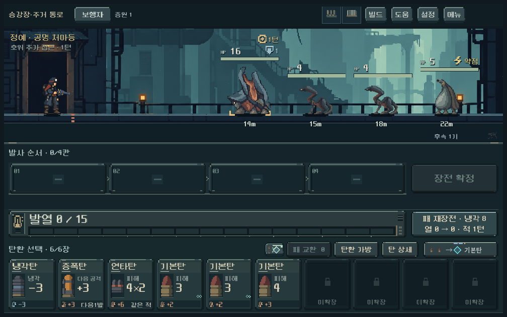
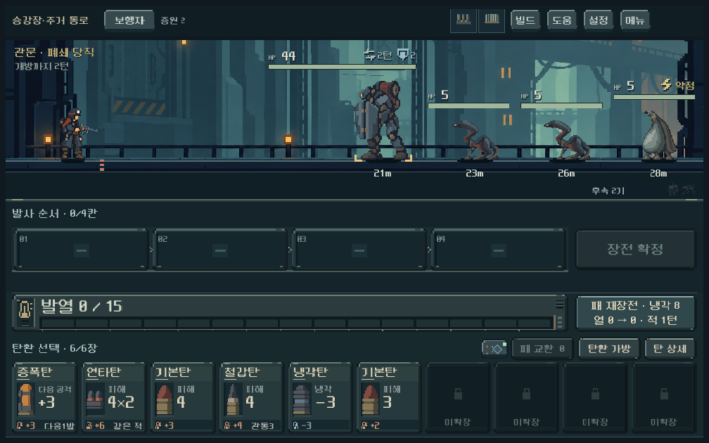
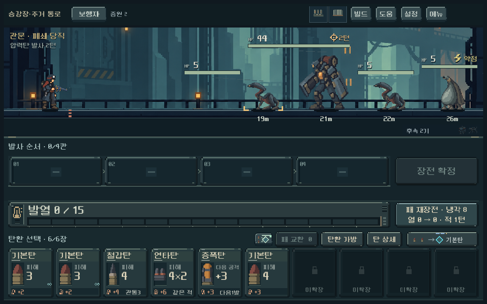
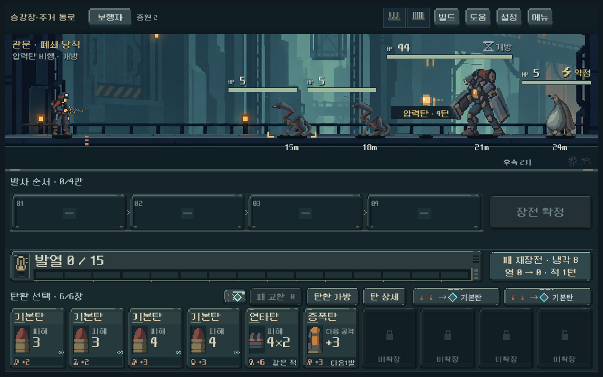
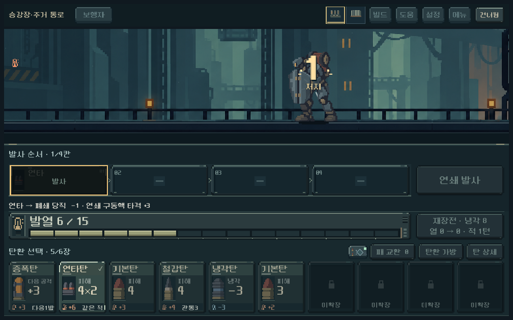

# 첫 지역 정예·고유 보스 — 2026-10-18

## 적용 결과

사용자가 제작 진행을 승인한 공명 처마등과 폐쇄 당직을 **새 등반 편성5**에 연결했다. 기존1~4 저장의 적 편성과 다른 지역/일반전은 유지한다. 전투 수치와 상태 전이는 디렉터 1차 구현값이며 사용자 미감·Galaxy·장기 난도는 확인 전이다.

- 정예: HP16/장갑1, 3적턴마다 살아 있는 호위2m 추가 접근. 전열4+후속1. 공명 동작을 이동 전에 재생한다.
- 보스: HP44/문판 장갑2, 방어2턴→개방 준비2턴→요격 가능한 압력탄→탄 소멸 후 개방 회복2턴. 전열4+후속2. 열림 장갑0, 파쇄로 줄인 문판 장갑 보존. 강제 무적/피해 상한 없음.
- 이미지 생성 도구에 승인 처마등·주인공·배경을 실제 입력했다. 각2상태 원화를 그대로 저장하고 Godot 영역/발 기준점/nearest/기존 알파 컷아웃을 적용했다. 절차형 상태 전환·이동·피격·사망 동작이며 전 프레임 수작업 애니메이션을 뜻하지 않는다.
- 보스는148px 높이와280px HP 영역, 정예는124px 상태 캔버스를 사용한다. 짧은 행동 예고·아이콘·터치 상세를 제공한다. 대형 배우가 피해 숫자를 가리는 결함을 실제 캡처에서 발견해 별도 숫자 레이어로 수정했다.
- 메인 개발 메뉴에 `정예 · 공명 처마등`, `보스 · 폐쇄 당직`을 추가했다. 이 연습은 사용자 저장을 덮어쓰지 않는다.

[현행 설계/초기 수치](../../direction/monster-roster.md#현행-구현--편성5) · [두 PNG와 전체 생성 프롬프트/참조 해시](../../art/concepts/elite-boss-20261018/provenance.json)

## 실행·기능 검증

Godot4.7, Windows OpenGL 실제 GPU 렌더. APPDATA/LOCALAPPDATA는 `qa_runtime/elite_boss/` 아래 격리, UI `save_enabled=false`. 변경 전 파일/작업 트리는 `qa_runtime/elite_boss/before/`에 보존했다.

| 검사 | 결과 | 근거 |
| --- | --- | --- |
| 새 규칙·저장 | 310 / 실패0 | [로그](assets/elite_boss_2026-10-18/challenge_rules.log) |
| 실제 UI·터치·보스 피니시 | 1,913 / 실패0 | [로그](assets/elite_boss_2026-10-18/challenge_ui.log) |
| 80조건 돌파 탐색·합법 재생 | 2,222 / 실패0 | [로그](assets/elite_boss_2026-10-18/challenge_balance.log), [경로/지표](assets/elite_boss_2026-10-18/matrix.json) |
| 실제 첫 구역6회 진행·저장 | 2,652 / 실패0 | [로그](assets/elite_boss_2026-10-18/challenge_campaign.log), [명령/상태](assets/elite_boss_2026-10-18/campaign.json) |
| 기존 발열 규칙 | 917 / 실패0 | [로그](assets/elite_boss_2026-10-18/heat.log) |
| 현행 탄환 확보 규칙 | 3,975 / 실패0 | [로그](assets/elite_boss_2026-10-18/earned_ammo.log) |
| 기존 피니시·카메라 회귀 | 504 / 실패0 | [로그](assets/elite_boss_2026-10-18/finish_zoom.log) |

최종 합계 **12,493검사 / 실패0**. 프레임마다 검사하는 UI 항목이 있어 검사 수는 실행마다 조금 달라진다. 검사 수는 완성도/재미의 점수가 아니다.

핵심 확인: 미리보기가 원본 상태/RNG를 바꾸지 않음, 실제 발사/재장전 결과와 예측 일치, 2턴 재장전의 상태 진행, 본체 사망 뒤 압력탄 유지, 일반 공격 요격, 준비 차단, 영구 장갑 감소, 큰 단타로 닫힌 보스 처치, 정예의 생존 호위만 추가 접근, 편성4 저장 보존, 실제 보스 보상 진입.

1008×630 / 1280×800 / 1440×630에서 원화·HP·거리·상태 중첩의 배치를 검사했다. 합성 터치로 적 상세를 열고 실제 재장전/발사 입력으로 상태를 진행했다. 보스도 적중 전 줌인→피해·사망→복귀 흐름을 확인했다. 별도 기존 피니시 회귀는 동시 처치·화상·화면 가장자리·건너뛰기·빠르게/즉시까지 확인한다.

재현: `powershell -NoProfile -ExecutionPolicy Bypass -File tools/run_challenge_checks.ps1 -Mode rules` (`ui`, `balance`, `campaign`도 지원).

## 밸런스 관찰과 한계

다섯 총기 × 두 시드(17/731042) × 세 코어 또는 기본탄 비교 편성 × 정예/보스 =80조건에서 돌파 경로를 찾고 실제 명령으로 재생했다. 운반 복장6장, 코어 비교는 성장2+방열 파츠1개와 각 축에 맞춘10장 덱이다. 기본탄 비교는 코어/파츠 없이 현행 시작 덱을 같은6장 복장으로 사용했다. 기본4장 복장 또는 모든 획득 경로의 승리를 보장하지 않는다.

| 비교 편성 | 정예 처치까지 적 턴 | 보스 처치까지 적 턴 |
| --- | --- | --- |
| 연쇄 성장 | 3~6 | 6~13 |
| 열압 성장 | 5~10 | 8~19 |
| 단타 성장 | 3~4 | 5~11 |
| 기본탄·코어 없음 | 7~13 | 15~25 |

이는 미래 패/RNG를 읽는 제한된 탐색의 **도달 가능성**이다. 승률, 사람의 평균 턴, 최적 전략, 코어 간 동등한 난이도의 증거로 해석하지 않는다. 기본탄만으로도 대응 여지는 있고 성장 편성은 더 짧게 돌파했지만, 저성장 보스전이 길게 느껴지는지는 사용자 체감으로 확인한다. 첫 구역 전체 진행 검사는 편성5/지도3, 쇄도·단발 증폭 총기와 세 코어, 시드731042의6회에서 시작→관문 보상까지 매 명령 저장/복원을 통과했다.

과거 `ranged_rules_runner.gd`는 이미 제거된 `reload_heat` 필드를 참조해 중단됐다. 현행 게임 결함과 구분하며 성공 합계에 포함하지 않았다. 원거리/과열 상호작용은 현행 발열917검사와 신규 규칙310검사로 확인했다. 알려진 Windows 루트 인증서 경고만 로그 필터에서 제외했다.

## 실제 화면

상태가 겹친 [장갑·화상·차단](assets/elite_boss_2026-10-18/boss_status_stack_1008.png)과 [넓은 화면](assets/elite_boss_2026-10-18/boss_open_1440.png)도 확인했다. 피니시 캡처는 연출 확인용 HP1의 격리 조건이다.

APK·커밋·푸시 없음. 실제 Galaxy 조작, 처음 보는 플레이어의 행동 이해도, 고난도/장기 균형은 미검증이다.
