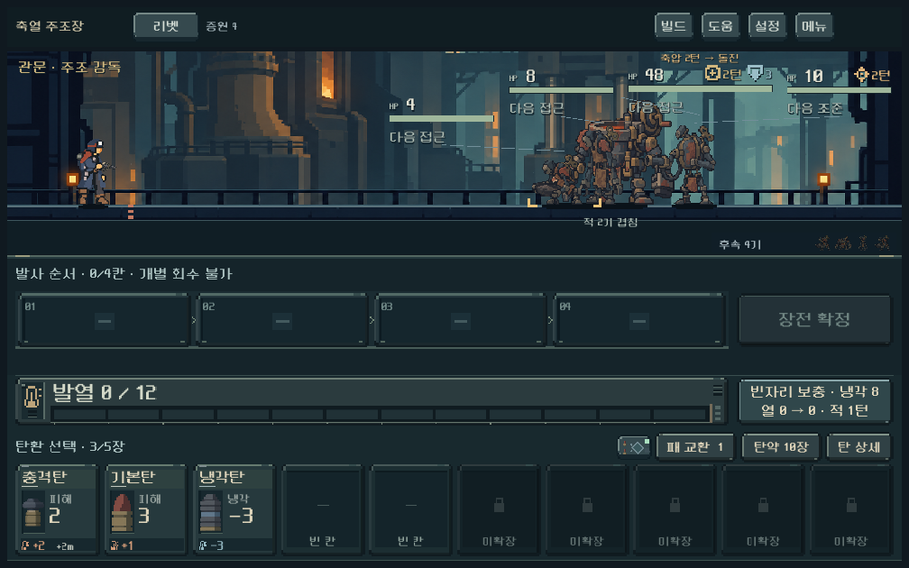
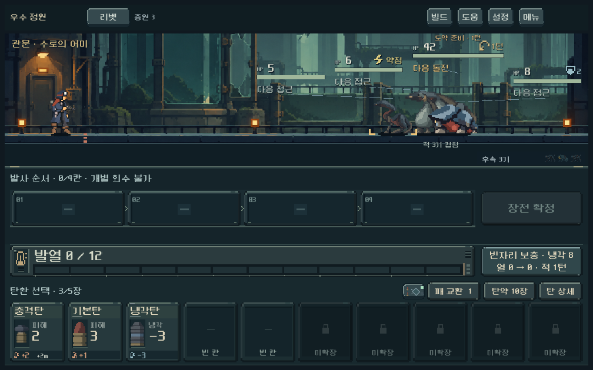
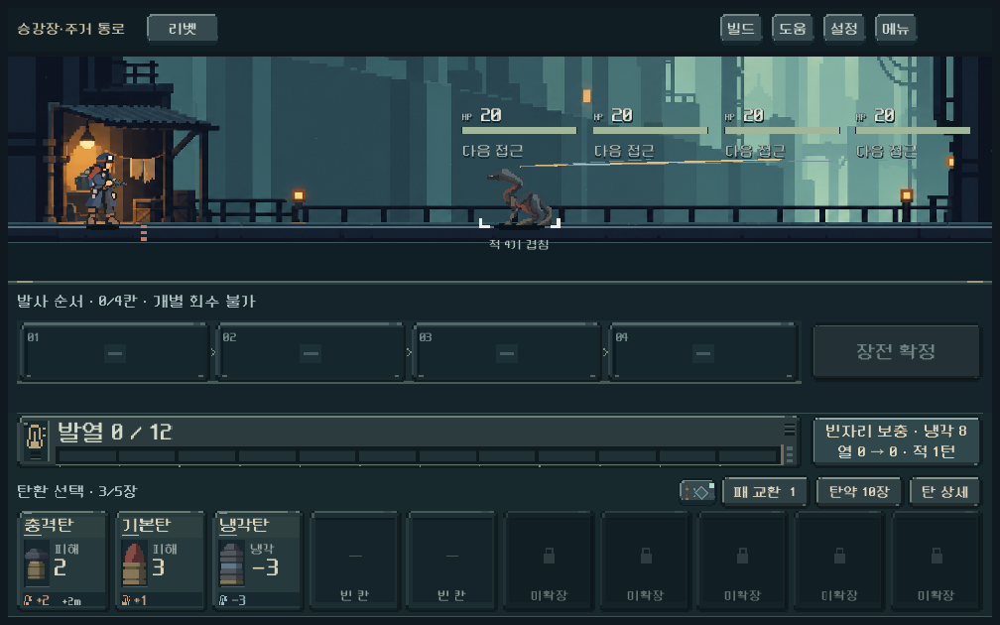

# 일렬 접지 복원과 거리 표시 교정 — 2026-10-29

사용자의 실행 승인에 따라 현재 배경을 유지하고 모든 적의 발을 주인공과 같은 바닥선에 맞췄다. 10월28일의 독립 가로 위치·분리된 HP·다음 행동 경고는 유지한다. 주 화면의 거리 숫자 제거에 동의하며, 남아 있던 보스 예고와 접근 연출의 미터 단위 이동량도 상세로 분리했다.

**상태:** 로컬 구현·기능 검사·대표 실제 화면 확인 완료. 사용자 재플레이와 모바일 실기기 지속 성능·기기 발열은 미검증. [현행 결정](../../direction/enemy-readability.md) · [이전 비용 검토](../../history/design/enemy-grounding-review-2026-10-29.md).

## 적용한 동작

- 적 발의 앞뒤 높이 차이를 없앴다. 배경 자산과 거리별 가로 기준점은 유지해 다른 적의 이동·처치·증원으로 정지한 적이 밀리지 않는다.
- 몸체가 크게 겹친 그룹에는 `적 N기 겹침`을 표시한다. 자동 표적을 앞에 그리고, HP에 포커스한 적은 그보다 앞에 표시한다. 분리된 HP와 연결선·터치 상세로 각각 확인한다. 이는 화면 표시이며 표적 선정 규칙 변경이 아니다.
- 발밑 거리 숫자는 기존 제거 상태를 유지한다. 보스의 `5m 전진`, `호위 +2m` 같은 주 화면 이동량은 `돌진`, `호위 접근`, `전진 지시`로 바꾼다. 준비 주기·차단·회복 상태와 `다음 접촉!` 등의 위험 경고는 남긴다.
- 정확한 거리·속도·특수 이동량은 기존 상세/도움말에서 확인한다. 탄환 카드의 밀기 효과처럼 선택 가치를 비교하는 수치는 유지한다. 상세용 기본 문구와 실제 전투 계산·저장·적 편성은 바꾸지 않았다.

## 검증

Godot `4.7.stable.official.5b4e0cb0f`, PC OpenGL Compatibility/NVIDIA RTX4060Ti. 각 실행은 `qa_runtime/` 아래 격리 저장을 사용했다. 서로 다른 화면 검사 실행은 순차 수행했다.

| 실행 | 검사 | 결과 |
| --- | ---: | --- |
| `run_playtest_revision_checks.ps1 -Mode threat -Tag ground_20261029` | 2,035 | 실패0, 실제 다음 행동과 위협 안내 일치 |
| `run_playtest_revision_checks.ps1 -Mode threat_ui -Tag ground_20261029` | 2,110 | 실패0, 공통 접지·가림/포커스·분리된 HP 터치·상세·경고·사격/재장전 |
| `run_distance_order_checks.ps1 -Stage after` | 1,492 | 실패0, 실제 밀치기·추월·처치·증원, 관찰140프레임 거리 역전0 |
| `run_playtest_revision_checks.ps1 -Mode payoff_ui -Tag ground_20261029` | 445 | 실패0, 파츠 발동·궤적·적중·사격 결과와 빠르게/즉시/건너뛰기 회귀 |
| 합계 | **6,082** | **실패0** |

1008/1280/1440 화면 폭, 같은 거리 네 적·근접·먼 거리, 다섯 구역 지도자/호위와 행동 직전 상태를 검사했다. 다섯 구역×세 배경 단계는1008 화면으로 캡처하고 발 기준/HP/가림 표식 영역을 검사했다. 모든 캡처를 사람 테스트로 취급하지 않는다. 대표10화면(정원/중앙 행동 직전, 동일 거리/포커스, 주조 중층·주거 하층·귀족 상층, 압력탄, 파츠 적중/사격 결과)은 실제 이미지로 확인했다. 새 네 실행의 stderr는 모두 비어 있다.

[집계·증거 해시](assets/enemy_grounding_2026-10-29/validation_summary.json) · [실행 소스 해시](assets/enemy_grounding_2026-10-29/source_hashes.json) · [이동 검사 로그](assets/enemy_grounding_2026-10-29/distance_stdout.log).

## 실제 화면

주조장 중층: 기존 통로 배경과 동일한 발 기준을 사용한다.

정원 지도자: 보스 이동량 숫자를 덜어 내고 도약 준비와 다음 돌진 경고를 유지했다.

동일 거리 네 적: 몸체가 포개져 한 개체처럼 보일 수 있으므로 네 HP와 겹친 적 수를 표시한다. 이 화면을 네 실루엣이 모두 분리돼 보인다는 증거로 사용하지 않는다.

## 남은 확인과 다음 작업

공통 바닥선과 안정적인 가로 위치를 우선했다. 동일 거리의 동일 외형은 여전히 몸체가 완전히 겹칠 수 있다. 적 수·개별 HP·포커스만으로 식별과 위험 판단이 충분히 쉬운지는 사용자 재테스트에서 확인한다. 새 표시의 모바일 비용·지속 FPS·기기 발열은 측정하지 않았으며 PC 자동 검사 통과로 해결을 선언하지 않는다.

다음 독립 작업은 [통합 우선순위](../../direction/playtest-priorities.md)의 발열·연속 사격·고장 방식 비교다. 확률 고장은 아직 채택하지 않았다. 이번 작업에서는 APK 생성·커밋·푸시·외부 게시를 수행하지 않았다.
