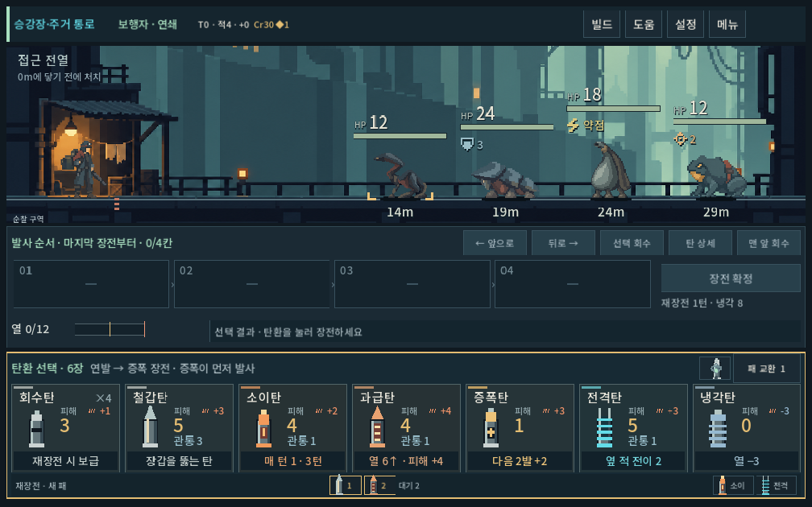
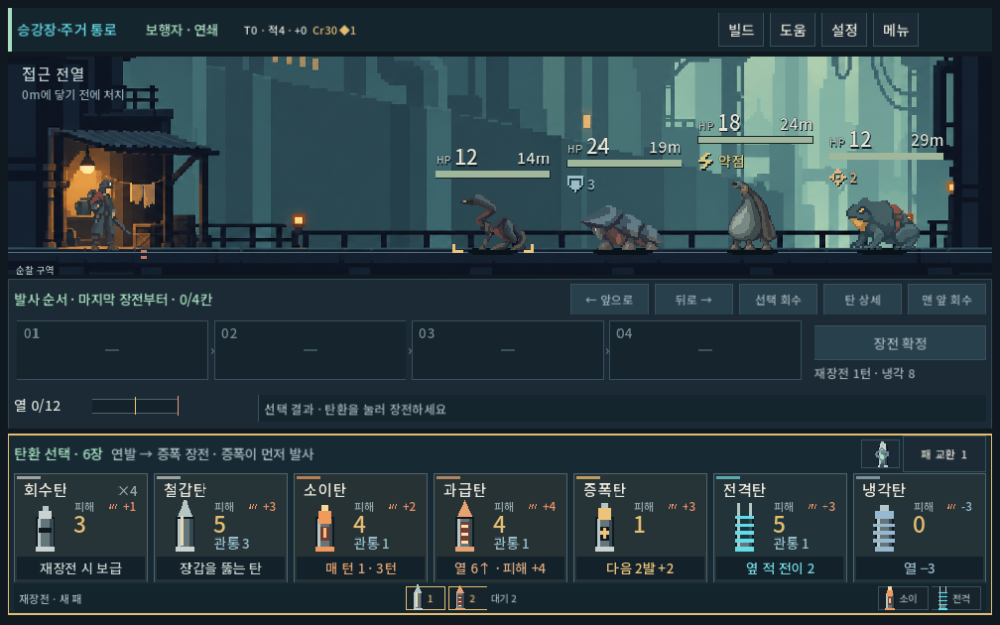
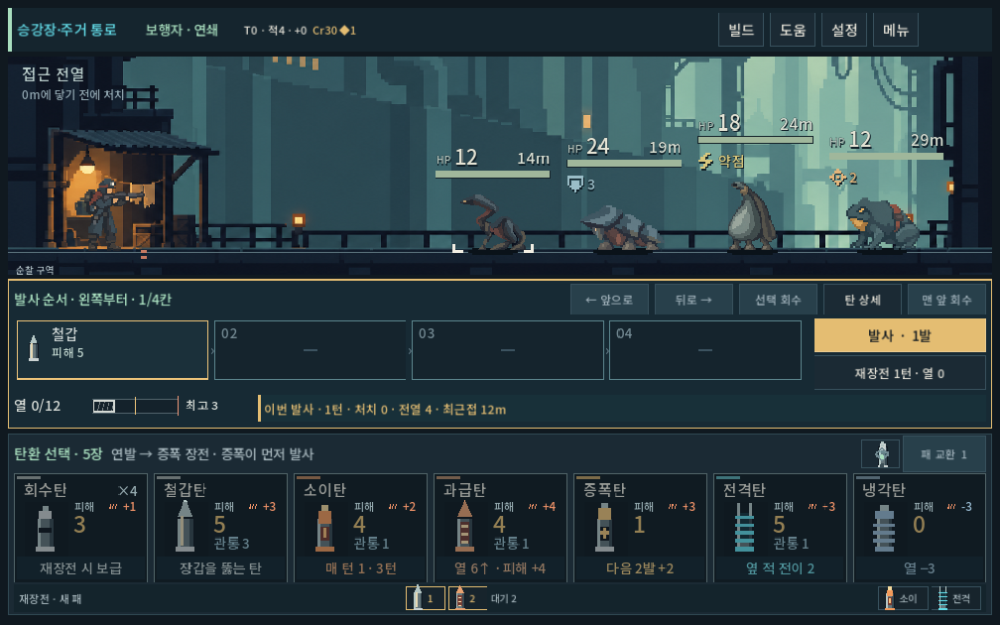
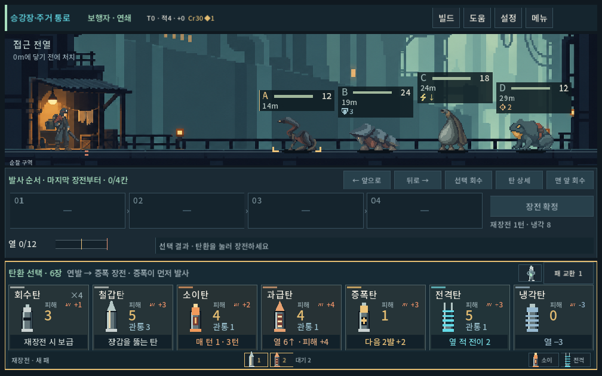
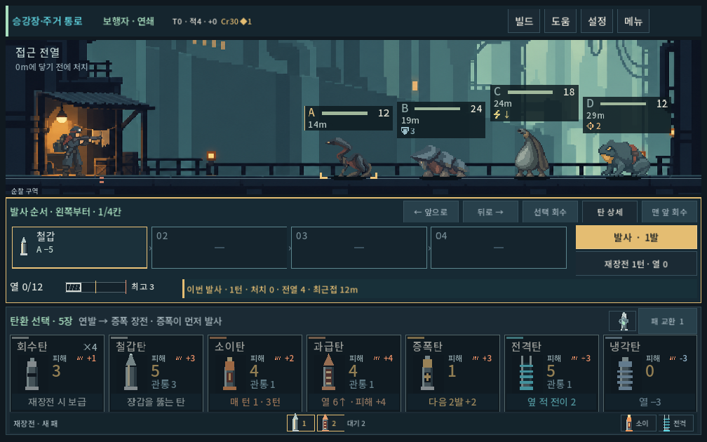
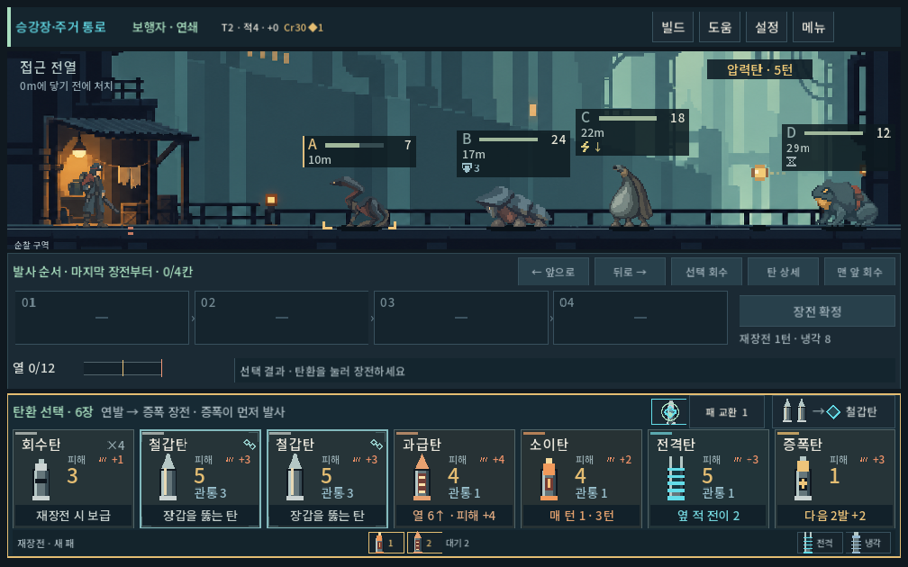
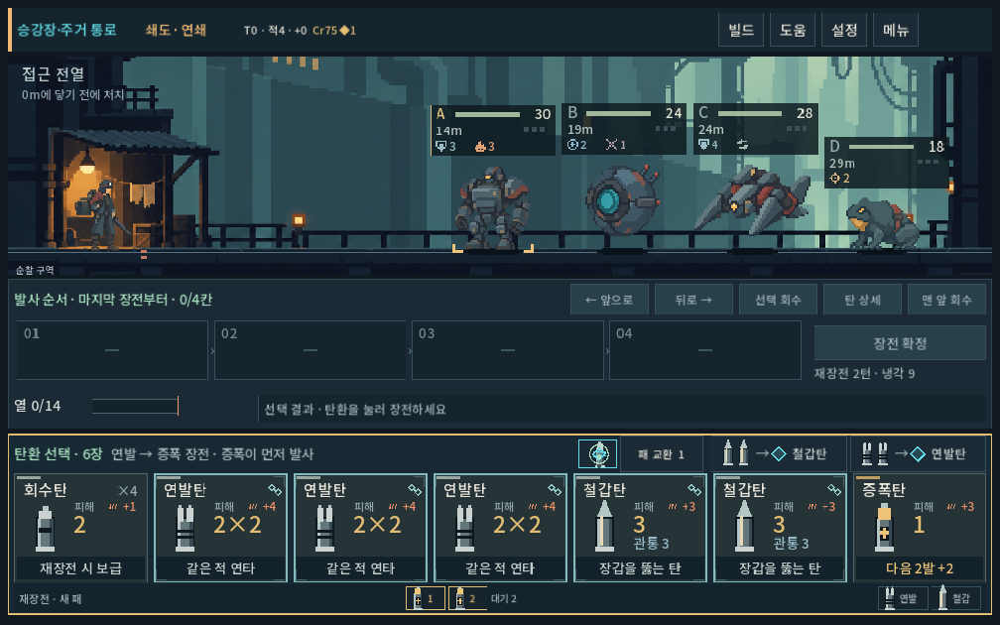
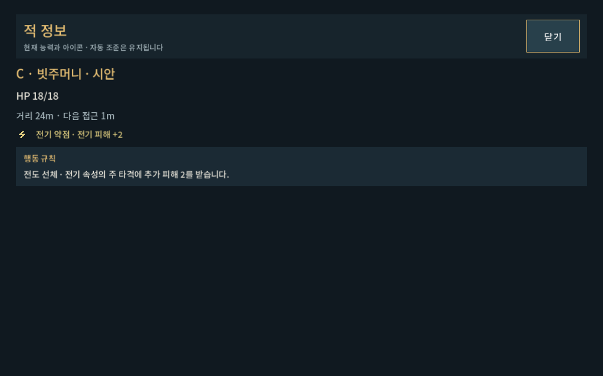

# 몬스터 머리 위 정보 정리

## 최신 수정 — 체력 바 위 우측에 약점·상태 정렬

사용자 승인 배치: 체력 바 위 왼쪽은 HP, 오른쪽 끝은 약점·장갑·상태 기호. 상태별 실제 글자 폭을 측정해 오른쪽에서 왼쪽으로 배치하고 HP 숫자와 간격을 확보한다. 전기 약점이 우선 위치를 차지하며, 추가 상태는 공간 부족 시 위로 줄바꿈한다. HP/체력 바의 머리 기준 위치와 발밑 거리는 유지했다. 새 정보 박스는 없다.

Godot 격리 저장 렌더3해상도(1280×900,1008×630,1440×630) **2180검사/0실패**, stderr 비어 있음. 기존 장전/명중/상세/거리 입력/무작위 표적 회귀와 상태 누락·HP/기호 겹침·영역 경계를 검사했다. 세 자리 HP128에 장갑·약점·화상·행동 차단을 함께 둔 스트레스 화면에서도 위로 줄바꿈되는 모습을 직접 확인했다. 일반 상태와 긴 가로 화면도 시각 확인했다. [로그](enemy_hud_2026-10-09_assets/upper_stdout.log). 사람의 이해도·Galaxy 실기기는 후속이다.

아래 상태를 체력 바 아래에 두는 설명은 이전 배치 기록이다.

## 최신 수정 — 거리 표시를 발밑으로 이동

사용자가 채택한 배치: 머리 위는 HP/체력 바/상태, 발밑은 현재 거리. 20px 거리 글자는 모든 적에 같은 지면 기준선을 사용하며 부유·호흡·피격 반동에 따라 상하 이동하지 않는다. 좌우 위치는 실제 전장의 적 위치를 따른다. 거리 영역도 같은 몬스터 상세를 여는 입력 판정에 포함했다.

글자 높이/표적 괄호의 여유를 위해 전장 바닥 기준을8px 올리고 증원 안내/클릭 영역을14px 위로 조정했다. 하단 상황 문구는 왼쪽 가용 폭만 사용해 거리와 겹치지 않는다. 배우 크기·전장 패널 높이·실제 이동 거리·표적 계산은 보존했다.

Godot 실제3해상도 최종 **1628검사/0실패**, stderr 비어 있음. 거리 영역의 화면 경계/동일 기준선/인접 간섭/발·표적 표시와 여유, 애니메이션 값 변경 전후 위치 불변, 거리의 적 판정,3m 근접 적과 후속2기 안내 동시 표시까지 확인했다. [로그](enemy_hud_2026-10-09_assets/ground_stdout.log). 사용자 체감·Galaxy 실기기는 후속.

아래 HP와 거리를 같은 줄에 두는 설명은 이전 구현이며 위 기준이 현행이다.

## 최신 수정 — 문자 식별 제거·현재값 확대

사용자 요청으로 머리 위/발사 순서/상세에서 A/B/C/D를 제거했다. HP 숫자는17→26, 거리는16→20, 상태 기호는14→21 논리 px로 키웠다. HP/거리 한 줄 아래 넓어진 체력 바(높이6→8), 그 아래 필요한 상태만 두 개씩 배치한다. 정보 영역은 기본50px, 상태 한 줄78px로 읽기 간격을 확보했다. 배경 박스는 없다. 쇄도 집중 칸은 체력 숫자와 겹치지 않게 바 아래에 둔다.

전기 약점은 큰 번개와 짧은 `약점`으로 표시해 속성/전기 충전과 구별한다. 기존 아래 화살표만 쓰던 표시보다 명시적인 디렉터 선택이다. 장갑/화상 등 다른 상태도 큰 기호와 수치를 사용한다.

탄창은 `A −5` 대신 `피해 5`를 보여 준다. 실제 탄창 터치/호버는 해당 표적(전이/확산 대상 포함)의 발밑을 강조한다. 산개는 가능한 표적을 모두 표시하며 하나의 확정 대상처럼 보여 주지 않는다. 세부 계산·사격 메시지는 몬스터 이름을 사용한다. 표적 인덱스/피해/무작위 계산은 변경하지 않았다.

최종3해상도 **800검사/0실패**, stderr 비어 있음. 기존 현재 HP 픽셀 불변/실제 피해 갱신/머리·발사체 간섭 검수에 공개 탄창 터치→표적 연결과 산개4대상 표시 검사를 추가했다. [로그](enemy_hud_2026-10-09_assets/readable_stdout.log). 사용자 직관성·Galaxy 실기기는 후속.

아래 식별 문자/작은 아이콘 관련 설명은 이전 구현 기록이며 위 수정이 우선한다.

## 최신 수정 — 박스 제거

사용자가 사각형 정보 면의 디자인을 아쉽다고 평가해 배경 면과 왼쪽 프레임을 제거했다. 문자·현재 HP 바·거리·상태 아이콘만 남기고 현재 표적/호버는 식별 문자 아래 짧은 선으로 표시한다. 보이지 않는 터치 영역은 보존하며 키보드 초점에도 큰 박스가 생기지 않게 했다. 밝은 건축 배경 위 판독성을 위해 글자에 좁은 어두운 외곽선/그림자, 아이콘에 작은 그림자, 체력 바에만 얇은 어두운 경계를 적용했다.

첫 무박스 렌더에서 밝은 배경 위 C/D·거리 대비가 약해 색과 글자 외곽선을 보강한 뒤 재검수했다. 최종3해상도782검사/0실패, stderr 비어 있음. [최종 로그](enemy_hud_2026-10-09_assets/open_stdout.log). 터치/상세/발사/현재값 유지와 읽기 영역의 위치를 보존했다. 사람의 선호 확인은 후속이다.

아래는 박스가 있던 첫 구현 기록이며 배경 면/왼쪽 강조선의 현행 기준은 위 수정이 우선한다.

2026-10-09 · 사용자 요청: 장전 피해에 따른 예상 HP 표시 제거, A/B/C·체력 바·거리 중심으로 축약, 장갑/약점 아이콘화.

## 적용과 판단

- 머리 위에는 식별 문자, 현재 HP 바/작은 현재값, 거리, 실제 존재하는 상태 아이콘만 남겼다. 현재 HP 숫자는 탄환 피해를 판단하는 데 필요해 유지한 디렉터 선택이다.
- `현재 HP → 예상 HP`, 무작위 예상 HP 범위, 바 위 예상 손실 색상을 제거했다. 적 상세의 사격 예상 문구도 제거했다. 발사 순서/발열/사격 결과 예측 계산은 보존했다.
- 장갑은 방패+수치, 전기 약점은 번개+아래 화살표, 화상은 불꽃+남은 턴, 보호/충전/차단/교대/발사 준비/대기는 별도 도트 기호다. 전기 약점은 일반 전기 피해와 혼동하지 않도록 아래 화살표와 상세 의미를 함께 사용한다.
- `접근 n`, `장갑 없음`, `빠른 접근`의 상시 문구를 제거했다. 이동 속도와 행동 규칙은 적을 눌러 확인한다. 쇄도의 집중3칸은 유지했다.
- 기존 상단 고정210×84 대신 머리 위 최대160×44(기본) 또는160×66(상태1줄) 논리 px. 상태가 많으면 한 줄3개씩 늘어나며 누락하지 않는다. 실제 원본/시안별 표시 높이로 머리 위치를 계산하고 몸통·인접 정보와 분리했다. 발밑 중복 A/B/C는 제거했다.
- 투명한 정보 면은 클릭 가능한 범위를 남긴다. 현재 표적/호버에만 왼쪽 강조선, 수평 밀집 때만 짧은 연결선을 사용한다.
- 적 상세는 기존 작은 회색 팝업에서 게임 공통 전체 화면으로 전환했다. 현재값→같은 아이콘과 의미→행동 규칙 순서, 닫기 후 전투/자동 조준 유지. 아이콘 의미가 팝업 아래에 가려지던 첫 안을 수정했다.
- 겹침을 막기 위해 원거리 압력탄의 안내 위치와 명중 숫자 위치도 실제 머리 위 표시 경계에 맞췄다.

새 비트맵 없이 `enemy_status_icons.gd`의 7×7 패턴을 Godot에서2배 정수 배율로 그린다. 큰 형태/제한된 강조색은 현재 탄환·배경과 통합 화면에서 비교했다. 코드 아이콘 제작값이며 사용자 최종 선호 확인과 구별한다.

## 화면

## 검증

Godot4.7 실제 렌더, 격리 저장,1280×900 /1008×630 /1440×630에서 최종 **782검사/0실패**, stderr 비어 있음.

- 실제 예측 피해가 발생한 상태에서 장전 전/장전 후/확정 후 머리 위 영역의 렌더 픽셀을 비교해 동일함을 확인했다. 무작위 산개 예측도 동일하다.
- 실제 명중 결과/적 상태 정합, 머리 위 클릭 위치·상세 진입·아이콘 의미·닫기·재장전 확인.
- 기본 생물·시안·기존 기계 적의 머리 위치, 네 적 사이 정보 간섭, 일반/복합 상태, 실제 HP 바, 명중 숫자/원거리 안내 겹침 확인.
- 기존 생물 시안 UI도 첫 HUD 변경 후221검사/0실패. 최종 상세/효과 위치 변경은782검사에 포함됐다.
- 첫 검사에서 기존 작은 팝업을 전체 화면 닫기 버튼으로 닫으려던 테스트 경로 오류를 확인했다. 실제 팝업에서는 아이콘 설명이 아래로 밀리기도 했다. 상세 화면을 게임 공통 전체 화면으로 바꾼 최종 결과와 초기 실패를 구분한다.

재현: `tools/run_eavesback_checks.ps1 -Mode hud` · [최종 로그](enemy_hud_2026-10-09_assets/stdout.log).

사람의 아이콘 직관성·Galaxy 실기기 확인은 후속. 규칙/덱/피해 계산/개인 저장은 변경하지 않았다. APK/커밋/푸시 없음.

실행: `PLAY.cmd` → 일반 전투 또는 개발 → 몬스터 시안 · 주거 통로.
