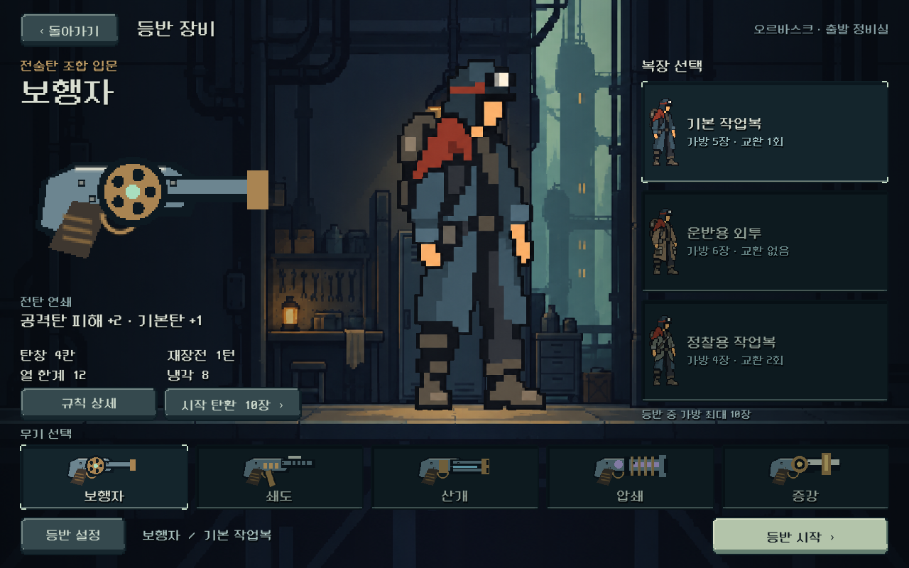
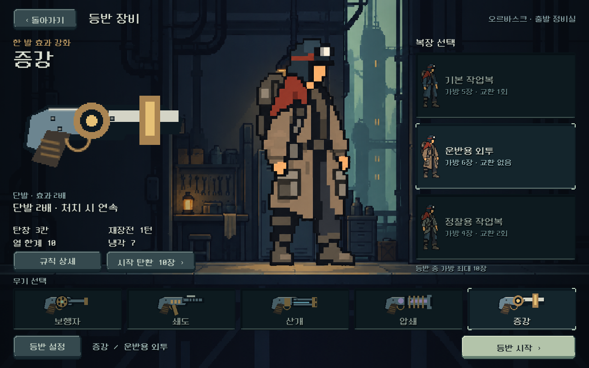
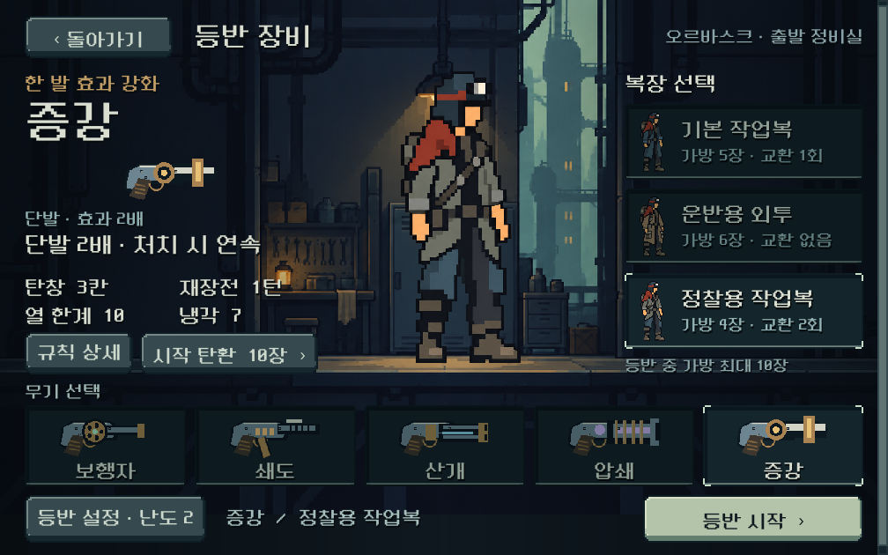

# 등반 장비 선택 — 2026-10-11

## 요청과 구현 범위

사용자는 슬더스2 캐릭터 선택 화면처럼 사용할 무기와 복장을 고르는 화면을 요청했다. [MegaCrit 공식 화면](https://www.megacrit.com/images/steam_screenshot3_new.png)의 큰 대표 그림·짧은 고유 능력·하단 선택 목록·확정 행동을 참고했다. 그림/버튼을 복사하지 않고 기존 ORVASK 도트 UI와 정비실 세계관으로 제작했다.

- 왼쪽: 선택 무기, 고유 효과, 탄창·재장전·열 한계·냉각.
- 중앙: 기본 작업복/운반용 외투/정찰용 작업복의 착용 미리보기.
- 오른쪽: 세 복장의 가방 크기와 교환 횟수를 직접 비교/선택.
- 하단: 다섯 무기의 실루엣 목록, 현재 구성, 등반 시작.
- 보조 창: 시작 탄환의 실제 종류/수량/효과, 해금된 보급과 난도/시드.

무기·복장 규칙은 유지했다. 훈련은 기존 기본 작업복을 쓰므로 다른 복장을 비활성 표시한다. 기존 등반을 덮어쓰기 전 확인을 유지한다. 선택을 바꿔도 다른 구성·시드를 보존하며 전체 페이지를 다시 만들지 않는다.

## 실제 화면

## 제작 구조

- 시각 원본: `redesign/equipment_screen.tscn`, `equipment_weapon.tscn`. 배경/대표 그림/버튼/선택 목록/기본 상태가 에디터에 직렬화되어 있다.
- 바인딩: `equipment_screen.gd`. 기존 Content/Campaign 실제 값을 사용한다. 큰 글씨에서는 컨테이너 최소 높이를 따라 필요한 만큼 스크롤한다.
- 무기: 기존 기계 실루엣을160×80 SubViewport에서 그려 nearest 확대. 기본 무기 그림의 에디터 렌더를 위해 `weapon_view.gd`에 @tool 적용.
- 원화: `assets/art/equipment_20261011/`. 전체 프롬프트·교정·참고·해시를 `provenance.json`에 기록했다. 이미지 원본을 보존하며 AtlasTexture/기존 alpha cutoff 셰이더로 표시한다.
- 배경 바닥과 주인공 발 위치를 준비 영역의 높이에 맞춰 정렬한다.

## 검증

저장은 모두 저장소 `qa_runtime/` 아래로 격리했다.

| 검사 | 결과 | 범위 |
|---|---:|---|
| `tools/run_equipment_checks.ps1` |457 / 실패0|1280×800,1008×630,1440×630 논리 크기, 실제 터치,5×3 출격, 이미지/수치, 시작 덱, 보급·시드·난도, 기존 저장 보호, 큰 글씨, 훈련|
| `tools/run_director_ui_checks.ps1 -Mode navigation` |458 / 실패0|새 장비 흐름과 기존 상점·파츠·저장 회귀|
| `tools/run_director_ui_checks.ps1 -Mode frontend` |33 / 실패0|메인→장비 선택→훈련 흐름|
| `tools/run_modal_touch_checks.ps1` |79 / 실패0|상세/설정/확인·키보드 복귀, 짧은 준비 화면 터치 스크롤, 탄환 드래그 공존|
| `tools/run_outfit_bag_checks.ps1 -Mode ui` |411 / 실패0|실제 복장 선택→출격→전투 손패/교환, 가방과 저장 흐름 회귀|

Godot4.7 실제 GL Compatibility 렌더를 직접 확인했다. 초기에는 작은 화면의 상세 버튼이 무기 목록에 가까웠으므로 세로 간격/최소 높이를 보정했다. 큰 글씨의 버튼 여백과 복장 설명 줄바꿈도 보정했다.

## 남은 범위

- 새 복장 그림은 현재 장비 선택용 미리보기다. 전투의 복장별 사격/재장전/피격 프레임, 복장 획득/중간 교체/헬멧은 별도 후속이다.
- 중앙 대기 그림은 정지 자세다. 복장 선택 전환 연출과 휴식 애니메이션은 후속 판단 대상이다.
- 사람의 선택 이해도·그림 선호와 Galaxy 실기기 감도는 미검증이다. 자동 검사 통과를 사용자 선호 승인으로 해석하지 않는다.
- APK·커밋·푸시 없음.

플레이: `D:/ProjectLoB/worktrees/core-redesign/PLAY.cmd` → 새 등반.
