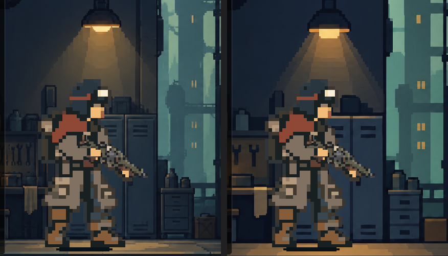

# 출발 정비실 배경 도트 밀도 비교

왼쪽은 이전 배경, 오른쪽은 사용자가 선택한 본편 배경입니다. 공구 걸이와 사물함의 잔선을 줄이고, 창밖 도시와 바닥 반사는 큰 색면으로 묶었습니다. 작업대·사물함·창의 위치와 청회색 공간, 황색 조명의 구도를 유지했습니다. 첫 후보의 조명 경계는 계단이 크게 드러나 두 번째 편집에서 그 경계의 도트 단위를 줄였습니다.

[PC 전체 화면 1280×800](compare_1280x800.png) · [모바일 가로 비율 1170×540](compare_1170x540.png) · [짧은 창 1008×454](compare_1008x454.png) · [채택 배경 원본](../../../../새-게임-프로젝트/assets/art/equipment_20261011/workshop_grouped_20261110.png) · [제작 입력과 프롬프트](provenance.json)

## 검수 결과

- 비교 단계에서 본편 장비 선택 화면의 배경 텍스처만 임시 교체했습니다. 세 해상도에서 선택한 총기·복장, 배우 크기, 바닥 배경 영역, 장비 목록과 출발 버튼 위치를 대조했습니다. 비교 검사 29개가 통과했습니다.
- 1170×540과 1280×800에서 부츠와 바닥이 맞닿는 것을 확인했습니다. 1008×454에서 무기 선택으로 스크롤한 뒤 처음 위치로 되돌리면 양쪽 모두 바닥선이 부츠보다 높게 보였습니다. 화면 배치 문제로 분리했습니다. Android 실기기 확인은 남아 있습니다.
- 오른쪽이 캐릭터와 주변 사물의 도트 밀도 차이를 줄이면서 작업대 소품과 창의 깊이를 유지했습니다. 사용자 확인 뒤 장비 선택 씬에 채택 배경을 연결했습니다.
- 본편 적용 뒤 1280×800과 1170×540에서 중앙 장면을 다시 캡처했습니다. 두 크기 모두 오른쪽 시안과 중앙 영역의 픽셀이 일치했습니다. [1170×540 적용 화면](live_1170x540.png)
- 본편 장비 선택 검사 6,142개가 통과했습니다. 무기·복장 선택, 출발 버튼, 새 등반 시작과 저장 복원을 포함합니다.
