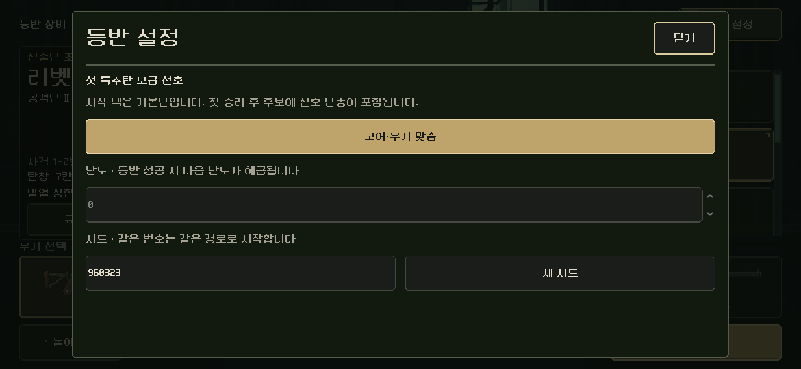

# 장비 선택 팝업 재질 본편 반영

2026-11-06. 사용자가 무기 카드 크기를 긍정한 뒤 다음 작업을 요청했다. 남아 있던 장비 선택의 상세·설정·확인 팝업을 현재 장비실의 먹색/철제·아이보리·황동으로 연결했다. [실제 같은 크기 전후](index.html).

## 범위와 구현

- 기존 `console_dialog.tscn`을 상속한 정식 `equipment/dialog.tscn`과 전용 스크립트/패널을 추가했다. `screen.gd`의 `_dialog`는 `page==loadout`일 때만 이 외형을 사용한다. 무기 상세·시작 탄환·등반 설정/시드·시스템 설정·기존 진행 교체 확인창을 포함한다. 다른 페이지는 기존 공용 씬을 계속 사용한다.
- 프레임·구분선·일반/선택/확인 버튼과 입력 칸·스크롤·드롭다운·체크 표시를 같은 계열로 정리했다. 반복 청록 무늬는 없애고, 주요 확인/선택에는 황동을 사용한다. 총기 고유 효과/위험 등 기능색은 유지한다.
- 원래 Theme를 팝업마다 복제하고 기존 내용 여백·아이콘 크기·상수·폰트/크기를 보존한다. 체크 표시는 기존과 같은40×24 네이티브 픽셀 형상에 색만 바꾼다. 새 레이아웃이나 연출/타이머를 만들지 않는다. 상속된 닫기·취소·확인·포커스/Tab·Escape·스크롤/안전 영역 코드는 그대로 사용한다.
- 대표 내용·철제 패널·버튼·구분선은 씬에 저작했다. 데이터 바인딩 전에 기존 분해 확인 문구가 보이지 않도록 정식 상세 씬의 확인 행동 줄은 숨겼고, 실제 `ask()`에서 기존대로 표시한다. 실행 중 새 주 배치를 만들지 않는다. [바인딩 전 네이티브 화면](after/authored_shell.png).
- Godot MCP 프로젝트 정보/4.7 연결 확인 성공. 현재 MCP의 편집 도구에 테마·그리기 코드 수정 기능이 없어 기존 로컬 리소스 편집과 격리 네이티브 실행 경로를 사용했다. 연결 실패는 없었다.

## 검증

- 신규 실제 팝업 시나리오는 전72/후75검사 실패0. 후3개는 컨트롤러 없는 정식 씬의 대표 내용/확인 줄과 캡처 검사다.1280×800·1170×540의 무기/탄환 상세·등반 설정·체크 켬/끔·확인/취소·다른 페이지 설정 **14상태/280 Control 관측**에서 Rect·글꼴 크기·focus_mode·mouse_filter와 문구를 대조했다. 기하·입력 속성/문구 차이0이며, 실행 시각으로 자동 생성된 시드 입력의 초기 값2개만 내용 대조에서 구분했다. 실제 시드 변경 바인딩은 별도 검사했다. [전](before/result.json), [후](after/result.json).
- 터치로 닫기/드롭다운 열기/도움말 토글/기본값 복원을 실행했다. Escape 닫기, 실제 음량 선택 콜백/설정 저장, 취소 후 기존 캠페인 파일 바이트 보존을 확인했다. 음량 선택은 OptionButton의 선택 콜백 검사이며 OS별 드롭다운 모든 입력 경로를 검증한 것으로 확대하지 않는다.
- 기존 장비 `QA_EQUIPMENT_LAUNCH_ONLY=1`: 실제35총기/복장 조합의 시작·캠페인/모델/RNG 대조·저장 복원·상세/설정·새 진행 취소/확인·훈련 등을 포함해 **479검사 실패0**. [원문](equipment_review.json), [오류](equipment_stderr.log).
- 다른 페이지의 팝업은 원래 씬 경로와 전체 Control 속성/문구가 같다. 실제 프레임 픽셀은1280×800에서 차이0,1170×540에서16픽셀/최대 채널 차이1/255다. 배경까지 포함한 PNG 바이트 동일은 아니므로 동일 파일이라고 주장하지 않는다. 전후 원본과 범위를 [검증](validation.json)에 남겼다.
- Model/Campaign/Content/Preferences와 공용 ConsoleDialog 씬·입력 스크립트/위젯, 장비 선택 씬·바인딩9파일은 작업 직전 SHA256과 같다. 공용 호스트 변경은 [팝업 씬 선택 분기](changes.diff)뿐이다. 기존 미커밋 변경을 보존했다.
- 초기 새 스크립트의 동적 변수 추론 오류를 파싱에서 검출해 bool 형식을 명시했다. 최초 오류 로그는 `qa_runtime/equipment_dialog_20261106/after/diagnostic_inference.log`에 보존했다. 최종 팝업/장비 검사 오류 로그는 모두 비어 있다.

시작 탄환·무기/설정·확인/취소·드롭다운·정식 씬을 실제로 열어 시각 확인했다. PC에서 S26 비율을 렌더한 결과이며 Android 실기기 안전 영역/손가락·지속 발열과 사람의 미감/이해도는 후속이다. 다른 페이지 공용 팝업의 재질까지 통일한 작업은 아니다. 새 총기2종 제작/규칙·문구 변경, APK·커밋·푸시·외부 게시 없음.
