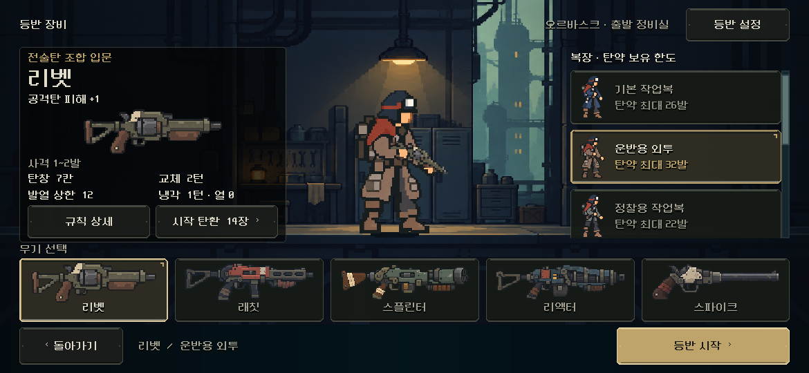

# 장비 선택 핵심 정보 정리

2026-11-06. 사용자가 고유 효과를 이름 근처에, 사격/탄창/발열을 한 묶음에, 복장 탄약 상한을 명확하게 표시하는 후속을 승인했다. 정식 장비 선택 씬과 기존 바인딩에 반영했다. [같은 크기의 실제 전후 화면](index.html).

## 변경과 보존

- `equipment_screen.tscn`의 `WeaponIdentity`를 총기명 바로 아래로 이동했다. 그림 아래에 떨어져 있던 고유 효과를 먼저 읽는다. 큰 구도, 중앙 배우, 목록·시작·돌아가기·설정·상세 버튼의 위치/크기를 유지했다.
- `WeaponStats` VBox를 저작해 그림 아래의 발사 방식과 기존 수치 Grid를 묶었다. 기존6px 간격·행 높이·글자 크기를 그대로 사용한다. `사격 1~2발`, `탄창 7칸`, `발열 상한 12`, `교체 2턴`, `냉각 1턴 · 열 0`처럼 비교할 수 있게 표기를 줄였다. 탄창 용량은 슬롯이므로 ‘발’로 바꾸지 않았다.
- 리액터는 기본 사격1~3발과 이름 아래의 조건부 강행1발을 구분하고, 스파이크는 단발 피해/효과 배율과 처치 시 연속 사격을 서로 다른 줄에서 표시한다. 수치/조건/실제 발사 계산은 바꾸지 않는다. 표시 범위가 항상 해당 발수의 완료를 보장한다는 의미는 아니다.
- 복장 카드의 `덱 12~32발`을 `탄약 최대 32발`로 바꾸고 오른쪽 제목은 `복장 · 탄약 보유 한도`로 정리했다. 선택 카드의 기존 황동 강조를 사용하며 새 행이나 버튼을 추가하지 않는다.
- 최소 유지량·현재 상한·정비 후 상한은 선택 카드 툴팁과 기존 시작 탄환 상세에 제공한다. 상세는 모바일에서도 기존 버튼으로 열 수 있다. 값은 현행 Roles의 데이터/함수에서 읽는다. 예: 원정복 최소14/상한36/정비 후 최대42발. 이 숫자를 새 밸런스나 별도 기획 원본으로 만들지 않았다.
- 짧은844px 창에서 문구 축소로 왼쪽의 기존 최소 너비가5px 줄어드는 것을 전후 비교로 발견했다. 정식 씬의 최소 너비266을 명시해 기존 상세 버튼 위치까지 보존했다. 전체 화면/글꼴 배율을 조정하지 않았다.

## 검증과 근거

- Godot MCP 프로젝트 정보 연결 성공, 활성 엔진4.7 확인. 현재 MCP에 테마/코드 편집 기능은 없어 기존 로컬 씬 편집·네이티브 캡처 경로를 사용했다. 연결 실패는 없었다. 주 배치는 TSCN에 저작되어 있고 새 런타임 재배치를 추가하지 않았다.
- PC 네이티브 **2,852검사 실패0**. 기존 `tools/run_equipment_live.ps1`의 전체6창 크기/3글씨 설정·5총기, 실제 터치/키보드·35총기/복장 시작·기존 캠페인/모델/RNG와 전체 저장 복원·상세/설정·교체 확인/취소·훈련·모의 안전 영역을 재사용했다. 각 정보 줄/복장 상한의 실제 글자 폭을 검사하고 표시 용량·열 상한·교체 비용·보유 상한/기본 연사를 실제 시작 모델과 대조했다. [원문](checks_review.json), [출력](checks_stdout.log), [오류](checks_stderr.log).
- 기본 글씨 설정에서1280×800·1170×540·2340×1080·2340×960·1008×454·844×390 × 리벳/리액터/스파이크 **18개 전후 화면**을 캡처했다. 큰 영역·중앙 배우 Rect·모든 총기/복장/행동 버튼의 **486기하 관측과 스크롤 범위 차이0**. [전](before/geometry.json), [후](after/geometry.json). 효과/그림/수치 그룹 내부의 정보 순서 이동은 의도된 변경이며 동일 대상으로 세지 않는다.
- 실제 PC·S26 비율·짧은 창, 리액터·스파이크, 새 최소/확장 설명이 있는 상세창을 열어 시각 확인했다. 매우 짧은 창에서 중간 내용만 스크롤되는 기존 동작을 유지한다. 시작/돌아가기는 고정이다.
- [소스 차이](changes.diff), [직전 파일](source_before/), [최종 해시/화면/검증](validation.json). Model/Campaign/Content/CombatRoles·배우·짧은 창 씬·테마7파일은 작업 직전과 SHA256이 같다. 기존 작업 트리를 초기화하지 않았다. 전투 HUD/지도 파일은 이번에 바꾸지 않았고 영향 없는 HUD 전체 검사를 반복하지 않았다.

## 남은 범위

사람의 이해도/미감, Galaxy S26 실기기 안전 영역·손가락 터치/지속 발열은 PC 비율 검사와 구분한다. 이번 상세 캡처에서 장비 선택의 기존 공용 상세/설정 팝업에 청록 디더 외형이 남아 있음을 확인했다. 새 정보는 읽히며, 해당 팝업의 재질 정리는 미적용 후속으로 남긴다. 이번 요청을 다른 화면 개편이나 신규 총기 제작으로 확대하지 않았다. APK·커밋·푸시·외부 게시 없음.
