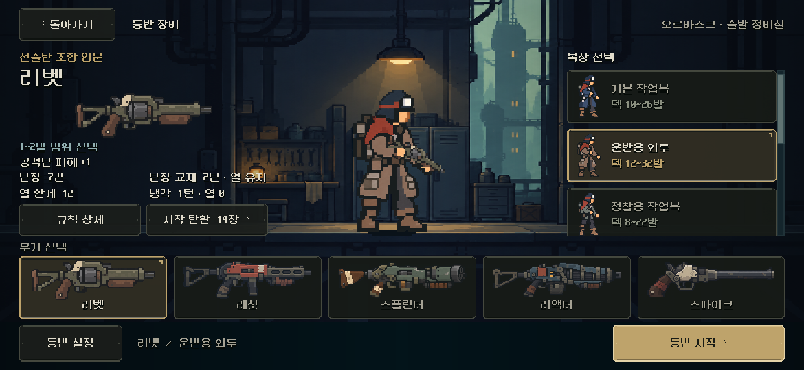

# 캐릭터·장비 선택 — 본편 통합

2026-11-06. 사용자 ‘개편 진행하고 중앙에 캐릭터 크기도 좀 더 줄어들면 좋겠다’ 지시로 [철제/황동 외형](../equipment_visual_2026-11-06/README.md)과 [모바일 시작 버튼 진단](../equipment_mobile_2026-11-06/README.md)을 본편에 반영했다. 아래 구현은 QA 오버레이가 아니라 실제 타이틀→장비 선택→시작 경로다. [현행 결정](../../../direction/equipment-ui.md).

## 실제 화면

[PC1280×800](equipment_1280x800.png) · [S26 비율2340×1080](equipment_2340x1080.png) · [더 짧은2340×960](equipment_2340x960.png) · [844×390](equipment_844x390.png) · [리액터/원정복](equipment_mobile_heavy.png) · [안전 영역 여백 모의](equipment_safe_insets.png).

## 바뀐 구조와 유지 범위

- `redesign/equipment_screen.tscn`의 상단과 하단 행동 줄 사이에 `SelectionScroll/SelectionLayout`을 저작했다. 장면/복장 목록/무기 목록은 이 안에 있고 시작·설정·돌아가기는 밖에 있다. 본편에 CanvasLayer 우회/런타임 재배치는 없다.
- 최소 높이617을 화면 전체에 강제하던 코드를 제거했다. 왼쪽 고유 효과의 빈 최소 높이44와 정상 플레이의 개발 안내 문구를 덜고, 장면은 실제 내용에 필요한 높이를 사용한다. 복장 목록은 정상 내부 스크롤을 유지한다.
- 짧은 창의 `redesign/equipment/screen_short.tscn`은 같은 씬을 상속하고 상하 여백12/그룹 간격8을 저작했다. 선택은 기존 안전 영역의 높이660 미만을 기준으로 한다. 전체 UI 배율·폰트·버튼·총기 카드 크기를 축소하지 않는다.
- PC1280×800의 시작 버튼은 이전과 같은250×54, 위치1002/728이다. S26 비율에서는 논리1170×540의 시작 버튼892/474~528, 무기 목록374~466으로 둘 다 처음부터 보인다. 더 짧은 창에서는 가운데만 스크롤되고 상·하단 행동은 고정된다.
- 중앙 실제 배우 미리보기는 가용 영역의85%로 줄이고 등록된 발 위치를 바닥에 맞춘다. 모바일에서는 장면 높이도 줄어 종전 화면 대비 전체 축소폭이 더 크다. 전투 배우·총기 아트 크기는 수정하지 않았다. 실제 선택에 따른 총기/복장 연동은 그대로다.
- 절제된 철제·황동·아이보리 스타일은 정식 `equipment/theme.tres`, 선택 상태 색은 `skin.gd`, 입력을 받지 않는 가장자리 빛은 `edge.gd`로 연결했다. 대표 중앙 착장은 기존 실제 배우에서 캡처한 에디터 전용 PNG이며 런타임은 실제 배우를 렌더한다. 테마/계층/대표 그림은 실행 전 에디터에서도 보인다.

## 검증

- Godot MCP 프로젝트 정보 확인 성공 후 기존 네이티브 실행·격리 저장 경로를 사용했다. `tools/run_equipment_live.ps1`: **1,513항목 실패0**, [원본](review.json), [출력](stdout.log), [오류 로그](stderr.log). PC Compatibility/RTX4060Ti 결과이며 Android 실기기가 아니다.
- 1280×800,1170×540,2340×1080,2340×960,1008×454,844×390과 지원 글씨 설정0.9/1.0/1.1,5총기를 실제 터치로 선택했다. 시작/상단 노출, 전체 페이지 스크롤 없음, 중앙 스크롤의 행동 줄 비이동, 목록의 접근과 버튼 크기를 확인했다. 기본 글씨의 PC/S26 비율은5총기 목록이 처음부터 보이는지도 확인했다.
- 35개 총기×복장 조합을 실제 터치로 선택하고 시작했다. 같은 시드/선택의 기존 `Campaign.start` 결과와 캠페인·모델/RNG가 일치하며, 저장/복원된 캠페인·프로필·전투 전체 내용도 일치한다. 저장 비교는 JSON 왕복의 숫자 표현 차이를 정규화한 전체 내용 비교이며 필드를 제외하지 않는다. 초기 검사기의 직접 Dictionary/문자열 비교 실패는 검사 수정 후 재실행했다. 게임 저장 코드는 수정하지 않았다.
- 실제 키보드 활성화/탭 포커스, 창 크기 변경 뒤 선택·시드 보존, 설정/시작 덱 상세, 기존 저장 교체 확인·취소의 바이트 보존, 확정 시작, 훈련의 복장 제한/시작을 확인했다. 안전 영역은 PC에서 비대칭 여백을 모의한 결과다.
- `tools/run_prototype_hud.ps1 -Mode ui -Fast`: **11,558항목 실패0**, [출력](hud_stdout.log), [오류](hud_stderr.log). 장비 화면 변경 뒤 기존 HUD 검사를 유지했다.
- 실제 Godot 에디터에서 대상 씬의 저작 계층·테마와 중앙 대표 캐릭터가 실행 없이 표시되는 것을 확인했다. 전체 에디터 스캔에는 이번 대상과 별도인 `tests/ranged_ui_runner.gd:176`의 `close_point` 추론 오류와 Android SDK build-tools 안내가 표시된다([로그](editor_stderr.log)). 이 보조 테스트/SDK 설정은 변경하지 않았다. 대상 실행 검사의 파싱/런타임 오류는0이다.

[이번 변경만 비교](this_change.diff) · [소스 해시/범위](manifest.json). 기존 작업 트리 전체의 다른 변경은 보존했다. Android 실제 터치/안전 영역·장시간 성능/발열과 사람의 크기·미감 판단은 후속 확인이다. APK 생성·커밋·푸시·외부 업로드는 하지 않았다.
