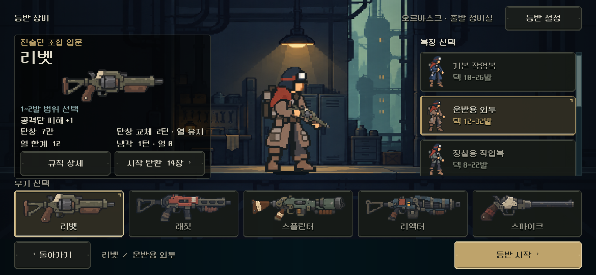

# 장비 선택 — 돌아가기 위치와 정보 노출 검토

2026-11-06. 사용자가 돌아가기를 기존 등반 설정 위치로 옮기고 핵심/필수 정보의 노출 위치를 검토해 달라고 요청했다. 버튼 이동은 본편에 적용했고 정보 재배치는 아래 제안으로 구별한다.

[PC1280×800](1280x800.png) · [S26 비율2340×1080](2340x1080.png) · [2340×960](2340x960.png) · [844×390](844x390.png) · [이전 화면](../equipment_panel_2026-11-06/1170x540.png).

## 본편 변경

- `equipment_screen.tscn`의 `loadout_back`을 Header에서 Footer의 첫 자리로 이동했다. 기존 설정 슬롯과 같은 폭150을 사용해 선택 요약과 시작 버튼의 위치도 유지했다.
- `preparation_options`는 Header 오른쪽 보조 메뉴로 이동했다. 기능을 삭제하거나 시드/보급/난도 설정을 테스트 메뉴로 바꾸지는 않았다. 상단 왼쪽은 화면 제목, 오른쪽은 장소/보조 설정이며 하단은 돌아가기/현재 선택/시작이다.
- 연결된 콜백과 버튼 이름·기존 장식을 유지했다. 계산/저장/전투/캐릭터·총기 카드 크기/복장 목록/정보 패널은 바꾸지 않았다.

## 정보 노출 검토 — 아래 재배치는 아직 미적용

검토 기준은 총기·복장 차이를 읽고 선택을 확인해 출발할 수 있는지다. 이는 화면과 데이터 바인딩을 근거로 한 디자인 판단이며 사람의 이해도 테스트 결과가 아니다.

| 영역 | 현재 판단 | 후속 제안 |
|---|---|---|
| 좌측 총기명/고유 효과 | 이름과 고유 효과 사이에 큰 총기 그림이 있어 서로 멀다. 선택을 바꾸는 핵심인 ‘공격탄 피해+1’, ‘3회 적중’ 등의 효과가 아래로 밀린다. | 고유 효과를 총기명 바로 아래로 올리고 그림과 구분한다. |
| 좌측 발사/수치 | 발사 범위·탄창·열 한계는 총기 선택을 비교할 핵심 정보다. 범위와 나머지 수치가 분리돼 있다. | 그림 아래의 한 수치 그룹으로 묶고, 공통인 ‘냉각1턴·열0’ 같은 설명은 상세 우선으로 둔다. |
| 우측 복장 | 목록 위치와 선택 표식은 적절하다. ‘덱12~32발’만으로는 최소 유지량/보유 상한인지, 무엇이 달라지는지 바로 읽기 어렵다. | 선택 복장의 보유 상한을 우측 선택 영역에서 먼저 읽히게 하고 최소량의 의미/제약은 상세로 설명한다. 선택 복장과 떨어진 왼쪽 총기 수치에 섞지 않는다. |
| 하단 | 선택 총기/복장 요약은 시작 직전 확인에 유효하고 시작은 오른쪽에 고정되어 있다. | 이번에 적용한 돌아가기/선택 확인/시작 구조를 유지한다. |
| 상단/상세 | 장소명·역할 문구는 분위기 정보이고, 시드는 고급 재현 기능이다. 난도/선호 보급은 실제 플레이 설정이다. | 이 정보들을 총기/복장 효과와 같은 우선순위로 확대하지 않는다. 시드 접기 등 설정창 자체 개편은 별도 제안이며 이번에는 기능/문구를 유지했다. |

우선 후속은 **고유 효과를 이름 근처로 → 발사/핵심 수치 묶기 → 선택 복장 수용량 명확화**다. 새 설명을 여러 곳에 반복해 추가하기보다 같은 선택과 관련된 정보를 가까이 두는 방향이다.

## 검증과 범위

- Godot MCP 프로젝트 정보 확인 성공 후 기존 네이티브 캡처/격리 저장 경로를 사용했다. 다섯 창 크기에서 중간 스크롤·장면 최소 높이·시작·총기 목록·배우 Rect가 이전과 동일했다. [기하](geometry.json), [출력](capture_stdout.log), [오류](capture_stderr.log).
- 기존 `tools/run_equipment_live.ps1`, `QA_EQUIPMENT_LAUNCH_ONLY=1`: **310항목 실패0**. 실제 터치/키보드 선택,35조합 시작/저장·상세/설정/교체 확인·취소/훈련 등을 재사용했다. [검사 원본](review.json) · [출력](stdout.log) · [오류](stderr.log). 별도 새 테스트는 작성하지 않았다.
- [이번 수정](changes.diff), [소스 해시/구현과 제안 구분](manifest.json). 변경된 정식 씬과 기존 바인딩만 연결하며 런타임 재배치로 구현하지 않았다.
- PC 네이티브 검증이며 Android 실제 안전 영역/손가락/사람의 이해도 검증은 아니다. 전투 HUD는 이번에 재실행하지 않았다. APK/커밋/푸시/외부 게시 없음.
