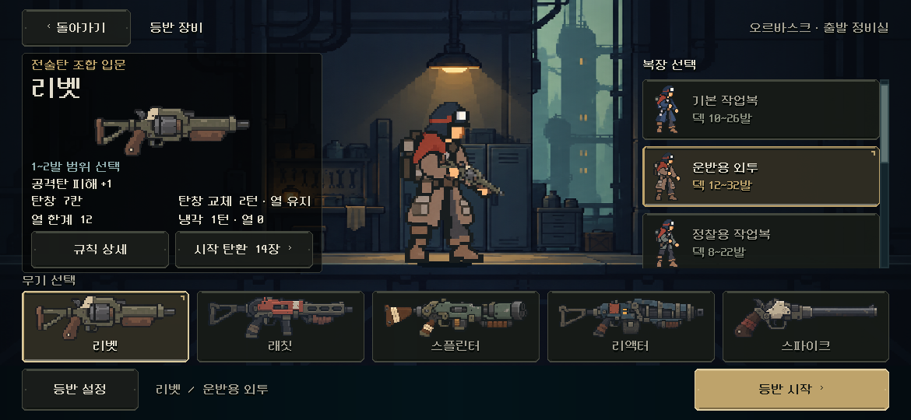

# 장비 선택 — 좌측 총기 정보 패널

2026-11-06. 사용자가 검정 반투명 박스 제안을 승인해 본편에 적용했다. 총기 이름·그림·성능과 상세 버튼을 하나의 먹색 정보창으로 묶고, 배경과 글자가 겹쳐 보이는 것을 줄인다.

[PC1280×800](1280x800.png) · [S26 비율2340×1080](2340x1080.png) · [짧은2340×960](2340x960.png) · [844×390](844x390.png) · [리액터/원정복](equipment_mobile_heavy.png) · [이전 화면](../equipment_live_2026-11-06/equipment_1170x540.png).

- 정식 `equipment_screen.tscn`의 장면 안에 `WeaponInfoBackdrop` Panel을 저작했다. 바탕은 거의 검정/불투명도68%, 얇은 철제 윤곽과 잘린 픽셀 모서리다. 자산은 `equipment/weapon_info_panel.tres`이며 런타임 생성/임시 디렉터리 참조가 없다.
- 좌측 정보열 전체를 오른쪽12만큼 옮겨 좌우12/상단8/하단6의 시각 여백을 확보했다. 정보열 폭과 버튼 크기, 최소 높이와 기존 내부 배치는 유지한다. 배경 Panel은 입력을 받지 않으며 컨테이너 배치/최소 크기에 참여하지 않는다.
- Godot MCP 프로젝트 확인 후 기존 네이티브 캡처·격리 저장을 사용했다. PC1280×800/1170×540/2340×1080에서 이전과 화면·장면 최소 높이·중간 스크롤·시작 버튼·무기 목록·중앙 배우의 크기/위치가 동일했다. [측정](geometry.json).
- 기존 `tools/run_equipment_live.ps1`을 `QA_EQUIPMENT_LAUNCH_ONLY=1`로 실행했다. 실제 터치/키보드,35조합 선택·시작·저장/복원, 상세·설정·교체 확인/취소·훈련과 안전 여백 모의를 포함해 **310항목 실패0**. [검사 원본](review.json) · [출력](stdout.log) · [오류](stderr.log). 이번 단순 외형 수정용으로 새 테스트를 만들지는 않았다.
- 이번 대상은 씬/스타일 두 파일이다. 직전 검증의 다른 구현 파일 해시가 유지됨을 확인했다. 전투 HUD11,558검사는 직전 통과 기록이며 이번에 재실행하지 않았다. [변경만 비교](scene.diff) · [범위/소스 해시](manifest.json).

Android 실제 안전 영역/터치·발열과 사람의 미감은 후속 확인이다. APK 생성·커밋·외부 업로드는 하지 않았다.
