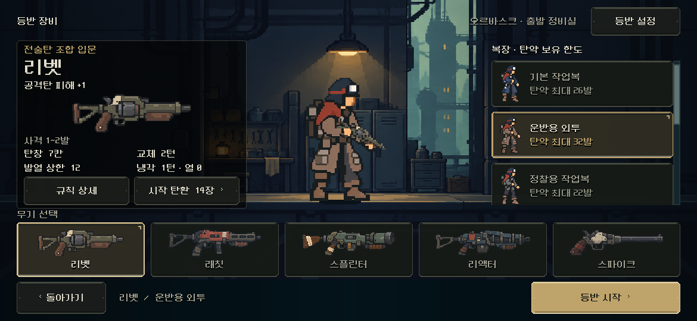

# 무기 선택 카드 그림 축소

2026-11-06. 사용자가 선택 창의 무기가 꽉 차 보인다고 평가해 하단5개 무기 카드 안의 그림만 줄였다. 카드·이름·선택 표시·클릭 영역·중앙 배우와 왼쪽 총기 미리보기는 유지했다. [실제 전후](index.html).

변경은 정식 `equipment_screen.tscn`의5개 카드 `Art` 여백20개뿐이다. 좌우14→28, 위5→11, 아래28→34로 조정해 높이92인 카드에서 그림 표시 영역을59→47로 줄였다. 기존 비율 유지 표시와 원본/공용 그림 스크립트는 그대로다. 새 아트나 실행 중 크기 조정은 추가하지 않았다.

Godot MCP 연결/4.7 프로젝트 정보를 확인하고 기존 네이티브 캡처 경로를 사용했다. 직전 정보 정리 보고서의 최종 씬 해시와 일치하는 화면을 전 기준으로 보존했다.6창×3총기18상태의 큰 영역/배우·모든 버튼486기하 관측과 스크롤 범위 차이0. 실제35조합 시작/저장·입력/상세·훈련을 포함한 기존 장비 검사 `QA_EQUIPMENT_LAUNCH_ONLY=1`은 **479검사 실패0**. [검사 원문](checks_review.json), [오류](checks_stderr.log), [변경](changes.diff), [해시/비교](validation.json).

PC/S26 비율의 실제 화면에서 여백을 확인했다. Android 실기기/사람 미감은 후속이며 전투·규칙/저장·팝업 외형은 이번 범위에 추가하지 않았다. APK/커밋/푸시/외부 게시 없음.
