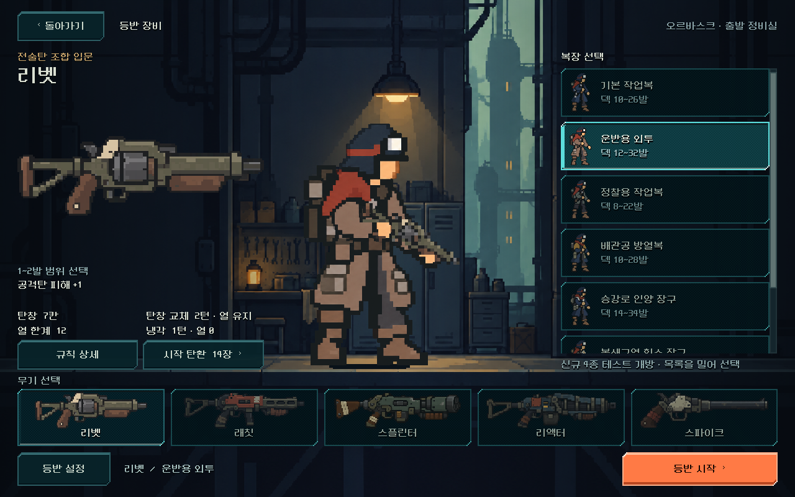
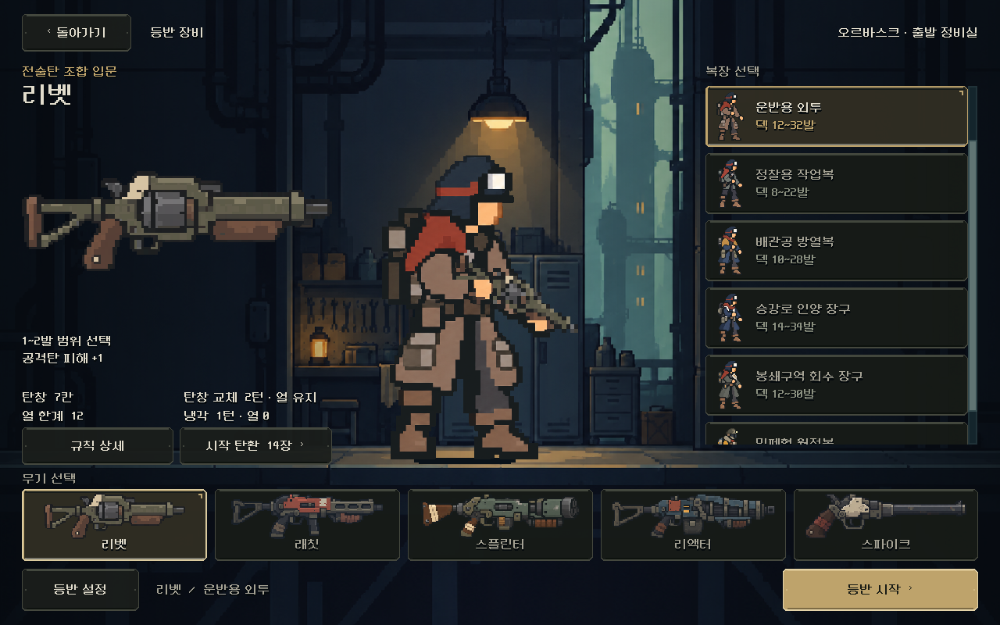

# 캐릭터·장비 선택 — 외형 시안

2026-11-06. 사용자 요청으로 새 총기2종보다 UI를 먼저 진행한다. 사용자가 선택한 우선 항목은 ‘화면의 분위기와 디자인’이며 실시간 착장 변화는 유지한다. [현행 결정](../../../direction/equipment-ui.md).

## 기존과 제안

### 기존1280×800

### 시안1280×800

현재 배경·조명·중앙 캐릭터·큰 무기 그림·우측 복장 목록·하단 총기 목록과 출발 버튼의 위치/크기를 유지했다. 반복 청록 무늬를 덜고 철제 받침과 작은 가장자리 빛, 황동 선택 표식을 사용한다. 이름/설명/덱 수치는 기존 노드이고 글꼴 크기를 바꾸지 않았다. ‘신규4종 테스트 개방’이라는 개발 안내는 시안에서 지우되 해당 줄의 높이를 보존했다.

[리액터/원정복1280×800](proposal_heavy.png) · [짧은 창의 기존](before_short.png) · [짧은 창의 시안](proposal_short.png).1170×540에서도 기존 정상 스크롤을 그대로 사용하며 아래쪽 항목을 억지로 축소해 넣지 않았다.

## 실행과 검증 범위

- Godot MCP로 활성 프로젝트/4.7 버전/구조를 확인한 뒤 기존 네이티브 캡처 경로를 사용했다. Compatibility/RTX4060Ti PC이며 실기기 렌더가 아니다.
- 실제 `redesign/main.tscn`의 장비 선택 화면에 QA 외형만 적용했다. 정식 씬·선택 코드·무기/복장 아트는 수정하지 않았다. QA 저장은 `qa_runtime/equipment_visual_20261106/`에 격리했다.
- 양쪽 창 크기에서 모든 버튼·중앙 미리보기·선택 무기 그림·스크롤/정보 영역의 Rect와 최소 크기가 전후 동일했다.
- 기존 공개 버튼 신호를 발생시켜5총기×7복장의 실제 배우 gun/outfit 연동을 검사했다. 이는 손가락 터치 전체 조작 검사와 다르다. 대표4상태 캡처를 포함한41검사 실패0, 파싱/실행 오류0.
- [검사 원본](review.json) · [출력](stdout.log) · [해시/범위](manifest.json). [미리보기 스크립트](capture.gd), [외형](material.gd), [픽셀 가장자리](trim.gd)는 검토 재현용이며 본편이 참조하지 않는다.

현재 상태는 **분위기 검토용 시안**이다. 정식 시작/저장·터치/키보드·큰 글씨의 전체 회귀와 사용자 미감은 통과한 것으로 기록하지 않는다. 확인 후 에디터에서도 같은 외형이 보이는 정식 씬/테마에 적용한다. APK/커밋/푸시/외부 업로드는 수행하지 않았다.
