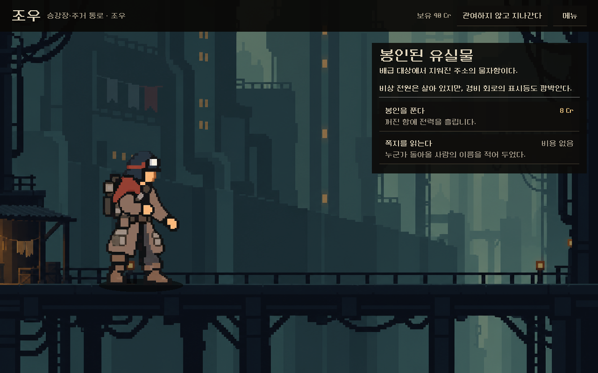
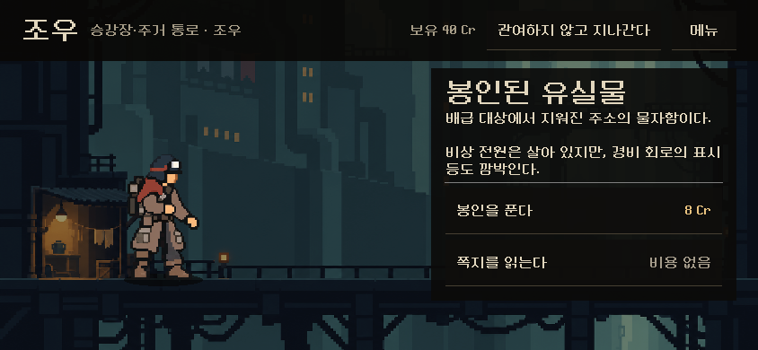
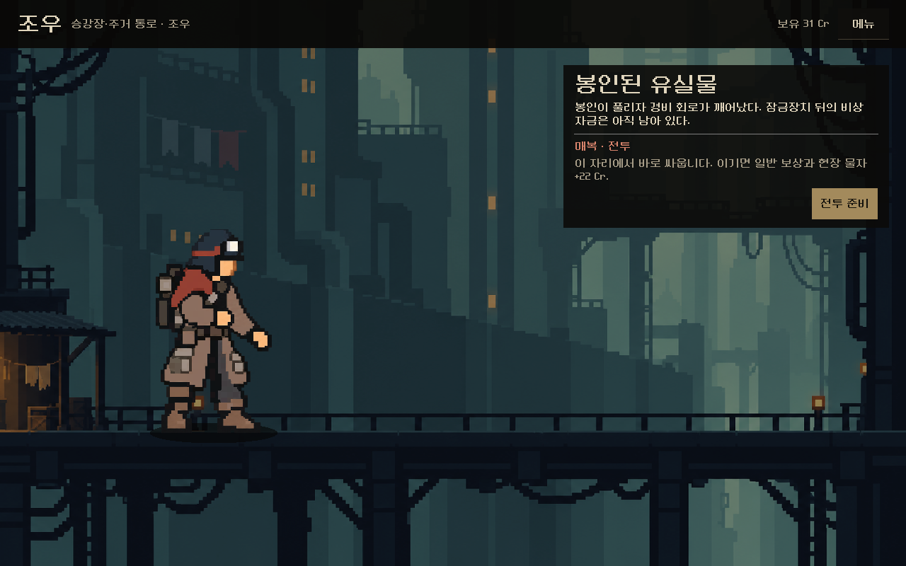
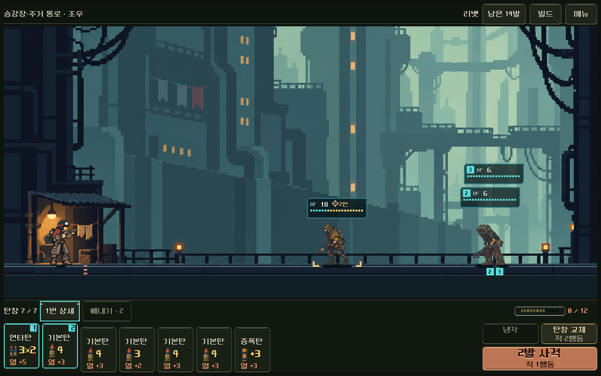
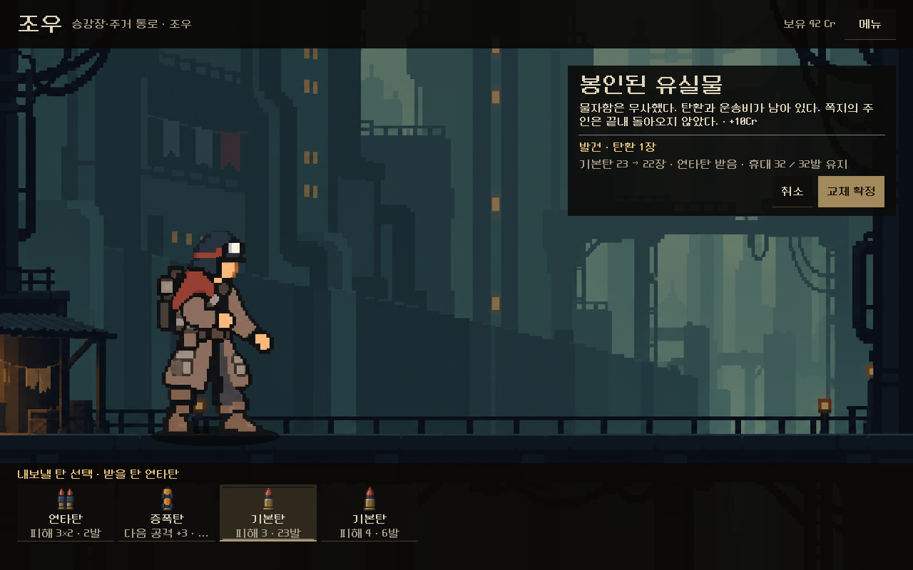

# 사건·조우 — 시안 본편 연결

2026-11-08. 사용자 승인("좋아 진행해 줘")으로 [사건·조우 시안](../event_review_2026-11-08/README.md)을 본편에 연결했다. APK·커밋·푸시는 하지 않았다.

## 무엇이 바뀌었나

`PLAY.cmd`에서 지도의 **조우**에 들어가면 이전의 탄약고 그림 + 선택 카드 화면 대신 시안의 장면이 열린다.

- 배경은 그 구역·층의 전투 배경, 오른쪽 이야기 창: 제목 → 서술 → 선택지 2개(행동·비용, 단서).
- 고르면 같은 창에 결과와 다음 행동 하나: `지도로 계속`(크레딧·기록·지나침), `전투 준비`(매복), 탄 발견.
- **매복의 `전투 준비`는 그 자리에서 실제 전투로 넘어간다.** 전투 배경이 조우 장면과 같아 이어진다. 이기면 기존 보상 화면으로 간다.
- **탄 발견에 교체를 붙였다**(시안은 추가만). 아래 선반에서 탄을 고른 뒤 `추가로 확보` 또는 `교체해서 확보`를 누른다. 교체를 누르면 선반이 내 탄 묶음으로 바뀌고, 내보낼 탄을 고른 뒤 `교체 확정`한다. 가방이 가득 차면 '추가 불가'로 바뀌고 교체가 주 행동이 된다. 탄약고와 같은 흐름이다.
- 머리줄의 `관여하지 않고 지나간다`는 탄 발견 단계에서 `탄환을 남기고 계속`으로 바뀐다.
- 선택·지나침·탄 확보는 본편 처리기로 **바로 자동 저장**된다. 매복 상태에서 종료하고 이어하면 `전투 준비`부터 열린다.
- 머리줄 `메뉴`(내 빌드·기록·설정·타이틀로), 보유 Cr 표시.
- 장소 개편 이전 저장(지도 1·2판)은 기존 `service()` 화면을 쓴다.

| 화면 | |
| --- | --- |
| 선택 1280×800 |  |
| 844×390 |  |
| 매복 |  |
| 매복 → 같은 자리 전투 |  |
| 가방 가득 · 교체 |  |

[결과](result_1280x800.png) · [탄 발견](loot_1280x800.png) · [1008×454](choose_1008x454.png)

## 검증

`tests/event_live_ui.gd`(새 파일, 탄약고 검사의 걷기 도구 상속): **72검사, 실패0.** 시드 251107~를 차례로 새 등반으로 시작해 1구역 첫 조우까지 실제 전투(자동 탐색기)·보상을 거쳐 걸어간다. 결과형·매복형·탄 발견형 선택을 모두 찾을 때까지 반복했다(이번 실행: 시드 251107 '봉인된 유실물'의 쪽지 읽기·봉인 풀기, 시드 251108 봉인 풀기→매복). 모든 상태는 저장 검증을 통과한다.

- 세 해상도: 이전 머리줄 제거, 화면 안, 실제 선택지 2개, 선택 → 결과·자동 저장, `지도로 계속` → 지도
- 지나침 해결, 메뉴 → 내 빌드 열고 닫기
- 매복 표시와 자동 저장, 이어하기 → 매복부터, `전투 준비` → 실제 전투 HUD
- 탄 발견 → 1장 추가와 자동 저장, 가방 가득 → 추가 불가·교체 확정 → 총량 유지

시안 회귀(`OPEN_EVENT_REVIEW.cmd -Capture`) 103검사 통과.

## 남은 것과 주의

- 사건별 그림은 없다(구역 배경 공유).
- 장면 파일은 `redesign/samples/event_review/`에 있다(시안 실행 도구와 공유).
- 이전 사건 화면 버튼(`city_encounter_*`, `city_event_*`, `city_service_skip`)을 누르던 오래된 검사는 탄약고 쪽 목록과 함께 갱신 필요: [탄약고 보고서](../supply_live_2026-11-08/README.md#남은-것과-주의).
- 실기기·사람의 이해도 미확인.

## 변경 파일

[changes.patch](changes.patch) — 이 작업의 변경분만.

| 파일 | 변경 |
| --- | --- |
| `redesign/campaign_ui.gd` | `render()`에서 개편 장소의 조우면 `modern_event()`. `EventScreen` 상수 |
| `redesign/screen.gd` | 탄약고·조우 장면 여백 0 (탄약고 줄을 조우까지 확장) |
| `redesign/samples/event_review/preview.gd` | `configure()`·`enter_live()`·`setup_scene()`·`add_live_menu()`·`command()`, 탄 발견 교체(`swapping`·`rebuild_stacks()`·`pick_stack()`), 머리줄 버튼 단계별 문구 |
| `tests/event_live_ui.gd` | 새 본편 조우 검사 |
