# 사건·조우 시안

2026-11-08. 사용자 요청: "다음 사항도 진행해 줘." 개편 대상 6순위 사건·조우의 **검토용 시안**이다. 같은 날 사용자 승인으로 [본편에 연결](../event_live_2026-11-08/README.md)했다(탄 발견 교체 추가).

## 실행

- `OPEN_EVENT_REVIEW.cmd`: 시안 창을 연다.
  - **F1** 문 너머의 발소리
  - **F2** 봉인된 유실물
  - **F3** 멈춘 보급 수레
  - **F4** 지금 사건을 '위험한 선택이 매복으로 이어지는 시드'로 다시 열기
- `OPEN_EVENT_REVIEW.cmd -Capture`: 세 해상도 캡처와 검사(출력은 `qa_runtime/event_review_20261108/`).
- 장면: `redesign/samples/event_review/preview.tscn`. 실제 등반을 1구역 사건 장소에 세우고(보유 20 Cr), 선택·매복 전투 시작·탄 확보·지나침은 실제 규칙으로 처리한다.

## 구성

[레퍼런스와 가져온 원리](../../art/references/2026-11-08-event/README.md) — Slay the Spire 사건, Citizen Sleeper 장소 행동·서술 기둥.

| 영역 | 내용 |
| --- | --- |
| 장면 | 구역·층의 **전투 배경**(`ascent_background.gd`)을 화면 전체에 깔고 차갑게 어둡게 덮는다. 주인공(복장별 전투 자세)이 다리 위에 선다. 새 그림 없음. |
| 머리줄 | 조우 · 구역/장소, **보유 Cr**, `관여하지 않고 지나간다`(선택 전에만), `메뉴`(시안에서는 동작 없음) |
| 이야기 창 | 사건 제목 → 서술 → 선택지 2개. 선택지 1줄: 행동 + 비용('비용 없음' / 'N Cr' / 'N Cr 부족'), 2줄: 단서. 비용이 모자란 선택지도 보이되 잠긴다. |
| 결과 | 같은 창에서 서술이 결과 문장으로 바뀌고 결과 표시가 붙는다. 획득 '+N Cr', 기록 '기록 회수', 매복 '매복 · 전투'(붉은색, 승리 보너스 안내) 중 하나다. 그 아래에는 행동 하나만 남는다. |
| 탄 발견 | 탄약고와 같은 아래 선반에 발견한 탄. 고르면 창에 '휴대 14 → 15 / 32발', `1장 확보` / `탄환을 남기고 계속` |
| 작은 화면 | 높이 500 미만에서 단서 줄을 숨기고(행동·비용은 유지) 선반 칸 그림을 숨긴다. |

| 상태 | 1280×800 | 1008×454 | 844×390 |
| --- | --- | --- | --- |
| 선택 | 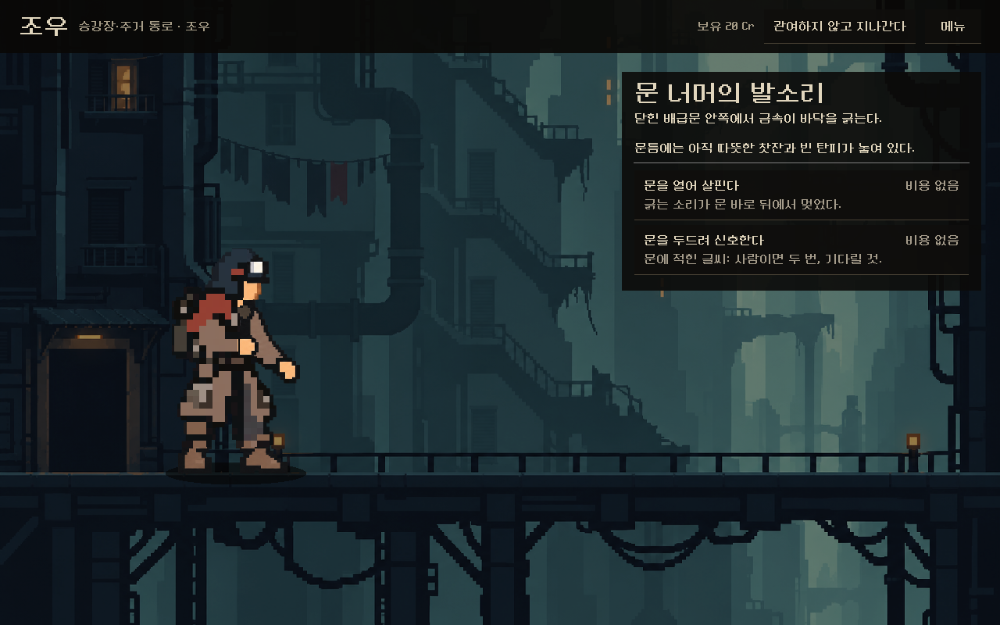 | 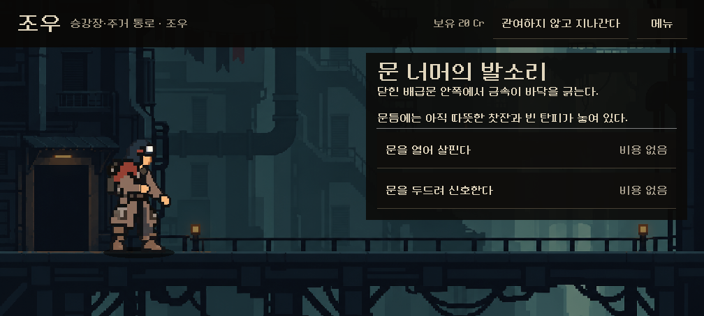 | 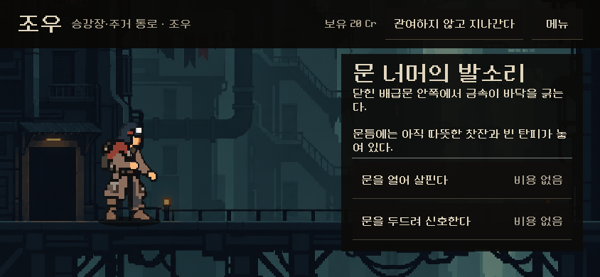 |
| 결과(크레딧) | 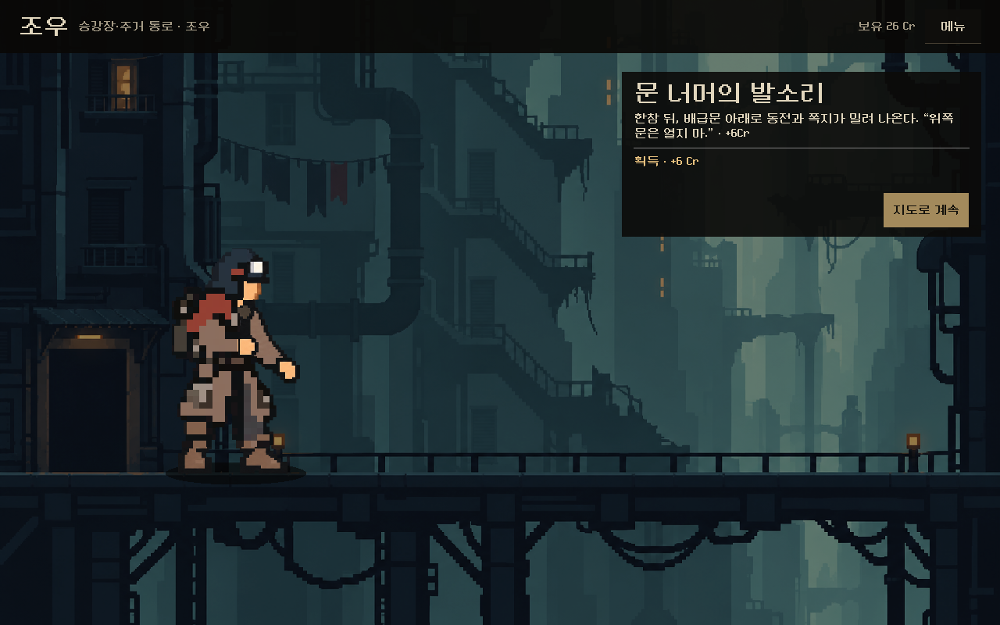 | 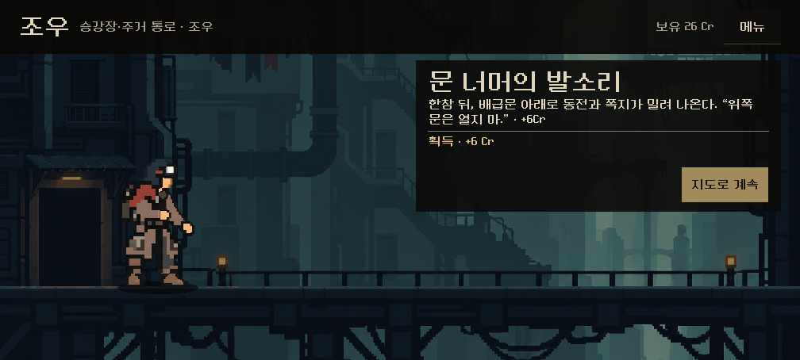 | 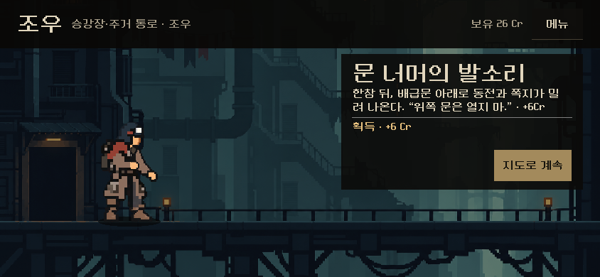 |
| 매복 | 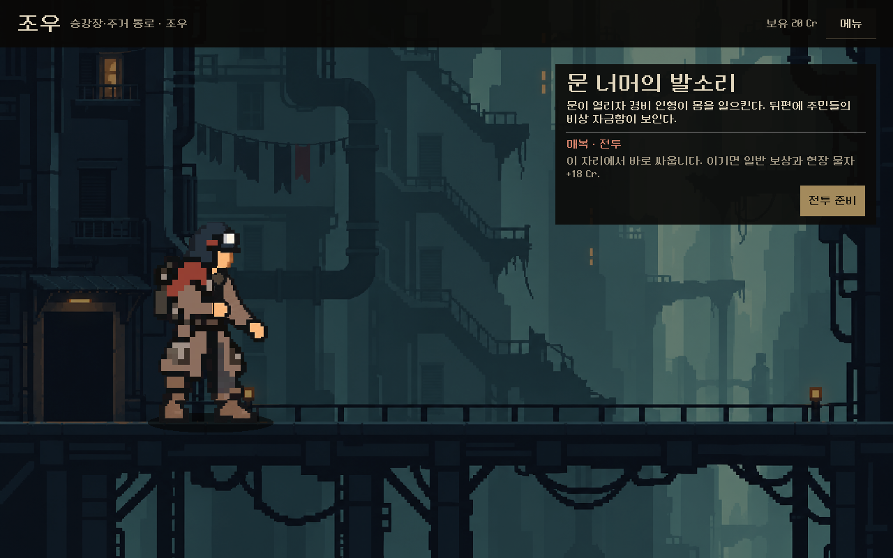 | 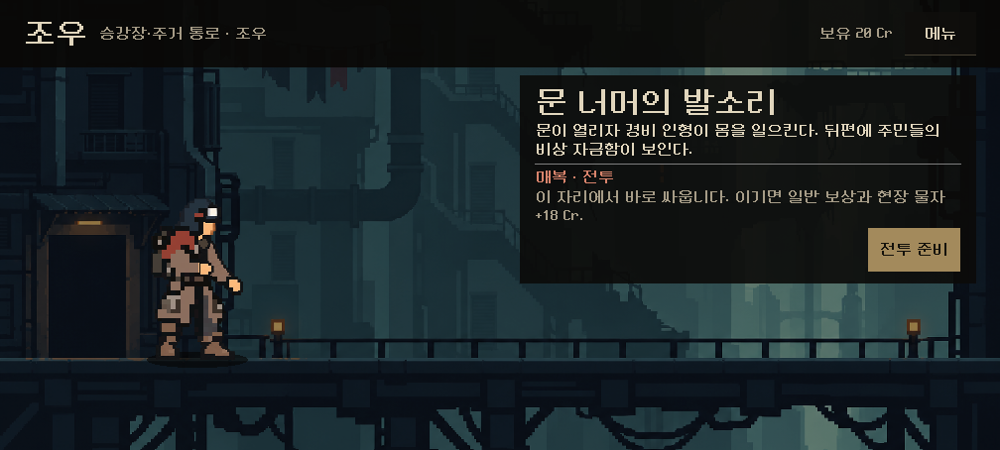 | 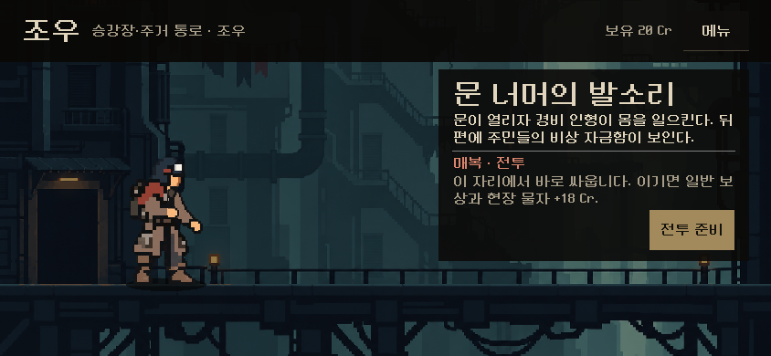 |
| 탄 발견 | 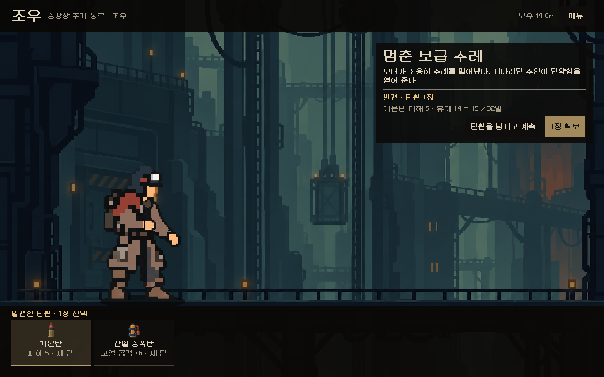 | 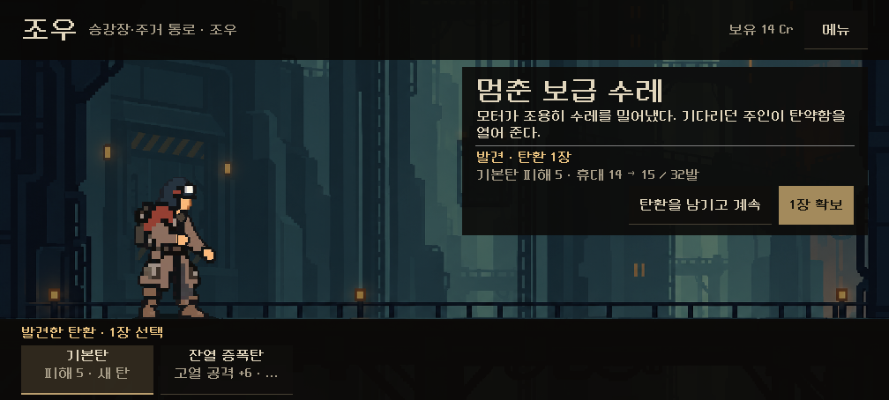 | 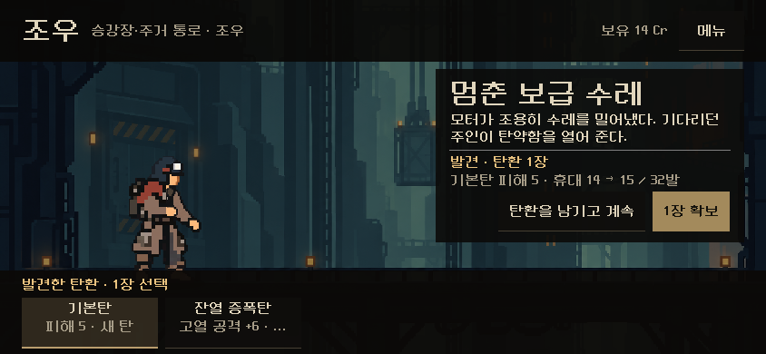 |

[비용 부족으로 잠긴 선택지](locked_1280x800.png)

## 검증

Godot 4.7 격리 실행, 화면 터치로 진행. **103검사, 실패0.**

- 화면 배치: 세 해상도·네 상태에서 이야기 창과 버튼이 화면 안, 이야기 창이 주인공과 선반을 가리지 않음
- 규칙
  - 선택지 2개, 안전한 선택(문 두드리기) +6 Cr과 해결
  - 위험한 선택(문 열기) → 매복, `전투 준비` → 실제 전투 시작
  - 유료 선택(보조 모터 6 Cr) → 비용 차감과 탄 발견, 고르기 전 확보 잠김, 1장 확보
  - 비용 부족 선택지 잠김, 쪽지 읽기 → 기록 회수, 지나침 → 변화 없이 해결

## 판단할 것과 한계

- 사용자 확인: 전투 배경을 사건 장면으로 쓰는 것, 결과를 고른 뒤에만 보여 주는 이야기 창, 매복 표시의 강도.
- 사건 3종 모두 같은 구역 배경이다. 사건별 그림(배급문, 물자함, 수레)은 없다. 필요하면 후속 아트 과제다.
- 탄 발견은 '추가'만 다룬다. 가방이 가득 차면 확보가 잠긴다. 본편 연결 때 탄약고의 교체 흐름을 그대로 붙인다.
- 시안의 `메뉴`는 동작하지 않는다(본편 연결 시 정비소·관문·탄약고와 같은 메뉴).
- 실기기·사람의 이해도 미확인.
