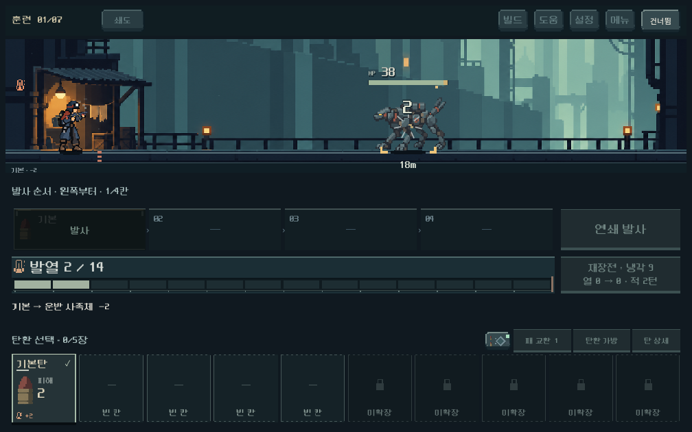
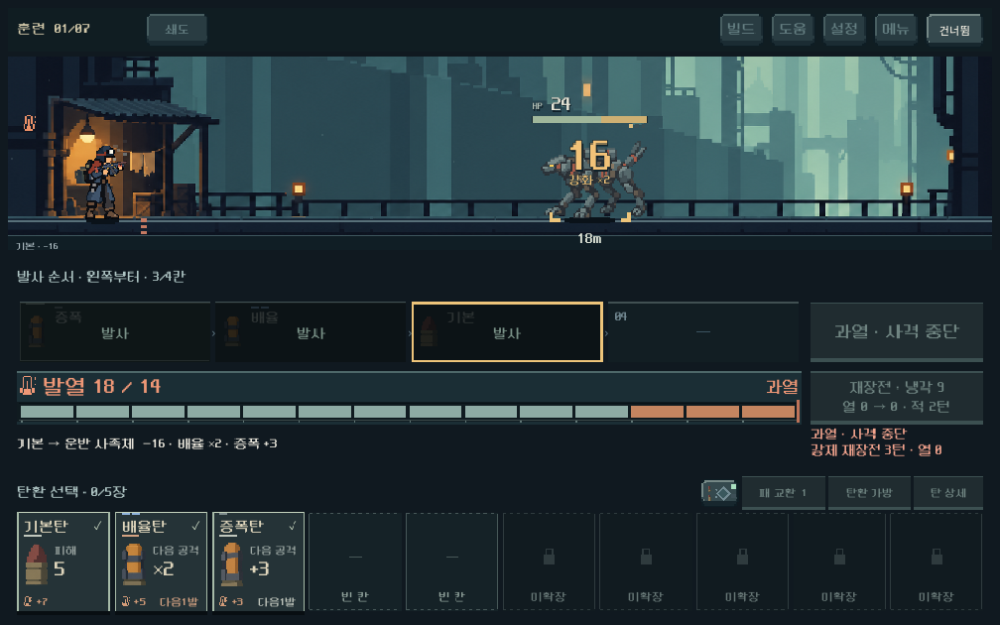
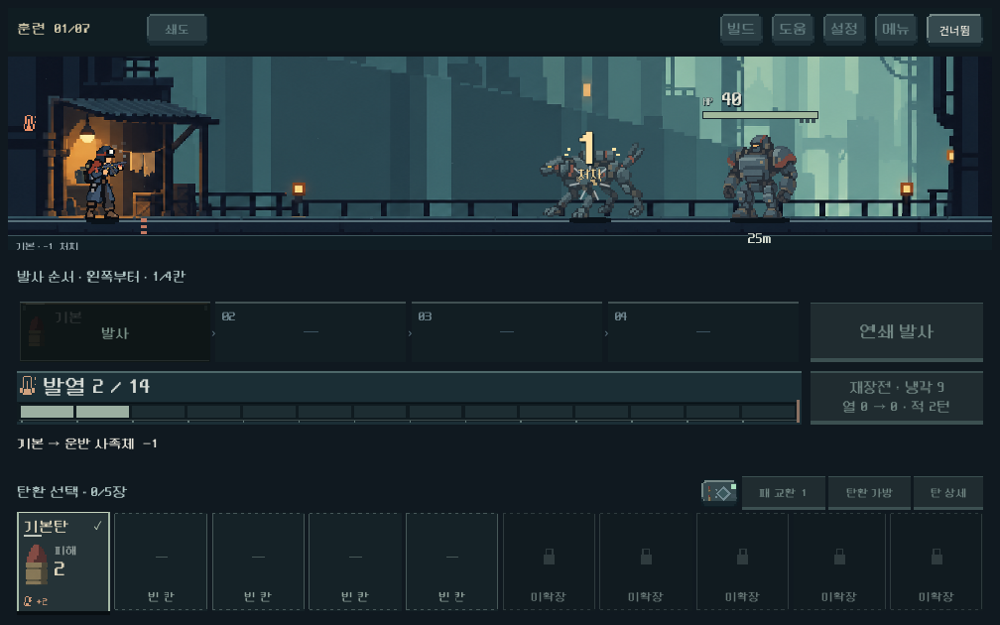
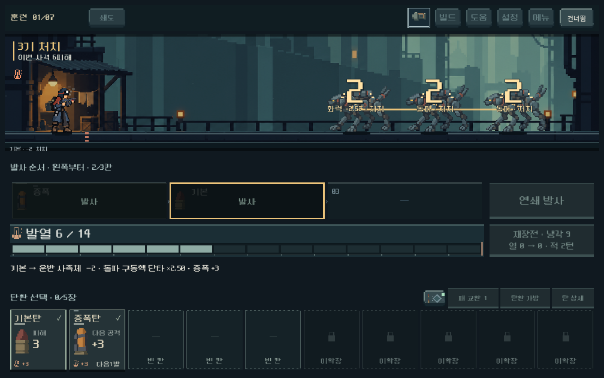
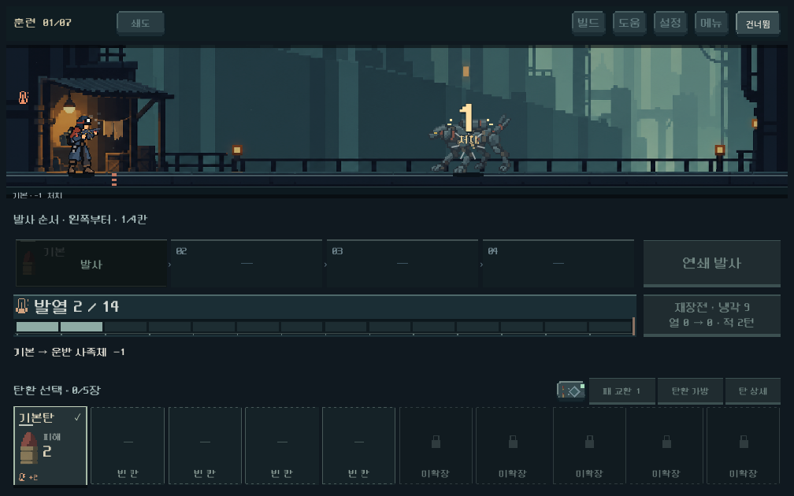

# 큰 피해·처치 숫자와 마지막 처치 피니시

## 사용자 요청과 범위

사용자는 기본탄 위력2~3의 빈도가 높다고 느꼈고, 큰 피해 또는 처치 타격의 숫자 확대와 마지막 적 처치의 슬로우를 요청했다. 발사 결과의 간결함은 긍정 평가했다.

이번에는 전투 연출만 수정했다. 시작 덱 위력1×2장/2×6장/3×2장의 분포는 유지하며 [후속 밸런스 관찰](../../direction/ammo-build-roles.md#플레이-관찰--2026-10-18)로 기록했다. `content.gd`, `model.gd`, `campaign.gd`, `ammo_acquisition.gd`의 작업 전후 SHA256이 동일하다. 전투 계산, 실제 피해 표시값, 저장 형식, 결과 UI 구성은 변경하지 않았다.

## 구현

- 실제 피해 숫자를 일반36 / 강화44 / 피해12 이상56 / 적 처치64로 구분한다. 초기 확대를 포함한 집중 검사에서 일반40·큰 피해64·처치72·피니시80px(논리 화면)을 관찰했다. 공간이 부족하면 크기를 줄여 HP·거리·다른 숫자를 침범하지 않도록 한다. 피해12 기준은 디렉터 조정값이며 확률 치명타 시스템을 도입하지 않았다.
- 처치 숫자는 따뜻한 밝은 금색이다. 압력탄의 `요격`을 적 처치로 취급하지 않는다. 실제 처치가 여러 대상에 일어나면 각 숫자를 해당 위치에서 보여 주고 쓰러지는 배우도 연출 종료까지 유지한다.
- 해결된 전투가 승리이고 대기 증원·생존 적·활성 압력탄이 모두 없을 때만 마지막 처치에 한 번 적용한다. 중간 전열 처치에는 발동하지 않는다. 화상으로 끝나는 전투도 포함한다.
- 기본 피니시는0.065초 충돌 유지 +0.72초 죽음 동작이다. 앞65% 구간에는 사망 진행률30%까지만 재생하고 뒤에서 정상 속도로 복귀한다. 배우 시계와 배경 공기 입자도 느리게 흐르며 배경만 약하게 어둡게 한다. UI 위치·입력·전역 `Engine.time_scale`·모델/RNG는 유지한다.
- 빠르게 설정은 기존0.55배 시간을 적용하고 즉시는 피니시를 생략한다. 진행 중 건너뛰기도 동작한다. 전역 시간 원복을 기다리는 방식이 아니므로 보상 진입이나 다음 전투에 슬로우 상태가 남지 않는다.

## 실제 화면

일반 타격과 큰 피해:

일반 처치와 마지막 동시 처치:

피니시 중반과 복귀:

본편 첫 지역의 생물 아트에서도 동일한 연출과 이후 보상 전환을 확인했다.

정지 이미지는 시간감을 전달하지 못한다. 기능 검사는 실제 프레임의 배우 시계 감속/재생 시간/건너뛰기를 측정했으며 사용자의 타격감·반복 피로도 판단은 실제 플레이로 확인한다.

## 검증

Godot4.7 실제 GPU, 격리 `qa_runtime/finish_feedback/` 및 `qa_runtime/combat_feedback/`, 저장 비활성. 집중 검사는1008×630 /1280×800 /1440×630, 기존 전투 피드백 회귀는1008×630 /1280×900 /1440×630에서 실행했다.

- `powershell -NoProfile -ExecutionPolicy Bypass -File tools/run_finish_feedback_checks.ps1`: **526검사 실패0**. 일반/큰 피해/처치, 마지막 적, 증원 대기, 돌파 동시 처치, 재장전 중 화상 처치, 빠르게/즉시/건너뛰기, 실제 본편 생물 아트와 보상 전환. 각 실제 입력 결과를 독립 모델 실행과 비교한다.
- `powershell -NoProfile -ExecutionPolicy Bypass -File tools/run_combat_feedback_checks.ps1`: 909검사 실패0. 실제 피해/증폭/연타/전이/화상/장갑 파쇄/냉각/과열, 전 프레임의 숫자 경계·HUD/거리 겹침과 모델/RNG 정합성을 확인했다.
- 새 검사 작성 중 타입 추론/SceneTree delta 호출을 교정했다. 즉시 보상 전환 시 해제된 전장 뷰를 검사하던 테스트도 뷰 제거를 고려하도록 수정했다. 기존 회귀의 `UIImpulse` 필수 노드·펄스 두 항목은 이전 카드 개편에서 native 버튼 표면으로 바뀐 구식 전제이므로 제거했다. 누락된 과거 효과를 제품에 다시 설치하지 않았다.
- 엔진 환경의 기존 루트 인증서 저장소 경고가 남는다. 최종 두 실행에 게임 스크립트 오류는 없다. 총1,435검사 실패0이며 대표 캡처를 직접 확인했다.

본편은 루트 `PLAY.cmd`. APK·커밋·푸시는 수행하지 않았다. 기존 사용자 변경을 보존했다. 최종 지속 시간의 선호와 Galaxy 실기 성능·가독성은 아직 검증하지 않았다.
