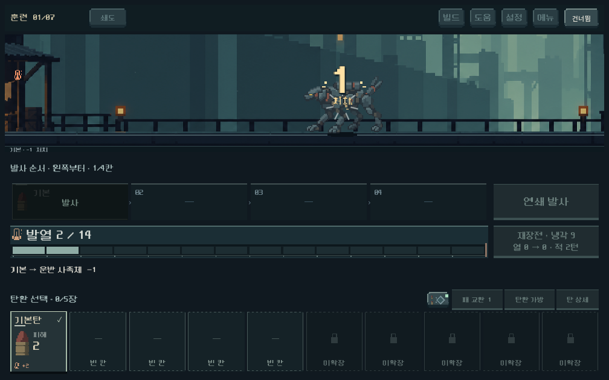
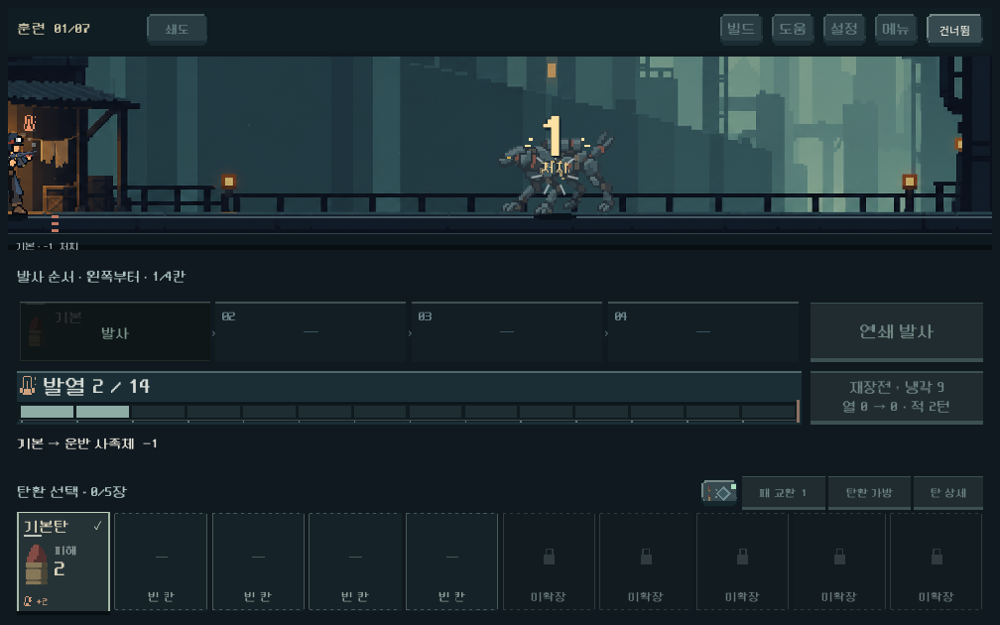
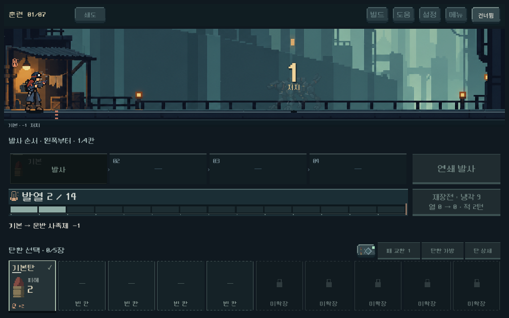

# 마지막 처치 대상으로 전장 줌

## 현행 후속 — 25% 확대·전체2.5초

사용자가 초기 줌을 긍정 평가하고 더 큰 확대와2~3초의 줌인·아웃 시간을 요청했다. 최대 확대를12%→25%, 보통 설정의 전체 피니시를0.785초→2.5초로 조정했다. 충돌 유지65ms 이후 약0.61초 줌인,0.97초 슬로우 유지,0.85초 줌아웃이다. 숫자·대상 프레이밍 제한과 HUD 고정은 그대로다.

기존 격리 GPU 줌 검사를 현행 시간·확대 기준에 맞춰 실행했다.3해상도 **456검사 실패0**. 실제 보통 피니시2.468~2.504초, 빠르게1.371초, 대상별 최대 확대1.25배를 측정했다. 동시·화상·가장자리 처치, 생물 Sprite, 숫자 경계, 건너뛰기·즉시, 모델/RNG 정합성 통과. 기존 환경 인증서 경고 외 스크립트 오류 없음. 대표 캡처 직접 확인; 실제 사용자 체감/Galaxy는 후속이다.

[동시 처치](finish_zoom_2026-10-18/tuning_25/multi_1008.png) · [측정 로그](finish_zoom_2026-10-18/tuning_25/stdout.log)

## 초기12% 버전 기록

사용자가 요청한 피니시 대상 중심의 약한 확대를 본편 전투에 추가했다. 기존 마지막 처치 슬로우 안에서 확대·복귀하므로 연출 시간을 더 늘리지 않는다.

## 적용과 결정

- 마지막 처치 순간 전장만 최대 12% 확대한다. 초반 25% 구간에서 확대하고 마지막 35% 구간에서 원래 구도로 돌아온다. 확대량·구도는 디렉터 초깃값이며 사용자 체감은 확인 전이다.
- 여러 적이 동시에 쓰러지면 해당 무리의 중심을 향하고, 대상과 처치 숫자가 화면 안에 들어오도록 확대·이동을 제한한다. 배경 바깥이 드러나지 않도록 이동 범위도 제한한다.
- 배경·캐릭터·총기·적·타격 효과·피해 숫자가 같은 변환을 사용한다. 별도 Sprite2D로 표시하는 생물도 함께 움직인다. 발열 계기·탄환 카드·발사 버튼·전투 문구는 원래 위치를 유지한다.
- 즉시 연출에서는 생략하며 빠르게/건너뛰기를 따른다. 중간 전열 처치에는 발동하지 않고 기존 동시·화상 처치 조건을 유지한다. 전역 시간, 전투 계산, 기본탄 분포는 바꾸지 않았다.

## 실제 화면

피니시 중반 — 전장은 확대되고 아래 조작부는 고정:

복귀 구간:

[동시 처치](finish_zoom_2026-10-18/multi_1008.png) · [본편 생물](finish_zoom_2026-10-18/wall_finish_1008.png) · [가장자리 대상](finish_zoom_2026-10-18/edge_right_1008.png)

실제 GPU 캡처를 직접 확인했다. 정지 이미지는 시간감을 전달하지 못하므로 자동 검사는 중간 프레임의 확대·복귀도 측정한다. 사용자 연출 선호와 Galaxy 실기 성능은 아직 확인하지 않았다.

## 검증

Godot 4.7, 격리 저장 `qa_runtime/finish_zoom/`와 `qa_runtime/finish_feedback/`, 저장 비활성. 1008×630 / 1280×800 / 1440×630에서 실제 터치 입력으로 실행했다.

- `tools/run_finish_zoom_checks.ps1`: **452검사 실패0**. 실제 확대·복귀, HUD 고정, 배경 빈틈·숫자 잘림, 화면 양 끝 대상, 동시·화상 처치, 별도 생물 Sprite 변환, 빠르게/즉시/건너뛰기와 모델/RNG 정합성.
- `tools/run_finish_feedback_checks.ps1`: **526검사 실패0**. 기존 일반/큰 피해/처치 숫자, 증원 대기, 피니시와 보상 전환 회귀.
- 합계 **978검사 실패0**. 루트 인증서 저장소의 기존 엔진 환경 경고 외 게임 스크립트 오류 없음. 주요 규칙 4파일의 작업 전후 SHA256 동일. 기존 미커밋 변경 보존.

실행은 루트 `PLAY.cmd`. APK·커밋·푸시는 수행하지 않았다. [줌 로그](finish_zoom_2026-10-18/zoom_stdout.log) · [회귀 로그](finish_zoom_2026-10-18/regression_stdout.log).
