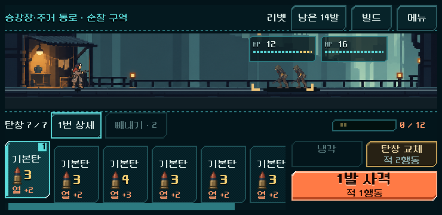
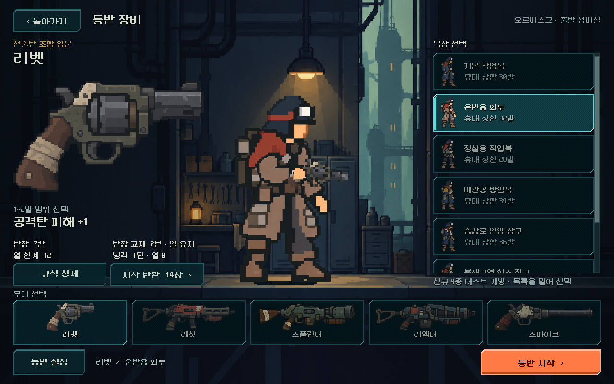

# 본편 사격·열 관리 통합과 덱 빌딩 검토

2026-11-02 착수, 11-03 검증/기록. 사용자 요청: 후반·파츠·탄약 검증과 본편 통합 진행, 덱 빌딩 재미 점검. 이어서 "그냥 별 생각없이 사격을 해도 진행이 돼"라고 구체화했다.

## 적용 결과

`PLAY.cmd`의 **새 등반**에 [사격 범위·열 관리](../../direction/fire-control.md)를 연결했다. 첫 탄부터 드래그→사격 확정, 기존 짧은 탭→빼내기, 메뉴 발수 조절을 공통 HUD에서 사용한다. 발사 예측/표시/실제 탄 소모/저장을 같은 모델로 연결했다. 드래그 중 같은 발수에 머물면 예측을 반복 계산하지 않는다.

탄창 교체는 기존 비용과 예비 순환을 유지하며 열·연속 발열을 지우지 않는다. 냉각 약실+4는 유지한다. 전용 냉각은1행동으로 열0·연속 누적 초기화·잔탄 보존. 고열 위력 감소는 껐다. 장비/총기 상세와 파츠 교체 수치를 실제 규칙에 맞췄다. 기존 저장과 훈련은 원래 규칙이며, 캠페인/전투의 버전 불일치나 본편 저장에 실험 설정을 끼운 경우 거절한다.

## 후반 검증에서 바뀐 판단

1. 비교판의 부분 냉각과 교체2행동을 그대로 연결하자 스플린터2구역 정예와 스파이크 최종 보스에서 기존 획득 경로의 승리를 찾지 못했다. 제한 탐색의 실패이며 불가능 증명은 아니다.
2. 전용 냉각을 열0으로 강화해 스파이크를 포함한4총기의 전체 등반을 확인했다. 스플린터의 해당 정예는 폭384/깊이100과 앞줄 빼내기를 포함해도 해법을 찾지 못했다.
3. 교체1행동도 시험했다. 해당 두 상태는 승리 경로가 생겼으나, 독립125상태의 사격/빈 탄창 교체 반복 통과가99→107로 늘어 **채택하지 않았다**.
4. 최종은 교체2행동 유지+전용 냉각 강화다. 스플린터는 같은 시드에서 공개된 정예 표시를 보고 다른 경로를 택하고 코어에 맞는 탄을 우선 획득해 완주했다. 다른 시드17의 정예 우선 경로도 완주했다. 특정 덱/경로의 어려운 정예를 없애거나 성공 사례로 바꾸어 기록하지 않는다.

## 연속 등반과 한계

| 시드·경로/획득 정책 | 총기 | 실제 전투 | 결과 |
| --- | --- | ---: | --- |
|731042·기존 상점/정비 우선 정책 | 리벳·래칫·리액터·스파이크 |100 |4등반 완주 |
|731042·정예 대안 경로/코어 탄 우선 | 스플린터 |24 |완주 |
|17·정예 우선/코어 탄 우선 | 스플린터 |30 |완주 |

합계6등반154전투. 새 Campaign에서 출발해 실제 지도·보상·구매·정비·전투 명령만 사용했다. 승리나 재화를 주입하지 않았다. 확인한 경로에서 비상 보급은0회, 의도적 냉각은46회였다. 적은 일부 시점에서 접촉 직전까지 도달한다. 스파이크 최종 보스의 최소 거리는1이며 여유가 큰 완주라고 보지 않는다.

탐색은 미래 탄 순서/RNG를 사용한다. 최적 경로나 사람 승률을 측정한 것이 아니다. 총기5종 모두 같은 획득 경로가 통과했다는 주장도 아니다. 스플린터 시드731042의2구역 정예10301·기존 덱은 여전히 미해결 균형 사례다. [기존 경로 실패](fire_control_2026-11-03_assets/scatter_blocked.json) · [넓은 탐색](fire_control_2026-11-03_assets/probe_vent.json).

## 덱 빌딩 검사

사용자의 사격 반복 문제는 별도로 확인했다. 기존 획득 상태125개에서 사격·빈 탄창 교체·소진 시 비상 보급만 쓰는 정책은 기존99개, 최종 규칙에서도99개를 통과했다. 이 정책에는 의도적 냉각·범위 선택·빼내기·미래 정보 판단이 없다. **입력과 열 관리를 통합했다고 덱 빌딩 재미가 해결된 것은 아니다.**

같은 탄 순서에서 파츠 효과를 제거한 인공 대조는16개만 통과했다. 성장 효과는 강하지만, 전투 중 선택을 건너뛰어도 해결되는 구간이 많다는 판단이다. 초반에는 특수탄 밀도가 낮고, 후반에는 많은 계열을1~2장씩 갖는 경향도 관측했다. 실제 사용자 덱이나 보상 전체의 일반화는 피한다. [상세 수치·근거·다음 개편](../../history/design/deckbuilding-review-2026-11-03.md) · [원시 결과](fire_control_2026-11-03_assets/audit.json).

## 실제 Godot 화면

740×360. 선택한 첫 탄만 올라오고1발 사격으로 표시된다. 기존 카드/전장 배치를 사용한다.

1280×800 장비 화면. 교체와 냉각의 실제 비용/열 처리를 구별하고 시작 탄약 수를 현재 총기에 맞춰 표시한다.

844×390·1280×800·2016×908에서도 선택/배치 검사를 수행했다. PC의 터치 이벤트·확대 배율 검사이며 Android 실제 터치/안전 영역·회전 검증은 아니다.

## 검사

Godot4.7, 모든 검사와 재개는 `qa_runtime/fire_control_20261102/` 등 격리 저장에서 수행했다. 날짜 표기는 착수일이며 최종 결과는11월3일이다.

| 검사 | 결과/범위 |
| --- | --- |
| `run_fire_control.ps1 -Mode rules -Label release` |249검사 실패0. 새/이전 저장, 선택 소모/예측, 열 유지,6종 파츠×5총기 냉각 계약, 잘못된 버전/실험 설정 거절 |
| `-Mode ui -Label release` |165검사 실패0. 실제 새 등반 버튼,4크기/5총기 드래그·사격·교체·냉각·빼내기·메뉴, 자동 저장·이전 HUD |
| `-Mode restart -Label release -Stage write/read` |8/14검사 실패0. 별도 프로세스에서 본편 이어하기·선택 발수·열·RNG·빼내기 잔여량 일치 |
| 전체 등반 |14,953검사 실패0인6완주. 전투/보상/정비/관문마다 정확한 저장 왕복 |
| 최종 소스 재생 |16,147검사 실패0. [전체154전투 명령과 시간·저장 재검증](fire_control_2026-11-03_assets/replay.json) |
| 기존 비교 규칙 |5,805검사 실패0 |
| 공통 HUD 회귀 |`run_prototype_hud.ps1 -Mode ui -Fast` 11,536검사 실패0 |
| 리소스 임포트 |`run_prototype_hud.ps1 -Mode import` 통과 |

초기 검사에서 새 숫자 버전의 JSON float 복원을 거절하던 오류를 수정했다. UI 검사 재실행 시 격리 저장의 ‘진행 중 등반 교체’ 확인창을 무시하던 테스트도 바로잡아 새 저장에서 시작한다. 해당 테스트 실패를 제품 기능 통과로 기록하지 않았다. 파츠 계약 중 일부는 통제된 단위검사 상태이며 실제 획득 결과와 구분한다.

[소스/결과 해시](fire_control_2026-11-03_assets/manifest.json) · [이번 변경만 분리한 패치](fire_control_2026-11-03_assets/change.patch). 기존 미커밋 변경을 보존하고 작업 시작 상태를 별도로 저장했다.

## 남은 범위

다음은 덱에 따라 대응이 달라지는 대표 편성, 핵심 탄의 집중 확보와 연계 보상, 자동 성장/능동 선택의 보상 배분이다. 덱/보상/적 개편은 이번 검사 결과를 기반으로 진행할 후속이며 아직 적용하지 않았다. Android 지속 성능/기기 발열·실제 손가락 조작, 기존 복장 혼합 제보는 미확인 상태다. 지도 전투 밀도도 후속으로 유지한다. APK·커밋·푸시·외부 게시 없음.
