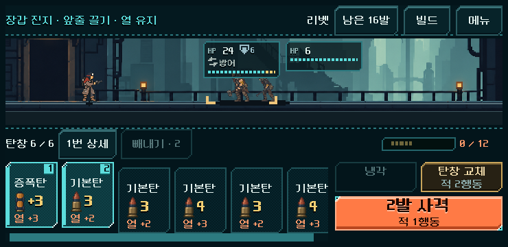
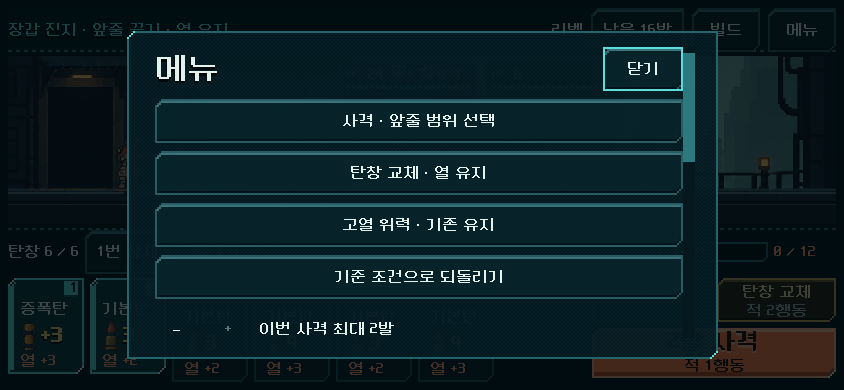

# 사격 범위·교체·냉각 비교 검증

2026-11-02. 사용자 실행 지시에 따라 [비교 설계](../../direction/fire-heat-comparison.md)를 실제 Godot 모델과 공통 HUD에 연결했다. 본편 규칙 전환이 아닌 플레이 가능한 격리 비교다.

## 실행

저장소 루트의 `OPEN_MAGAZINE_COMPARISON.cmd` 실행. 기본은 **앞줄 드래그 + 교체 시 열 유지 + 고열 위력 기존 유지**, 장갑 진지/리벳이다. 첫 탄부터 오른쪽으로 끌어 선택하고 사격을 누른다. 짧게 누른 탄은 기존처럼 빼내기로 제거한다. 메뉴에서 사격·교체·고열 조건을 각각 바꾸거나 기준 조건으로 복귀한다. 다음 총기/다음 전투도 메뉴에 있다.

5총기 × 첫 교전101·장갑 진지401·첫 관문802. 기존 전체 등반 검증에서 현행 `magazine_build_version=2`로 획득한 실제 진입 상태15개를 복사했다. [출처와 상태](../../../새-게임-프로젝트/redesign/samples/fire_heat/openings.json). 연속 등반·새 보상 획득 검증으로 확대 해석하지 않는다.

## 실제 화면

740×360. 별도 안내 카드를 추가하지 않고 기존 제목/메뉴에 조건을 표시한다. 발사 범위는 기존 상승 카드·테두리·사격 버튼 발수에 연결했다.

844×390. 설정은 독립적으로 바꿀 수 있고 바꾸면 같은 진입 상태로 재시작한다.

1280×800도 캡처/배치 확인했다. 작은 화면에서 앞줄 선택·되돌리기·취소·실제 사격을 5총기로 검사했다. 가장자리 스크롤은 총기 발수 한계를 넘기지 않는다. PC에서 발생시킨 터치 이벤트 검증이며 Android 기기 손가락 조작의 증거는 아니다.

## 같은 상태에서 선택이 달라지는 사례

**래칫/장갑 진지, 실제 진행 후 열8·연속 공격2:** 열 유지 조건에서1발 선택은 피해7·적1행동·열11. 2발 또는3발 선택은 과열로2발에서 멈추고 피해11·강제 냉각 포함 적4행동·열0이다. 더 큰 피해와 적에게 내주는 시간이 실제로 갈린다. 짧은 사격을 무료 행동으로 처리하지 않는다.

**리벳/장갑 진지, 실제 진행 후 열11·연속 공격3·잔탄2:**

| 선택 | 이후 열 | 연속 누적 | 적 행동 | 이후 탄창 |
| --- | ---: | ---: | ---: | ---: |
| 냉각 | 5 | 0 | 1 | 기존2발 보존 |
| 기존 교체 | 3 | 0 | 2 | 새6발 |
| 열 유지 교체 | 11 | 3 | 2 | 새6발 |
| 열−2 교체 | 9 | 3 | 2 | 새6발 |

교체에서 열/누적 감소를 떼어 내면 냉각의 역할이 명확해진다. 다만 재장전 뒤 추가 냉각이 반복되어 전투가 늘어질 가능성은 사람 테스트 대상으로 남는다. 고열80%는 장갑/버림 때문에 저위력탄에 더 큰 영향을 줄 수 있어 기본값에서 껐다. 열압 파츠의 강화와 성능 저하를 함께 최종 채택하지 않았다.

원시 비교는 [동일 상태·합법 경로 기록](fire_heat_comparison_2026-11-02_assets/matrix.json)에 있다. 상태에는 RNG와 탄 순서가 포함된다.

## 기능과 회귀

Godot4.7, 별도 APPDATA/LOCALAPPDATA, 오류0. 모든 실행은 `qa_runtime/` 안의 격리 저장을 사용했다.

| 검사 | 결과 | 범위 |
| --- | --- | --- |
| `run_fire_heat_checks.ps1 -Mode rules` | 5,805 / 실패0 | 기존15상태의 변경 전 모델과 전체 결과 일치, 앞줄 소모/강행 한계, 예측·RNG·저장, 교체/냉각, 고열 경계, 재장전 도중 패배 저장 |
| `run_fire_heat_checks.ps1 -Mode ui` | 105 / 실패0 | 3크기,5총기 터치·마우스, 짧은 탭 빼내기, 밖에 놓기/Esc/포커스/다중 터치 취소, 긴 탄창 스크롤, 조건 전환·메뉴−/+·저장 재개 |
| `run_fire_heat_checks.ps1 -Mode matrix` | 658 / 실패0 | 15진입×5조건의75승리 경로를 실제 명령으로 재생 |
| `run_weapon_magazine.ps1 -Mode rules` | 7,101 / 실패0 | 기존 총기·탄창 규칙 회귀 |
| `run_prototype_hud.ps1 -Mode ui -Fast` | 11,536 / 실패0 | 기존 공통 HUD 회귀 |
| `run_prototype_hud.ps1 -Mode import` | 통과 | 전체 Godot 리소스 임포트/파싱 |

[규칙 원시 결과](fire_heat_comparison_2026-11-02_assets/rules.json) · [조작 결과](fire_heat_comparison_2026-11-02_assets/ui.json). 고열75% 경계와 냉각 약실+4의 일부 검사는 명시적으로 만든 단위검사 상태다. 이를 실제 획득/플레이 결과로 세지 않았다. 기존 상태에는 실험 키가 없으므로 바뀐 규칙을 적용하지 않는다. 잘못된 실험 저장은 원래 모델을 변형하지 않고 거절한다. 비교 저장 재개는 장면 재생성으로 확인했다.

경로 검사는 폭24/깊이36, 실패 시64/60의 제한 탐색이다. 실제 RNG를 포함하고 빼내기 대안은 탐색하지 않는다. **75/75는 이 조건에서 승리 경로를 찾았다는 뜻이며 최적 턴·사람 승률·전체 균형의 증거가 아니다.** 더 큰 선택 집합에서 더 느린 경로를 찾기도 하므로 조건별 총턴을 우열 판단에 사용하지 않았다.

## 변경 근거와 남은 일

[이번 변경분](fire_heat_comparison_2026-11-02_assets/change.patch) · [소스/검증 해시](fire_heat_comparison_2026-11-02_assets/manifest.json). 기존 사용자 변경이 많은 작업 트리에서 시작했으며 변경 전 파일을 기준으로 이번 수정만 분리했다. 신규 비교 파일·검사도 패치에 포함했다.

사람의 선택 이해도·조작 피로·전투 호흡, 다른 획득 순서와 후반 전체 등반, Android 실제 터치/복귀·지속 성능/기기 발열은 남는다. 기존 재장전 복장 혼합 제보는 미재현 상태 그대로다. `PLAY.cmd` 기본 진입·기존 저장·지도 생성은 유지했다. APK 생성·커밋·푸시·외부 게시 없음.
