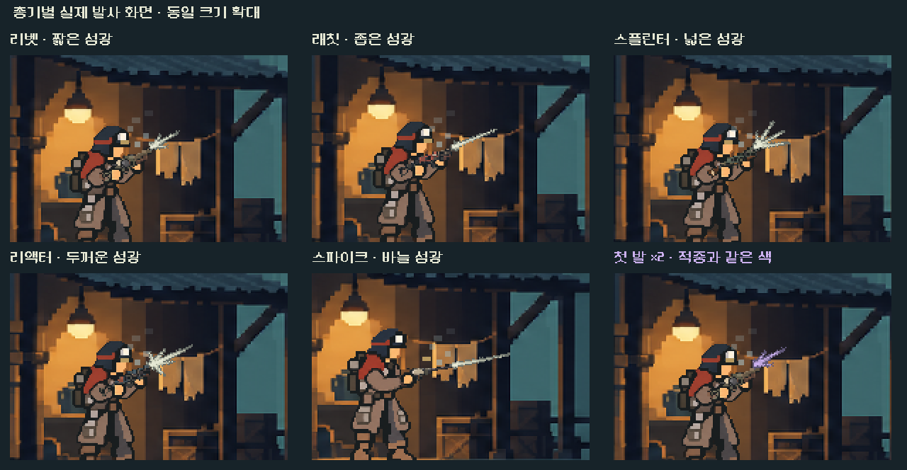
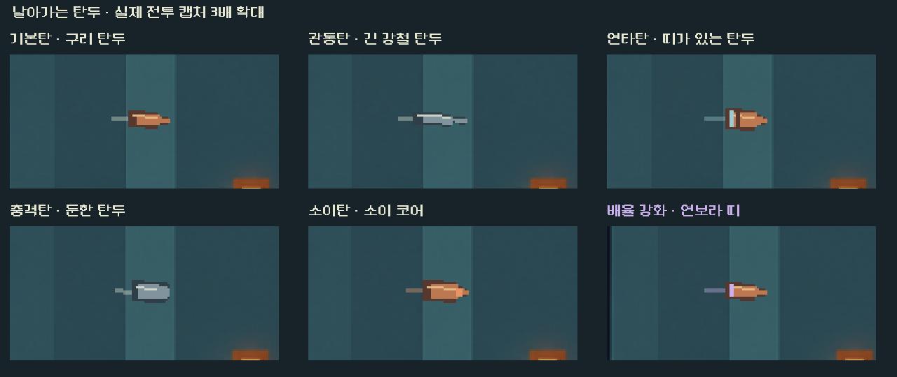

# 총기별 총구 섬광과 탄도 1차 적용

**리소스 수 범위 정정:** 아래360/361개는 공유 HUD의 별도5전투 연구판 정적 목록이다. 본편 전체 수/패키지 포함 검사와 구분한다. 실제 본편 연결은 main.tscn/공개 사격 검사로 검수했다. [후속 본편 진입 기준 검사](../interaction_fx_2026-11-06/README.md).

**최신 후속:** 사용자가 탄환 모양의 비행체를 요청해 [탄두형 투사체](#탄두형-투사체-후속)를 추가했다. 아래 섬광 비교/원래 검증은 보존하고 최신 비행 비교/증거는 문서 끝에 기록했다.

2026-11-06. 승인된 다음 단계인 발사 VFX를 본편에 적용했다. 형태/강도는 디렉터 구현안이며 사람의 미감·Galaxy S26 실기기 확인은 남는다.

통제 전투의 실제 총구 주변을 같은 크기로 잘라 정수2배 확대했다. 비교 캡처만3배 느리게 재생했으며 본편 시간은 유지했다. 작은 창/실제 획득 검사는 보통 속도다.

| 총기 | 발사 표현 |
|---|---|
| 리벳 | 짧은 가지형 섬광, 짧은 탄도 |
| 래칫 | 좁고 긴 섬광, 같은 탄도 안의 작은 눈금 |
| 스플린터 | 넓은 가스 섬광, 굵고 짧은 단일 탄도 |
| 리액터 | 두꺼운 섬광, 실제 강행 사격에만 총구 양옆 가스 |
| 스파이크 | 가늘고 긴 바늘형 섬광/탄도 |

실제 결과 하나당 섬광 한 번과 탄도 한 줄이다. 타격 스택을 별도 발사로 만들거나 가짜 산탄을 추가하지 않는다. 실제 강행의 추가 탄은 별도 결과이므로 별도 발사로 표시한다. 지원 탄은 작은 저채도 운반 표시로 남긴다.

## 위치·색·유지 범위

- 중복되던 기본/강화 섬광과 탄도를 통합했다. 섬광은 실제 복장·자세·반동의 무기 총구 좌표/회전을 따른다.
- 발사 순간 출발점을 고정해 탄이 회복 중인 총구를 따라 흔들리지 않는다. 꼬리는 실제 이동 거리 내에서만 그리며 도착점은 실제 대상/요격 표적 좌표다.
- 일반 아이보리·가산 황동·배율 연보라·열/강행 주황·연타 청색을 [적중 기준](../impact_parts_2026-11-06/README.md)과 공유한다. 막힘/요격의 발사에도 적용된 강화색은 유지하지만 피해0의 적중에 배율 폭발을 만들지는 않는다. 지원 준비는 강화 공격처럼 보이지 않는다.
- 동작 축소/즉시 연출은 시트와 가스 장식을 생략하고 작은 섬광/짧은 단일 선과 정보색을 유지한다.
- 전투 계산·예측·목표/RNG·저장·입력·카드 배치/크기와 기존 비행0.19초·피니시/반동/탄피/소리/충돌 시간은 유지했다.

## 제작

고정 pixelfx0.3.0의 pistol/shotgun 후보를 렌더/검토했다. 원본에는 탄피·연기·다수 탄도가 있어 `flashShape/flash`만 사용해 섬광을 따로 구웠다. 외부 원본 저장소는 수정하지 않았다.

- [재생성 도구](../../../../tools/build_firing_fx.mjs): `node tools/build_firing_fx.mjs`.
- [출처·고정 커밋/옵션·해시](../../../../새-게임-프로젝트/assets/art/firing_fx_20261106/provenance.json), 같은 폴더의 MIT 라이선스/고지.
- 시트480×384, 셀96×64/5열/총30프레임. 총기별6프레임 중 앞2프레임은 한 번의 최대 섬광, 다음2프레임은 축소, 마지막2프레임은 투명하다. 피벗(20,32)을 총구에 맞췄다.
- 중립 시트1개를 캐시하고 결과색으로 변조한다. 런타임 JS/입자 시뮬레이션/난수·추가 소리/지연은 없다. 기존 비행 초반에서 재생한다.
- 여정360개 선택 리소스에 새 시트/스크립트가 포함된다. 샘플 원본·QA 후보·제작 JS는 본편 참조 목록에 없다. APK는 생성하지 않았다.

## 검증

격리 저장의 PC 네이티브 Godot4.7 Compatibility에서 수행했다.

| 검사 | 결과 |
|---|---|
| `tools/run_firing_fx.ps1 -Mode rules` | 777검사 실패0. 실제 결과 색/강행·막힘/지원, 고유·투명 시트, 근거리/동일 좌표·여러 방향에서 꼬리 제한 |
| `-Mode ui` | 9,979검사 실패0.25구성/96단계 캡처, 실제 시트색 픽셀·고정 출발점·대상/효과 정리 |
| 복장/반동 | 5총기×7복장×5반동=175개 좌표/회전 확인. 전체 복장을 전투로 각각 재생한 검사는 아니다 |
| 실제 입력/저장 | 공개 Fire마다 전체 모델/RNG가 오라클과 일치. 기존 획득 경로의 리벳/래칫/리액터로 사격→격리 저장/복원 일치 |
| 작은 창/동작 축소 | 1008×454에서5총기, 중첩 배율·동작 축소/공개 입력 확인. 실기기 검사가 아니다 |
| 기존 파츠 적중 | 판정172/네이티브291검사 실패0 |
| 기존 `run_prototype_hud.ps1 -Mode ui -Fast` | 11,558검사 실패0 |
| 소스/참조 | 모델/캠페인/예측/계산/무기 배우·프로필7파일 해시 동일, 선택 리소스360개 |

[작은 창](small_window.png) · [실제 강행](overdrive.png) · [동작 축소](reduced.png) · [검증 요약](validation.json). 원본96캡처/좌표·프로필/격리 저장은 저장소 `qa_runtime/firing_fx_20261106/`에 보존한다. 초기777/928도 통과했지만 최종 수치는 캡처 중 파일 쓰기를 뒤로 옮기고 강행/지원·픽셀 검사를 추가한777/9,979다.

사람 체감·연속 발사 피로·S26 장시간 성능은 미검증이다. 다음은36~37번 재질/장갑·차폐 타격과 전이·불씨/지역 불길 구분이다. 신규 총기·버튼/구매 반응 등 기존 후속 목록도 유지한다.

## 탄두형 투사체 후속

사용자 요청: 날아가는 탄도 탄환 모양이면 좋겠다. 선과 흰 점 중심의 기존 비행을 **금속 탄두+짧고 약한 잔상**으로 교체했다.

실제 전투 비행 중 캡처를 같은 크기로 잘라 정수3배 확대했다. 기본 구리 탄두, 관통 침형 강철, 연타 띠형, 충격 둔형 강철, 소이형과 파츠 배율 강화 띠를 비교한다. 탄종별 전부 고유 그림을 만든 것은 아니며 역할 계열의 실루엣을 공유한다. 지원 탄은 저채도 캡슐로, 동작 축소에서도 작은 탄두 모양은 유지하되 잔상은 생략한다.

- 승인 탄환 원화의 구리/강철 색면을 참고해 Godot에서 작은 계단형 도형/명암을 그린다. 별도 PNG/입자·난수/콜리전은 추가하지 않았다. 탄종 원본과 강화/임시 변형은 `Content.source_id`로 같은 계열을 사용한다.
- 탄두 코끝이 실제 도착점이며 비행 방향에 맞춰 회전한다. 총구에서 나오기 전 몸통/잔상이 뒤로 늘어나지 않도록 실제 이동 거리만큼만 드러낸다. 발사 수·위치와 기존 피니시 카메라 변환을 유지한다.
- 금속 몸통 색을 지키고 파츠의 실제 강화색은 띠/잔상에 표시한다. 강화 효과가 없는 일반탄에는 가짜 강화 띠를 만들지 않는다. 실제 피해/요격/막힘 계산과 적중 폭발 조건은 그대로다.
- **외형만 변경했다.** 기존 비행0.19초/반동·소리·피니시/명중 판정·전투 계산/RNG·저장·입력·카드 배치/크기는 유지한다.

검증: `tools/run_firing_fx.ps1 -Mode rules -Label projectile` 777검사 실패0. `-Mode projectile -Label projectile` 5,338검사 실패0/17구성·66단계 캡처. 실제 화면의 금속 몸통/강화 띠 픽셀,5총기/1008×454·동작 축소와 효과 정리를 확인했다. 공개 Fire마다 전체 모델/RNG가 오라클과 같았으며 기존 획득 경로3총기의 사격 후 격리 저장/복원도 같았다. 큰 비교 화면은3배 느리게 캡처하고 작은 창/획득 경로는 보통 속도다. 기존 HUD11,558검사도 실패0.

모델/캠페인/예측/탄환·파츠 계산/무기 배우·프로필/기존 적중 기준과 비행 함수의 소스 해시를 유지했다. 여정361참조에 `projectile_visual.gd`가 추가되며 새 비트맵은 없다. [전체 전투의 실제 비행](projectile_full.png) · [작은 창](projectile_small.png) · [최신 검증/해시](projectile_validation.json). 상세 캡처/로그는 `qa_runtime/firing_fx_20261106/projectile/`에 격리했다. 사람 체감/실제 S26 지속 성능은 미검증이며 APK/커밋/푸시/외부 게시를 수행하지 않았다.
