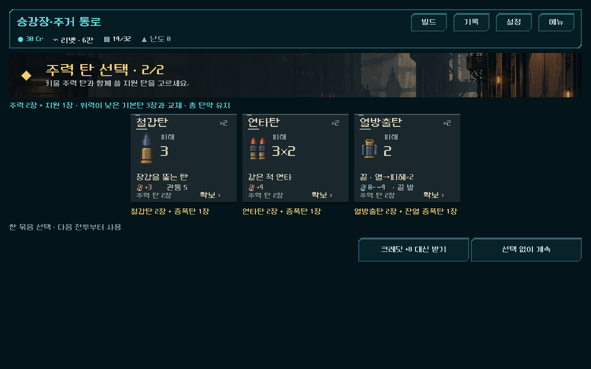
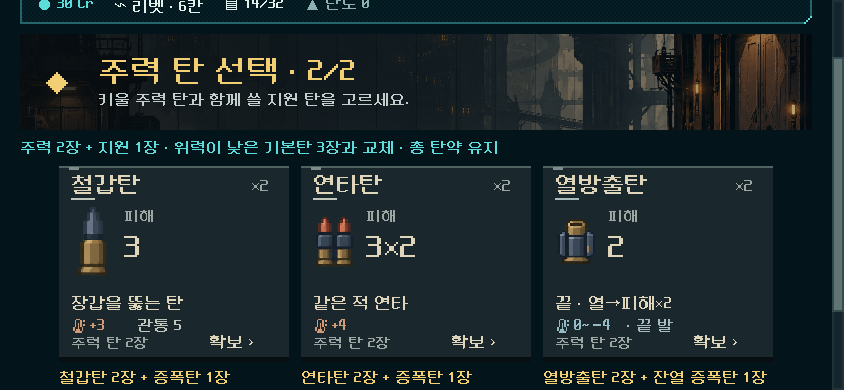
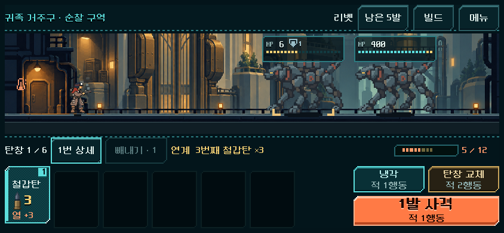

# 핵심 탄·발사 위치 파츠 본편 적용

2026-11-03. 사용자 승인: 핵심 탄으로 피해를 크게 키우는 성장 구조, 세 번째 발 강화 등 파츠 재검토. [현재 규칙](../../direction/focus-build.md). `PLAY.cmd` → **새 등반**에 적용했다. 기존 저장의 탄·보상·파츠 규칙은 유지한다. 재미의 사람 검증은 아직이다.

## 적용한 흐름

첫 전투에서 성장 코어를 고른 다음 연타·철갑·열방출 중 주력 탄을 선택한다. 주력 2장과 지원 1장이 낮은 위력의 기본탄 3장을 대체하므로 시작 탄약 총량은 그대로다. 이후 보상·공방·보급은 같은 주력의 복사본과 지원을 제시하고, 첫 구역 깊이 4부터 가능한 화력 개조본/압축본도 제시한다. 상점 탄 진열은 주력을 보충할 수 있다. 강화는 **새 1장 확보**이며 기존 모든 탄을 자동 변경하지 않는다. 현재 탄의 발열·점유 칸·위치 제약은 유지한다.

선두 격발기는 첫 발 직접 피해 ×2, 새 모듈 제3 격발기는 세 번째 실제 발사 탄 ×3, 후미 점화기는 실제 증폭을 받은 마지막 단타 ×3이다. 제3 격발기는 새 등반의 초반 첫 미발견 파츠 진열에 나오며 이후 일반 파츠 풀에도 포함된다. 지원탄은 순서에 포함하고, 빼내기는 제외한다. 부분 사격·냉각·저장 복원으로 순서를 초기화하지 않으며 교체 시 초기화한다.

성장 코어·증폭·연타·방열·관통 파츠의 기존 역할은 남겼다. 모든 파츠를 위치 조건으로 바꾸거나 적 체력을 일괄 상향하지 않았다. 큰 피해가 실제 어느 탄과 파츠에서 나왔는지를 HUD 연계 문구·발동 표시·피해 표시로 연결했다. 새 보상 화면은 작은 창에서 정수 크기의 글자와 스크롤을 쓰고 지도/메뉴로 나갈 때 원래 배율을 복원한다.

## 선택에 따른 피해 차이

아래는 실제 Model/Forecast로 만든 **통제된 기능 사례**다. 획득한 덱의 일반 승률이나 사람이 선택할 확률을 뜻하지 않는다. 적 체력/거리를 충분히 둬 초과 피해와 조작 시점을 측정했다.

| 비교 | 관측 |
| --- | --- |
| 동일 탄창 `기본탄 → 증폭 → 기본탄 → 연타` | 그대로 쏜 마지막 연타 6피해. 가운데 기본탄을 합법적으로 빼내 증폭·세 번째 위치를 연타에 맞추면 36피해 |
| `기본탄 → 증폭 → 철갑`, 제3 격발기 + 후미 점화기 + 돌파 코어 | 합산 6 × 위치 3 × 후미 3 × 코어 2 = 108 직접 피해. 일괄 피해 상향이 아니라 조건의 중첩 |
| 세 번째 자리에 지원탄 | 직접 피해·위치 배율 없음. 다음 공격으로 위치 배율을 넘겨주지 않음 |
| 연타의 남은 타격 | 다음 적으로 전달될 때도 그 탄의 위치 배율을 유지. 재귀적인 추가 발동 없음 |
| 산개 | 서로 다른 장갑을 가진 3표적의 공개 예측 범위 안에 실제 피해가 들어옴. 숨은 표적을 확정으로 표시하지 않음 |

[규칙 검사 원시 결과](focus_build_2026-11-03_assets/rules.json). 6→36은 해당 조건에서 주력 탄 한 발의 피해이며 모든 덱의 피해가 6배가 됐다는 주장이 아니다.

## 실제 획득으로 전체 등반

시드 731042, 운반복, 현재 지도의 합법 경로와 구매·보상·교체·관문 선택을 사용했다. 승리·크레딧·파츠를 주입하지 않았다. 획득 정책은 공개된 주력/지원/강화와 소유 파츠를 사용한다. 전투 탐색은 미래 탄 순서/RNG를 보므로 사람의 난도·승률이나 최적 행동 증거가 아니다.

| 총기 | 전투 | 사용 행동 합계 | 수동 냉각 | 비상 보급 | 완주 |
| --- | ---: | ---: | ---: | ---: | --- |
| 리벳(single) | 25 | 318 | 2 | 1 | 성공 |
| 래칫(burst) | 25 | 275 | 4 | 0 | 성공 |
| 스플린터(scatter) | 25 | 280 | 5 | 0 | 성공 |
| 리액터(heavy) | 25 | 429 | 6 | 4 | 성공 |
| 스파이크(amplifier) | 25 | 270 | 10 | 0 | 성공 |

5등반 125전투, 획득/입력/저장 검사 11,892개 실패 0. 같은 명령을 별도로 현재 코드에 재생해 **12,876개 실패 0**, 최종 덱·행동 시간·정상 도달 보상 1회 지급을 확인했다. [주요 3총기](focus_build_2026-11-03_assets/climb_primary.json) · [다른 2총기](focus_build_2026-11-03_assets/climb_alternate.json) · [현재 소스 재생](focus_build_2026-11-03_assets/replay.json).

처음의 복사본 위주 후보와 획득 정책은 리벳·스파이크 최종 보스에서 제한 탐색이 실패했다. 이후 강화 프로필의 실제 확보 경로를 연결하고, 검사 정책도 주력 5장 제한에서 7장과 보유 관통 파츠 선택으로 바꿨다. 최종 성공을 강화 후보 하나의 단독 효과로 해석하지 않는다. 초기 실패도 [별도 기록](focus_build_2026-11-03_assets/initial_primary.json)에 보존한다. 리벳/리액터의 비상 보급 사용은 남은 자원 균형 확인 사항이다.

최종 완주 경로는 빼내기를 사용하지 않았다. 잘 구성한 덱이 그대로 사격해도 강한 상황은 허용한다. 별도의 같은 덱 비교가 빼내기로 주력 탄을 맞추는 선택의 이득을 입증하지만, 전체 등반에서 얼마나 자연스럽게 쓰는지는 사람 확인이 필요하다. 이전 99/125 반복 통과 수치를 낮추는 것을 이번 개편의 성공 기준으로 사용하지 않는다.

## 실제 화면·조작

1280×800 첫 주력 선택. 묶음의 수량과 실제 지원 탄을 선택 전에 표시한다.

844×390에서는 전체 화면 축소를 해제하고 세로 스크롤을 사용한다. 740×360은 두 열로 배치하며 아래의 세 번째 선택지도 실제 터치로 선택했다.

실제 HUD에 통제 상태를 표시해 가운데 탄 빼내기 → 1발씩 사격 → 세 번째 철갑탄 배율을 확인했다. 이 그림의 적/탄창은 설명용 통제 상태이며 획득 경로 화면과 구분한다.

## 검사와 경계

모든 검사는 `qa_runtime/focus_build_20261103/` 및 기존 QA 전용 저장에서 수행했다. Godot 4.7 stable, Windows의 실제 렌더링/터치 이벤트 검사다.

| 검사 | 결과 |
| --- | --- |
| `tools/run_focus_build.ps1 -Mode rules -Label final` | 643검사 실패 0. 배율/연타/지원/빼내기/냉각/교체/산개/예측/버전 검증, 실제 UI 선택 저장을 새 프로세스에서 복원 |
| `-Mode ui -Label final` | 74검사 실패 0. 실제 새 등반·첫 전투·코어·주력 묶음·3크기·스크롤/터치·획득 저장·배율 복귀·전투 HUD |
| `-Mode climb -Label growth_primary/growth_alternate` | 5완주 125전투, 11,892검사 실패 0 |
| `-Mode replay -Label final` | 12,876검사 실패 0 |
| 기존 `run_fire_control.ps1 -Mode rules -Label focus_regression` | 249검사 실패 0 |
| 기존 `run_fire_heat_checks.ps1 -Mode rules -Label focus_regression` | 5,805검사 실패 0. 과거 모델과 기존 규칙 전체 상태 비교 포함 |
| 기존 `run_prototype_hud.ps1 -Mode ui -Fast` | 11,536검사 실패 0 |
| 기존 `run_prototype_hud.ps1 -Mode import` | 통과 |

초기 UI 검사는 탐색의 ‘기본 최대 발수 0’을 UI에서 1발로 지정해 전투가 덜 끝나는 테스트 오류가 있었다. 최대 발수로 입력하도록 바로잡았으며 초기 실패를 통과 결과로 세지 않았다. 산개 캐시 검사의 첫 예시도 구/신 배율 결과가 우연히 같은 피해여서 서로 다른 결과가 나오는 실제 탄으로 수정했다.

Android 안전 영역·손가락 조작·장시간 발열/성능, 성장의 재미·반복 사격이 충분히 다른 느낌인지에 대한 사람 확인은 미검증이다. 기존 복장 혼합 제보와 지도 전투 밀도는 별도 후속이다. APK·커밋·푸시·외부 게시 없음.

[소스/결과 해시](focus_build_2026-11-03_assets/manifest.json) · [이번 변경만 분리한 패치](focus_build_2026-11-03_assets/change.patch).
