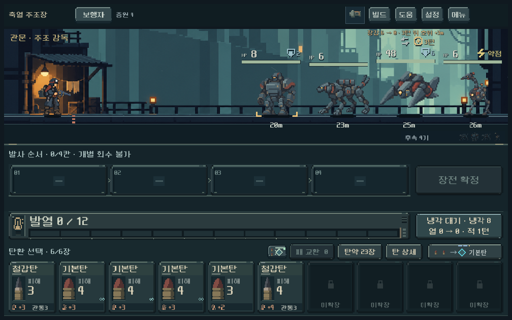
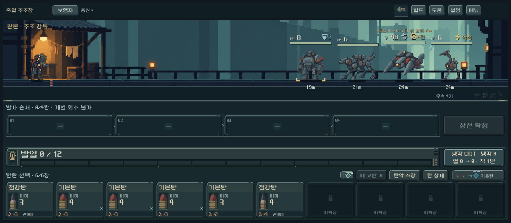

# 2구역 축열 주조장 — 난이도·연속 테스트

사용자의 요청은 2구역까지 테스트할 수 있도록 난이도를 작업하는 것이다. 일반전 단계 구분, 장갑 교대 정예, 장갑/호위 독려 보스, 행동 표시와 바로 시작하는 연습 경로를 연결했다. 디렉터가 정한 1차 수치이며 사람 체감으로 최종 확정한 밸런스는 아니다.

## 적용과 실행

- `PLAY.cmd`로 실행 → **새 등반**: 새 편성6으로 1구역부터 진행한다.
- 빠른 비교: 타이틀 하단 **개발 → 2구역 입구 · 1구역 통과 덱 → 무기 선택**. 시드731042의 실제1구역 진행에서 획득한 덱/코어 성장/탄창 확장을 복원한다. 기본 난도0/가방6장. 연습 중에는 정상 등반·프로필을 저장하지 않는다.
- 기존 편성1~5 이어하기는 기존 편성을 유지한다. 진행 중 전투를 교체하지 않는다.
- APK/커밋/푸시는 만들지 않았다.

## 최종 편성

| 전투 | 구성 |
| --- | --- |
| 일반 초입1~3 | 6기, 장갑2~3 전열, 4턴 준비 후 다른 적2m 접근 |
| 일반 중반4~6 | 7기, 장갑3 또는 보호막2 전열, 독려3턴 |
| 일반 후반7~8 | 8기, 장갑4 또는 장갑4↔0 전열 |
| 금형 파수꾼 | HP26, 장갑5↔0, 총7기 |
| 주조 감독 | HP48, 장갑6↔0, 3턴마다 다른 전열 적3m 추가 접근, 총8기 |

전열4기/후속 대기를 유지한다. 보스 장갑은 매 적 턴마다 개폐하며 2턴 재장전이면 두 번 개폐한다. 호위를 먼저 처리하면 독려가 약해진다. 관통/파쇄/화상으로 닫힘을 상대하거나 열린 시점에 큰 기본 타격을 넣을 수 있다. 적 HP나 거리를 플레이어 빌드에 따라 동적으로 높이지 않는다.

기존 기계형 아트를 사용한다. 정예·보스 전용 외형이나 주조장 전용 배경까지 제작한 것으로 보지 않는다. 짧은 현재→다음 장갑/남은 턴/접근 거리 예고와 독려 연결선·접근 숫자는 이번 작업 범위다.

## 실제 진행 비교

`foundry_campaign_runner`는 시작 덱으로 1구역에 들어가 공개 명령으로 전투·획득·정예·보스·관문 보상을 진행한 뒤 2구역으로 간다. 보유하지 않은 탄/파츠를 지급하지 않는다. 선택 가능한 정예를 우선하며 상점·공방도 이용 가능한 경로에서만 진입한다. 매 명령 뒤 격리 저장/복원을 비교한다.

시드731042,931104 × 다섯 무기의10회 연속 진행에서 2구역 전투65회를 재생했다. HP48 초안으로 모두 두 번째 관문에 도달하고 보상을 받은 후3구역 지도로 이동했다. 이후 보스 호위의 장갑/HP를 낮춘 최종 편성은 **동일한 실제 보스 입장 저장10개**에서 다시 생성하여 전투·보상·관문 이동까지 별도로 재검증했다. 보스 입장 상태의 획득 탄, 파츠, 코어 성장, 소모품, 시드는 유지했다.

시드731042 보스 비교:

| 무기 | 기존 보스 적 턴 / 사용 탄 | 최종 보스 적 턴 / 사용 탄 / 잔탄 |
| --- | --- | --- |
| 보행자 | 비교 대상 제외 | 6 / 11 / 15 |
| 쇄도 | 5 / 10 | 7 / 13 / 13 |
| 산개 | 비교 대상 제외 | 7 / 14 / 12 |
| 압쇄 | 6 / 15 | 12 / 25 / 1 |
| 증강 | 2 / 3 | 6 / 6 / 20 |

시드931104 최종 보스는 보행자7턴/16발, 쇄도8턴/12발, 산개5턴/12발, 압쇄12턴/20발, 증강5턴/6발이었다. 모두 통과했지만 압쇄의 잔탄은 두 조건에서1/5발로 다른 무기보다 적다.

HP56 초안은 압쇄의 잔탄이1/3발이었다. HP48, 전면 호위 HP10/장갑3→HP8/장갑2, 후속 장갑 호위HP9→8로 낮췄다. 다만 같은 제한 탐색이 항상 탄약을 가장 적게 쓰는 경로를 고르는 것은 아니다. 압쇄 탐색 폭을4→12로 확대해도 이번 결과의 소모량은 같았다. **잔탄 여유가 충분해졌다고 판정하지 않는다.**

탐색은 미래 패/RNG를 알고, 선택한 코어 성장과 자동 획득 정책에 의존한다. 실제 사람 승률·임의의 빌드·난도 상승·모든 지도/경로를 보장하지 않는다. 일반전의 다양한 임계치가 선택을 재미있게 만드는지도 사람 확인이 필요하다.

## 검증 증거

- 편성·예측·열·재장전·장갑 영구 파쇄·차단·화상·기존 저장/지역 보존: **1,875검사, 실패0**.
- 실제1→2구역 연속 진행: 시드731042 **6,729**, 시드931104 **5,985검사, 실패0**.
- 최종 보스 입장 저장 재생: **762 + 720검사, 실패0**.
- 실제 GPU 화면/입력: **524검사, 실패0**, 1008×630 / 1280×800 / 1440×630. 장갑 개폐·독려 후 모델/표현 일치, 상세 열기, 2턴 재장전 예고, 개발자 메뉴와 정상 저장 보호 확인.
- 1구역 보스·정예 회귀: **332검사, 실패0**.
- 변경 파일 공백 검사 통과.

사용 탄 수는 `Campaign.save()`가 전투 종료 후 더미를 재정리하기 **전**에 캡처한다. 초기 계측에서0으로 나오던 오류를 수정해 기존/개편 양쪽을 다시 측정했다. 적 턴은 누적 등반 턴이 아니라 전투 입장 대비 차이다. UI 검사의 최초 실패는 개발자 팝업을 닫지 않은 검사 입력에서 발생했고 실제 메뉴 콜백으로 닫도록 수정했다. 실제 주조장에서는 기본 기계 뷰를 사용하므로 전용 행동 표시도 그 뷰를 상속하도록 연결했다.

- [기존3무기 연속 결과](assets/foundry_balance_2026-10-21/baseline_731042.json)
- [시드731042 연속 결과](assets/foundry_balance_2026-10-21/campaign_731042.json) · [시드931104 연속 결과](assets/foundry_balance_2026-10-21/campaign_931104.json)
- [최종 보스731042](assets/foundry_balance_2026-10-21/boss_731042.json) · [최종 보스931104](assets/foundry_balance_2026-10-21/boss_931104.json)

## 다음 사람 테스트

1. 관통/화상/전기/기본 타격의 사용처가 다르게 느껴지는가.
2. 정예·보스의 장갑 개폐와 독려가 보여서 행동을 바꾸게 되는가.
3. 압쇄의 소모가 과한지, 증강/성장 코어의 여유가 지나친지.
4. 장전 후 회수 금지, 과열 강제 재장전, 유한 탄약이 합쳐져 납득 가능한 실수 비용인지.

Galaxy 실제 조작·성능, 2구역 전용 아트, 고난도와3구역 이후 밸런스는 미검증 후속이다.
