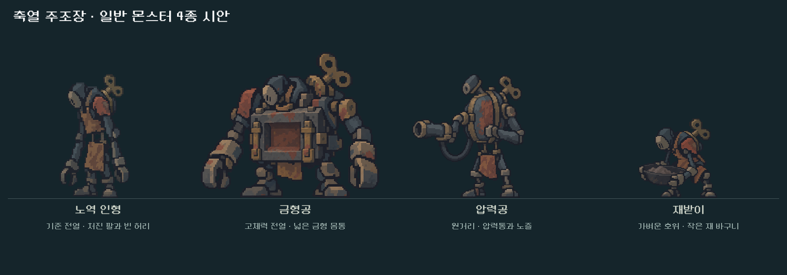
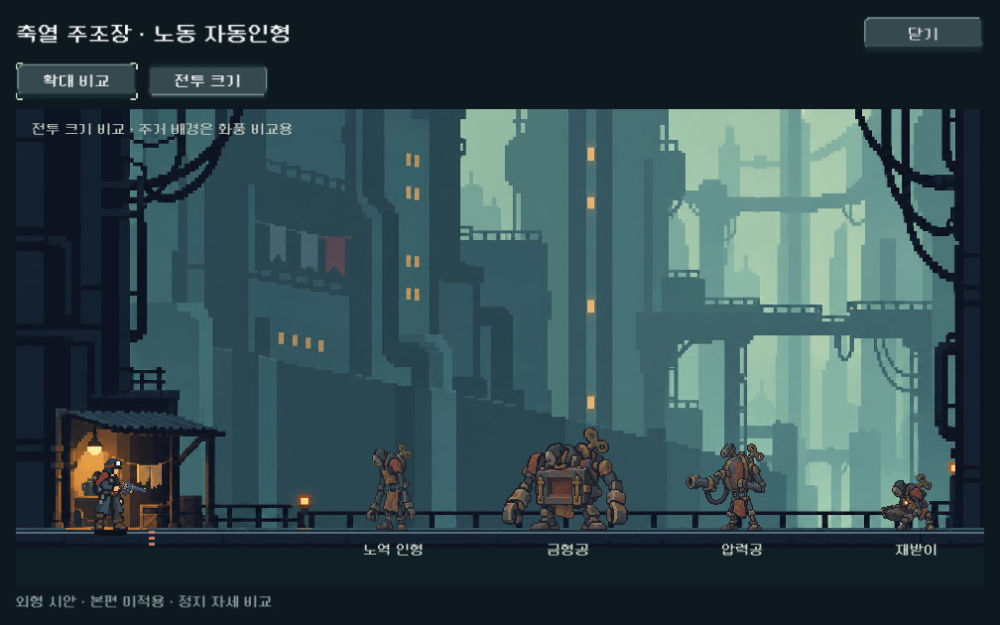

# 축열 주조장 일반4종 — 콘셉트 시안

2026-10-22. 사용자 ‘다음 스텝 진행’에 따라 전날 정한2구역 일반4종의 정지 시안과 비교 화면을 제작했다. **본편 편성/전투 규칙/밸런스는 그대로이며, 신규 아트는 개발 미리보기에서만 사용한다.** 새 화풍·컨셉의 사용자 선호, 상태 동작과 본편 난이도는 확인 전이다.

## 시안

| 이름 | 유지한 콘셉트 | 제작자 확인 |
|---|---|---|
| 노역 인형 | 긴 처진 팔, 둥근 봉인 가면, 닳은 앞치마와 빈 허리 | 가늘고 긴 기준 전열. 빈 프레임과 반복 노동 자세가 보임 |
| 금형공 | 작은 머리, 넓은 사각 금형, 낮고 무거운 하체 | 고체력 적의 넓은 실루엣. 명암/녹은 큰 덩어리로 묶음 |
| 압력공 | 타원형 압력통, 노즐 팔과 하나의 큰 호스 | 원거리 적의 방향과 총구가 작게 보여도 구별됨 |
| 재받이 | 낮게 웅크린 몸, 큰 재 바구니와 얇은 관절 | 무거운 인형 사이의 작은 호위로 높이와 자세 구별 |

네 종은 큰 황동 태엽 키, 낡은 철/앞치마, 봉인된 가면을 공유하는 순수 기계 가족이다. 주인공의 복장·인체를 복제하지 않고 색면·클러스터·선 처리만 참조했다. 키가 비교적 크게 읽히는 정도와 각 종의 선호는 사용자 검토 대상이다.

## 제작·등록

- 도구: 내장 `image_gen`. 노역 인형1회 후 그 결과를 가족 참조에 추가해 나머지3종을 별도 생성했다. API/PixelLab 대체 호출 없음.
- 첫 참조: 승인 주인공 v2, 승인 처마등 v1, 주거 전투 배경. 가족 참조: 노역 인형 v1+주인공+배경. 입력을 실제 이미지 경로로 전달했다.
- 원본4장은 `새-게임-프로젝트/assets/art/foundry_concepts_20261022/`에 복사하고 RGBA를 보존했다. 픽셀 재가공/블러/수동 덧그림 없이 측정한 영역과 발 기준을 등록했다.
- 생성 PNG에는 alpha1 수준의 넓은 미세 가장자리가 있다. 기존 `monster_alpha_cutout.gdshader`의 alpha0.5 컷아웃을 표시 때 사용한다. 원본을 지우거나 가짜 투명 배경으로 바꾸지 않았다.
- 원본 크기: 노역1254×1254, 금형1341×1173, 압력1305×1206, 재받이1422×1106. 원본 PNG 크기와 실제 점유 크기는 구별한다.
- 비교용 점유 높이는112/132/112/72 논리px이며 실루엣 비율을 유지한다. 현재 본편 주인공 크기 계산의 compact240/tall350 기준을 동일하게 사용했다. 이는 초안의 비교 크기이며 영구 제작 규격이 아니다.
- 모든 원본/참조의 해시, 전체 프롬프트, 도구, 입력 순서, 생성 출력명은 [provenance.json](../../../새-게임-프로젝트/assets/art/foundry_concepts_20261022/provenance.json), 측정값은 [asset_report.json](../../../새-게임-프로젝트/assets/art/foundry_concepts_20261022/asset_report.json), 표시 영역은 [registration.json](../../../새-게임-프로젝트/assets/art/foundry_concepts_20261022/registration.json)에 있다.

## 실제 표시 확인

- Godot4.7/Compatibility/OpenGL,1280×800/1008×630/1440×630에서 확대/전투 크기 총6화면을 캡처했다. 이들은 원화 비교용이며 실제 전투 시뮬레이션은 아니다.
- 캐릭터 바깥 잘림0, 발 기준선 일치, 비율 유지,3해상도에서 이름/버튼 배치 확인. 개발 메뉴의 진입·닫기와 독립 실행의 종료 경계를 확인했다.
- [표시 검사 결과](assets/foundry_concepts_2026-10-22/visual_qa.json) 실패0. 최초 QA 호출의 옛 개발 메뉴 함수명을 실제 `_developer`로 고친 뒤 완료했다.
- 원본의 색면·윤곽·명암을 주인공/배경과 직접 비교했다. 제작자 판단으로 같은 가족의 표현이 유지되고 크기별 기능 실루엣이 구별된다. 사람의 이해도·선호나 Galaxy 실기 검증을 대신하지 않는다.
- QA APPDATA/LOCALAPPDATA는 `qa_runtime/foundry_concepts/`로 격리했다. 뷰어는 Campaign/Model/Preferences/저장 호출이 없는 별도 장면이다.
- 배경은 기존 주거구 그림을 비교용으로 사용했다. 새 주조장 배경을 만들었거나 신규 적이 본편에 배치된 것으로 설명하지 않는다.

## 확인 경로와 다음 작업

- `PLAY_FOUNDRY_CONCEPTS.cmd` 또는 게임 메인 → 개발 → ‘몬스터 시안 · 축열 주조장’.
- ‘확대 비교’와 ‘전투 크기’를 전환한다. 개발 메뉴의 기존2구역 입구는 기존 편성/아트를 그대로 사용하므로 새 시안 화면과 구별한다.
- 다음은 사용자 외형 검토 후2구역 정예/보스 시안, 공격·피격·축압 등 상태 제작과 실제 규칙/예측 연결이다. 이번에 정지 자세를 애니메이션 완성으로 간주하지 않는다.
