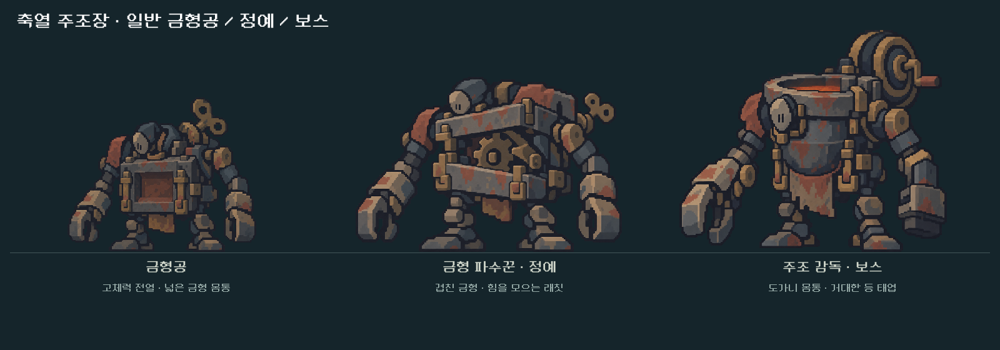
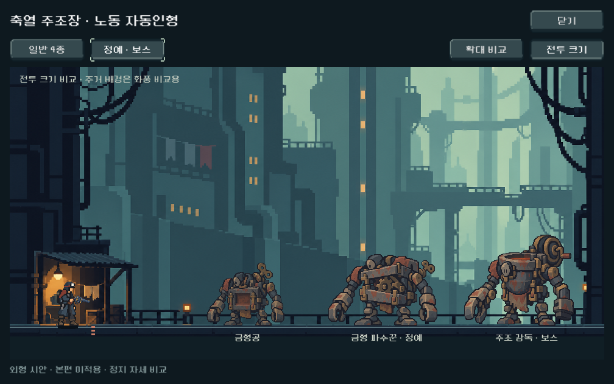

# 축열 주조장 정예·보스 — 외형 시안과 비교

2026-10-23. 사용자 ‘나머지 작업 진행’ 요청에 따라 전 단계의 다음 대상으로 기록한 금형 파수꾼과 주조 감독을 제작했다. 일반4종에 더해 **2구역 일반4/정예1/보스1의 정지 외형 시안**이 준비됐다. 본편 편성·밸런스·패턴·애니메이션 적용 완료를 뜻하지 않는다. 신규 외형의 사용자 선호는 확인 전이다.

## 형태와 제작 판단

| 대상 | 큰 형태 | 비교 표시 높이 |
|---|---|---|
| 기존 금형공 | 하나의 사각 금형과 낮은 몸체, 기준 비교 대상 | 132 논리px |
| 금형 파수꾼 · 정예 | 어긋난 두 금형, 노출된 큰 래칫, 더 넓은 어깨와 낮은 무게중심 | 150 논리px |
| 주조 감독 · 보스 | 둥근 도가니 몸통, 낮게 매달린 가면, 비대칭 작업 팔과 하나의 큰 등 태엽 | 190 논리px |

- 순수 기계 노동 자동인형의 재질과 가면을 공유한다. 정예는 금형공의 강화형, 보스는 도가니와 원형 태엽을 가진 별도 실루엣으로 제작했다.
- 기존 금형공 원본, 승인 주인공 v2, 승인 주거 전투 배경을 실제 이미지 입력으로 전달했다. 주인공은 큰 색면/선 처리, 배경은 팔레트만 참조했다.
- 내장 image_gen으로 각1회 생성했다. PixelLab/API CLI나 수작업 픽셀 덧그림은 사용하지 않았다.
- 원본 RGBA2장 바이트를 그대로 보존했다. 알파128 이상 영역과 발 기준을 측정하고, 기존 알파 컷아웃 셰이더와 nearest 필터로 표시한다. 고해상도 PNG와 실제 게임 점유 크기는 구분한다.
- 원본 크기: 정예1402×1122, 보스1341×1173. 비교용 높이와 발 기준은 이번 외형 검수 값이며 본편 최종 크기나 영구 제작 규격이 아니다.
- 제작자 시각 확인: 기존 일반 기계와 도트 덩어리/탁한 철·녹·황동 색이 이어지고, 작은 화면에서 가슴 기어와 등 태엽이 구별된다. 새 자산이 더 밝은 테두리나 고채도 효과로 튀지 않는다. 실제 상태 예고의 이해도는 별도 검증 대상이다.

원본·전체 프롬프트·참조/출력 해시는 [provenance.json](../../../새-게임-프로젝트/assets/art/foundry_leaders_20261023/provenance.json), 영역·발 기준은 [registration.json](../../../새-게임-프로젝트/assets/art/foundry_leaders_20261023/registration.json), 알파/크기/해시 측정은 [asset_report.json](../../../새-게임-프로젝트/assets/art/foundry_leaders_20261023/asset_report.json)에 보존했다.

## 확인 경로

- 기존 `PLAY_FOUNDRY_CONCEPTS.cmd`, 또는 메인 → 개발 → ‘몬스터 시안 · 축열 주조장’.
- ‘일반4종’ / ‘정예·보스’와 ‘확대 비교’ / ‘전투 크기’를 전환한다. 기본은 정예·보스 비교이며 왼쪽 금형공은 크기 기준이다.
- 뷰어가 항목 수와 발 중심에 맞춰 여백/크기를 계산하도록 확장했다. 탭 전환 시 이전 스프라이트를 제거하고 새 그룹을 표시한다.
- 주거 배경은 화풍·크기 비교용이다. 새 주조장 전용 배경을 제작한 것으로 간주하지 않는다.

## 검증

- 격리 APPDATA/LOCALAPPDATA: `qa_runtime/foundry_leaders/render/`. 실제 사용자 저장을 사용하지 않았다.
- 실행: `qa_runtime/foundry_leaders/run.ps1`, Godot4.7 Compatibility / NVIDIA OpenGL 실제 렌더.
- 1280×800,1008×630,1440×630에서2그룹×2표시 모드 총12화면 캡처. 스프라이트 잘림/겹침, 발 기준선, 버튼 화면 경계, 그룹 전환의 잔여 스프라이트, 기본 진입 그룹 확인.
- 실제 메인 개발 메뉴를 통한 오버레이 진입·그룹 전환·닫기 확인. 독립 실행 판별도 확인.
- `FOUNDRY LEADERS COMPLETE failures=0`, 오류 로그 비어 있음. [결과](assets/foundry_leaders_2026-10-23/visual_qa.json) · [실행 로그](assets/foundry_leaders_2026-10-23/stdout.log) · [검증 스크립트](assets/foundry_leaders_2026-10-23/qa.gd).
- 비교 보드도 같은 Godot 렌더러에서 캡처했다. 이미지 편집으로 만든 합성 전투 화면이 아니다.
- 이번 변경은 별도 시안 뷰어와 아트에 한정되어 전투 계산 전체 회귀를 반복하지 않았다. Galaxy 실기/사람 미감/전투 행동 전달 확인은 미실시다.

## 다음 작업

정지 외형을 기반으로 대기·축압·전진/회복의 상태 키포즈를 제작하고, 고체력 중심 패턴과 실제 전투 표시를 연결한다. 현재 본편은 기존2구역 편성/장갑 교대 규칙을 유지한다. 전용 배경과 3~5구역 시안도 별도 후속이다.
