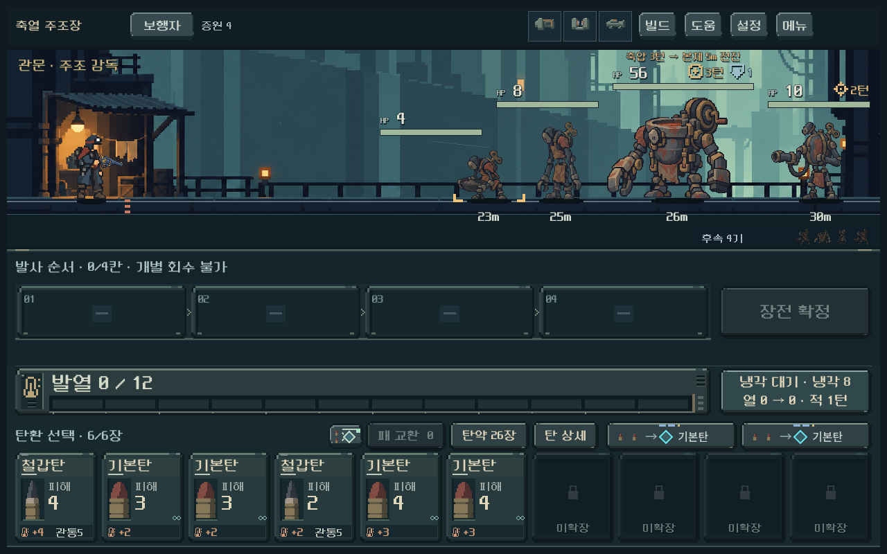
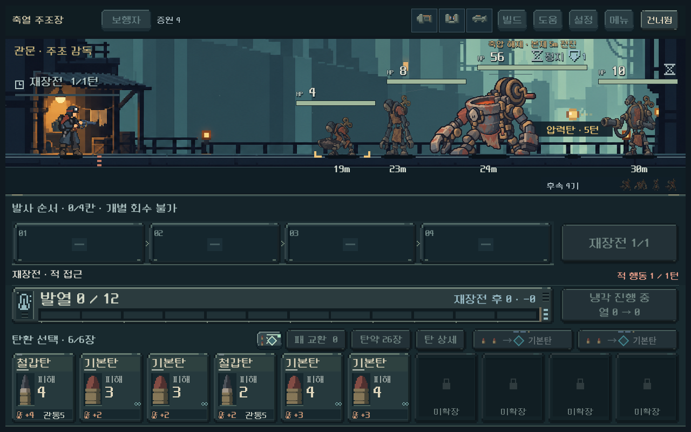
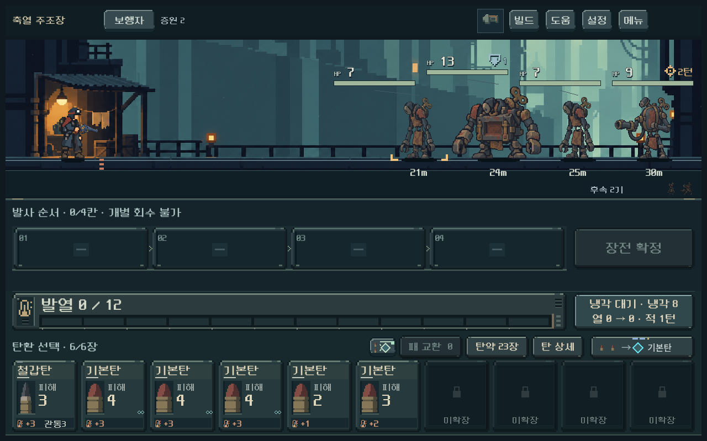

# 주조장 6종 본편 연결과 축압 동작 — 2026-10-23

사용자 ‘다음 작업 진행’에 따라 이전 정지 시안을 실제 전투로 연결했다. [현행 규칙](../../direction/monster-roster.md#현행-2구역--편성8--2026-10-23)의 수치는 디렉터 구현값이며 사용자 재미/미감 확인과 최종 밸런스 확정을 의미하지 않는다.

## 적용 결과

- 새 등반 편성8의 2구역에서 노역 인형·금형공·압력공·재받이·금형 파수꾼·주조 감독이 실제로 등장한다. 기존 저장1~7의 적과 다른 지역은 유지한다.
- 정예/보스는 축압 자세→자기 몸체의 큰 전진→다음 행동 정지로 진행한다. 2턴 재장전도 각 행동을 순서대로 처리한다. 체력 재생이나 호위 당기기는 없다.
- 압력공은 준비 자세와 발사 반동, 실제 요격 가능한 압력탄을 사용한다. 전장과 후속 아이콘 모두 새 외형이다.
- 정예/보스 원화가 체력 표시를 덮지 않게 표시 크기를 조정하고, 포즈가 달라져도 최대 폭을 기준으로 거리를 배치한다. 원본 PNG를 수정하지 않았다.
- 내장 이미지 생성 도구로 같은 개체를 참조한 시트3장/키포즈6개를 제작했다. [프롬프트·참조·해시](../../../새-게임-프로젝트/assets/art/foundry_motion_20261023/provenance.json), [측정 등록](../../../새-게임-프로젝트/assets/art/foundry_motion_20261023/registration.json)을 보존했다. 본편은 가져온 텍스처와 코드 등록을 사용해 원본 JSON 파일의 배포 포함 여부에 의존하지 않는다.
- 보스 시트의 양쪽 포즈는 가로 경계가 일부 겹치므로 실제 불투명 개체 사이의 투명 공간을 따라 UV 다각형을 나눴다. 발 위치·윤곽·재질 원본은 보존했다. 키포즈와 절차형 이동/피격/사망을 조합한 방식이며 모든 프레임을 그린 걷기 애니메이션은 아니다.

## 기능과 실제 화면 검증

Godot 4.7 stable, 격리 APPDATA/LOCALAPPDATA, 정상 사용자 저장 미사용. 최종 **9,485검사/실패0**. [검증 집계](assets/foundry_live_2026-10-23/verification.json)와 같은 폴더의 각 로그에 재현 근거를 보관했다.

| 검사 | 통과 수 | 범위 |
|---|---:|---|
| 새 주조장 규칙 | 1,408 | 3시드×9깊이×일반/정예/보스, 무기 독립 편성, 주기/강제 냉각/차단/화상 처치/요격, 예측과 실제 동일, 저장 검증, 등록 데이터 정합성 |
| 새 주조장 실제 UI | 1,156 | 1008×630·1280×800·1440×630, 일반/정예/보스, 충전·전진·반동·피니시, 터치 상세, 건너뛰기/즉시, 표시와 최종 모델 일치 |
| 획득 덱 정예·보스 재현 | 1,358 | 5무기×2전투, 합법 명령 재생과 단계별 전체 캠페인 저장/복원 |
| 이전 주조장 규칙/UI | 1,875 / 524 | 이전 장갑 개폐·독려 편성과 저장 버전 유지 |
| 첫 지역 정예·보스 규칙/UI | 332 / 1,915 | 공유 이동 훅 변경 뒤 기존 패턴·화면·피니시 회귀 |
| 발열 규칙 | 917 | 기존 발열/재장전 규칙 회귀 |

실제 화면에서 일반4종과 정예·보스의 전신/발, 체력·거리·예고, 압력탄, 피니시 피해 숫자 레이어를 확인했다. 자동 경계 검사와 제작자 시각 확인을 구별하며, Galaxy 기기 터치/성능과 사람의 패턴 이해도는 이번에 검증하지 않았다. 피니시 화면은 합성 경로를 검증하기 위한 HP1 고정 조건이므로 난이도 증거로 사용하지 않는다.

검사 과정에서 보스 몸통이 체력 영역과 겹치는 문제를 수정했다. 디버그로 노드를 건너뛴 상태는 정규 경로 저장 검증에 사용할 수 없어, 획득 덱 비교와 바로 테스트는 실제 도착 저장으로 교체했다. 첫 제한 탐색에서 못 찾은 압쇄 보스는 탐색 폭을 늘렸을 때 통과했다. 이를 근거로 즉시 적을 약화하지 않았다.

## 획득 덱 비교와 해석 한계

기존 시드731042의 실제 1→2구역 진행에서 획득한 덱/파츠/경로/RNG를 사용했다. 첫 정예10301과 보스10902 도착 상태를 복원하고 적 편성만8로 재생성했다. [출처·원본 해시](../../../새-게임-프로젝트/tests/fixtures/foundry_arrivals_20261023/provenance.json), [명령 경로·상태 결과](assets/foundry_live_2026-10-23/balance.json).

| 무기 | 정예: 적 행동 / 사용탄 | 보스: 적 행동 / 사용탄 |
|---|---:|---:|
| 보행자 | 5 / 12 | 6 / 12 |
| 쇄도 | 8 / 14 | 10 / 16 |
| 산개 | 5 / 12 | 7 / 16 |
| 압쇄 | 10 / 19 | 12 / 24 |
| 증강 | 4 / 6 | 6 / 6 |

압쇄는 보스전26장 중24장을 사용했고 증강은6장을 사용했다. 서로 다른 획득 빌드·장전/발사 규칙이며 같은 덱의 무기 성능 비교가 아니다. 압쇄의 탄약 부담과 증강의 여유는 사람 플레이에서 추적할 항목이다. 자동 탐색은 미래 패/RNG에 접근하며 최적해를 보장하지 않는다. 단일 시드의 돌파 가능성을 확인한 결과이지, 평균 승률·적정 난이도·최적 플레이의 증거가 아니다. 새 편성으로1→2구역 전체를 연속 진행한 결과도 아니다.

## 실행과 다음 범위

- `D:/ProjectLoB/worktrees/core-redesign/PLAY.cmd` → 메인 **개발** → **2구역 정예 · 금형 파수꾼** / **2구역 보스 · 주조 감독**. 해당 지점의 실제 획득 덱을 복원하고 테스트 중 저장하지 않는다.
- 다섯 무기의 **2구역 입구**로도 시작할 수 있다. 새 등반은 편성8, 기존 이어하기는 원래 편성이므로 변경된 적을 보려면 새 등반 또는 개발 테스트를 사용한다.
- 재현 명령: `tools/run_foundry_live_checks.ps1 -Mode rules|ui|balance`, 기존 주조장은 `tools/run_foundry_checks.ps1`, 첫 지역은 `tools/run_challenge_checks.ps1`, 발열은 `tools/run_heat_checks.ps1`.
- 다음 제작 범위는 **주조장 전용 배경3단계**. 현재는 기존 공통 탑 배경을 사용한다. 사용자 전투/미감 의견, 압쇄 탄약 부담, 새 편성 전체 지역 연속 검증과 Galaxy는 별도 후속이다.
- APK·커밋·푸시·PC 종료는 이번 요청에 포함되지 않아 진행하지 않았다.
