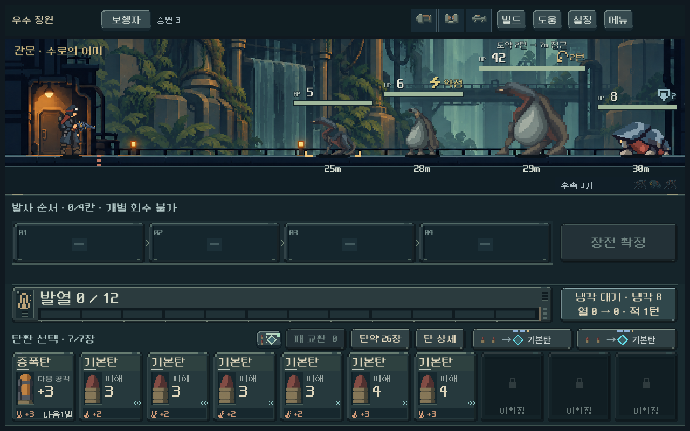
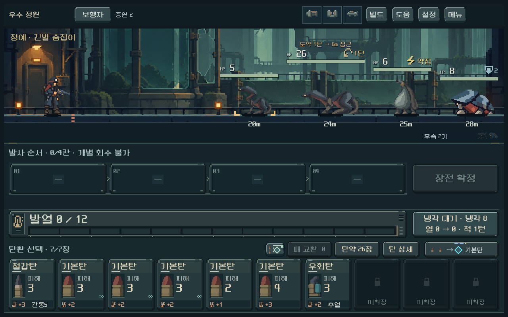
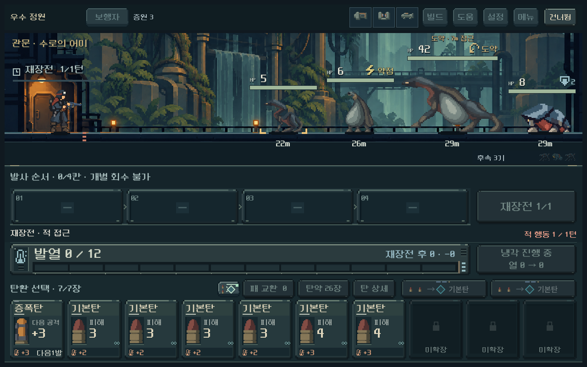

# 우수 정원 정예·보스 — 본편 연결

2026-10-24. 사용자 ‘다음 스텝 진행’ 요청으로 긴발 숨접이와 수로의 어미의 원화·키포즈·도약 규칙·전투 표시를 적용했다. 디렉터 구현안이며 사용자 미감과 최종 난이도는 확인 전이다.

## 변경과 실행

- 신규 등반 편성9의 3구역 정예/보스에 적용. 일반4종과 다른 구역은 유지한다. 기존 저장1~8의 편성은 그대로이며, 저장을 조용히 새 몬스터로 바꾸지 않는다.
- 준비 → 도약 → 숨고르기. 적 행동마다 공개된 시계가 진행되고, 정예6m/보스7m 도약 다음 행동은 제자리다. 재장전 2턴은 실제로 이 주기의 두 행동을 처리한다. 차단·화상·강제 냉각·예측/실행은 같은 모델을 사용한다.
- 이름/HP/도약까지 남은 턴/접근 거리, 준비 자세, 실제 도약 중 표시, 착지 이후 휴식을 연결했다. 무적 점프·실시간 제한·무한 소환은 없다.
- 실행: 저장소 루트 `PLAY.cmd` → 메인 **개발** → **정원 정예 · 긴발 숨접이** / **정원 관문 · 수로의 어미**. 개발 진입은 저장하지 않는다. 본편에서는 새 등반의 3구역에서 만난다.
- 규칙·수치 정본: [몬스터 명단](../../direction/monster-roster.md). 원화/전체 프롬프트/참조 해시: [제작 기록](../../art/garden-leaders-20261024.json).

## 아트와 화면

기존 숨접이/빗주머니·승인 주인공·실제 정원 전투를 참조한 이미지 생성2장, 각3키포즈다. 생성 결과2172×724 RGBA 원본을 그대로 보존했다. 정예 기준 높이108, 보스136을 종별로 공유한다. 포즈 경계가 직사각형으로 겹치는 아틀라스이므로 연결된 불투명 영역을 측정해 Godot UV 다각형으로 분리했다. PNG를 가공하거나 재도색하지 않았다. `tools/measure_garden_leaders.py`는 등록 메타데이터와 내보내기용 GDScript 상수를 동기화한다.

1008×630 / 1280×800 / 1440×630에서 정지·준비·회복, 터치 상세, 도약·건너뛰기·즉시 설정, 보스 피니시와 보상 전환을 확인했다. 23장 캡처 중 대표7장(정예 기본/준비, 보스 기본2비율/도약/회복/피니시)을 직접 검수했다. 몸·자신의 HP/예고·옆 HP의 겹침과 화면 밖 잘림은 자동 좌표 검사도 통과했다. 이는 Galaxy 실기기 검사와 구별한다.

## 기능 검증

| 검사 | 통과 | 실패 |
|---|---:|---:|
| 신규 규칙·예측·저장·차단·화상·강제 냉각 | 359 | 0 |
| 실제 전투 UI와 동작 | 839 | 0 |
| 획득 덱5무기 × 정예/보스 도달 가능성 | 363 | 0 |
| 기존 주조장 규칙 회귀 | 1,408 | 0 |
| 정원 배경·입력·이전 저장 회귀 | 1,681 | 0 |
| 합계 | 4,650 | 0 |

APPDATA/LOCALAPPDATA를 `qa_runtime/garden_live/` 등에 격리하고 UI 저장을 끈 상태로 실행했다. Godot4.7 / Compatibility. 재현 명령은 `tools/run_garden_live_checks.ps1 rules|ui|balance`, `tools/run_foundry_live_checks.ps1 rules`, `tools/run_garden_background_checks.ps1`이다. 최종 로그와 원본 캡처는 [증거 폴더](assets/garden_live_2026-10-24/)에 있다.

초기 검사에서 신규 아이콘 색상 등록 누락을 찾아 수정했다. 규칙 검사2건은 없는 선택 필드 직접 접근과 이전 맵의 장소명 가정을 고쳤다. 첫 UI 완료 검사에서는 HP1 처치용 입력이 피해0인 증폭탄을 골라 피니시/보상2검사가 실패했다. 양수 피해 탄을 고르는 검증 입력으로 수정한 뒤 839검사 통과. [첫 UI 로그](assets/garden_live_2026-10-24/ui_initial.log)를 보존했다. 시각 검수 중 도약 순간 휴식 아이콘이 먼저 표시되는 문제도 찾아, 동작 동안은 ‘도약’, 착지 후에는 ‘휴식’으로 맞췄다.

## 전투 가능성과 한계

기존 실제2구역 통과 기록의26장 덱·파츠를 그대로 보존한 `tests/fixtures/garden_arrivals_20261024/`를 사용했다. 실제 관문 보상/3구역 첫 노드/저장 복원을 확인한 뒤 정예·보스 노드로 직접 이동해 전투를 탐색했다. 신규 강력 탄을 지급하지 않았다. 초기 도약까지 살아남도록 적 수치를 조작하지 않았다.

| 총기 | 정예 적 행동 / 사용 탄 | 보스 적 행동 / 사용 탄 |
|---|---:|---:|
| 보행자 | 3 / 6 | 4 / 7 |
| 쇄도 | 5 / 7 | 4 / 10 |
| 산개 | 2 / 6 | 4 / 12 |
| 압쇄 | 6 / 13 | 8 / 19 |
| 증강 | 3 / 4 | 4 / 4 |

10조건 모두 승리 경로가 존재했다. 하나의 획득 경로/시드와 미래 패를 아는 자동 탐색이므로 승률·사람 난이도·전략 다양성을 증명하지 않는다. 과거 관문 보상 체계의 획득 덱이며, 현행 편성9/관문 개조로 1~3구역을 연속 플레이한 기록도 아니다. 압쇄 보스19장과 증강4장의 격차, 강한 파츠가 도약 전에 지우는 경우는 후속 밸런스 관찰 항목이다.

다음 제작은 4구역 귀족/시종의 외형과 차폐 해제 예고다. 사람의 패턴 이해도, 현행 성장으로 3구역 전체 진행, 다중 시드/고난도/Galaxy는 별도 검증이 필요하다. APK·커밋·푸시·외부 게시·PC 종료는 실행하지 않았다.
