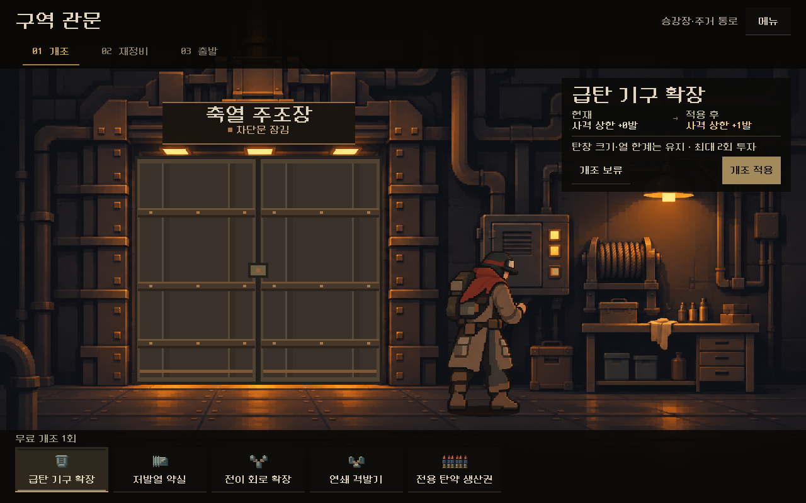
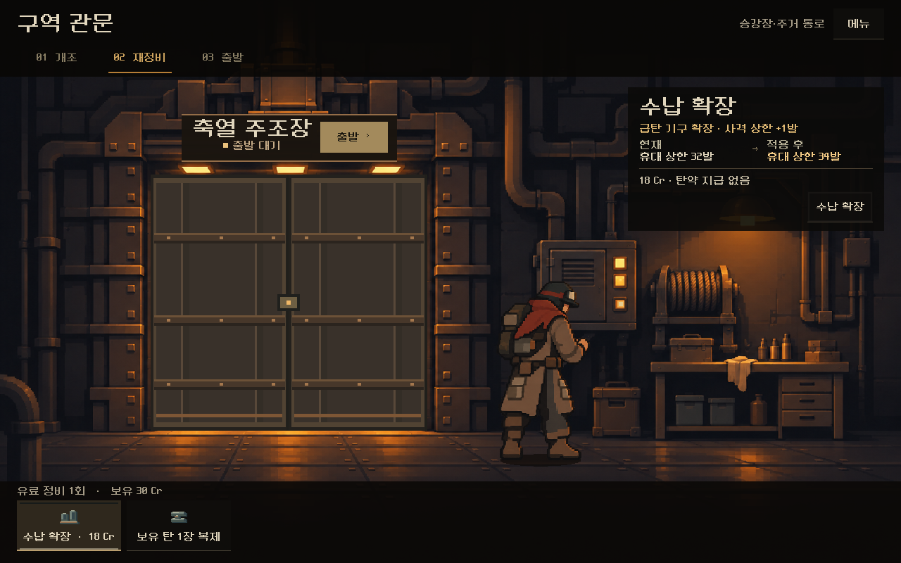
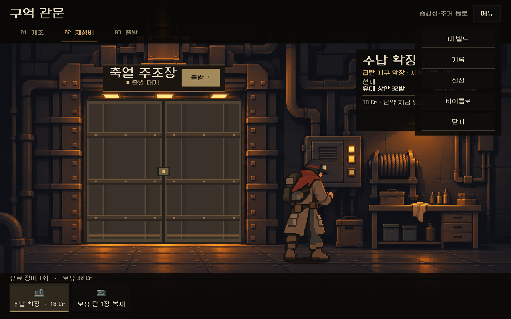
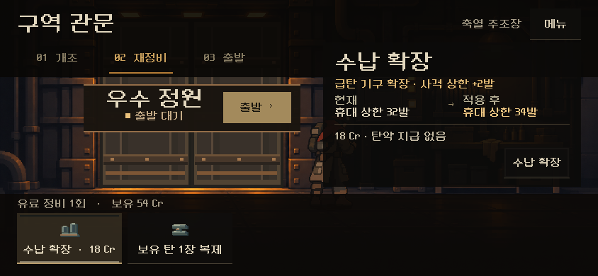
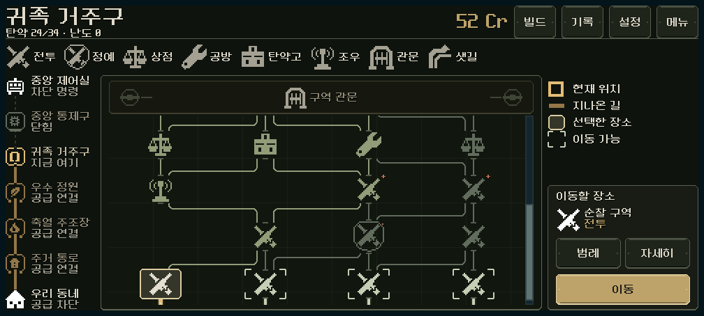

# 관문 — 승인 시안 본편 연결

2026-11-07. 사용자 요청: "본편에 연결해주고, 다음 보급소의 목업 작업 진행해 줘." 대상은 [조작대와 출발을 나눈 관문 시안](../gate_threshold_2026-11-05/README.md)(2026-11-05 사용자 피드백 반영판)이다. APK·커밋·푸시는 하지 않았다.

## 무엇이 바뀌었나

`PLAY.cmd`에서 구역 보스를 이기고 보상을 고르면, 이전의 카드 격자 관문 대신 시안의 장면이 열린다.

- 개조 선택(무료 1회) → 재정비(유료 1회: 수납 확장 / 보유 탄 복제) → 문 위 표찰의 `출발`
- 출발하면 경보등과 개방 신호 → 완전 암전 → 다음 구역 지도
- 개조·생산·정비·출발은 모두 본편 행동 처리기(`screen.gd::_campaign_action`)를 거쳐 **바로 자동 저장**된다. 개조 뒤 종료하고 이어하면 재정비 단계부터 열린다.
- 조작대 앞 캐릭터는 등반의 복장을 따른다(시안은 운반복 고정).
- 머리줄 `메뉴`: 내 빌드 · 기록 · 설정 · 타이틀로. 정비소와 같은 구성이다. 이전 관문 화면의 '보유 파츠 관리 / 탄약 구성 확인'은 `내 빌드`로 대신한다.
- 경제 규칙 이전에 시작한 등반(지도 3판 저장)은 유료 재정비가 없다. 이 경우 재정비 단계는 '정비 없음' 안내와 표찰의 출발만 보인다.
- 높이 440px 미만 화면(예: 844×390)에서는 오른쪽 비교창을 단계 줄 높이로 올려 실행 버튼이 아래 선반에 가리지 않게 했다. 시안이 검증한 1008×454 이상의 배치는 같다.
- 이전 관문 화면(`gate_reward_ui.gd`)은 관문 개편 이전 규칙의 저장에만 남는다.

| 화면 | |
| --- | --- |
| 개조 선택 1280×800 |  |
| 재정비와 표찰의 출발 |  |
| 메뉴 |  |
| 844×390 재정비 |  |
| 출발 뒤 다음 구역 지도 1008×454 |  |

[전용 탄약 생산](production_1280x800.png) · [정찰복 작업 자세](scout_1280x800.png) · [유료 정비 없는 이전 저장](legacy_service_1280x800.png) · [844×390 개조](upgrade_844x390.png) · [1008×454 재정비](service_1008x454.png)

## 검증

Godot 4.7, 격리 APPDATA. 실제 `main.tscn`에 실제 등반을 올리고 화면 터치로만 진행했다.

| 검사 | 결과 |
| --- | --- |
| `tests/gate_live_ui.gd` (새 파일) | **123검사, 실패0.** 11월6일 최신 구성 자동 등반(`qa_runtime/ammo_upgrade_single_20261106/balance_final`)의 실제 관문 상태 1~4구역을 1280×800·844×390·1008×454에서 사용. 이전 격자/머리줄 제거, 실제 구역명·개조 후보, 선택만으로는 미적용, 개조·수납 확장 적용과 자동 저장, 메뉴→내 빌드 열고 닫기, 표찰 안의 출발 버튼, 암전 뒤 다음 구역 지도와 저장, 개조 후 이어하기→재정비, 전용 탄약 생산(기본탄 3장 정확히 교체), 복장별 자세, 지도 3판 저장(유료 정비 없음)의 개조·출발 |
| 관문 시안 3종 재실행(출력은 격리 폴더) | 표찰형 129 · 작업대형 112 · 첫 분할형 102검사, 실패0. 시안 실행 경로(`OPEN_GATE_REVIEW.cmd`)는 그대로 동작 |

실행: 검사는 `QA_GATE_DIR`, `QA_GATE_PREFIX`, `QA_LEGACY_GATE` 환경 변수로 관문 상태 파일을 받는다(위 폴더와 `qa_runtime/campaign_magazine_20261101/v3_single/rules/gate_single_731042_r1.json`).

## 남은 것과 주의

- **관문 배경은 구역과 관계없이 같은 작업장 그림이다**(시안 자산 `assets/art/gate_review_20261105/workstation.png`). 구역별 관문 배경은 후속 아트 과제다.
- 장면 파일은 아직 `redesign/samples/gate_review/`에 있다. 시안 실행 도구가 같은 경로를 쓰므로 옮기지 않았다. 본편은 `campaign_ui.gd::modern_gate()`에서 `threshold_preview.tscn`을 연다.
- **이전 관문 화면을 누르던 오래된 검사 7개는 이제 실패하는 것이 맞다**: `bag_growth_ui_runner`, `city_ui_runner`, `economy_roles_ui`, `gate_ui_runner`, `late_growth_ui_runner`, `playtest_rework_ui`, `ui_readability_ui`(`city_gate_*`, `GateUpgradeGrid` 등). 같은 흐름은 `gate_live_ui.gd`가 검사한다. 다시 쓸 때 새 장면 기준으로 고친다.
- `run_campaign_magazine.ps1 -Mode ui -RunTag v3_single`(11월2일 기록 재생)은 관문 전 1구역 4번째 전투에서 멈춘다. 11월3~6일 전투 수치 변경으로 기록한 사격 순서가 맞지 않게 된 것으로, 관문 변경과 무관하다. 새 기록(`-Mode rules`)부터 다시 만들어야 한다.
- 실기기 터치와 사람의 이해도는 미확인.

## 변경 파일

[changes.patch](changes.patch) — 작업 직전 사본과 비교한 이 작업의 변경분만.

| 파일 | 변경 |
| --- | --- |
| `redesign/campaign_ui.gd` | `render()`에서 개편 관문이면 `modern_gate()`로 장면을 연다. `GateScreen` 상수 |
| `redesign/screen.gd` | 관문 장면의 가장자리 여백 0 (한 줄) |
| `redesign/samples/gate_review/preview.gd` | `configure()`·`enter_live()`·`add_live_menu()`·`command()`·`paid_service()`·`fit_stage()`. 시안 고정물(`load_gate`, F1/F2)은 `configure()` 없이 열릴 때만 사용 |
| `tests/gate_live_ui.gd` | 새 본편 관문 검사 |
