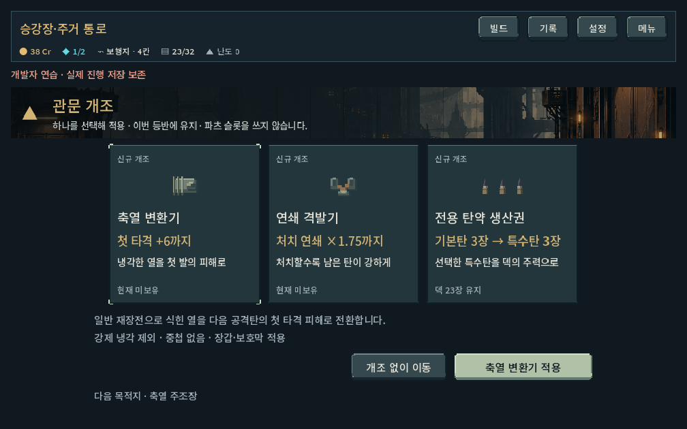
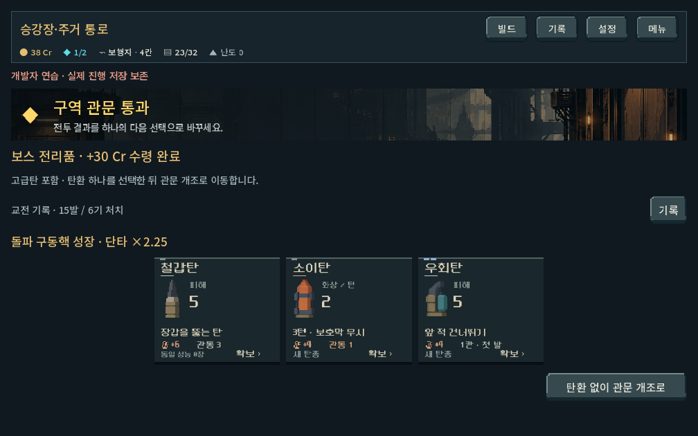
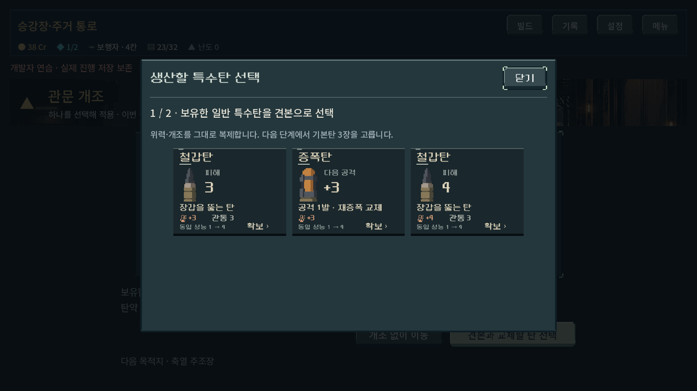
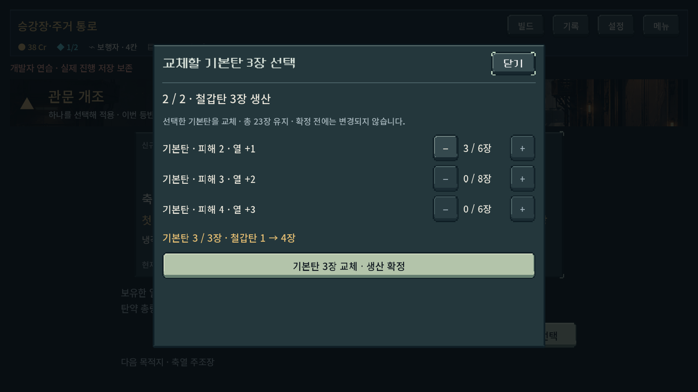
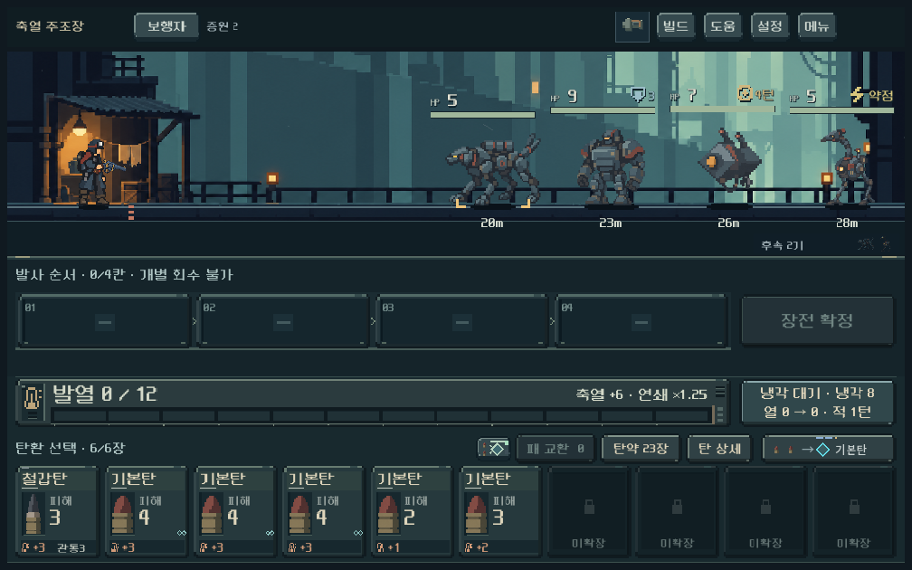

# 관문 보상 개편 검증 — 2026-10-21

## 적용 결과

첫 전투의 성장 코어 선택은 유지했다. 새 등반은 보스 처치 크레딧을 자동으로 받고, 고급탄 포함 3후보에서 한 장을 선택한 뒤 별도 관문 개조를 선택한다. 초기 개조는 축열 변환기, 전용 탄약 생산권, 연쇄 격발기다. 기존 이어하기에는 이전 관문 규칙이 유지된다.

[현행 규칙·계산 순서·수치의 결정 상태](../../direction/gate-rewards.md). 사용자 승인은 이 구조의 구현이며 특정 수치나 자동 검사 결과를 사람의 재미 평가로 간주하지 않는다.

## 환경과 검증

- 작업 위치: `D:/ProjectLoB/worktrees/core-redesign`, 기준 HEAD `197c694` + 기존 미커밋 작업과 이번 변경. 기존 변경 109항목을 보존하고 작업했다.
- Godot 4.7 stable, 시드731042. `tools/run_gate_checks.ps1`의 rules/ui/campaign과 `tools/run_reserve_checks.ps1 -Mode rules` 사용.
- APPDATA/LOCALAPPDATA를 `qa_runtime/gate/` 및 기존 비축 QA 경로로 분리했다. 사용자의 실제 저장 파일에 쓰지 않았다.
- UI: Compatibility/OpenGL, 1008×630,1280×800,1600×900. 본편 Control과 실제 카드·버튼을 렌더하고 선택 신호를 호출했다. 물리 터치/사람의 가독성 시험과는 구별한다.

| 검사 | 통과 | 내용 |
|---|---:|---|
| 관문 규칙 | 540 | 5무기의 축열 1회 가산, 지원탄 보존, 보호막 소비, 강제 냉각 제외, 직접 처치/전이 구별, 코어 잔타/초과 피해, 상한, 산개 예측 캐시, 지급/저장/잘못된 입력 거부 |
| 관문 UI | 48 | 3해상도 선택→확정, 생산 견본→기본탄3장 선택→확정, 보스 전리품, 1008에서 계속 버튼 노출, 효과 상태 갱신, 개발 미리보기 |
| 기존 탄약 비축 회귀 | 683 | 삽입·회수 금지·사용함·탄약 소진과 기존 동작 |
| 실제1→2구역 연속 진행 | 3,963 | 무기/코어3조합, 첫 코어·보상·상점·정예·보스·관문 선택, 매 입력 저장/복원, 두 번째 관문 이후3구역 지도 진입 |
| **합계** | **5,234** | 실패0. 검사 수는 독립 플레이 횟수나 완성도 점수가 아니다. |

5지역×10시드의 보스 후보는 모두 중복 없는 3개였으며 고급탄을 포함했다. 마지막 지역은 전리품 뒤 엔딩으로 진행한다. 이 검사는 보상 상태 구성 검사이고 5지역 전체 플레이 완주가 아니다.

생산권은 원본 프로필의 위력/개조를 유지한다. 3장 미만 선택, 실제 보유 수보다 많은 동일 기본탄 선택, 미소유 견본은 변경 없이 거부한다. 5무기의 기존 획득 덱에서 모든 개조의 지급·복원을 확인했다. 이전 저장이 새 개조로 자동 전환되지 않는 것도 확인했다.

## 진행에서 확인한 효과와 한계

실제 새 등반에서 첫 구역을 통과한 뒤 아래 선택으로 이어갔다. 첫 코어, 보상, 덱과 파츠는 정상 획득한 것이다. 탐색기는 내부 상태와 이후 뽑기 정보를 활용하므로 사람의 승률·판단 난도를 대표하지 않는다. 경로 선택은 정예를 우선하는 기존 검사 정책을 재사용했다.

| 무기 / 코어 | 첫 관문 선택 | 2구역 전투 | 2구역 보스의 경과 턴 / 사용탄 | 확인 |
|---|---|---:|---|---|
| 압쇄 / 열압 | 축열 변환기 | 7전투 통과 | 14턴 / 21장 | 축열이 실제7발에 적용 |
| 쇄도 / 연쇄 | 연쇄 격발기 | 7전투 통과 | 7턴 / 10장 | 배율이 실제35발에 적용, 최대×1.75 |
| 증강 / 돌파 | 전용 탄약 생산권 | 7전투 통과 | 6턴 / 5장 | 기존 일반 특수탄3장 추가, 기본탄3장 감소, 총량 유지 |

이는 서로 다른 빌드의 도달 가능성 자료다. 같은 상태의 개조 유무를 대조한 승률 실험은 아니다. 증강의 화력 여유와 압쇄의 탄약 부담 차이가 여전히 커 후속 사람 테스트가 필요하다. 최초 테스트 로그의 `chain_actions=1`은 발사 행동 **시작 시점**의 배율만 센 값으로, 연사 중 올라간 나머지34발을 누락한다. [개별 사격 기록 집계](assets/gate_rewards_2026-10-21/shot_metrics.json)의35발을 실제 적용 횟수로 사용한다.

## 화면 검수와 수정

- 관문 선택 카드의 높이/폭을 통일하고 선택과 확정을 분리했다. 생산은 확정 전 견본 수량 변화와 바꿀 기본탄을 표시한다.
- 처음 UI 검사에서 1008 창의 카드 너비가 실패했지만 실제 캡처는 정상이다. Godot 논리 좌표와 물리 창 크기를 섞어 비교한 검사 오류를 수정했다.
- 초기 생산권 구현이 기본탄 등급을0으로만 판별해 −1등급 기본 프로필을 제외하던 문제를 수정하고 모든 획득 덱에서 자격 검사를 추가했다.
- 보스 전리품에서 열/파츠 통계가 카드와 진행 버튼을 화면 아래로 밀어내는 시각 문제를 확인했다. 코어 성장과 짧은 교전 기록만 남기고 상세 통계를 기록 창에서 확인하게 했다.
- 축열/연쇄는 열 패널·발사 레일·적중 결과·피해 상세에 연결했다. 배율 계산과 첫 타격 축열을 분리해 표기하며 실제 적중 시 상시 상태도 즉시 갱신한다.

아래 화면은 획득 덱을 복원한 뒤 관문/효과 상태를 명시적으로 구성한 UI 검사 화면이다. 자연 진행의 증거는 위 캠페인 재생 기록이다.

## 재현과 남은 확인

- `PLAY.cmd` → 새 등반에서 첫 보스 이후 확인. 빠른 화면 확인은 메인 → 개발 → 관문. 개발 미리보기는 저장하지 않는다.
- 자동 검증 자료: [규칙](assets/gate_rewards_2026-10-21/rules.json), [UI](assets/gate_rewards_2026-10-21/ui.json), [전체 진행과 입력](assets/gate_rewards_2026-10-21/campaign.json), [진행 로그](assets/gate_rewards_2026-10-21/campaign.log).
- Galaxy 실기, 사람의 선택 이해·선호, 3~5구역 장기 경제/난이도, 모든 무기의 다중 시드·상위 난도 비교는 미검증이다. 신규 효과3종은 초기 후보이며 후보군 확대는 체감 확인 후 검토한다.
- 새 APK, 커밋·푸시·외부 게시·PC 종료는 이번 요청에서 수행하지 않았다.
