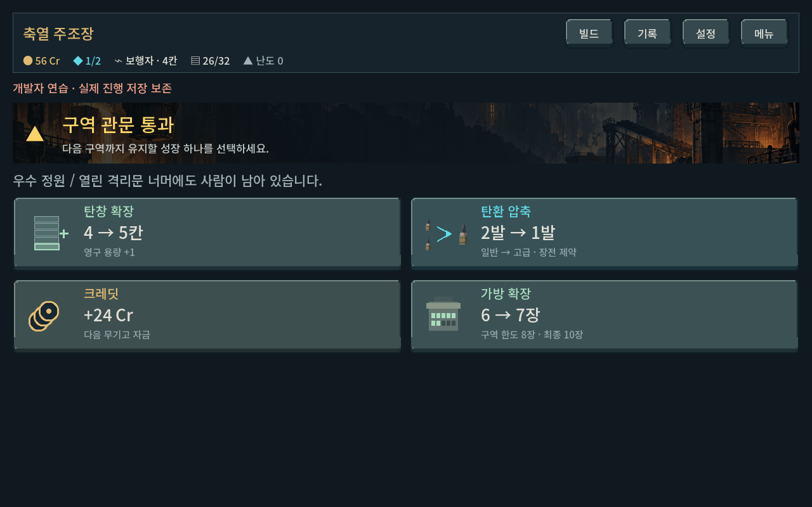
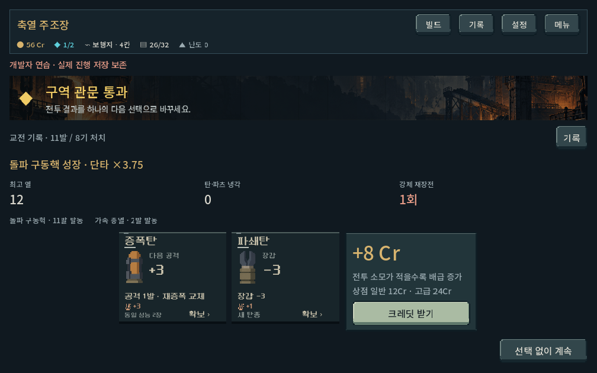
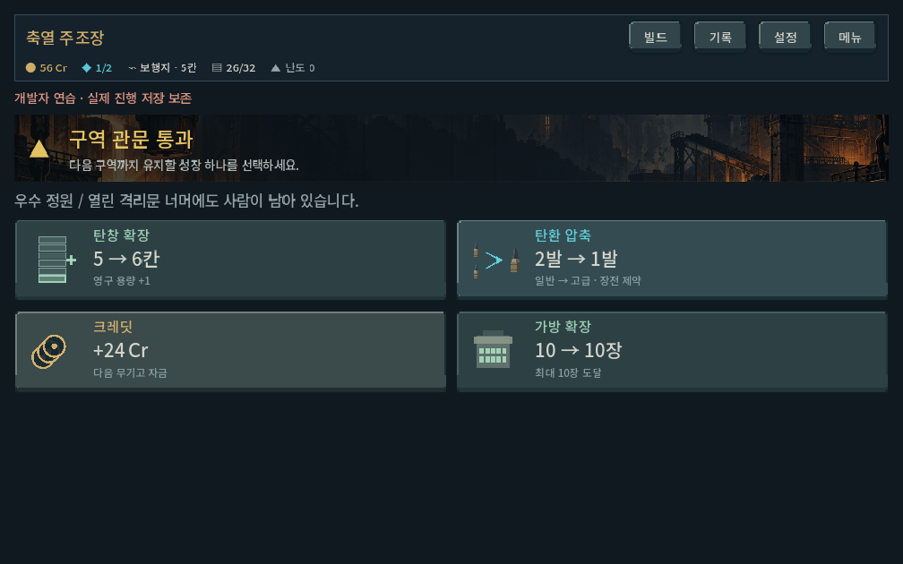

# 관문 보상 검토 — 2026-10-21

상태: 사용자 요청에 따른 검토. 게임 규칙·본편 UI는 변경하지 않았다. 아래 개편안은 디렉터 제안이며 사용자 확정이나 구현 완료가 아니다.

## 결론

관문 보상은 지급 실패보다 **현재 빌드 게임과 보상 구조의 불일치**가 주요 문제다. 코어·파츠·전투별 유한 탄약·7종 복장으로 게임이 달라졌지만 관문은 고정된 성장 4버튼을 유지한다. 승리의 특별함, 선택의 유효성, 다음 구역 대비를 함께 개편해야 한다.

## 현재 실제 흐름

1. 보스 승리 후 일반 보상 화면: 탄환 후보2개 또는 크레딧 중1개, 혹은 건너뛰기. 성장 코어 정산은 전투 계산에 따라 별도로 반영된다.
2. 마지막 지역을 제외하면 관문 화면: 탄창+1 / 일반2장→고급1장 압축 / 24Cr / 가방+1 중1개.
3. 선택 즉시 다음 지역 지도. 최종5구역은 두 번째 관문 선택 없이 결말로 연결된다.

탄창은 등반 중 확장2회까지, 가방은 복장 기본 수납과 지역별 성장 한도를 적용한다. 이 보상은 등반 동안 유지되며 계정 영구 강화는 아니다.

근거: `redesign/campaign.gd:211–250,327–383`, `campaign_content.gd:239–285`, `campaign_ui.gd:384–463,1008–1026`.

## 확인된 문제

| 문제 | 확인 근거 | 영향 |
| --- | --- | --- |
| 보스 전리품의 개성이 약함 | 같은 깊이·시드·덱에서 boss/combat만 바꾼40조건의 탄환 후보가 모두 동일. 보스 전용 파츠 보상 없음 | 고유 보스를 잡아도 첫 보상이 일반전과 동일 |
| 고정4택의 유효 선택 감소 | 탄창 확장2회 후 비활성. 7~10장 복장은 첫 관문 가방 한도7 때문에 모두 확장 불가 | 큰 가방으로 시작할수록 선택 하나가 빠지고, 이후 탄창까지 막히면 압축/돈 위주 |
| 공방·상점과 중복 | 동일 영구 압축은 공방 무료 작업, 상점18Cr로 제공. 가방 성장도 공방에서 가능 | 관문만의 성장 기대가 약함. 24Cr와 압축의 경쟁은 다음 상점 접근성·방문1회 제한에 따라 달라지며, 압축이 항상 열등하다고 단정할 수는 없음 |
| 유한 탄약에 대한 압축 설명 부족 | 압축은 실제 덱에서2장 제거/1장 추가. 기본 관문 카드는2→1과장전제약만 표시 | 발사 횟수·총 화력·코어 타격 횟수의 대가까지 확인하려면 추가 화면이 필요. 압축이 무조건 상향은 아님 |
| 반복되는 보상 화면 | 일반 보상 뒤 다시 ‘구역 관문 통과’와4버튼 화면 | 승리→정산→성장→이동의 구분이 약함 |
| 유지 기간과 상태 표시 불명확 | 안내는‘다음 구역까지 유지’, 탄창은‘영구 용량+1’. 실제 등반 전체 유지. 상한 도달 탄창 카드도 비활성 상태로 현재→+1표시 | 일시/계정영구 효과로 오해 가능. 불가능한 성장도 제안처럼 보임 |
| 화면의 비교 정보 부족 | 큰 가로 버튼4개와넓은빈영역. 무기/장착 파츠/발열운용과선택의연결은별도빌드창 필요 | 숫자+1이 플레이를 어떻게 바꾸는지 즉시 판단하기 어려움 |

선택 빈도와 어느 보상이 실제로 우세한지는 사람 테스트/여러 빌드 비교 전에는 확정하지 않는다. 특히 기존 연속 진행 QA는 첫 관문에서 탄창, 둘째에서 가방을 선택하는 정책이므로 보상 간 균형의 증거가 아니다.

## 권장 개편 초안

**기본 정산 + 빌드를 바꾸는3택1**을 한 보상 흐름으로 구성한다.

- 기본 전리품 크레딧은 자동 정산한다. 현행24Cr를 모든 기존 보상에 그대로 추가하는 방식은 피하고, 일반 보스 전리품과관문보상을합친 예산을 재설계한다. 확정 금액은 아직 없다.
- 주 선택은 **무기 개조·파츠 중심**으로 구성한다. 예: 탄창 확장 / 교차 급탄기 / 연쇄 방열기. 이는 후보의 성격을 설명하는 예시이며 매번 같은3개를 고정하지 않는다.
- 기존 빌드와 연결되는 후보, 다른 운용을 열 후보, 준비·열 관리 후보를 섞는다. 모두 맞춤 정답으로 만들지 않는다. 보유품·무효 효과·확장 한도·코어 최대1개·파츠5칸을 검사한다.
- 상한 도달 후보는 다른 유효 보상으로 대체한다. 후보가 부족할 때의 재화 대안/건너뛰기는 보장한다. 교체가 필요한 파츠는 실제 장착 가능 여부와 교체 대상을 먼저 보여 준다.
- 성장 중인 코어를 새 코어로 바꾸도록 강제하지 않는다. 기존 자동 성장에 관문 추가 배율을 중복으로 주거나 새 코어 강화 체계를 함께 넣지 않는다.
- 가방 확장·일반 압축은 공방을 주된 획득 경로로 정리한다. 탄창 확장은 관문 후보에 남겨 무기 성장 경로를 보존하고, 기존 확장2회 한도는 별도 검증 전 유지한다.
- 일반 탄환2택 화면을 관문 뒤에 그대로 추가로 남길지까지 포함해 통합한다. 단순히 보상을 더 얹는 작업으로 진행하지 않는다.

### 화면

상단: 관문 돌파와획득재화/코어성장결과를 짧게 정산.
중앙: 동일 크기의 보상3개, 이름·주효과·대가만 우선 표시.
선택 후: 현재 무기/파츠에 적용한전후차이와교체필요여부.
하단: 선택 확정 후 다음 구역으로 이동. 현재 일반 버튼들은 즉시 확정되고 압축만 별도 선택창인 불일치도 정리.

‘이번 등반 동안 유지’로 기간을 통일하고, 보상의 결과를 현재→변경 후로 표시한다. 전투가 시작되기 전 첫 지역 보상에서2구역장갑대응을 간접적으로 준비시킬 수 있으나 특정탄/파츠를 필수지급·강제하지 않는다.

## 실제 확인

- 엔진: Godot4.7, 현재작업트리, 기준시드731042.
- 기존 실제 진행으로 획득한 둘째 관문 저장5총기×4선택=20건: 적용·저장·복원 모두 성공.
- 보스/일반 후보 비교4지역×10시드=40쌍: 모두 동일. 보스권리만의차이를분리하기위해동일노드의kind만바꾼내용검사이며전체플레이검사가 아니다.
- 복장7종×관문4곳=28상태: 가방확장가능여부확인.
- 실제Godot화면1280×800/1008×630확인. 상한탄창+10장복장화면은 가용성점검용 명시적상태구성이며 실제장기플레이완주로 간주하지 않는다.
- 격리 `qa_runtime/gate_review/` 사용, 본인저장미접근. QA스크립트는게임규칙을수정하지않는다.
- 신규보상안의균형·재미·Galaxy터치체감은미검증. 전체게임회귀검사는이번검토범위가 아니다.

[검사 데이터](assets/gate_rewards_review_2026-10-21/audit.json) · [재현 스크립트](assets/gate_rewards_review_2026-10-21/probe.gd) · [실행 로그](assets/gate_rewards_review_2026-10-21/stdout.log)

## 화면 증거

## 슬더스 사례 확인에 따른 제안 보완 — 2026-10-21

사용자가 슬더스의 실제 보상을 먼저 확인하도록 요청했다. 외부 자료 검토이며 게임 구현은 변경하지 않았다.

- 슬더스1의1·2막: 기본95~105골드, 희귀카드3택1, 확률적포션 이후 별도상자에서보스유물3택1. 이들은 돈/카드/유물중하나만택하는동일층위선택이아니다. [맵·보스보상](https://slaythespire.wiki.gg/wiki/Treasure_Rooms).
- 슬더스2: 확인한게임데이터v0.107.1에서는 보스전리품이골드·희귀카드선택·가능한포션이며, 큰성장보상은다음막입구고대의존재에게받는다. [보스](https://sts2.dev/keywords/room-boss) · [고대의존재](https://sts2.dev/keywords/room-ancient). 공식설명도고대의존재의전용유물이전작보스유물을대체한다고명시한다. [Mega Crit 공식소개](https://www.megacrit.com/news/2025-11-13-neowsletter-issue-16/).
- 사례: 커피드리퍼는매턴에너지+1/휴식불가, 스네코의눈은매턴드로우+2/뽑는카드비용무작위, 판도라의상자는기본타격·수비변환. 단순수치상향부터운용방식변화·덱재편까지포함되며모든유물이명시적페널티를필수로가지는것은아니다. [커피](https://slay-the-spire.fandom.com/wiki/Coffee_Dripper) · [스네코](https://slay-the-spire.fandom.com/wiki/Snecko_Eye) · [판도라](https://slaythespire.wiki.gg/wiki/Pandora%27s_Box).

**앞선 판단 보완:** 보상이두단계라는사실자체를결함으로보지않는다. 서로비슷한제목/정보/보상가치로역할구분없이반복되는점이문제다. 보스전리품(재화+좋은탄환확보)→관문개조(운용규칙을바꾸는3택1)를별도단계로유지하는안이적합하다. 한화면에모두통합은필수조건에서제외한다. 일반파츠몇개를그대로다시진열하는데그치지않고관문선택의고유가치를설계해야한다. 우리게임은중간관문4회이므로슬더스의2회보스/막성장보상강도를그대로복제하면안된다. 구체후보·수치는미확정이며유저확정전구현하지않았다.

## 관문에서 특별하게 느껴질 보상 후보 — 검토 초안

사용자는 체감상 특별한 보상 후보를 요청했다. 아래는 `content.gd`의 현재 파츠와 `model.gd`의 피해·재장전 계산을 대조한 **디렉터 제안**이며 사용자 확정, 구현, 균형·체감 검증이 아니다. 이름과 수치는 비교용이다. 게임 코드와 현재 규칙은 변경하지 않았다.

특별함의 기준은 다음 전투에서 장전·재장전·덱 구성 중 적어도 한 결정이 달라지고, 그 결과가 기존 발사 레일·열·피해 숫자로 읽히는 것이다. 새 관리 자원을 늘리는 것 자체는 목표가 아니다.

### 우선 비교할 세 후보

1. **축열 변환기 — 재장전을 다음 한 발의 준비로 바꾼다.** 일반 재장전에서 실제로 식힌 열을 다음 공격탄의 첫 직접 타격 가산 피해로 전환한다. 예를 들어 열6을 식히면 첫 타격 +6. 지원탄은 소비하지 않고, 다회 타격 전체에 +6을 반복하지 않는다. 실제 적용 시 가산의 배율 적용 위치·상한은 기존 코어와 비교해야 한다. 강제 과열 냉각은 제외하고 충전은 중첩하지 않는다. 재장전 턴과 잔열 상실이 기존 비용으로 작동하므로 추가 페널티를 먼저 붙이지 않는다. 냉각·짧은 사격 빌드에 별도 동기를 줄 가능성이 있다.
2. **전용 탄약 생산권 — 특수탄의 덱 내 비중을 크게 바꾼다.** 소유한 일반 등급 특수탄 한 장을 견본으로 고르고, 선택한 기본탄3장을 동일 프로필의 사본으로 교체한다. 이번 등반에 유지하며 압축탄·임시탄은 견본에서 제외한다. 예를 들어 연타탄1장을 가진 덱이 연타탄4장을 가진 덱으로 바뀐다. 총 탄약 수·가방 크기는 유지한다. 높은 발열과 지원탄 편중은 실제 덱 구성의 대가이며 별도 일률 페널티는 필수가 아니다. 변경될 카드와 최종 탄종 수를 확정 전에 보여준다. 교체할 기본탄이나 견본이 부족하면 유효하지 않은 후보로 제시하지 않는다. 탄약고의 한 장 확보보다 큰 덱 재편이라는 차이가 있다.
3. **연쇄 격발기 — 처치가 다음 공격의 배율을 키운다.** 같은 탄창에서 직접 처치를 낸 탄환마다 이후 공격의 배율이 한 단계 상승한다. 비교 예시는 ×1.00→×1.25→×1.50, 상한 ×2.00이며 재장전 시 초기화한다. 한 탄으로 여러 적을 처치해도 한 단계만 오르고, 해당 탄 자신·화상·전이·충격파 처치가 반복 발동하지 않게 구분한다. 약한 적에서 화력을 키워 강한 적으로 넘기는 흐름을 기대한다. 첫 처치가 어려운 단독 보스와 짧은 탄창에서는 약하다. 기존 코어 배율과의 결합·장갑 적용은 별도 검증 대상이다.

이 세 후보는 최초 비교 대상이며 영구적으로 고정된 관문3택1 목록을 의미하지 않는다. 검증 후 더 넓은 후보군에서 중복·현재 빌드 적합성을 고려해 세 가지를 제시하는 방향이다.

### 후속 후보와 위험

- **보조 장착대:** 일반 모듈 슬롯 +1과 해당 슬롯에 넣을 모듈1개를 함께 제공한다. 코어 추가 장착은 허용하지 않는다. 대가 후보는 탄창 −1칸이다. 새 모듈이 함께 와야 빈 슬롯만 얻는 지연 보상이 되지 않는다. 총기별 탄창 하한과 기존 돌파/압축 코어의 용량 손실, 늘어나는 파츠 표시 공간 때문에 우선 세 후보 뒤에 비교한다. 실제 모듈은 선택 전에 공개한다.
- **과열 강행 장치:** 전투당 첫 과열 한 번은 장전한 탄창을 끝까지 쏜 뒤 강제 재장전하고, 살아남은 적이 있다면 기존 과열 재장전보다1턴 더 지불하는 안이다. 모든 탄의 소모·발열은 그대로이며 증강의 단발 행동 규칙까지 자동 연사로 바꾸지는 않는다. 마지막 전열을 전멸시키면 시간 대가를 받지 않으므로 만능 마무리가 될 위험이 크다. 열압 충격파 재발동과 증원 경계도 검토해야 하므로 초기 도입은 권하지 않는다.

### 중복 및 표현 원칙

- 과열 광역 충격파는 열압 구동핵, 초과 피해 전달은 돌파 구동핵, 처치 냉각은 회수 순환펌프에 이미 있다. 이름만 바꾼 관문 전용 보상으로 재사용하지 않는다.
- 무료 탄환 회수·사용함 무한 재순환은 최근 확정한 삽입 리스크·전투별 비축을 무너뜨릴 수 있어 이번 추천에서 제외한다.
- 일반 탄창 +1/가방 +1/Cr는 유용하더라도 특별한 관문 보상의 중심으로 삼지 않는다. 보스 기본 전리품·공방 성장과 역할을 구분한다.
- 획득 시 효과 한 문장과 현재→이후를 보여준다. 다음 전투의 첫 발동 때 기존 열/발사 레일/피해 숫자에 짧은 강조를 넣고 상시 설명문을 늘리지 않는다.
- 성장 코어의 누적 성장 보존, 관문4회의 배율 중첩, 보상 저장·복원, 무기5종별 실효 가치는 구현 전후 검증 대상이다. 현재 코드 대조만으로 재미나 수치 균형을 확인했다고 보지 않는다.
