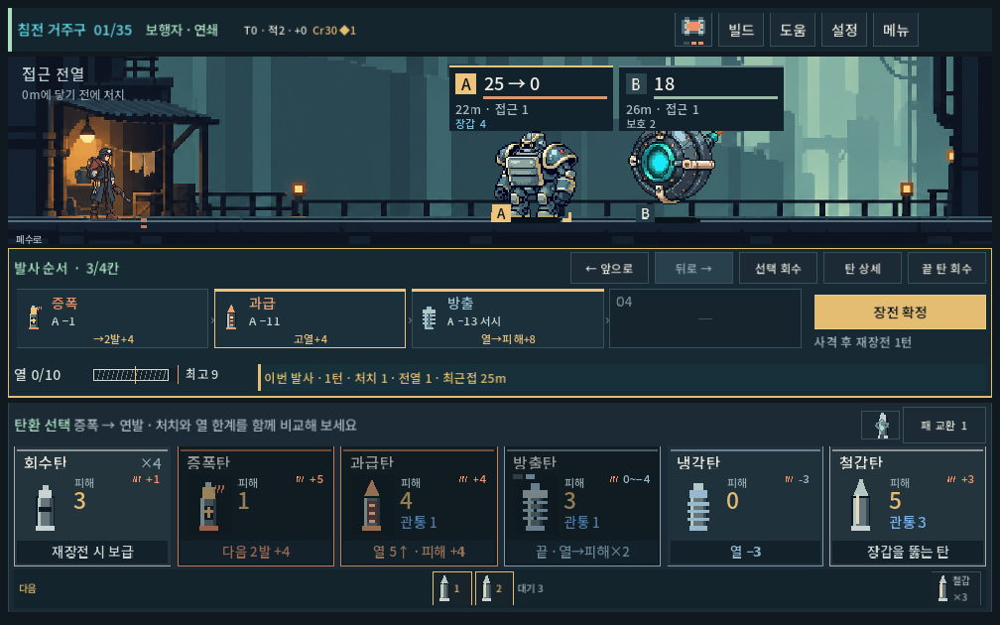
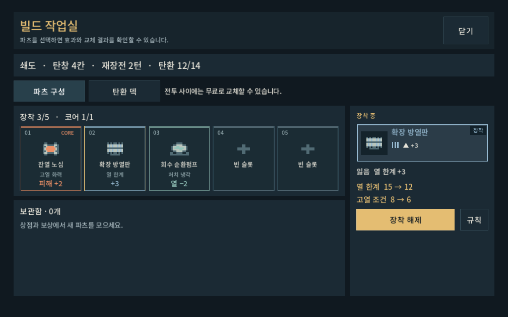

# 발열 빌드 확장 — 구현·검증

2026-10-04 · `prototype/core-redesign` 작업 트리 · Godot 4.7 Windows · 기본 HEAD `7037ee41`. 기존 사용자 작업을 보존하고 [본편 PLAY.cmd](../../../PLAY.cmd)에 통합했다. [규칙·수치·결정 상태](../../direction/heat-builds.md).

## 구현

파츠3종(확장 방열판·회수 순환펌프·잔열 노심), 탄환2종(과급·방출)을 전투·예측·상점·보상·빌드·저장까지 연결했다. 전술 보급14종·파츠23종이며 처음 받는 덱은 유지한다. 기존 열 한계 도달 탄 해결 → 후속 중단 → 강제 재장전 구조를 유지했다.

처치 냉각은 타격·기폭·전이 후 한 번 적용하고 그 뒤 과열을 판정한다. 시간 경과 화상과 투사체 요격은 제외한다. 과급/잔열은 발사 직전 열을 보고, 방출은 마지막 위치에서 최대4열을 피해로 바꾼다. 처치 냉각이 다음 고열 보너스를 끄는 반대 효과도 검증했다.

카드에 조건/열 소모·끝 칸 표시를 넣고, 레일에 고열 보너스와 열 전환을 표시했다. 게이지는 최종 열 한계와 고열 진입선을 반영한다. 상점·장비에서 열 한계와 고열 조건의 전후 값을 공개한다. 실제 처치 뒤 냉각 피드백을 주며 일반 재장전/추가 냉각의 진행을 구분한다.

산개5발 이상 정확 예측은 별도 스레드에서 계산한다. 결과 대기 중에도 회수·순서 변경이 가능하며 확정/발사는 결과 확인 후 활성화된다. 이전 계산 취소, 늦은 결과 배제, 메뉴 이동 취소, 열린 정보창 유지, 종료 시 스레드 정리를 적용했다. 예측을 샘플링하거나 불리한 분기를 버리지 않았다.

## 기능 검증

모든 실행은 `qa_runtime/` 아래 APPDATA/LOCALAPPDATA를 사용했다. 실제 진행 저장에 덮어쓰지 않았다.

| 범위 | 검사 / 실패 | 근거 |
|---|---:|---|
| 신규 규칙 | 2,479 / 0 | [로그](heat_builds_2026-10-04_assets/rules.log): 다섯 무기의 고열 경계, 냉각/과열 우선순위, 요격·화상 제외, 전이 다중 처치, 두 배 효과, 끝 위치 고정, 실제 저장 |
| 신규 UI | 274 / 0 | [로그](heat_builds_2026-10-04_assets/ui.log): 공개 마우스 입력, 1280×900/1008×630/1440×630, 카드 문구 폭·화면 경계, 발사 후 열·적 상태, 진열·구매·장착, 계산 중 편집 |
| 기존 발열 규칙 | 757 / 0 | [로그](heat_builds_2026-10-04_assets/heat_rules.log): 과열 중단·냉각 순서·증강·승패·구 저장·압축 잔탄 |
| 기존 발열 UI | 272 / 0 | [로그](heat_builds_2026-10-04_assets/heat_ui.log): 자동 재장전·미발사·상시 열과 실제 연출 |
| 탄환 회귀 규칙 | 45,881 / 0 | [로그](heat_builds_2026-10-04_assets/ammo_rules.log): 기존 탄 연계와 모든 보급 후보, 경량 계산 동등성 |
| 탄환 회귀 UI | 253 / 0 | [로그](heat_builds_2026-10-04_assets/ammo_ui.log): 전투·원거리·상점·발견 보상 흐름 |
| 성장·상점 회귀 | 4,589 / 0 | [로그](heat_builds_2026-10-04_assets/progression_rules.log): 5무기×24시드 파츠 순환·경제·초기 보급·저장 |
| 전체 등반 | 26,829 / 0 | [경로](heat_builds_2026-10-04_assets/campaign_summary.json), [로그](heat_builds_2026-10-04_assets/campaign.log): 5무기×2경로×35층, 4,353명령마다 저장 복원 |

추가로 산개의 모든 표적 경로를 직접 실행해 처치 냉각에 따른 강제 재장전 확률, 발사 수, 최고 열 범위, 적별 HP와 처치 확률을 독립 비교했다. 경량 샷 계산도 모든 전술탄·다섯 무기·새 파츠 구성·모든 합법 시작 온도에서 전체 모델과 상태까지 일치했다.

전체 등반은 기본 난도·시드731042·후보 상한800의 탐색이다. 사람의 승률이나 난이도 평가가 아니다. 새 보급 풀로 명령 기록을 새로 만들었으며 이전 보고서의 완주 기록을 재사용하지 않았다. [전체 기록](heat_builds_2026-10-04_assets/campaign.json.gz). 같은4,353명령을 재실행해 **30,492검사/0실패**, 열 경로 모두 최종 전투 이력까지 일치했다. [재생 로그](heat_builds_2026-10-04_assets/replay.log), [재생 원본](heat_builds_2026-10-04_assets/replay.json.gz).

개발 중 기존 검사의 `20파츠/10회 진열` 가정이 새 콘텐츠 수와 맞지 않아 전체 파츠 수로 검사 범위를 계산하도록 수정하고 재실행했다. UI 대기 검사는 숨겨진 창의 빠른 프레임 수가 아니라 실제 시간 제한으로 수정했다. 최종 성공 실행에 Script/Parse 오류는 없다. 격리 환경의 Windows 인증서 저장소 읽기 메시지는 스크립트 실패와 구분한다.

## 선택 차이와 실제 화면

- 방열판: 같은 고출력→연발→철갑→냉각에서 기본3발/총3턴과 장착4발/1턴이 갈린다.
- 순환펌프: 같은 철갑→냉각이 처치 성공2발/1턴, 실패1발/총3턴으로 갈린다.
- 잔열 노심: 같은 고출력·과급·방출3발을 앞뒤로 바꾸면 장갑4·HP40 비교 적에게16/26피해. 냉각 부품은 고열 조건을 끌 수 있고, 저발열 조합에는 다른 공격 부품의 가치가 남는다. [사례 원본](heat_builds_2026-10-04_assets/thermal_cases.json).

실제 게임 캡처를 직접 확인했다. 1008×630에서 새 카드 조건문·열 숫자·발사 레일이 겹치지 않고, 구매/장착 결과와 실행 버튼을 읽을 수 있다. 사용자가 설명 없이 이해하는지는 별도 플레이 확인이 필요하다.





[처치 냉각](heat_builds_2026-10-04_assets/kill_cooling_1008.png), [방열판 상점](heat_builds_2026-10-04_assets/shop_radiator.png), [잔열 노심 상점](heat_builds_2026-10-04_assets/shop_ember_core.png), [방출탄 상점](heat_builds_2026-10-04_assets/shop_vent.png), [산개](heat_builds_2026-10-04_assets/responsive_scatter.png).

## 성능과 남은 판단

동기 계산 자체는 냉각 포함8발/3,200분기에서 약1.35초였다. 이전 1.17~1.59초보다 크게 빨라졌다고 주장하지 않는다. 현재 개선은 무거운 계산과 화면 조작을 분리하고 무효가 된 계산을 중단한 것이다. [직접 계산 측정](heat_builds_2026-10-04_assets/forecast_performance.json).

새 고열 파츠를 단 산개8발을 화면에 반영하는 호출은 약25.9ms였고, 즉시 끝 탄을 회수한 뒤7발 최신 결과와 화면 확인까지 약1.53초였다. 그동안1,659렌더 프레임이 진행했고 실제 회수 입력을 수락했다. 이는 숨겨진 QA 창의 실행 관찰이며 일반 플레이 FPS/휴대폰 성능이 아니다. [응답성 원본](heat_builds_2026-10-04_assets/responsiveness.json). PC의 다른 QA 작업과 함께 측정했다.

Galaxy 실기 성능·열 관리 피로도·다중 시드 장기 빌드 선택·방출의 효율·압쇄 안정성은 미확인이다. 기능/시각 검사를 재미 완성으로 취급하지 않는다. APK·커밋·푸시는 생성/수행하지 않았다.

## 재실행과 증거

```powershell
powershell -NoProfile -ExecutionPolicy Bypass -File tools/run_heat_builds_checks.ps1 -Mode rules
powershell -NoProfile -ExecutionPolicy Bypass -File tools/run_heat_builds_checks.ps1 -Mode ui
powershell -NoProfile -ExecutionPolicy Bypass -File tools/run_progression_checks.ps1 -Mode campaign -Label heat_builds
powershell -NoProfile -ExecutionPolicy Bypass -File tools/run_ammo_expansion_checks.ps1 -Mode replay -Label heat_builds -CampaignSource qa_runtime/progression/campaign_heat_builds/city_campaign_report.json
```

[산출물 SHA-256](heat_builds_2026-10-04_assets/manifest.json), [관련 소스 SHA-256](heat_builds_2026-10-04_assets/source_sha256.json). 소스 식별자는 커밋·릴리스 완료를 뜻하지 않는다.
