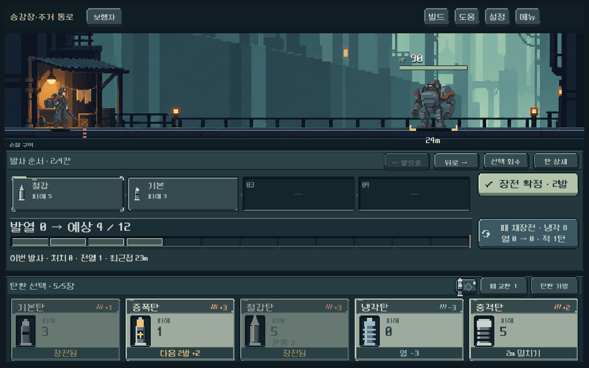
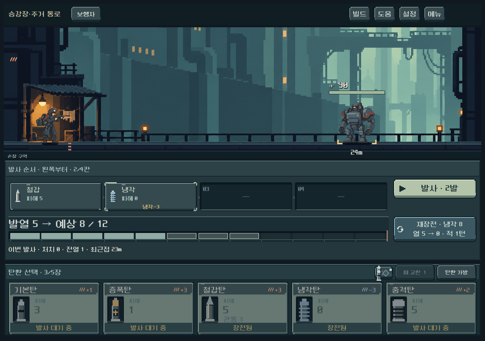
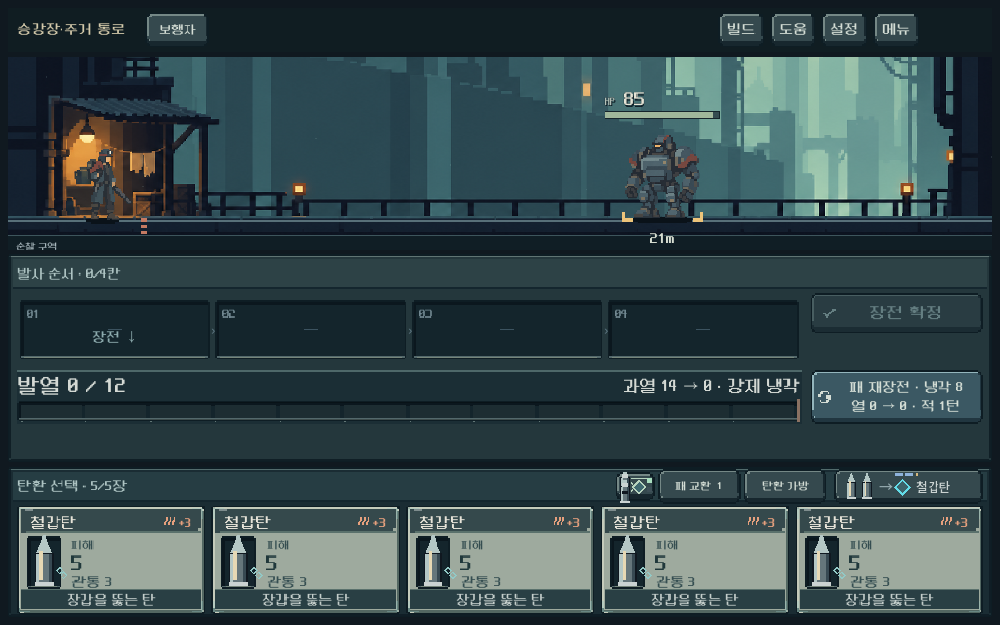
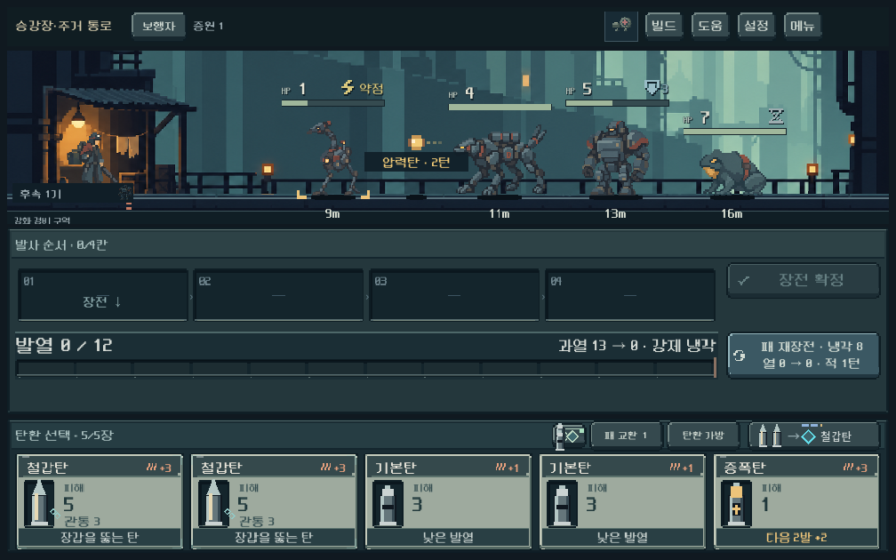

# 발열 표시 조사 및 보완 — 2026-10-10

사용자 제보: 장전 중과 발사 후 모두 UI가 0으로 보인다.

## 후속 확인 — 장전 중 예상치의 정보 위계

사용자가 발열 카운터는 탄환 삽입·장전 때 변해야 한다고 명확히 설명하고 `발열 0 / 12`와 윤곽 셀만 보이는 화면을 제공했다. 아래 최초 조사는 실제 발사 시 값 전달에 치우쳤다. 최신 요청의 핵심은 현재치와 예상치를 한곳에서 판독하는 것이다.

- 큰 제목을 `발열 0 → 예상 8 / 12`로 변경했다. 예상은 사격 중 최고치이며, 범위가 있는 경우 `8~12`처럼 표시한다. 툴팁에 최고치/냉각 후 값 차이를 설명한다.
- 탄환 추가·회수·순서 변경·장전 확정에 따라 갱신하며, 전투 상태의 실제 열은 변경하지 않는다. 발사 연출에서는 실제값으로 돌아온다.
- 기존 68px 높이를 유지하고 제목을 실측해 28~20px로 맞춘다. 우측 보조 문구는 제목과 겹치지 않을 때만 그린다. 과열 예고는 기존 발사 버튼 하단에도 유지된다.
- 최신 `run_heat_live_checks.ps1`: **410검사, 실패 0**. 세 해상도에서 `0→1→4`, 회수 후 `1→0`, 냉각탄 재배치에 따른 예상 최고치 `5→8`, 확정 후 유지 및 기존 발열 이벤트/냉각 검증 포함.
- 실제 1008×630 장전 화면, 1280×900 순서 변경 화면을 열어 제목·게이지·행동 버튼과 겹침이 없는 것을 확인했다. Galaxy 실기기와 사용자 이해도는 후속 확인.

## 재현과 판정

- 일반 발사: 5종 무기에서 명중 후 실제 열과 게이지 값 일치. 기본탄/철갑탄 연쇄는 4, 증강 단발은 3. 지속적인 0 고정은 재현되지 않았다.
- 정상 저장을 읽기 전용으로 복사해 격리 실행: 보행자, 장전된 연타/연타/충격/증폭이 `0 → 4 → 8 → 10 → 13`으로 증가하고 강제 재장전 후 0. 원본 저장 변경 없음.
- 장전은 실제 열을 소비하지 않는다. 게이지는 현재 열, 테두리 칸과 우측 문구는 사격 최고 예상치다.
- 별도로 발사 전 발열 이벤트가 HUD에 전달되지 않고 명중 시점에야 적용되는 연결 누락을 확인했다. 수정 전 신규 이벤트 검사 9개 실패, 명중 후 정합성 검사는 통과했다. 이것을 사용자 제보 전체의 확정 원인으로 단정하지 않는다.

## 수정

- heat_added / heat_removed / kill_cooling 이벤트를 게이지에 즉시 전달한다.
- 세 번째 발 파츠 냉각을 발사 전 냉각에서 제외한다. 해당 효과는 기존대로 명중 시 최종 열에 반영된다. 전투 계산 변경 없음.
- 강제 재장전 후 `과열 13 → 0 · 강제 냉각`처럼 최고치와 냉각 결과를 남긴다. 다음 행동 뒤 오래된 결과는 사라지고, 새 장전 예측/재장전 미리보기가 우선한다.

## 검증

- `tools/run_heat_live_checks.ps1`: 228검사, 실패 0. 5종 무기, 발열 이벤트, 명중, 냉각탄, 강제 재장전, 연출 기본/축소 설정, 다음 행동 시 결과 정리, 저장 복사본 재생 포함. 연출 속도는 테스트 가속 0.2.
- `tools/run_heat_checks.ps1 -Mode rules`: 783검사, 실패 0.
- `tools/run_combat_affordance_checks.ps1`: 340검사, 실패 0. 기존 냉각 미리보기와 전투 조작·레이아웃 회귀 통과.
- 1280×900 일반 발사와 1008×630 강제 냉각 결과 실제 렌더 확인. 새 행 없이 기존 게이지 우측에 문구가 들어가고 레이아웃 넘침 없음.
- 원래 사용자 실행 창에서 계속 0에 고정되는 현상 및 실제 Galaxy 체감은 추가 확인이 필요하다. APK/커밋/푸시 없음.

