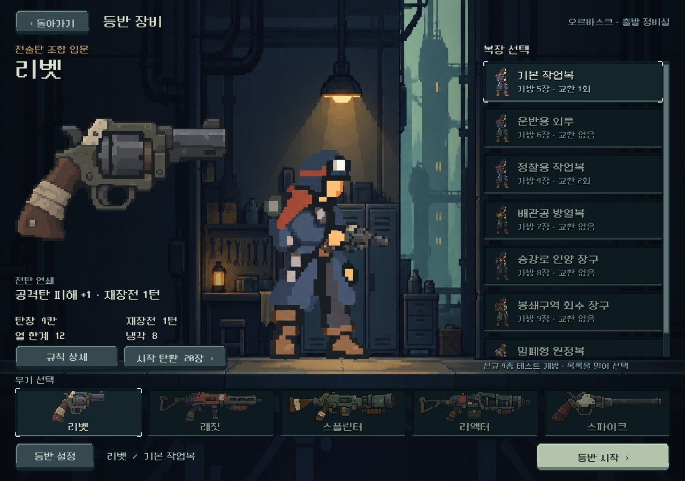
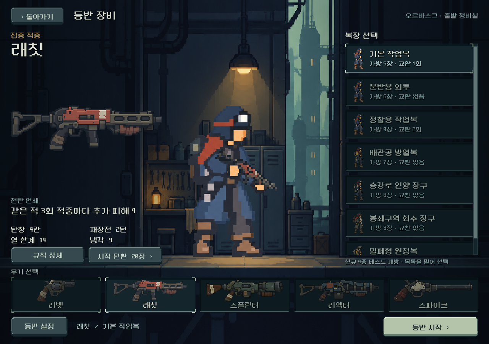
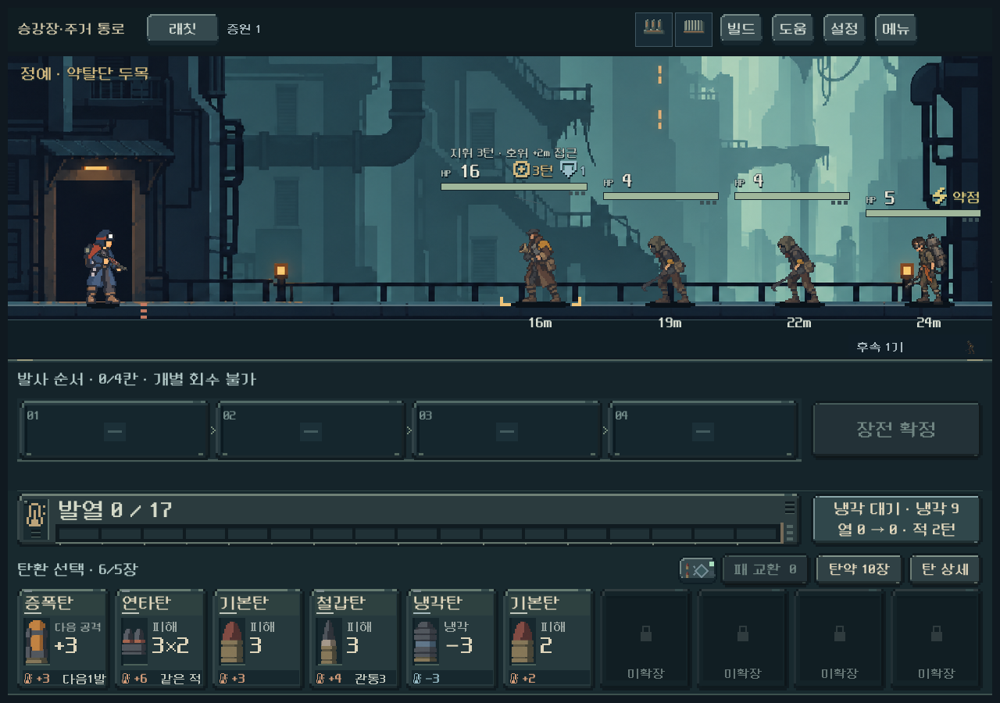

# C안 적용과 전투·장비 선택 캐릭터 공유

2026-10-25. 사용자는 C안 채택 후 전투와 무기 선택에 적용을 요청했고, 선택용 그림을 새로 그리는 것이 아니라 **현재 전투 캐릭터 자체를 선택 화면에서도 사용**하도록 명확히 했다.

## 결과

- 기본 권총 몸체는 승인 C 파일과 해시가 동일하다. 장총 몸체는 기존 6자세·손과 발 등록을 유지하며 같은 윤곽 처리를 적용했다.
- 선택 중앙에는 전투와 같은 `weapon_actor.tscn`을 표시한다. 복장, 현재 무기, idle 자세, 재질과 무기 격자, 손/총 합성 모두 공유한다. 화면용 확대와 바닥 정렬만 다르다.
- 복장 목록의 작은 그림도 실제 전투 몸체 첫 자세를 사용한다. 별도의 선택 원화는 더 이상 표시하지 않는다.
- 선택용 원화를 추가 제작했던 중간 결과는 사용자 정정 후 본편에 연결하지 않고 컨셉 기록으로 보존했다. 추가 복장 원화 제작은 진행하지 않았다.

## 확인한 범위

| 검사 | 결과 | 범위 |
|---|---:|---|
| 장비 UI | 650 / 실패0 | 3해상도, 무기5×복장7 선택/등반, 실제 배우와 총기 잘림, 저장 보호, 큰 글자 |
| 전투 동작 | 509 / 실패0 | 무기별 실제 반동·재장전·건너뛰기·접지·거리 순서 |
| 전체 배우 카탈로그 | 210 / 실패0 | 35조합×6자세의 전체 실루엣, 비교판6장 시각 확인 |
| 전투/선택 동일성 | 8 / 실패0 | 기본복 한손/양손, 회수·원정복 대표4조합의 몸체 참조와 **합성 이미지 픽셀 해시 동일** |

총1,377검사 실패0. Godot4.7 Compatibility, 격리 APPDATA/LOCALAPPDATA 및 저장 비활성. [동일 렌더 증거](assets/hero_contour_live_2026-10-25/shared_actor_evidence.json). [모바일 비율 화면](assets/hero_contour_live_2026-10-25/equipment_mobile_expedition.png). 로그는 같은 폴더에 있다.

이전 초상화 구조를 직접 참조하던 slum/reserve UI 검사2개를 현행 공유 배우에 맞게 바꾸고 `--check-only`로 구문 확인했다. 해당 두 전체 회귀는 이번에 별도로 실행하지 않았으며 위 숫자에 포함하지 않았다.

## 남은 범위

기존 운반복·정찰복은 전투에서 기본 작업복 몸체를 사용하므로 선택에서도 같은 외형이다. 특수4복장은 기존 전투 원화 그대로이며 이번에 외곽선을 새로 그린 대상은 기본 몸체의 두 무기 계열이다. 해당 복장들의 고유 외형 재작업을 완료했다고 보지 않는다. 실제 Galaxy와 사용자의 최종 화면 체감은 확인 전이다.

## 파일·제작 기록

- `assets/art/hero_contours_20261025/work_pistol.png`, `work_long.png`: built-in image_gen 편집/승인본 복사. [전체 프롬프트와 해시](../../../새-게임-프로젝트/assets/art/hero_contours_20261025/provenance.json).
- `redesign/weapon_actor.gd`: C 몸체와 공통 몸체 조회.
- `redesign/equipment_actor.gd`, `equipment_screen.gd/.tscn`: 실제 전투 배우 재사용, 선택·목록·바닥 정렬.
- [6자세 중 조준 비교](assets/hero_contour_live_2026-10-25/outfit_matrix_aim.png) · [재장전 비교](assets/hero_contour_live_2026-10-25/outfit_matrix_reload_seat.png).

전투 규칙·능력치·사용자 저장·기존 원본 보존. APK·커밋·푸시·외부 업로드는 이번 요청에 포함하지 않았다.
