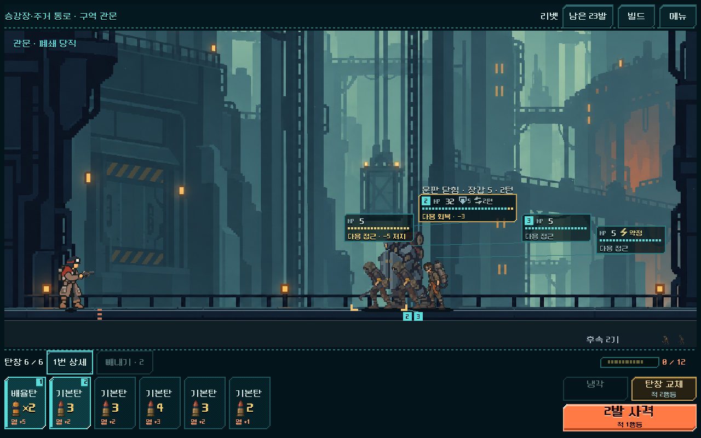
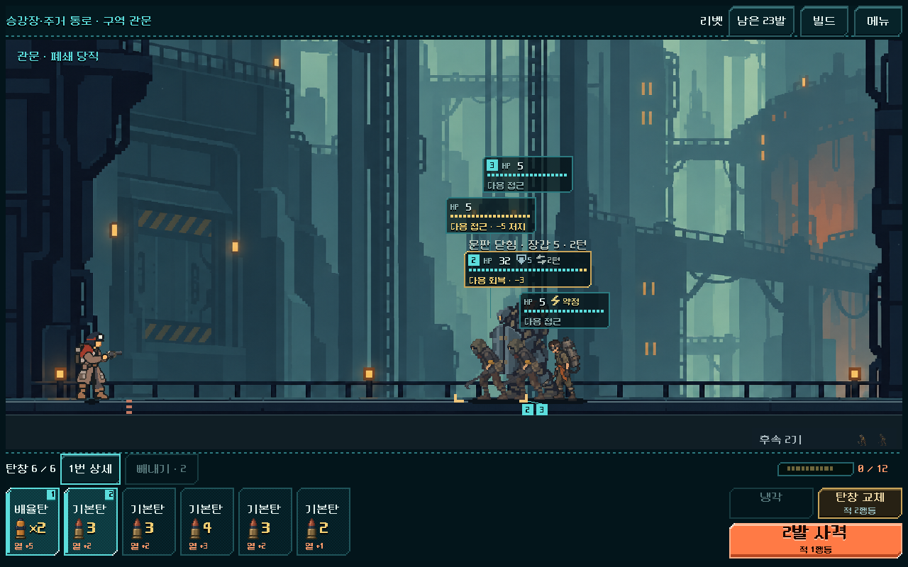
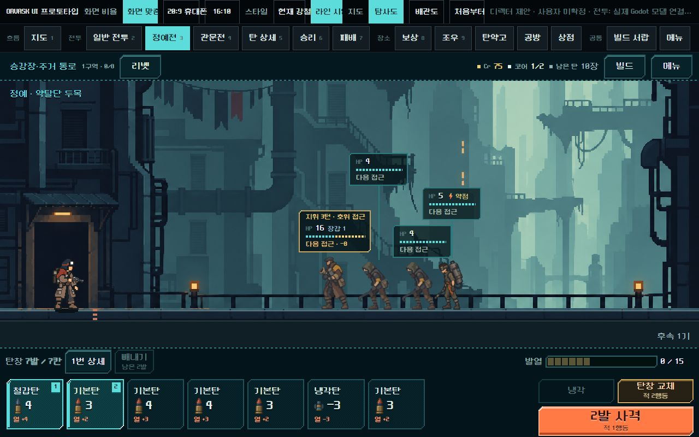
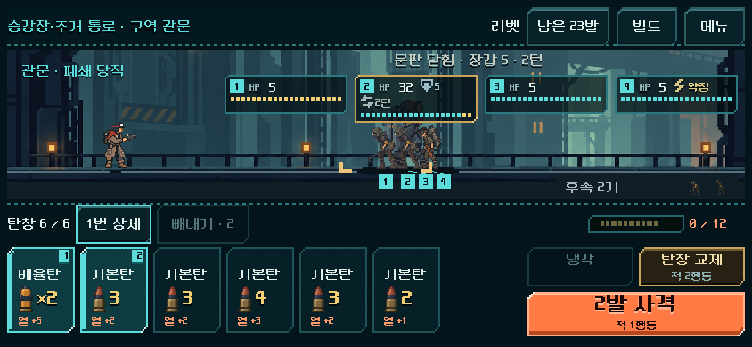
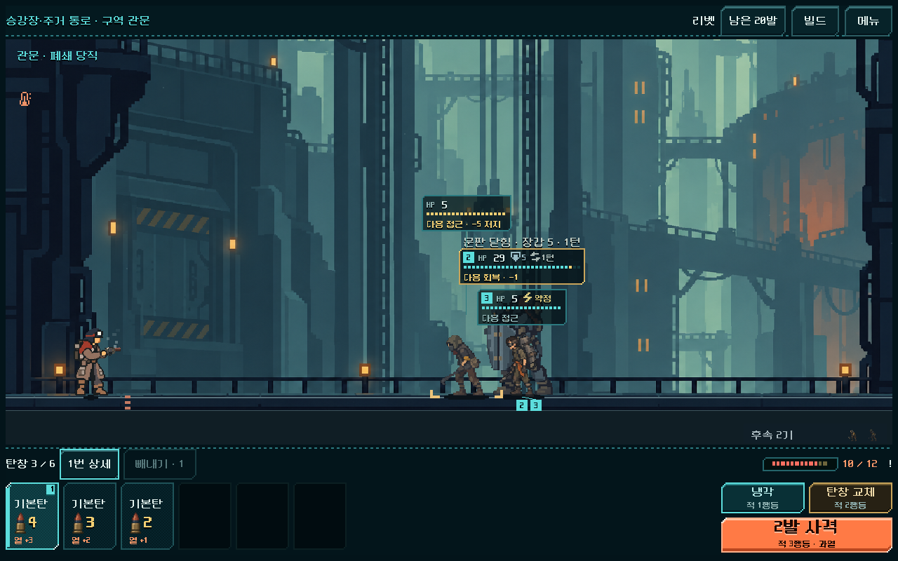

# 몬스터 HP 카드 — 머리 위 세로 겹침 처리

2026-11-01. 사용자가 지적한 HTML 목업과 본편의 배치 차이를 수정했다. `PLAY.cmd`의 개편된 등반 및 공통 HUD 미리보기에 적용한다.

## 기준과 차이

사용자 승인 범위는 **몬스터 머리 위 가로 위치 유지 → 카드가 겹치면 위로 이동 → 연결선 → 실제 세로 공간 부족 시 한 줄 전환**이다. 이전 [캐릭터·HP 보정](actor_hp_2026-11-01.md)의 ‘기존 수평 충돌 회피 유지’를 대체한다. 그 단계의 글꼴·게이지·캐릭터 크기는 유지한다.

목업 `ui_prototype_2026-10-31/index.html`의 `drawField()`를 기준으로 삼았다. 목업은 정예/보스를 먼저 배치하고, 카드 중심을 적의 가로 위치에 맞춘 뒤 다른 카드에 부딪히면 위로 올린다. 카드 간 세로 여백6px, 화면 가장자리4px, 낮은 전투 영역230px 미만에서는 수평 배치다. 브라우저에서 라인 테마의 정예/관문 화면을1280×800으로 다시 확인하고 저장했다.

| 요소 | 적용 기준 | 본편의 필요한 차이 |
| --- | --- | --- |
| 카드 가로 위치 | 적 발의x에 카드 중심을 맞춤, 가장자리만 제한 | 기존128/180px 카드 크기와 최소44px 터치 높이 유지 |
| 카드 세로 위치 | 머리 위에서 시작, 겹치면6px 간격으로 위로 이동 | 상태 아이콘 줄 수에 따른 실제 높이 사용 |
| 정예/보스 안내 | 카드와 함께 이동 | 본편의 별도 행동 안내 영역도 충돌 판정에 포함 |
| 연결선 | 올라간 카드에서 해당 몬스터 머리로 | 모든 카드 뒤에서 그려 다른 카드의 글자를 덮지 않음 |
| 낮은 화면 | 한 줄 배치 | 230px 미만뿐 아니라 모든 층을 담을 실제 공간이 부족해도 전환 |
| 이동 안정성 | 같은 적의 대응 관계 유지 | 정예/보스 우선·고정 적 순서,12px 분리 여유로 경계 흔들림 방지, 연출 중 카드 높이 유지 |

레이아웃은5구역 공용 `redesign/campaign_hud/line_readout.gd`에 있다. 각 지역과 미리보기의 `intent_rect()`도 공용 결과를 사용한다. 그리는 카드, 마우스/터치 판정, 키보드 포커스용 Button이 동일한 사각형을 사용하며 이동/크기 변화 때 갱신된다. 캐시에는 크기·생존 적·머리 위치·카드 크기·안내 표시 여부가 반영된다.

## 실제 화면

아래 전후는 **동일한 본편 저장·1280×800**이다. 시드731042, 리벳/운반복,1구역 관문. 적을 옆으로 옮기지 않고 카드만 위로 분리했다.

| 수정 전 | 수정 후 |
| --- | --- |
|  |  |

목업과 본편의 **같은1280×800 화면 크기 비교**다. 목업의 개발 도구 줄·전투 영역 높이·적 구성/수치가 본편과 다르므로 배경과 모든 픽셀이 일치한다는 의미는 아니다. 비교 항목은 머리 위 정렬, 세로 겹침 회피와 연결선이다.

| HTML 라인 목업 — 정예4기 | Godot 본편 — 관문4기 |
| --- | --- |
|  |  |

## 검증

Godot MCP로 활성 프로젝트/4.7 버전 확인 후 기존 격리 CLI 경로로 렌더·입력을 검사했다. APPDATA/LOCALAPPDATA는 `qa_runtime/` 아래에 두었다.

- `tools/run_campaign_magazine.ps1 -Mode visual -RunTag hp_stack_final`: **1,950검사 / 실패0**. 실제 획득 저장7개(5구역)×1280×800·1008×454·844×390·740×360. 카드/상태/안내의 겹침과 화면 범위, 머리 위x정렬, 연결선 종점, 카드/터치 영역 일치, 위층 카드별 실제 터치→해당 몬스터 상세, 빼내기→사격 뒤 재배치 확인.
- 겹침 전용 **표현 테스트**: 네 적의 표시 거리만 같은 값으로 만든 후 세로 분리, 작은 거리 변화/추월 시 층 순서, 한 기 처치 뒤 재배치, 같은 화면 인스턴스의 크기 전환을 검사했다. 이는 실제 플레이로 도달한 상태가 아닌 표시 테스트이며 Model/Campaign 데이터와 RNG는 변경하지 않았다. [완전 겹침](hp_stack_2026-11-01_assets/fixture_four_overlapping.png), [한 기 제거](hp_stack_2026-11-01_assets/fixture_after_death.png).
- 기존 `run_prototype_hud.ps1 -Mode ui -Fast`: **11,536 / 실패0**. 연속 전투/보상/정비/관문 `-Mode flow -Fast`: **4,274 / 실패0**. 피해 예측 `-Mode readout -Fast`: **405 / 실패0**.
- `model.gd`, `campaign.gd`, `forecast.gd`는 작업 전후 SHA-256 동일. 화면 렌더/표시 테스트 전후 실제 전투 상태와 RNG도 동일하다. 카드/행동 버튼 배치·입력 명령·저장 형식은 유지한다.

근거: `qa_runtime/campaign_magazine_20261101/hp_stack_final/visual`의 캡처·geometry.json·stdout/stderr, 같은 폴더 상위의 source_hashes.json. 작업 전 소스/규칙 해시는 `hp_stack_before`. 기존 HUD 결과는 `qa_runtime/combat_hud_20261031/prototype_20261101`.

실제 캡처로1/2/4/5구역의 배치·연결선·작은 화면을 검토했다. 사용자 미감·정보 이해도와 Android 실기기 판독성은 별도 확인 사항이다. 이번 작업은 HP 배치 수정이며 전체125전투 밸런스·실기기 성능 검사를 재실행한 것은 아니다.
