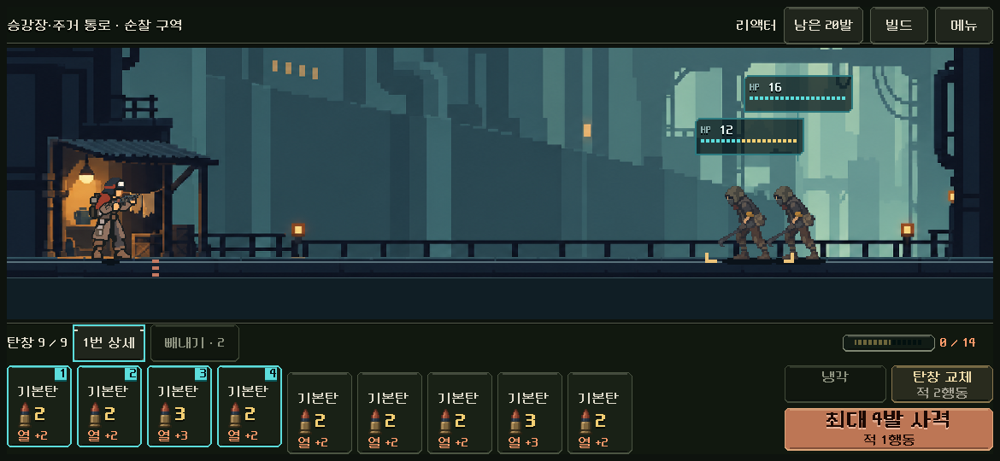

# 전투 HUD·지도 버튼 재질 본편 적용

2026-11-06. 사용자가 [화면 간 정합성 검토](../ui_cohesion_2026-11-06/README.md)의 방향을 승인하고 다음 작업을 요청했다. 전투의 중립 재질과 지도 버튼 마감만 본편에 적용했다. [같은 크기의 실제 전후 화면](index.html).

## 적용 범위와 유지한 의미

- 본편이 상속하는 `samples/hud/combat_hud.tscn`과 메뉴·상세 씬의 기본 틀을 철제·먹색 바탕/아이보리 글자로 연결했다. 청록 디더 텍스처를 쓰던 장식 노드는 `combat_material/frame.gd`의 도트 모서리·선·빛/그림자로 그린다. 새 원화나 화면 배치는 만들지 않았다.
- 기본 카드 받침은 차분한 철제 바탕으로 바꾸고, 다음 발사 탄의 청록 테두리·순서 번호·상승, 제외의 붉은 테두리, 빈 용량의 어두운 외피를 유지했다. 실제 `shot_started`/교체 때도 새 받침 상태로 갱신한다. 이름·수치·탄환 그림·카드 크기/입력 영역은 같다.
- 상·하단의 청록 점선 레일은 조용한 철제 이음선으로 바꿨다. 일반 버튼·비활성 글자는 아이보리/중립색으로 정리했다. 사격·냉각·교체·발열·위험·피해/파츠별 색, HP 게이지와 상태 표시는 의미를 보존한다. 이번에는 적 HP 카드의 배치/겹침이나 별도 세계의 장소 UI를 바꾸지 않았다.
- 지도에는 장비 선택의 기존 `equipment/edge.gd` 장식을 그대로 재사용했다. 기존 동작을 유지하는 `primary_variation` 인자만 추가해 지도 `MapPrimary`에도 같은 빛/그림자를 사용한다. 헤더4개, 범례·자세히·이동의7버튼에 입력을 받지 않는 장식 자식만 저작했다. 관문/지도 기호·경로·레이아웃은 그대로다.
- 실제 채움색·선 마감은 승인된 재질 방향에 따른 구현 선택이다. 사용자가 새 화면의 미감을 확인한 것으로 기록하지 않는다.

## 구현과 정식 씬

새 파일은 `redesign/combat_material/{skin,frame,band}.gd`다. `@tool` 장식과 각 씬의 직렬화된 `kind`를 사용하므로 에디터에서도 기존 대표 구도가 보인다. 주 배치를 코드에서 생성하거나 재배치하지 않는다. 기존 NinePatchRect의 패치 여백·부모·이름과 버튼의 클릭/포커스 연결을 보존한다. 전투에만 새 재질을 연결하고 과거 공용 `line_frame`/`combat_pixel_skin` 자산을 덮어쓰지 않았다.

Godot MCP의 `get_project_info`로 활성 프로젝트와4.7 엔진 연결을 확인했다. 연결 오류는 없었다. 현재 MCP에 테마·그리기 코드 편집 기능이 없어 기존 로컬 리소스 편집/네이티브 캡처 경로를 사용했다. 이 작업은 HTML/DOM 결과로 Godot 검증을 대체하지 않는다.

[작업 직전과의 차이](changes.diff), [직전 파일](source_before/), [전후 관측/최종 소스 해시](validation.json). 큰 기존 미커밋 작업 트리를 초기화하지 않았다. Model/Forecast/Campaign/CampaignContent/RouteMap/전투 입력 컨트롤러6파일의 작업 직전 SHA256이 유지된다.

## 검증

| 요구/위험 | 실제 확인 | 결과 |
| --- | --- | --- |
| 실행 바인딩 전에도 정식 구도/재질 노출 | HUD·메뉴·상세의 게임 컨트롤러 스크립트를 제거한 채 각 정식 씬을 직접 열어 네이티브 캡처. | **3검사 실패0**. [저작 HUD](authored/combat_hud.png), [출력](authored/stdout.log). 실제 HUD 그림도 확인했다. |
| 외형 변경이 배치·입력·전투에 영향 | 같은 획득 저장 `heavy_17_r1_n101`을 본편 main으로 열고 1280×800·1170×540·740×360에서 준비/선택/상세/메뉴/사격/교체18상태 캡처. 공개 Fire/Reload는 전체 원본 모델/RNG 복제와 비교. 전후 보이는 Control2,579관측의 Rect·최소 크기·mouse_filter, 전체 캠페인/모델/프로필 비교. | 전/후 각각93검사 실패0. 모든 기록과 기하 차이0. |
| 다양한 총기/작은 창/빈 탄창/입력 회귀 | 기존 `tools/run_prototype_hud.ps1 -Mode ui -Fast` 그대로 실행. 5총기·4크기·실제 빼내기/사격·저장 재개·키보드·재장전 알림 포함. | **11,558검사 실패0**. [출력](hud_stdout.log), [원문](hud_result.json). |
| 지도 장식이 선택·상세/범례·이동과 경로에 영향 | 기존 `tools/run_map_material.ps1 -Mode current`, 획득된 최신v4의293명령/5구역과 정확한 원래 캠페인·전투/RNG·프로필 종료 상태 대조. | **15,770검사 실패0**. 정식 씬 preview도 **11검사 실패0**. [지도 출력](map_stdout.log), [정식 씬 출력](preview_stdout.log). |
| 본편 재생/구역·저장 연결, 실제 사격 중 글자 | 기존 `tools/run_presentation_integration.ps1 -Mode flow -Label hud-material`, 실제293명령/5구역, 메뉴/상세·보상·정비·지도·자동 저장/복원과 기존 원래 종료 상태 비교. 실제 타격 중 비활성 사격 글자의 GPU 픽셀 확인. | **1,532검사 실패0**. [통합 출력](flow_stdout.log), [원문](flow_result.json). |
| 장비 선택의 공용 장식 기본값 보존 | 기존 `tools/run_equipment_live.ps1`, `QA_EQUIPMENT_LAUNCH_ONLY=1`. 실제 선택·35조합 시작/저장·상세·설정/교체 확인과 취소. | **310검사 실패0**. [출력](equipment_stdout.log), [원문](equipment_result.json). |

격리 `qa_runtime`의 APPDATA/LOCALAPPDATA만 사용했다. 전후 캡처 도구/실행기는 `tests/hud_material_capture.gd`와 `tools/run_hud_material.ps1`이며 동일 실제 입력·전체 상태를 비교하기 위한 것이다. 재질 함수의 반환값만 확인하는 검사가 아니다.

초기 비교 도구에서 `Model.simulation_state`가 과거 기록을 잘라 전체 history 비교6개가 실패했다. UI를 바꾸기 전 발생한 도구 문제이며 원본 전체 복제로 교정한 뒤 전/후 모두 통과했다. 초기 원문은 `qa_runtime/hud_material_20261106/before/diagnostic_pruned_history.*`에 보존했다. 새 장식의 초기 `Skin` 이름은 Godot 내장 클래스와 충돌해 파싱 단계에서 검출했고 `HudSkin`으로 고쳤다. 최종 실행 오류 로그는 모두 비어 있다.

## 시각 확인과 남은 범위

준비/선택/메뉴/상세·지도 실제 캡처와3·5구역의 본편 재생 화면을 열어 확인했다. 기본 받침의 반복 청록 무늬가 제거되고 장비/지도와 같은 절제된 철제 면으로 연결된다. 카드/기능색은 계속 구별된다. [S26 비율](after/ready_1170x540.png)은 PC에서 같은 비율로 렌더한 결과다. Android 실제 안전 영역·터치·지속 발열과 사람의 미감/장시간 판독은 미검증이다. 새 APK·커밋·푸시·외부 게시 없음.
