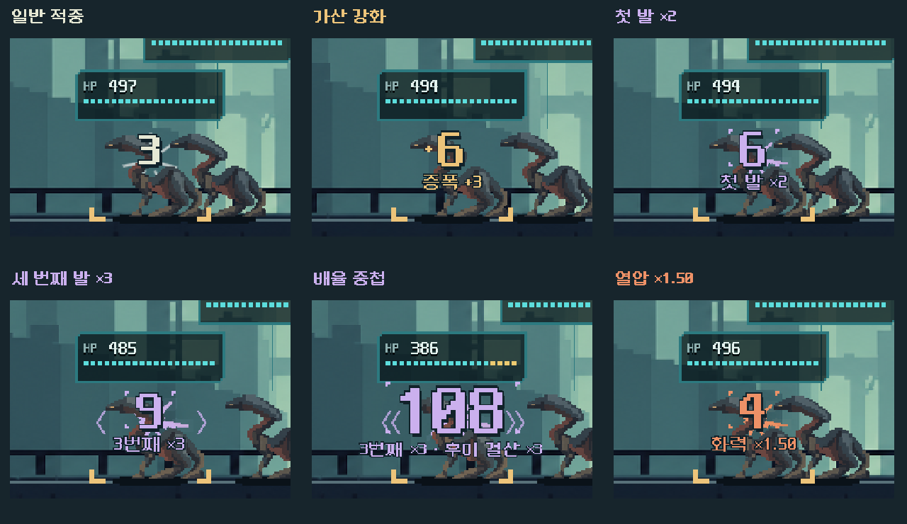

# 실제 파츠 효과에 따른 적중 색과 배율 타격

**리소스 수 범위 정정:** 아래358개는 공유 HUD의 별도5전투 연구판 정적 목록이다. 본편 전체 수/패키지 포함 검사와 구분한다. 본편 효과 연결은 실제 캠페인/공개 사격 검사로 확인했다. [후속 본편 진입 기준 검사](../interaction_fx_2026-11-06/README.md).

2026-11-06. 사용자 요청: 피해 숫자를 단일 색으로 처리하지 않고 파츠 효과, 특히 곱배율이 적용된 적중의 색/효과를 구분한다. **본편에1차 적용했다.** 팔레트와 강도는 디렉터 선택이며 사용자 미감/실기기 확인은 남는다.

같은6피해도 가산 강화와 첫 발×2의 색/형태가 다르다. 그림은 통제된 조건의 실제 Godot 전투 캡처를 확대 배치한 것이며, 수치 균형이나 실제 획득 경로의 성과 비교가 아니다.

## 표현 기준과 적용

| 실제 결과 | 숫자/타격 표현 |
|---|---|
| 일반 직접 피해 | 아이보리, 기존 작은 타격 |
| 지원/파츠의 가산 강화 | 황동색, 작은 더하기 무늬 |
| 첫 발/세 번째 발/후미/코어 등 적용된 곱배율 | 연보라, 숫자 모서리와 퍼지는 타격. ×3/중첩에는 겹친 측면 무늬 |
| 열압/강행의 배율 | 주황색을 유지하며 배율 타격 무늬 사용 |
| 연타/집중, 전이 후속 피해 | 청색 계열. 연타 숫자는 이중 눈금 |
| 화상/지역 불길/화상 이동 | 기존 불 계열 색을 유지 |

처치나 큰 피해의 중요도는 크기/기존 팝으로 유지하면서 원인 색을 덮지 않는다. 피해 가산·배율·연타가 적용된 경우 숫자와 발동 배너의 색도 맞춘다. 화상 상태를 함께 부여한 배율 공격은 피해 숫자 색과 화상 설명 색을 분리한다. 색만으로 구분하지 않고 더하기/모서리/이중 눈금·겹친 타격 모양을 함께 쓴다.

장착 목록이나 예상 피해 총량으로 발동을 추정하지 않는다. `impact_style.gd`는 해결된 결과의 `math.factor`, `part_factor`, `engine_percent`, `overdrive_percent`, `gate_percent`, 실제 가산/타격·`part_effects`를 읽는다. 세 번째 발 파츠를 장착해도 첫/두 번째 발은 보통 적중으로 남는다.0피해/막힘·요격·지원 준비에는 배율 적중 폭발이 없다. 후속 전이/화상은 자신의 결과 종류를 표시하며 원 공격의 위치 배율을 재발동한 것처럼 표현하지 않는다.

## 이펙트 제작과 위치

pixelfx0.3.0의 `impacts/hit-spark`와 `impacts/crit-hit`를 렌더/검토하고 각각 원본 검사도 통과했다. 배율 적중에는 후자의 중립 램프23프레임 투명 시트를 선택하고, 본편에서 실제 결과 색과 단계로 표시한다. [출처·옵션·프레임·해시·고지](../../../../새-게임-프로젝트/assets/art/impact_parts_20261106/provenance.json).

- 시트864×816 / 셀216×136 /4열 /23프레임. 바닥 원점(84,106)에서 제작 높이26을 빼 **실제 접점(84,80)**을 적중 위치에 맞췄다. 마지막 프레임이 완전 투명함을 확인했다.
- 첫 축소안은 큰 숫자 뒤에서 효과가 묻혀, 실제 화면을 본 뒤 크기와 중첩 측면 무늬를 조정했다. 최종 화면으로 검사를 다시 수행했다.
- 캐시한 시트1개와 고정 도형을 사용한다. 런타임 JS/입자 시뮬레이션/난수는 없다. 기존 적중 구간의 `pulse`로 재생하며 사격/적 행동 시간이나 계산을 늘리지 않는다.
- 동작 축소에서는 폭발 재생을 생략하고 숫자 색/정적인 표시를 남긴다. 사격 종료·다음 행동에서 상태를 비운다. 숫자의 기존 적중 앵커, HP 카드·화면/카드 크기·입력은 유지한다.

[실제 본편 화면](stacked_full.png) · [작은 창/동작 축소](reduced_1008x454.png) · [실제 획득 상태](acquired_full.png)

## 검증과 한계

Godot4.7 Compatibility / NVIDIA4060Ti, 격리 APPDATA/LOCALAPPDATA에서 실행했다.

| 검증 | 결과 |
|---|---|
| `tools/run_impact_parts.ps1 -Mode rules` | 172검사 실패0. 실제 첫/세 번째·중첩/열압·가산/연타 결과, 미발동/막힘/지원·요격/후속·처치/구형 영수증·읽기 순수성 |
| `-Mode ui` | 291검사 실패0/49상태 캡처. 통제된13조건과 실제 획득1상태, 실제 Fire 입력/모델·RNG 완전 일치, 실제 숫자 색 픽셀/정리·1008×454/동작 축소 |
| 실제 획득 상태 저장/재개 | 기존 획득 경로의 파츠 보유 저장을 읽어 실제 사격 후 새 격리 파일 저장/복원. 모델 상태 정확히 일치 |
| 기존 핵심 탄/위치 파츠 규칙 | 643검사 실패0 |
| 기존 지원 조합/소이탄 표기 | 각각953 /1,705검사 실패0 |
| 기존 파츠 발동/영수증 저장 표기 | 223검사 실패0 |
| 기존 `run_prototype_hud.ps1 -Mode ui -Fast` | 11,558검사 실패0 |

[최종 UI 원문/관측](ui/frames.json) · [판정 규칙 원문](rules/stdout.log) · [모델/표현 소스 대조](source_audit.json). 모델/예측/캠페인/탄환·파츠 계산은 단계 시작 해시와 동일하다. 변경은 표현 판정/읽기 표시·타격 그림/배너 색이며 저장 버전도 바꾸지 않았다.

PC 원본 해상도로 일반·가산·배율/중첩·열압·막힘/처치·전이, 짧은 창/동작 축소와 실제 획득 장면을 확인했다. 사람의 순간 구분/연속 사격 피로와 Galaxy S26 실기기 지속 발열·성능은 후속이다. 총구/탄도, 재질별 적중·차폐, 전이/불씨의 본격적인 VFX 보강 전체가 끝난 것은 아니다.

현재 여정 리소스 목록358개에 새2스크립트와 선택 시트가 포함됨을 확인했다. [리소스 확인](resource_selection.json). APK·커밋·푸시·외부 게시 없음.
