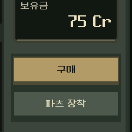

# 버튼 입력과 구매·장착·강화 완료 반응

2026-11-06.38~39번을 본편 `redesign/main.tscn`에1차 적용했다. 화면 구성·버튼/카드 크기·글꼴·클릭 영역과 계산/저장을 유지하고 현재 화면 안의 짧은 선으로 반응한다. 완료 문구를 새로 늘리지 않았다.

실제 Godot 구매 키/잔액을 잘라 약50ms 간격으로 기록한17개 원본 프레임이다. GIF는 정지 그림을 합친10프레임/850ms로 반복한다. 중간 그림을 생성/보간하지 않았다. 실제 구매는75→63 Cr 한 번이며 영상 반복은 명령을 재실행하지 않는다. 키를 누르는 동안 결제하지 않는 것도 확인했다.

## 입력과 결과

| 상태/처리 | 반응 |
|---|---|
| 가리킴·누름·복귀 | 기존 색/프레임에 짧은 표면선·눌림 음영과 복귀 반응 |
| 선택·비활성·포커스 | 기존 표시/키보드 포커스 유지, 빈 기본 포커스에 작은 끝 표시 |
| 구매/새 진열 | 실제 잔액·판매 완료/갱신 물품과 기존 완료 표시의 확인선 |
| 장착·해제·코어 교체 | 실제 바뀐 슬롯/보관 항목·기존 결과 문구 반응 |
| 강화/정비 | 완료 상태/정보창·실제 새로 생긴 탄환 항목 반응 |
| 보상·관문 | 현재 지도/공통 상태·빌드 버튼 등 기존 결과 위치 |
| 취소·거절·품절/비활성 재입력 | 입력 상태만 유지, 성공 피드백 없음 |

숫자는 실제 최종 값으로 즉시 바뀐다. 가짜 중간 잔액을 보여 주거나 연출 때문에 명령/화면 전환을 기다리게 하지 않는다. 기존 클릭/확정음을 유지하고 성공한 무료 정비 확정에도 기존 확인음을 연결했다. 지도 기호의 기존 선택 연출은 보존했다.

## 구현과 수명

- `ui/interaction_response.gd`는 그리기 전용 Node2D다. 컨테이너 배치/최소 크기·간격/클릭/포커스에 참여하지 않고 부모 위치·크기·배율·글자를 움직이지 않는다. 각 화면의 현재 테마 글자색을 사용하고 패널은 해당 테마의 Label 색을 사용한다.
- `ui/interaction_feedback.gd`가 버튼 이벤트를 연결하고 `_campaign_action`의 실제 성공 뒤에만 결과를 받는다. 클론은 새 부모에 연결하며 이전 완료를 재생하지 않는다. 위젯 숨김/제거·설정 변경 시 정리하며, 매 프레임 게임 상태를 조회하지 않는다. 기록은32건으로 제한한다.
- 저장/화면 갱신 뒤 잔액·보유 탄·파츠 차이를 읽는다. 다른 페이지/장소나 새 재고 버전으로 바뀐 결과는 폐기한다. 기존 저장 오류는 유지하며 로컬 명령 성공을 디스크 저장 성공이라고 표시하지 않는다.
- 기본/빠르게는 짧은 선 이동/복귀, 즉시는 Tween/스윕 없이 정적인 확인선을0.28초 표시한다. 명령 진행은 즉시 끝난다. 전투의 실제 연출 설정도 따른다.

[전체 구매 화면](purchase_full.png) · [장착 슬롯](installed.png) · [강화 완료](upgrade.png) · [검증/소스 해시](validation.json).

## 검증

격리 저장의 PC 네이티브 Godot4.7 Compatibility에서 수행했다. 원본/로그는 `qa_runtime/interaction_fx_20261106/`에 보존한다.

| 실행 | 결과 |
|---|---|
| `tools/run_interaction_fx.ps1 -Mode ui` | 198검사 실패0/7개 성공 상태 캡처. 구매·중복/거절, 장착·해제/교체, 강화/취소, 다른 페이지로 결과가 남지 않는지 확인 |
| 실제 입력/배치 | 마우스 가리킴/누름·바깥에서 놓기, 키보드 선택/포커스, 터치. 위치/최소 크기·장식 제거 전후 배치 일치, FlowContainer 간격·클론 연결 확인 |
| 결과/재개 | 구매는 전체 캠페인/모델/RNG/프로필이 동일 명령 오라클과 일치. 장착·해제·교체·강화의 정확한 결과와 저장/복원 확인 |
| 크기/즉시 | 1280×800/1170×540, 정적인 확인선과 전투 메뉴의 실제 즉시 설정 변경 확인. 실기기 검사가 아님 |
| `-Mode movie` | 7검사 실패0/원본17프레임. 실제 키0.18초 누름→해제로 한 번 결제. 키 위치/크기·결과/RNG 일치 |
| 기존 상점/강화/보상 UI | 각각216 /2,015 /104검사 실패0 |
| 기존 `run_prototype_hud.ps1 -Mode ui -Fast` | 11,558검사 실패0 |

최초 취소 계측은 바깥으로 이동하는 마우스 사건을 누락했고 구매 오라클은 본편 저장 정규화를 생략했다. 실제 이동/저장 절차를 포함하도록 검사를 보완했으며 구매/취소 로직을 바꾸지 않았다. 숨은 전투 설정도 실제 메뉴를 열어 조작했다.

모델/캠페인/예측·탄환/파츠 규칙·설정/소리 처리7파일 해시는 동일하다. 배치 씬/테마/아트 원본은 수정하지 않았다. 실제 본편 `project.godot → redesign/main.tscn`의 정적 의존성641개에 새 스크립트2개가 포함된다. APK 검사가 아니다. 이전 VFX 기록의 ‘magazine-journey’ 개수는 별도5전투 연구판의 정적 목록이므로 본편 전체 수/패키지 검사와 구분한다.

사람의 강도/반복 피로도·S26 실기기와 지속 성능은 미확인이다. 다음은40번 통합 판독성/모바일 지속 검증이며 신규 총기 역할 등 기존 후속 목록은 유지한다. APK/커밋/푸시/외부 게시 없음.
