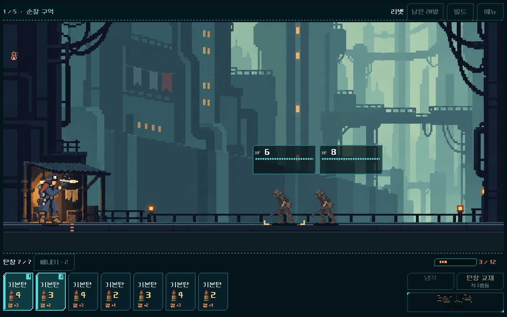
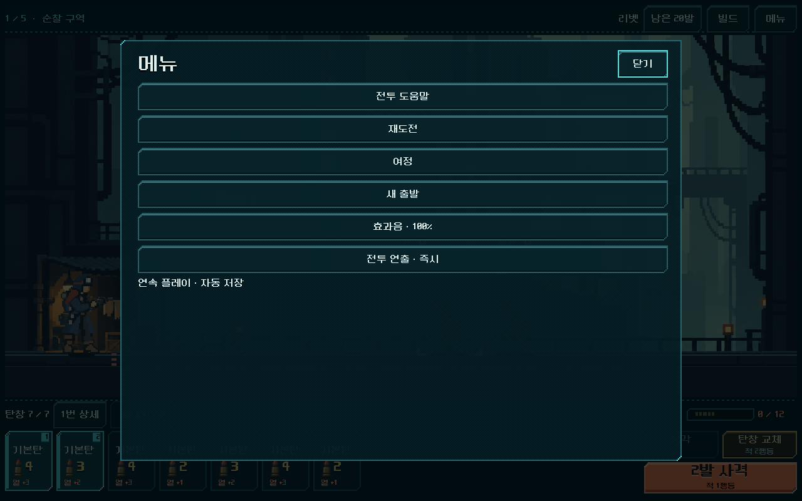
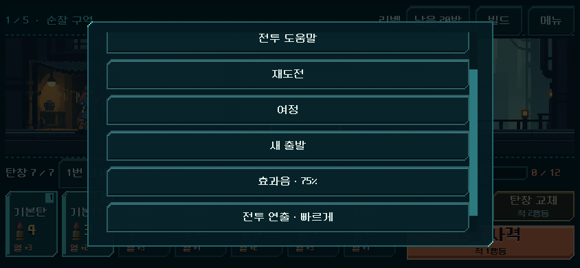

# 탄창 여정 — 전투 효과음·발열과 과열 접근 연출

2026-11-01. 사용자는 APK를 직접 진행하고 인게임 작업을 계속하라고 지시했다. 현재 플레이 경로인 `OPEN_COMBAT_UI_STUDY.cmd`와 새 HUD를 쓰는 독립 비교에 적용했다. 기존 캠페인 기본 진입은 유지한다.

## 수정한 문제

- 새 HUD는 전장의 사격/명중/열 이벤트를 기존 `presentation_feedback.gd`에 연결하지 않고 있었다. 일반·강화 사격, 명중/장갑 반응, 과열, 냉각, 탄창 교체/준비 완료, 실제 승리 후 보상을 기존 음원에 연결했다. 화면 새로고침·보상 후보 선택·저장 복귀는 보상음을 반복하지 않는다.
- 발열 게이지가 행동 전체가 끝난 뒤 한 번에 바뀌었다. 이제 실제 발사·명중·냉각 이벤트의 열 값을 재생하고, 행동이 끝나면 기존 다음 사격 예측으로 돌아간다. 이미 계산된 최종 열을 미리 보여주지 않는다.
- 강제 냉각의 중간 스냅샷이 최종 `turns`와 냉각 후 `heat`를 사용했다. 그 결과 사격 구간이 냉각 턴까지 소비하고 뒤의 냉각 구간은 경과 시간이 0이어서 적 이동이 생략됐다. 중간 시점을 실제 사격 직후로 복원해 사격 후 적 1행동과 강제 냉각의 실제 추가 행동을 순서대로 재생한다. 계산·적 위치의 최종 결과는 동일하다.
- 잔탄 보존 냉각에 재장전 동작/문구가 나오던 연결을 구분했다. 냉각 중에는 탄창 교체 동작을 쓰지 않고 실제 냉각 비용을 표시한다. 종료 후 표현 상태를 초기화한다.
- 기존 라인 테마 메뉴 안에 효과음 끄기/25/50/75/100%, 전투 연출 기본/빠르게/즉시를 추가했다. 기존 공통 환경설정 파일을 사용하며 전투 저장과 분리한다. 즉시는 전투 효과음·동작을 줄인다. 작은 화면에서는 기존 메뉴 스크롤과 초점 순환으로 접근한다.

## 검증과 증거

Godot MCP에서 4.7 및 활성 프로젝트를 확인했다. 실제 Godot 렌더링·터치 입력, 격리 APPDATA/LOCALAPPDATA로 검사했다. 새 효과 자산이나 전투 규칙을 만들지 않았다.

| 요구/위험 | 확인한 경로 | 결과 |
| --- | --- | --- |
| 사격/열/냉각 시점 | 실제 첫 여정 사격과 동일 상태 모델 비교, 각 열 이벤트와 HUD 값 | 집중 검사169, 실패0 |
| 획득과 효과음 | 첫 3사격 승리 → 실제 돌파 코어/철갑탄 보상 → 다음 전투의 강화 사격 | 승리음1회, 강화음 연결, 반복 갱신 무음 |
| 과열 접근 누락 | 기존 리벳 관문 획득 상태에서 자연 연속 사격3회 | 사격 적1행동 + 실제 강제 냉각 전 행동 재생, 마지막 표시 적 상태와 모델 동일 |
| 냉각/교체 구분 | 보유 탄창 냉각·실제 교체·강제 냉각 | 냉각에 교체음/교체 턴 없음, 정상 교체 시작/완료 각1회 |
| 환경설정/작은 화면 | 740×360, 844×390, 1280×800의 실제 메뉴 입력·스크롤 | 44px 이상 입력, 화면 내 배치, 설정 변경으로 전투/난수/여정 불변 |
| 음소거·정리 | 실제 재생 중 음소거, 즉시 모드, 화면 종료/재생성 | 모든 음성 정지, 환경설정 재개, 이전 음성 노드 해제 |
| 기존 HUD | `run_prototype_hud.ps1 -Mode ui -Fast` | 11,536, 실패0. 새 마지막 메뉴 항목을 기준으로 Tab 순환 검사 갱신 |
| 연속 여정 | 같은 도구 `-Mode flow -Fast` | 4,274, 실패0. 3크기5전투/보상/정비/재도전·재개 |
| 새 프로세스 저장 | 같은 도구 `-Mode restart -Stage write/read -Fast` | 5 + 6, 실패0 |
| 리소스 누락 방지 | `test_mobile*.py`, 동적 음원 디렉터리 선택 확인 | 14개 시험 통과. APK 생성 검사는 아님 |

위 HUD 검사의 Suite는 `journey_feedback_20261101`이다. 집중 검사는 `-Mode feedback`으로 실행하며 실제 믹서 출력을 음소거된 출력 이전에서 기록했다. 피크0.187481, 프레임1,443,328(48kHz)으로 무음/클리핑이 없었다. 6개 음성 풀을 재사용한다. 실제 청취에 의한 음색·밸런스/타격감의 사람 평가는 별도다.

기존 본편용 `run_presentation_feedback_checks.ps1`은252검사 중8실패가 나왔다. 본편에서 참조하는 두 공유 파일(`risk_battle_view.gd`, `presentation_feedback.gd`)을 이번 수정 전으로 되돌린 격리 복사본에서도 **동일252검사·동일8실패·동일 믹서 피크0.758118**을 재현했다. 강화음 가정3건과 기존 보상/상점 입력 경로5건이며, 이번 변경의 회귀는 아니다. 해당 검사의 현행 시나리오 정합성 보완은 후속으로 남기고 통과했다고 기록하지 않는다. [현재 로그](journey_feedback_2026-11-01_assets/legacy_current.log) · [변경 전 대조 로그](journey_feedback_2026-11-01_assets/legacy_baseline.log).

## 실제 화면

[실제 믹서 녹음](journey_feedback_2026-11-01_assets/actual_feedback_mix.wav) · [검사 수치와 코드 해시](journey_feedback_2026-11-01_assets/validation.json).

## 범위와 남은 확인

- `model.gd`, `campaign.gd`, `magazine_journey.gd`, `project.godot`는 작업 전후 SHA256이 같다. 카드 크기·전투 버튼 위치·선택 빼내기·피해/열/행동 비용·난수·전투 저장 형식은 유지했다.
- 주 변경은 공통 HUD의 이벤트 연결, 메뉴 설정, 기존 탄창 컨트롤러의 중간 표현 스냅샷과 전장 냉각 동작이다. 새 상시 처리 루프나 무한 효과 노드는 추가하지 않았다.
- 원본 증거는 `qa_runtime/combat_hud_20261031/journey_feedback_20261101/`이다. 실패했던 과열 검사는 실제 재생 누락을 검출했고 수정 후 통과했다. 추가 메뉴 때문에 낡은 Tab 검사에서 난 실패와 구분한다.
- 모바일 APK·ZIP·Drive 업로드를 수행하지 않았다. 직전 모바일 준비 보고서의 리소스 묶음은 이번 변경 이전 코드이며 최신 패키지 검증을 대신하지 않는다. APK는 사용자가 별도로 진행한다.
- Android 터치·지속 FPS·발열, 실제 청취 품질, 반복감/긴장감·성장의 사람 체감은 미검증이다. 다음 인게임 검토는 기존 획득 덱을 사용한 정예/다른 탄 순서의 선택과 압박이다. 결과 없이 발열/적 체력 수치를 올리거나 본편 규칙을 전환하지 않는다.
