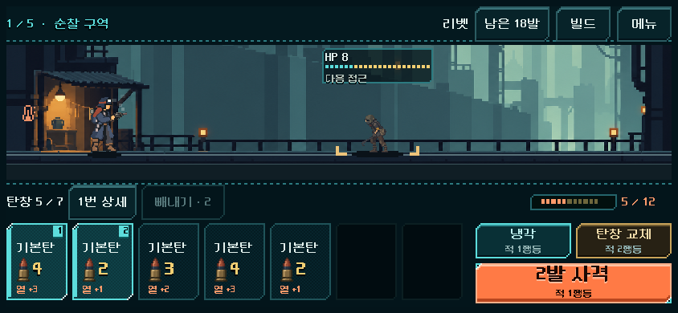
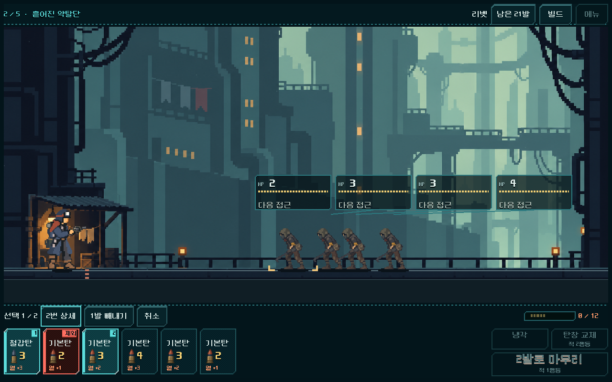
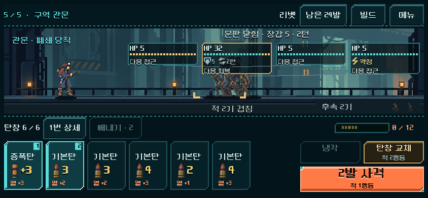
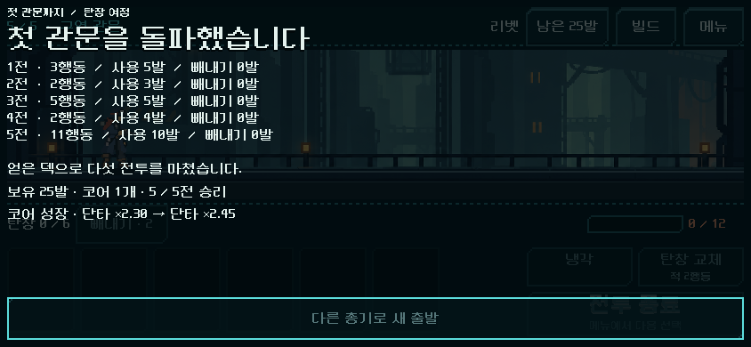

# 첫 관문 연속 플레이 점검과 표시 복구 — 2026-11-01

## 결과와 범위

사용자의 라인 + 도트 UI 긍정 후기 이후, 기존 첫 관문 여정을 점검했다. **행동 뒤 사라지던 적 행동 안내와 연결되지 않았던 체력 게이지의 사격 예측을 복구했다.** 기존 실행은 `OPEN_COMBAT_UI_STUDY.cmd`다.

게임 창에서 직접 첫 전투, 코어/철갑탄 획득, 종료·재실행, 두 번째 전투의 빼내기와 승리를 확인했다. 전체 여정은 실제 터치 입력 자동 검사로 3화면 크기에서 관문까지 진행했다. 추가로 기존 획득 경로 5총기·25전투를 현재 모델로 재생해 행동 비용과 선택 대안을 관찰했다. 제작자가 코드를 읽은 뒤 수행한 검토이며 블랙박스 또는 사람 재미 검증으로 부르지 않는다.

## 재현·수정한 결함

| 항목 | 수정 전 | 수정 후와 확인 |
| --- | --- | --- |
| 적 행동 안내 | 새 출발 때는 ‘다음 접근’이 보이나 첫 사격 후 사라짐. 애니메이션이 끈 `inspection_enabled`를 비교/여정 컨트롤러가 되돌리지 않았음 | 대기 상태의 refresh에서 복원. 사격·냉각·교체·빼내기 후 살아 있는 적 안내 확인 |
| 사격 결과 비교 | 계산한 예측을 발열/사격 버튼에는 쓰지만 전장 `sync`에는 빈 사전을 전달. 금색 HP 예측 구간이 표시되지 않음 | 동일한 `last_prediction`을 전장에 전달. 선택한 탄의 제외 미리보기까지 같은 예측을 사용 |

수정은 `redesign/samples/combat_weapon_magazine.gd`의 전장 갱신에 한정했다. 모델/획득/여정/기본 진입 파일은 작업 전후 해시가 같다. 애니메이션 중에는 계속 정보를 잠그며, 무작위 표적 총기의 HP 표시는 `hp_max` 기준의 보장된 감소분만 사용한다. 확률을 고정 결과로 바꾸거나 난수를 추가 소비하지 않는다.

회귀 검사는 수정 전에 ‘전장 예측이 발열/사격 예측과 다르다’는 실패를 검출했다. 원문은 `qa_runtime/journey_review_20261101/readout_before_fix.log`에 보존했다. 추가한 연속 입력 시험의 첫 시도는 기존 0.3초 확정 잠금 중 다음 버튼을 눌러 중단됐다. 검사에서 잠금 해제를 기다리도록 수정했으며 제품의 중복 확정 방지는 유지했다. 이 시험 도구 실패는 별도 로그 `readout_test_debounce.log`에 남겼다.

## 실제 선택에서 확인한 것

**빼내기의 이득과 대가:** 첫 전투를 그대로 세 번 사격해 이긴 뒤 돌파 구동핵과 철갑탄을 실제 획득했다. 두 번째 전투의 자연 탄창에서 두 번째 기본탄을 빼면, 이후 탄이 앞으로 와서 다음 두 발에 적을 모두 처치할 수 있었다. 게임 창에서 선택 미리보기 → 빼내기 → 사격을 실행해 확인했다.

| 두 번째 전투의 대안 | 사격 입력 | 적 행동 | 실제 발사 | 빼낸 탄 | 총 소모 |
| --- | ---: | ---: | ---: | ---: | ---: |
| 그대로 쏘기 | 2 | 2 | 3발 | 0발 | 3발 |
| 두 번째 기본탄 빼기 후 사격 | 1 | 1 | 2발 | 1발 | 3발 |

그대로 쏘는 대안도 승리한다. 관문 첫 탄창에서는 증폭탄을 빼면 다음 사격 후 남는 적 HP 합이38에서39로 증가했다. 이는 특정 상황의 다음 사격 비교이며 전체 전투의 우월 전략을 뜻하지 않는다. 빼내기 사용 자체를 목표로 수치를 바꾸지 않는다.

**성장:** 리벳 경로의 돌파 구동핵은 장착 시 단타 ×2.00, 방패전 승리 뒤 ×2.15, 무리전 뒤 ×2.30, 관문 뒤 ×2.45로 실제 성장했다. 성장 수치와 획득 덱이 다음 전투·저장 복귀에 이어졌다. 이것은 기능과 결과의 확인이며 성장의 만족감은 사용자 플레이 확인이 필요하다.

**전투 대비:** 기존 탐색 경로를 현재 모델로 재생한 리벳 결과다. ‘적 행동’에는 교체·과열 비용이 포함돼 사격 버튼 횟수와 다르다.

| 구간 | 입력 순서 | 적 행동 | 선택 대안 관찰 |
| --- | --- | ---: | --- |
| 순찰 | 사격3회 | 3 | 짧은 도입, 빼내기 없이 승리 |
| 흩어진 약탈단 | 사격2회 | 2 | 위 표처럼 한 발을 포기해 한 번에 끝내는 대안 존재 |
| 방패 진지 | 사격 → 교체 → 사격2회 | 5 | 일부 시점에 냉각/교체를 택하면 접촉 패배 |
| 모여든 약탈단 | 사격2회 | 2 | 짧은 성장 확인 구간, 중간 탄을 빼면 다음 피해가 달라짐 |
| 관문 | 사격 → 냉각 → 사격2회 → 교체 → 사격3회 | 11 | 열 관리·교체 위험 확인 필요 |

다른 대표 경로의 관문 적 행동은 버스트20, 스캐터19, 헤비22, 앰플리파이어5였다(내부 총기 ID). 무기마다 차이가 크므로 모든 적의 속도·체력을 일괄 올릴 근거로 삼지 않는다. 앰플리파이어의 짧은 돌파와 다른 총기의 관문 길이는 다음 사람 확인 항목이다.

경로는 과거 제한 탐색에서 숨은 난수까지 사용해 찾은 합법 경로다. 이번 재생은 선택 가능한 **다음 한 행동의 공개 예측**과 비교했다. 25전투 완주를 사람 승률·자연 행동·일반 균형으로 해석하지 않는다. 하나의 고정 순서731042와 총기별 대표 코어/보상 경로만 포함한다.

## 검증

Windows / Godot4.7 / OpenGL Compatibility / RTX4060Ti. 격리 APPDATA/LOCALAPPDATA는 `qa_runtime/journey_review_20261101/`와 `qa_runtime/combat_hud_20261031/journey_review_20261101/` 아래다. 사용자 플레이 저장은 수정하지 않았다.

| 확인 | 결과 |
| --- | --- |
| 표시 회귀·획득 후 실제 빼내기 비교 | 405검사, 실패0; 844×390·1280×800, 무작위 표적 포함 |
| 기존 공통 HUD `ui` | 11,536검사, 실패0; 4크기·5총기 |
| 기존 연속 여정 `flow` | 4,266검사, 실패0; 844×390·1008×454·1280×800의5전투/보상/정비/재도전/재개 |
| 기존 직접 빼내기 `direct` | 2,167검사, 실패0 |
| 별도 프로세스 저장 재개 `restart` | 쓰기5·읽기6검사, 실패0 |
| 현재 모델의 획득 경로 재생 | 5총기·25전투, 실패0 |

재현: `powershell -NoProfile -ExecutionPolicy Bypass -File tools/run_prototype_hud.ps1 -Mode readout -Fast -Suite journey_review_20261101`. 기존 `ui`, `flow`, `direct`, `restart`도 같은 Suite로 실행했다. 저장 재개는 `-Stage write` 다음 `-Stage read` 순서다. 획득 경로 관찰 코드는 `tests/journey_decision_audit.gd`, 원시 결과와 소스 해시는 [근거 폴더](journey_review_2026-11-01_assets/)에 보존했다.

## 화면

사격 뒤에도 적 행동과 금색 예상 피해가 유지된다.

빼낼 탄을 고르면 다음 사격의 처치 결과가 함께 바뀐다. 선택만으로 소유 탄·난수·행동은 변하지 않는다.

## 판단과 다음 범위

현재 라인 + 도트 외형, 짧은 일반전과 압박 구간의 대비, 빼내기 선택 규칙과 수치는 유지한다. 표시 결함은 수정·검증 완료다. 사용자에게서 받은 ‘좋은 거 같아’는 UI 적용 결과에 대한 긍정 평가로 기록하며 연속 재미·모바일 확인까지 확대하지 않는다.

다음은 이 실행본으로 보상 이후 판단 변화와 관문까지의 긴장감을 확인하는 사람 플레이다. 모바일 여정 전달 모드 지원과 실기기 지속 FPS·발열은 아직 남는다. 본편 기본 캠페인 전환·구버전 이어하기 정책, APK/커밋/푸시/외부 업로드는 이번 작업에서 변경하지 않았다.
